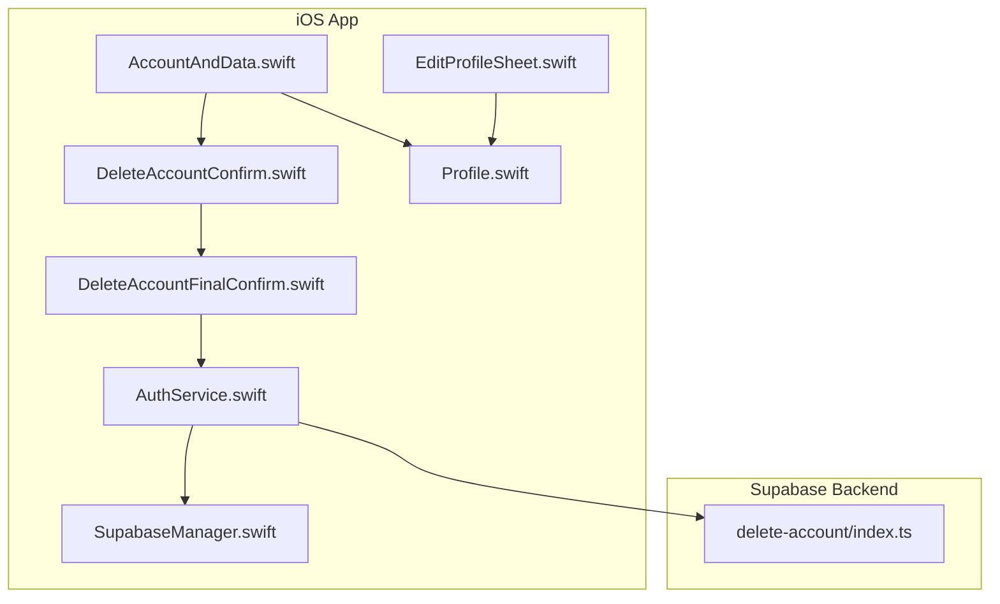
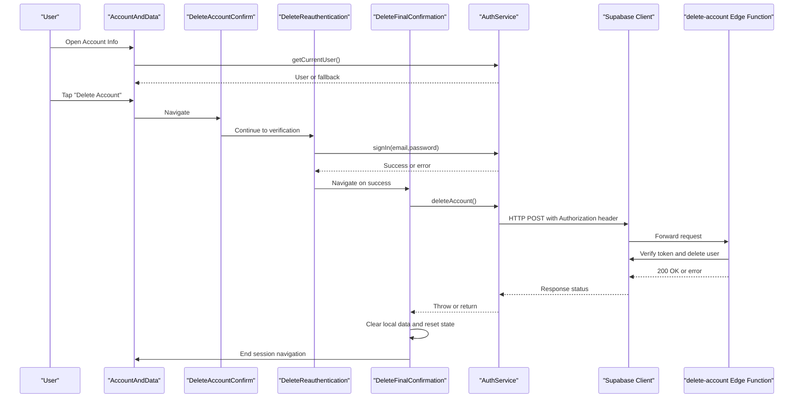
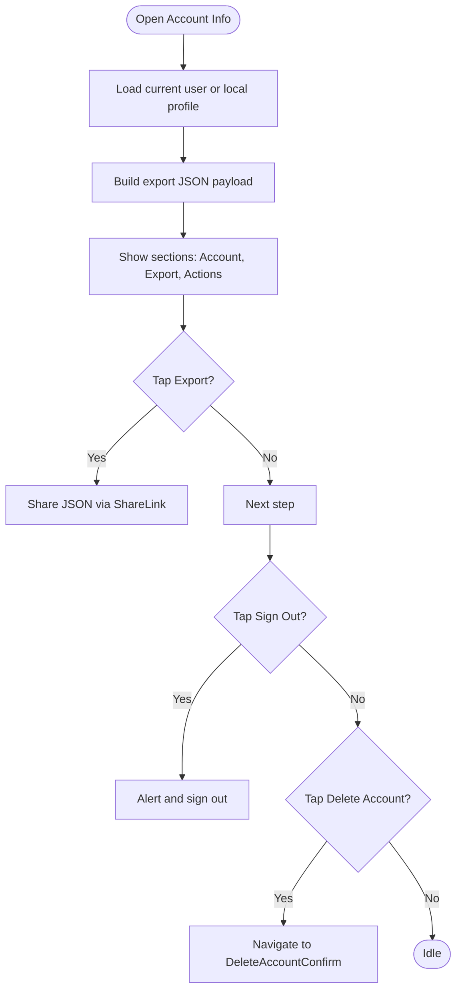
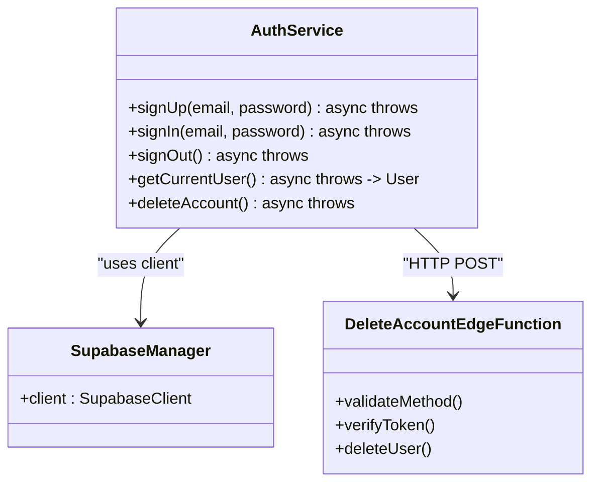
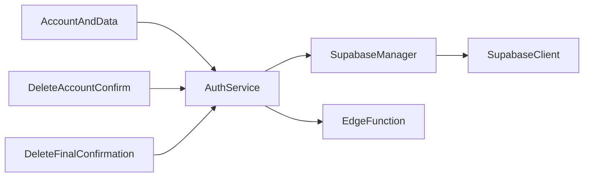

# Account Settings & Data Management

<cite>
**Referenced Files in This Document**
- [AccountAndData.swift](file://Moko/Moko/UIScreens/homeScreens/ProfileOverView/AccountAndData.swift)
- [DeleteAccountConfirm.swift](file://Moko/Moko/UIScreens/homeScreens/ProfileOverView/DeleteAccountConfirm.swift)
- [DeleteAccountFinalConfirm.swift](file://Moko/Moko/UIScreens/homeScreens/ProfileOverView/DeleteAccountFinalConfirm.swift)
- [AuthService.swift](file://Moko/Moko/AuthService.swift)
- [SupabaseManager.swift](file://Moko/Moko/SupabaseManager.swift)
- [delete-account/index.ts](file://Moko/Moko/supabase/functions/delete-account/index.ts)
- [Profile.swift](file://Moko/Moko/Models/Profile.swift)
- [EditProfileSheet.swift](file://Moko/Moko/UIScreens/homeScreens/ProfileOverView/EditProfileSheet.swift)
- [SettingsInfoScreens.swift](file://Moko/Moko/UIScreens/homeScreens/ProfileOverView/SettingsInfoScreens.swift)
- [APP_STORE_CONNECT_PRIVACY_CHECKLIST.md](file://APP_STORE_CONNECT_PRIVACY_CHECKLIST.md)
</cite>

## Table of Contents
1. [Introduction](#introduction)
2. [Project Structure](#project-structure)
3. [Core Components](#core-components)
4. [Architecture Overview](#architecture-overview)
5. [Detailed Component Analysis](#detailed-component-analysis)
6. [Dependency Analysis](#dependency-analysis)
7. [Performance Considerations](#performance-considerations)
8. [Troubleshooting Guide](#troubleshooting-guide)
9. [Conclusion](#conclusion)

## Introduction
This document explains the Account Settings and Data Management features for the application, focusing on:
- The AccountAndData screen that displays account information and provides data export and account deletion entry points.
- The multi-step account deletion workflow with confirmation, reauthentication, and final irreversible deletion.
- Data export capabilities and privacy controls exposed to users.
- Integration with Supabase for authentication and account operations.
- Security best practices, consent management, and audit logging recommendations.

The goal is to help developers and reviewers understand how user data is presented, exported, and deleted, while ensuring secure handling and compliance-friendly flows.

## Project Structure
The relevant files are organized under the iOS app’s UI screens and services:
- UI screens for account settings and deletion live under the Profile overview section.
- Authentication and Supabase integration are implemented in dedicated service classes.
- A Supabase Edge Function handles server-side account deletion.
- Local data models define the structure of profile and related entities.

**Diagram sources**
- [AccountAndData.swift:46-113](file://Moko/Moko/UIScreens/homeScreens/ProfileOverView/AccountAndData.swift#L46-L113)
- [DeleteAccountConfirm.swift:4-35](file://Moko/Moko/UIScreens/homeScreens/ProfileOverView/DeleteAccountConfirm.swift#L4-L35)
- [DeleteAccountFinalConfirm.swift:11-54](file://Moko/Moko/UIScreens/homeScreens/ProfileOverView/DeleteAccountFinalConfirm.swift#L11-L54)
- [AuthService.swift:15-58](file://Moko/Moko/AuthService.swift#L15-L58)
- [SupabaseManager.swift:6-18](file://Moko/Moko/SupabaseManager.swift#L6-L18)
- [delete-account/index.ts:3-25](file://Moko/Moko/supabase/functions/delete-account/index.ts#L3-L25)
- [Profile.swift:12-30](file://Moko/Moko/Models/Profile.swift#L12-L30)

**Section sources**
- [AccountAndData.swift:46-113](file://Moko/Moko/UIScreens/homeScreens/ProfileOverView/AccountAndData.swift#L46-L113)
- [DeleteAccountConfirm.swift:4-35](file://Moko/Moko/UIScreens/homeScreens/ProfileOverView/DeleteAccountConfirm.swift#L4-L35)
- [DeleteAccountFinalConfirm.swift:11-54](file://Moko/Moko/UIScreens/homeScreens/ProfileOverView/DeleteAccountFinalConfirm.swift#L11-L54)
- [AuthService.swift:15-58](file://Moko/Moko/AuthService.swift#L15-L58)
- [SupabaseManager.swift:6-18](file://Moko/Moko/SupabaseManager.swift#L6-L18)
- [delete-account/index.ts:3-25](file://Moko/Moko/supabase/functions/delete-account/index.ts#L3-L25)
- [Profile.swift:12-30](file://Moko/Moko/Models/Profile.swift#L12-L30)

## Core Components
- AccountAndData screen: Displays sign-in method (email), allows editing profile, exporting local data as JSON, signing out, and initiating account deletion.
- DeleteAccountConfirm screen: Explains what will be deleted and navigates to identity verification.
- DeleteReauthentication view: Requires email/password re-sign-in to confirm intent.
- DeleteFinalConfirmation screen: Presents a final irreversible warning and performs server deletion plus local cleanup.
- AuthService: Wraps Supabase Auth operations including sign-up, sign-in, sign-out, current user retrieval, and account deletion via an Edge Function.
- SupabaseManager: Initializes the Supabase client.
- delete-account Edge Function: Validates request, verifies user token, and deletes the user using Supabase admin API.
- Profile model: Defines local profile data fields including creation timestamps.

Key responsibilities:
- User-facing account info display and actions.
- Secure reauthentication before destructive operations.
- Data export generation from local SwiftData models.
- Server-side account deletion through a protected Edge Function.
- Local data cleanup after successful server deletion.

**Section sources**
- [AccountAndData.swift:18-44](file://Moko/Moko/UIScreens/homeScreens/ProfileOverView/AccountAndData.swift#L18-L44)
- [AccountAndData.swift:46-113](file://Moko/Moko/UIScreens/homeScreens/ProfileOverView/AccountAndData.swift#L46-L113)
- [DeleteAccountConfirm.swift:4-35](file://Moko/Moko/UIScreens/homeScreens/ProfileOverView/DeleteAccountConfirm.swift#L4-L35)
- [DeleteAccountConfirm.swift:38-103](file://Moko/Moko/UIScreens/homeScreens/ProfileOverView/DeleteAccountConfirm.swift#L38-L103)
- [DeleteAccountFinalConfirm.swift:11-77](file://Moko/Moko/UIScreens/homeScreens/ProfileOverView/DeleteAccountFinalConfirm.swift#L11-L77)
- [AuthService.swift:15-58](file://Moko/Moko/AuthService.swift#L15-L58)
- [SupabaseManager.swift:6-18](file://Moko/Moko/SupabaseManager.swift#L6-L18)
- [delete-account/index.ts:3-25](file://Moko/Moko/supabase/functions/delete-account/index.ts#L3-L25)
- [Profile.swift:12-30](file://Moko/Moko/Models/Profile.swift#L12-L30)

## Architecture Overview
The account deletion flow integrates UI components, local data models, authentication services, and a Supabase Edge Function.

**Diagram sources**
- [AccountAndData.swift:92-99](file://Moko/Moko/UIScreens/homeScreens/ProfileOverView/AccountAndData.swift#L92-L99)
- [AccountAndData.swift:76-82](file://Moko/Moko/UIScreens/homeScreens/ProfileOverView/AccountAndData.swift#L76-L82)
- [DeleteAccountConfirm.swift:20-26](file://Moko/Moko/UIScreens/homeScreens/ProfileOverView/DeleteAccountConfirm.swift#L20-L26)
- [DeleteAccountConfirm.swift:93-102](file://Moko/Moko/UIScreens/homeScreens/ProfileOverView/DeleteAccountConfirm.swift#L93-L102)
- [DeleteAccountFinalConfirm.swift:56-77](file://Moko/Moko/UIScreens/homeScreens/ProfileOverView/DeleteAccountFinalConfirm.swift#L56-L77)
- [AuthService.swift:44-58](file://Moko/Moko/AuthService.swift#L44-L58)
- [delete-account/index.ts:3-25](file://Moko/Moko/supabase/functions/delete-account/index.ts#L3-L25)

## Detailed Component Analysis

### AccountAndData Screen
Responsibilities:
- Display current sign-in method (email) by querying the authenticated user; fall back to local profile username when not signed in.
- Provide Edit Profile sheet for updating profile details.
- Generate a JSON export containing profile, quests, calm sessions, insights scores, and onboarding responses.
- Offer Sign Out and Delete Account actions with appropriate warnings.

Implementation highlights:
- Uses SwiftData queries to gather local data for export.
- Builds a structured JSON payload with ISO8601 date formatting and sorted keys.
- Presents ShareLink to export data.
- Shows destructive actions with clear footers explaining consequences.

**Diagram sources**
- [AccountAndData.swift:18-44](file://Moko/Moko/UIScreens/homeScreens/ProfileOverView/AccountAndData.swift#L18-L44)
- [AccountAndData.swift:46-113](file://Moko/Moko/UIScreens/homeScreens/ProfileOverView/AccountAndData.swift#L46-L113)

**Section sources**
- [AccountAndData.swift:18-44](file://Moko/Moko/UIScreens/homeScreens/ProfileOverView/AccountAndData.swift#L18-L44)
- [AccountAndData.swift:46-113](file://Moko/Moko/UIScreens/homeScreens/ProfileOverView/AccountAndData.swift#L46-L113)

### DeleteAccountConfirm Screen
Responsibilities:
- Inform the user about what data will be permanently removed.
- Provide a link to verify identity before proceeding.

Behavior:
- Lists categories of data to be deleted.
- Navigates to reauthentication screen upon user choice.

**Section sources**
- [DeleteAccountConfirm.swift:4-35](file://Moko/Moko/UIScreens/homeScreens/ProfileOverView/DeleteAccountConfirm.swift#L4-L35)

### DeleteReauthentication View
Responsibilities:
- Require explicit re-sign-in to confirm destructive intent.
- Pre-fill email from current user if available.
- Validate inputs and show errors.

Flow:
- On success, navigate to final confirmation screen.
- On failure, display error message.

Security considerations:
- Forces re-authentication to prevent accidental deletions.
- Uses secure field for password input.

**Section sources**
- [DeleteAccountConfirm.swift:38-103](file://Moko/Moko/UIScreens/homeScreens/ProfileOverView/DeleteAccountConfirm.swift#L38-L103)

### DeleteFinalConfirmation Screen
Responsibilities:
- Present final irreversible warning.
- Trigger account deletion via AuthService.
- Clean up local SwiftData models and app state.
- Navigate away via endSession callback.

Local cleanup:
- Deletes all SwiftData models: Quest, CalmDownModel, InsightsModel, Profile, OnboardingResponse, OnboardingQuestion, OnboardingState.
- Clears pending debriefs and resets CurrentUser.
- Removes specific UserDefaults keys.

Error handling:
- Displays connection-related error message without clearing local data if server deletion fails.

**Section sources**
- [DeleteAccountFinalConfirm.swift:11-77](file://Moko/Moko/UIScreens/homeScreens/ProfileOverView/DeleteAccountFinalConfirm.swift#L11-L77)

### AuthService and Supabase Integration
AuthService methods:
- signUp, signIn, signOut, getCurrentUser.
- deleteAccount calls a Supabase Edge Function with the current access token and API key headers.

SupabaseManager:
- Provides a shared SupabaseClient instance configured with URL and publishable key.

Edge Function (delete-account):
- Validates HTTP method and Authorization header.
- Verifies user token via Supabase auth.
- Uses service role key to delete the user via admin API.
- Returns success or error response.

**Diagram sources**
- [AuthService.swift:15-58](file://Moko/Moko/AuthService.swift#L15-L58)
- [SupabaseManager.swift:6-18](file://Moko/Moko/SupabaseManager.swift#L6-L18)
- [delete-account/index.ts:3-25](file://Moko/Moko/supabase/functions/delete-account/index.ts#L3-L25)

**Section sources**
- [AuthService.swift:15-58](file://Moko/Moko/AuthService.swift#L15-L58)
- [SupabaseManager.swift:6-18](file://Moko/Moko/SupabaseManager.swift#L6-L18)
- [delete-account/index.ts:3-25](file://Moko/Moko/supabase/functions/delete-account/index.ts#L3-L25)

### Data Export Capabilities
The export feature generates a JSON payload containing:
- Profile summary fields (display name, handle, age range, XP, streaks).
- Quest records (title, notes, category, dates, completion status, awarded XP).
- Calm session history (exercise title, duration, date).
- Insights scores (courage, clarity, presence, warmth, date).
- Onboarding responses (question ID and answer).

Characteristics:
- Pretty-printed and sorted keys for readability.
- ISO8601 formatted dates.
- Presented via ShareLink for easy sharing or saving.

Privacy implications:
- Exposes personal and behavioral data; users should be aware of what is included.
- No server upload occurs during export; it remains local until shared.

**Section sources**
- [AccountAndData.swift:18-44](file://Moko/Moko/UIScreens/homeScreens/ProfileOverView/AccountAndData.swift#L18-L44)

### Privacy Controls and Compliance
Navigation to privacy policy and account settings is provided within the app’s settings area. The project includes a checklist for App Store Connect privacy disclosures and production verification steps.

Recommendations:
- Ensure privacy policy URL is valid and accessible.
- Complete App Privacy answers in App Store Connect.
- Verify data collection statements against actual behavior.
- Provide support contact information.

**Section sources**
- [SettingsInfoScreens.swift:178-218](file://Moko/Moko/UIScreens/homeScreens/ProfileOverView/SettingsInfoScreens.swift#L178-L218)
- [APP_STORE_CONNECT_PRIVACY_CHECKLIST.md:33-40](file://APP_STORE_CONNECT_PRIVACY_CHECKLIST.md#L33-L40)

### Account Creation Date and Subscription Details
- Account creation date: The local Profile model includes createdAt and updatedAt timestamps. These can be displayed in the Account Info screen if needed.
- Subscription details: Not implemented in the referenced files. If subscription data exists elsewhere, it should be integrated similarly to other profile fields.

Best practice:
- Clearly indicate whether subscription data is stored locally or remotely.
- Avoid exposing sensitive subscription identifiers unless necessary.

**Section sources**
- [Profile.swift:29-30](file://Moko/Moko/Models/Profile.swift#L29-L30)

### Email Verification Status
- The current implementation does not explicitly check or display email verification status.
- Recommendation: Add a verification flag query and UI indicator to inform users if their email is verified.

**Section sources**
- [AccountAndData.swift:92-99](file://Moko/Moko/UIScreens/homeScreens/ProfileOverView/AccountAndData.swift#L92-L99)

## Dependency Analysis
Component relationships:
- AccountAndData depends on AuthService for user info and on SwiftData models for export.
- DeleteAccountConfirm and DeleteFinalConfirmation depend on AuthService for reauthentication and deletion.
- AuthService depends on SupabaseManager for client configuration and makes HTTP requests to the Edge Function.
- The Edge Function depends on Supabase environment variables and uses admin APIs for deletion.

Potential coupling issues:
- Hardcoded Supabase URL and publishable key in SupabaseManager may need secure configuration management.
- AuthService directly constructs HTTP requests; consider centralizing endpoint configuration.

**Diagram sources**
- [AccountAndData.swift:92-99](file://Moko/Moko/UIScreens/homeScreens/ProfileOverView/AccountAndData.swift#L92-L99)
- [DeleteAccountConfirm.swift:93-102](file://Moko/Moko/UIScreens/homeScreens/ProfileOverView/DeleteAccountConfirm.swift#L93-L102)
- [DeleteAccountFinalConfirm.swift:56-77](file://Moko/Moko/UIScreens/homeScreens/ProfileOverView/DeleteAccountFinalConfirm.swift#L56-L77)
- [AuthService.swift:15-58](file://Moko/Moko/AuthService.swift#L15-L58)
- [SupabaseManager.swift:6-18](file://Moko/Moko/SupabaseManager.swift#L6-L18)

**Section sources**
- [AccountAndData.swift:92-99](file://Moko/Moko/UIScreens/homeScreens/ProfileOverView/AccountAndData.swift#L92-L99)
- [DeleteAccountConfirm.swift:93-102](file://Moko/Moko/UIScreens/homeScreens/ProfileOverView/DeleteAccountConfirm.swift#L93-L102)
- [DeleteAccountFinalConfirm.swift:56-77](file://Moko/Moko/UIScreens/homeScreens/ProfileOverView/DeleteAccountFinalConfirm.swift#L56-L77)
- [AuthService.swift:15-58](file://Moko/Moko/AuthService.swift#L15-L58)
- [SupabaseManager.swift:6-18](file://Moko/Moko/SupabaseManager.swift#L6-L18)

## Performance Considerations
- Export JSON generation builds a potentially large payload; consider streaming or pagination if datasets grow significantly.
- Deleting multiple SwiftData models sequentially is acceptable for small sets; batch operations could improve performance if needed.
- Network calls to Supabase should include timeouts and retry logic for resilience.

[No sources needed since this section provides general guidance]

## Troubleshooting Guide
Common issues and resolutions:
- Reauthentication failures: Ensure correct email/password; check network connectivity and Supabase auth configuration.
- Account deletion errors: Verify Edge Function deployment, environment variables (SUPABASE_URL, SUPABASE_ANON_KEY, SUPABASE_SERVICE_ROLE_KEY), and network access.
- Local cleanup not applied: If server deletion fails, local data remains intact; advise users to retry or contact support.

Operational checks:
- Confirm Edge Function returns expected status codes.
- Validate Authorization header format and API key presence.
- Monitor error messages surfaced to users for actionable feedback.

**Section sources**
- [DeleteAccountConfirm.swift:93-102](file://Moko/Moko/UIScreens/homeScreens/ProfileOverView/DeleteAccountConfirm.swift#L93-L102)
- [DeleteAccountFinalConfirm.swift:74-77](file://Moko/Moko/UIScreens/homeScreens/ProfileOverView/DeleteAccountFinalConfirm.swift#L74-L77)
- [AuthService.swift:44-58](file://Moko/Moko/AuthService.swift#L44-L58)
- [delete-account/index.ts:3-25](file://Moko/Moko/supabase/functions/delete-account/index.ts#L3-L25)

## Conclusion
The Account Settings and Data Management features provide a clear path for users to review account information, export their data, and initiate a secure, multi-step account deletion process. The implementation emphasizes user consent through reauthentication and irreversible warnings, while integrating with Supabase for robust backend operations. To strengthen compliance and security:
- Add explicit email verification status display.
- Centralize configuration and secrets securely.
- Implement audit logging for sensitive operations.
- Expand privacy documentation and ensure App Store Connect disclosures match actual data practices.

[No sources needed since this section summarizes without analyzing specific files]