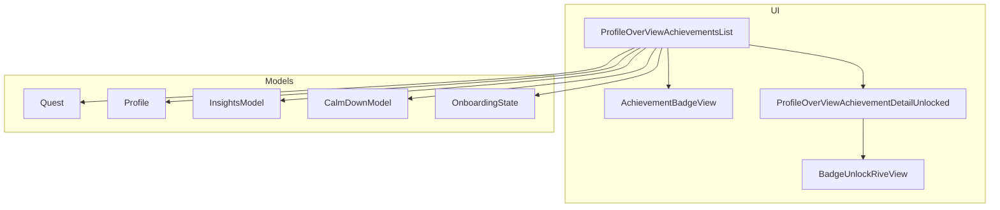
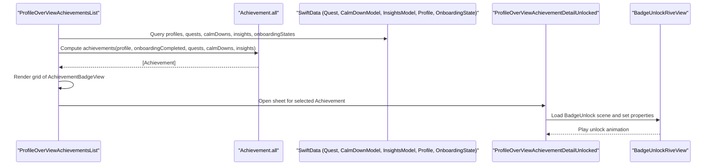
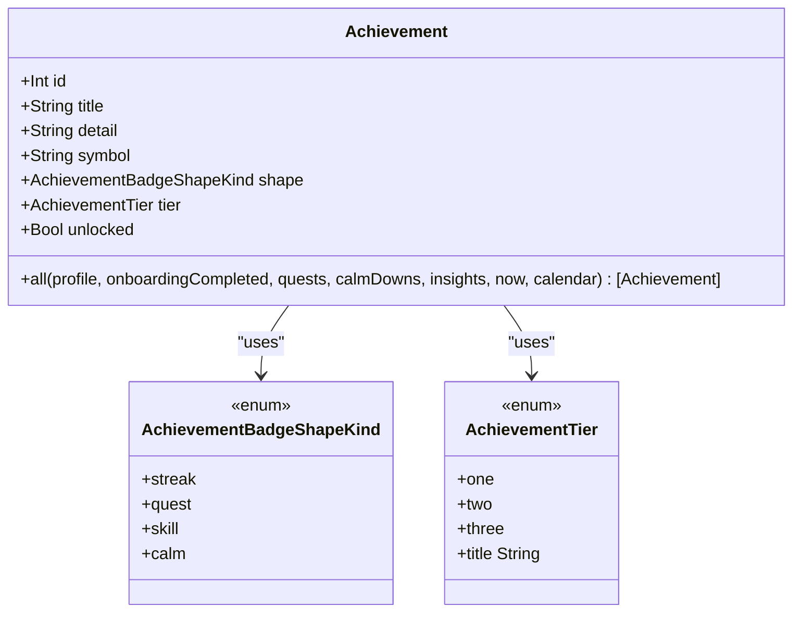
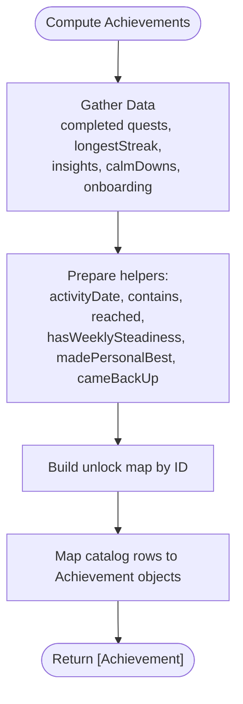
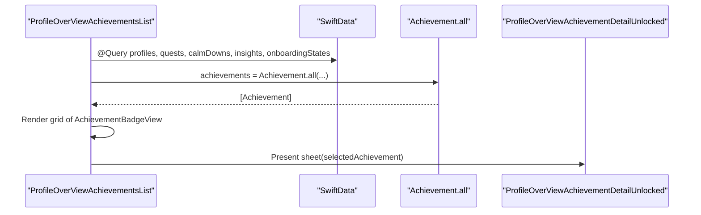
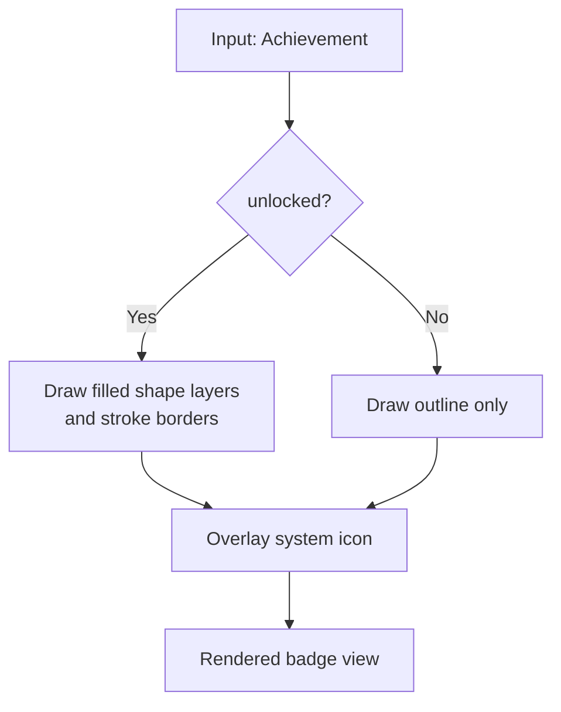
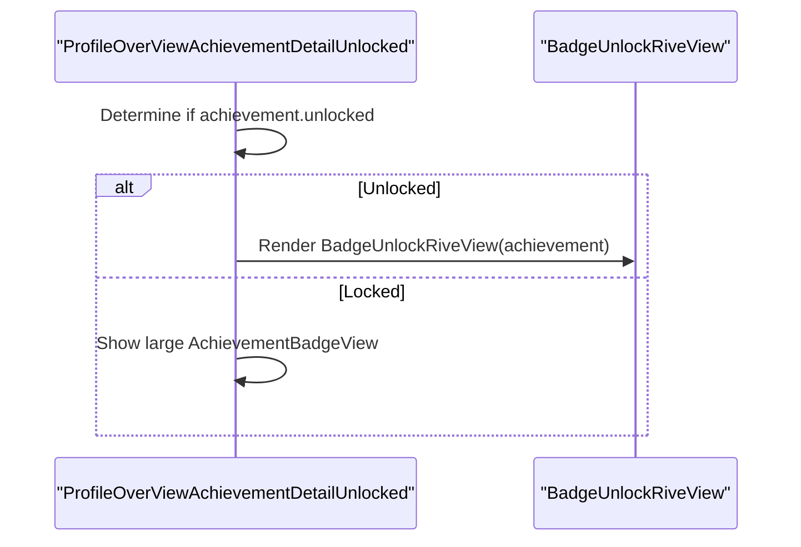
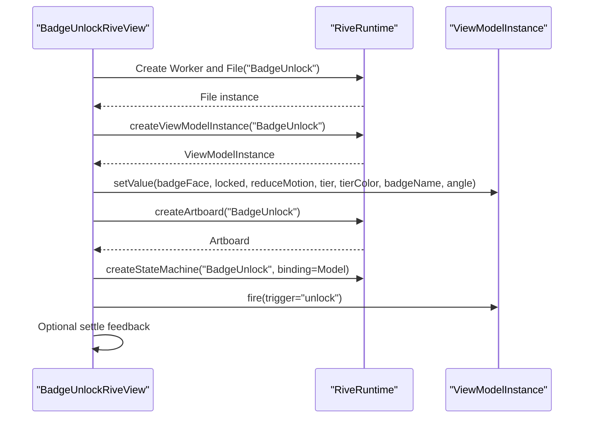
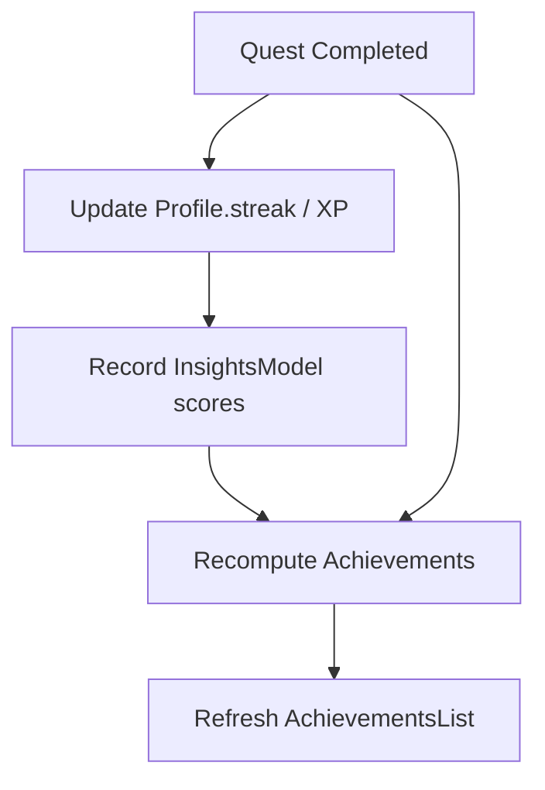
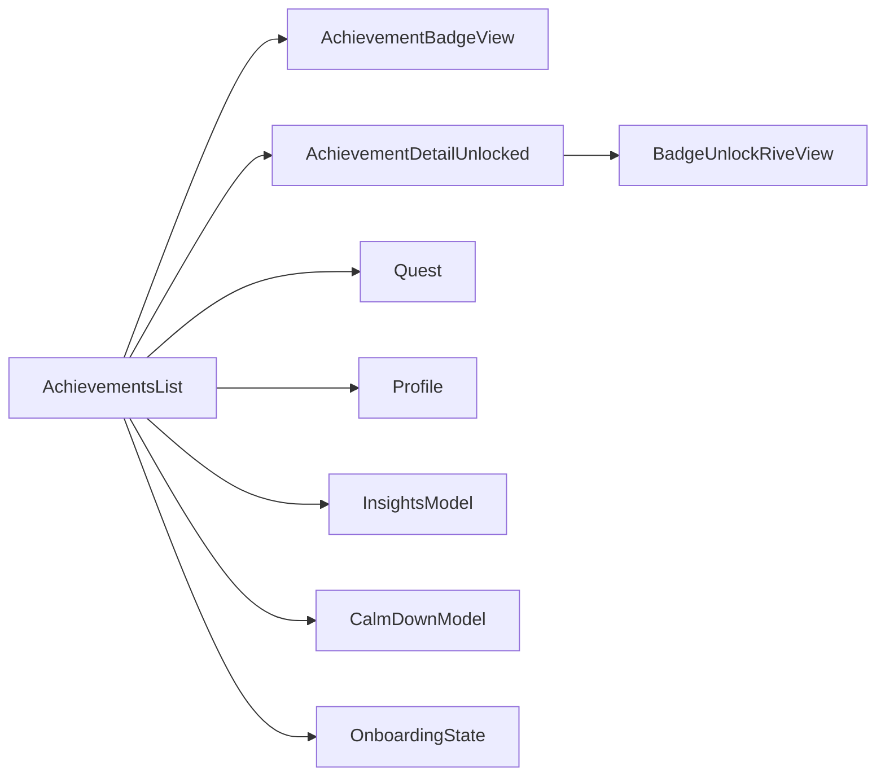

# Achievement System

<cite>
**Referenced Files in This Document**
- [AchievementsList.swift](file://Moko/Moko/UIScreens/homeScreens/ProfileOverView/AchievementsList.swift)
- [AchievementDetailUnlocked.swift](file://Moko/Moko/UIScreens/homeScreens/ProfileOverView/AchievementDetailUnlocked.swift)
- [BadgeUnlockRiveView.swift](file://Moko/Moko/UIScreens/homeScreens/ProfileOverView/BadgeUnlockRiveView.swift)
- [QuestModels.swift](file://Moko/Moko/Models/QuestModels.swift)
- [CalmDownModel.swift](file://Moko/Moko/Models/CalmDownModel.swift)
- [InsightsModel.swift](file://Moko/Moko/Models/InsightsModel.swift)
- [Profile.swift](file://Moko/Moko/Models/Profile.swift)
- [Onboarding_state.swift](file://Moko/Moko/Models/Onboarding_state.swift)
- [QuestProgress.swift](file://Moko/Moko/Models/QuestProgress.swift)
</cite>

## Table of Contents
1. [Introduction](#introduction)
2. [Project Structure](#project-structure)
3. [Core Components](#core-components)
4. [Architecture Overview](#architecture-overview)
5. [Detailed Component Analysis](#detailed-component-analysis)
6. [Dependency Analysis](#dependency-analysis)
7. [Performance Considerations](#performance-considerations)
8. [Troubleshooting Guide](#troubleshooting-guide)
9. [Conclusion](#conclusion)

## Introduction
This document explains Moko’s Achievement System: how achievements are modeled, calculated from user activities, and presented to the user. It covers the achievement model structure, badge unlocking mechanics, progression tracking across quests, onboarding, calm-down sessions, and insights data, as well as the UI components for listing badges, visualizing them, and showing detailed unlock animations.

## Project Structure
The achievement system is implemented primarily in a single SwiftUI screen with supporting models:
- Achievement catalog and calculation logic live in the profile overview screen file.
- Badge visuals and Rive-based unlock animation are provided by dedicated view files.
- Data inputs come from SwiftData models for quests, calm-down sessions, insights, profile streaks, and onboarding completion.

**Diagram sources**
- [AchievementsList.swift:275-338](file://Moko/Moko/UIScreens/homeScreens/ProfileOverView/AchievementsList.swift#L275-L338)
- [AchievementDetailUnlocked.swift:1-69](file://Moko/Moko/UIScreens/homeScreens/ProfileOverView/AchievementDetailUnlocked.swift#L1-L69)
- [BadgeUnlockRiveView.swift:1-88](file://Moko/Moko/UIScreens/homeScreens/ProfileOverView/BadgeUnlockRiveView.swift#L1-L88)
- [QuestModels.swift:50-100](file://Moko/Moko/Models/QuestModels.swift#L50-L100)
- [Profile.swift:12-59](file://Moko/Moko/Models/Profile.swift#L12-L59)
- [InsightsModel.swift:11-26](file://Moko/Moko/Models/InsightsModel.swift#L11-L26)
- [CalmDownModel.swift:11-37](file://Moko/Moko/Models/CalmDownModel.swift#L11-L37)
- [Onboarding_state.swift:4-23](file://Moko/Moko/Models/Onboarding_state.swift#L4-L23)

**Section sources**
- [AchievementsList.swift:1-338](file://Moko/Moko/UIScreens/homeScreens/ProfileOverView/AchievementsList.swift#L1-L338)
- [AchievementDetailUnlocked.swift:1-69](file://Moko/Moko/UIScreens/homeScreens/ProfileOverView/AchievementDetailUnlocked.swift#L1-L69)
- [BadgeUnlockRiveView.swift:1-88](file://Moko/Moko/UIScreens/homeScreens/ProfileOverView/BadgeUnlockRiveView.swift#L1-L88)
- [QuestModels.swift:50-100](file://Moko/Moko/Models/QuestModels.swift#L50-L100)
- [Profile.swift:12-59](file://Moko/Moko/Models/Profile.swift#L12-L59)
- [InsightsModel.swift:11-26](file://Moko/Moko/Models/InsightsModel.swift#L11-L26)
- [CalmDownModel.swift:11-37](file://Moko/Moko/Models/CalmDownModel.swift#L11-L37)
- [Onboarding_state.swift:4-23](file://Moko/Moko/Models/Onboarding_state.swift#L4-L23)

## Core Components
- Achievement model: Defines each badge’s identity, description, icon, shape category, tier, and unlocked state. The static factory computes all achievements based on current app data.
- AchievementBadgeShapeKind: Categorizes badges into quest, streak, skill, or calm.
- AchievementTier: One, two, three; used for thresholds and visuals.
- ProfileOverViewAchievementsList: Displays all badges, counts earned ones, and opens details.
- AchievementBadgeView: Renders a flat vector badge with tiered rim colors and accessibility labels.
- ProfileOverViewAchievementDetailUnlocked: Shows detailed badge info and triggers the Rive celebration when unlocked.
- BadgeUnlockRiveView: Loads the Rive “BadgeUnlock” scene, injects badge metadata, and plays the unlock animation.

Key responsibilities:
- Calculation: All achievement conditions are evaluated in one place using current Quest, CalmDownModel, InsightsModel, Profile, and OnboardingState data.
- Presentation: The list renders badges; detail view shows rich information and animation.
- Animation: Rive runtime integrates with SwiftUI to play unlock celebrations.

**Section sources**
- [AchievementsList.swift:4-178](file://Moko/Moko/UIScreens/homeScreens/ProfileOverView/AchievementsList.swift#L4-L178)
- [AchievementsList.swift:201-273](file://Moko/Moko/UIScreens/homeScreens/ProfileOverView/AchievementsList.swift#L201-L273)
- [AchievementDetailUnlocked.swift:1-69](file://Moko/Moko/UIScreens/homeScreens/ProfileOverView/AchievementDetailUnlocked.swift#L1-L69)
- [BadgeUnlockRiveView.swift:1-88](file://Moko/Moko/UIScreens/homeScreens/ProfileOverView/BadgeUnlockRiveView.swift#L1-L88)

## Architecture Overview
The achievement system follows a data-driven approach:
- Data layer: SwiftData models provide quests, calm sessions, insights, profile streaks, and onboarding status.
- Computation layer: Achievement.all evaluates all 60 achievements against the current dataset.
- UI layer: AchievementsList queries data, computes achievements, and renders them. Detail view presents badge info and triggers Rive animation.

**Diagram sources**
- [AchievementsList.swift:275-338](file://Moko/Moko/UIScreens/homeScreens/ProfileOverView/AchievementsList.swift#L275-L338)
- [AchievementDetailUnlocked.swift:1-69](file://Moko/Moko/UIScreens/homeScreens/ProfileOverView/AchievementDetailUnlocked.swift#L1-L69)
- [BadgeUnlockRiveView.swift:1-88](file://Moko/Moko/UIScreens/homeScreens/ProfileOverView/BadgeUnlockRiveView.swift#L1-L88)

## Detailed Component Analysis

### Achievement Model and Catalog
- Fields: id, title, detail, symbol, shape, tier, unlocked.
- Shape categories:
  - quest: circular badges for quest-related milestones.
  - streak: ribbon-like shapes for consecutive practice days.
  - skill: hexagonal shapes for insight score milestones.
  - calm: rounded rectangles for calm session milestones.
- Tier thresholds:
  - Tier one: base thresholds (e.g., insight scores at 60).
  - Tier two: intermediate thresholds (e.g., insight scores at 75).
  - Tier three: advanced thresholds (e.g., insight scores at 90).
- Catalog: 60 predefined achievements covering onboarding, quest completion, streaks, social scenarios, insight scores, calm sessions, and insight trends.

**Diagram sources**
- [AchievementsList.swift:4-178](file://Moko/Moko/UIScreens/homeScreens/ProfileOverView/AchievementsList.swift#L4-L178)

**Section sources**
- [AchievementsList.swift:4-178](file://Moko/Moko/UIScreens/homeScreens/ProfileOverView/AchievementsList.swift#L4-L178)

### Unlock Conditions and Progression Tracking
Achievements are computed from:
- Quest completion:
  - Total completed count thresholds.
  - Category-specific completions (friends, family, work, dating).
  - Custom vs library quests.
  - Difficulty-based completion.
  - Weekly cadence (five quests in a calendar week).
- Streaks:
  - Longest streak thresholds (3, 7, 14, 30, 50, 100).
  - Returning after a break (gap of four or more days).
  - Rest day usage after seven active days without breaking streak.
- Insights:
  - Max scores per dimension (courage, clarity, presence, warmth) mapped to tiers.
  - Personal best detection over chronological history.
  - Steady week: all four dimensions within one point for seven distinct days.
  - Comeback: any dimension rises after a dip.
- Calm sessions:
  - First session and specific types (box breathing, imagery, grounding, mirror).
  - Session count and total minutes.
  - Pre-quest calm within 30 minutes before a quest.
- Onboarding:
  - Completion unlocks the first achievement.

**Diagram sources**
- [AchievementsList.swift:19-178](file://Moko/Moko/UIScreens/homeScreens/ProfileOverView/AchievementsList.swift#L19-L178)

**Section sources**
- [AchievementsList.swift:19-198](file://Moko/Moko/UIScreens/homeScreens/ProfileOverView/AchievementsList.swift#L19-L198)

### UI Components

#### AchievementsList
- Queries SwiftData for profiles, quests, calmDowns, insights, and onboarding states.
- Filters quests to the local user.
- Computes achievements via Achievement.all.
- Displays a two-column grid of cards with badge visuals, titles, and tier labels.
- Opens a detail sheet for the selected achievement.

**Diagram sources**
- [AchievementsList.swift:275-338](file://Moko/Moko/UIScreens/homeScreens/ProfileOverView/AchievementsList.swift#L275-L338)

**Section sources**
- [AchievementsList.swift:275-338](file://Moko/Moko/UIScreens/homeScreens/ProfileOverView/AchievementsList.swift#L275-L338)

#### AchievementBadgeView
- Renders a scalable badge with:
  - Shape path based on category.
  - Tier-based rim color when unlocked.
  - System icon centered inside.
  - Accessibility label including title, status, and tier.

**Diagram sources**
- [AchievementsList.swift:244-273](file://Moko/Moko/UIScreens/homeScreens/ProfileOverView/AchievementsList.swift#L244-L273)

**Section sources**
- [AchievementsList.swift:244-273](file://Moko/Moko/UIScreens/homeScreens/ProfileOverView/AchievementsList.swift#L244-L273)

#### AchievementDetailUnlocked
- Presents badge title, status, tier, and description.
- For unlocked badges, embeds BadgeUnlockRiveView; otherwise shows a large locked badge.

**Diagram sources**
- [AchievementDetailUnlocked.swift:1-69](file://Moko/Moko/UIScreens/homeScreens/ProfileOverView/AchievementDetailUnlocked.swift#L1-L69)

**Section sources**
- [AchievementDetailUnlocked.swift:1-69](file://Moko/Moko/UIScreens/homeScreens/ProfileOverView/AchievementDetailUnlocked.swift#L1-L69)

#### BadgeUnlockRiveView
- Loads the Rive “BadgeUnlock” artboard and state machine.
- Injects:
  - Badge face image generated from the achievement’s system icon.
  - Locked/unlocked state.
  - Reduce motion preference.
  - Tier number and color.
  - Badge name.
- Triggers the “unlock” event after initialization and optional settle delay.
- Supports tilt gesture that updates an angle property on the Rive model.

**Diagram sources**
- [BadgeUnlockRiveView.swift:1-88](file://Moko/Moko/UIScreens/homeScreens/ProfileOverView/BadgeUnlockRiveView.swift#L1-L88)

**Section sources**
- [BadgeUnlockRiveView.swift:1-88](file://Moko/Moko/UIScreens/homeScreens/ProfileOverView/BadgeUnlockRiveView.swift#L1-L88)

### Integration with Quest System
- Quest completion drives many achievements:
  - Count-based milestones.
  - Category-specific milestones (friends, family, work, dating).
  - Custom vs library quest distinctions.
  - Difficulty-based milestone.
  - Weekly cadence (five quests in a calendar week).
- Streak calculations rely on:
  - Profile.longestStreak for high-tier streak achievements.
  - Date gaps between completed quests to detect returns and rest days.
- Insight scores influence skill-based achievements:
  - Max scores per dimension determine tier unlocks.
  - Chronological analysis determines personal bests and comeback patterns.
  - Seven-day steady-week detection uses recent insights.

**Diagram sources**
- [QuestModels.swift:50-100](file://Moko/Moko/Models/QuestModels.swift#L50-L100)
- [Profile.swift:12-59](file://Moko/Moko/Models/Profile.swift#L12-L59)
- [InsightsModel.swift:11-26](file://Moko/Moko/Models/InsightsModel.swift#L11-L26)
- [AchievementsList.swift:19-178](file://Moko/Moko/UIScreens/homeScreens/ProfileOverView/AchievementsList.swift#L19-L178)

**Section sources**
- [QuestModels.swift:50-100](file://Moko/Moko/Models/QuestModels.swift#L50-L100)
- [Profile.swift:12-59](file://Moko/Moko/Models/Profile.swift#L12-L59)
- [InsightsModel.swift:11-26](file://Moko/Moko/Models/InsightsModel.swift#L11-L26)
- [AchievementsList.swift:19-178](file://Moko/Moko/UIScreens/homeScreens/ProfileOverView/AchievementsList.swift#L19-L178)

### Categories and Tiers Summary
- Categories:
  - Quest-based: completion counts, categories, difficulty, weekly cadence, custom/library.
  - Streak-based: longest streak thresholds, return-after-break, rest-day usage.
  - Milestone-based (Skill): insight score thresholds per dimension and trend-based milestones.
  - Calm-based: session counts, types, total time, pre-quest timing.
- Tiers:
  - One: entry-level thresholds.
  - Two: intermediate thresholds.
  - Three: advanced thresholds.

**Section sources**
- [AchievementsList.swift:113-174](file://Moko/Moko/UIScreens/homeScreens/ProfileOverView/AchievementsList.swift#L113-L174)

## Dependency Analysis
- AchievementsList depends on:
  - SwiftData models: Quest, CalmDownModel, InsightsModel, Profile, OnboardingState.
  - Internal enums: AchievementBadgeShapeKind, AchievementTier.
  - Subviews: AchievementBadgeView, ProfileOverViewAchievementDetailUnlocked.
- AchievementDetailUnlocked depends on:
  - BadgeUnlockRiveView for animated celebration.
- BadgeUnlockRiveView depends on:
  - RiveRuntime for loading and controlling the “BadgeUnlock” scene.

**Diagram sources**
- [AchievementsList.swift:275-338](file://Moko/Moko/UIScreens/homeScreens/ProfileOverView/AchievementsList.swift#L275-L338)
- [AchievementDetailUnlocked.swift:1-69](file://Moko/Moko/UIScreens/homeScreens/ProfileOverView/AchievementDetailUnlocked.swift#L1-L69)
- [BadgeUnlockRiveView.swift:1-88](file://Moko/Moko/UIScreens/homeScreens/ProfileOverView/BadgeUnlockRiveView.swift#L1-L88)
- [QuestModels.swift:50-100](file://Moko/Moko/Models/QuestModels.swift#L50-L100)
- [Profile.swift:12-59](file://Moko/Moko/Models/Profile.swift#L12-L59)
- [InsightsModel.swift:11-26](file://Moko/Moko/Models/InsightsModel.swift#L11-L26)
- [CalmDownModel.swift:11-37](file://Moko/Moko/Models/CalmDownModel.swift#L11-L37)
- [Onboarding_state.swift:4-23](file://Moko/Moko/Models/Onboarding_state.swift#L4-L23)

**Section sources**
- [AchievementsList.swift:275-338](file://Moko/Moko/UIScreens/homeScreens/ProfileOverView/AchievementsList.swift#L275-L338)
- [AchievementDetailUnlocked.swift:1-69](file://Moko/Moko/UIScreens/homeScreens/ProfileOverView/AchievementDetailUnlocked.swift#L1-L69)
- [BadgeUnlockRiveView.swift:1-88](file://Moko/Moko/UIScreens/homeScreens/ProfileOverView/BadgeUnlockRiveView.swift#L1-L88)

## Performance Considerations
- Achievement computation runs synchronously on the main thread during view rendering. For large datasets, consider:
  - Memoizing computed achievements.
  - Offloading heavy computations to background tasks.
  - Incremental recomputation when only relevant data changes.
- Rive animation:
  - Avoid frequent reinitialization; reuse instances where possible.
  - Respect accessibility reduce-motion settings to minimize unnecessary work.
- Image generation for badge face:
  - Cache rendered glyph images to avoid repeated drawing.

[No sources needed since this section provides general guidance]

## Troubleshooting Guide
- Badges not unlocking:
  - Verify that underlying data is present and correct:
    - Quest completion flags and timestamps.
    - Profile.longestStreak values.
    - InsightsModel entries with valid dates and scores.
    - CalmDownModel entries with exerciseTitle and exerciseTime.
    - OnboardingState.isCompleted flag.
- Rive animation does not play:
  - Ensure the “BadgeUnlock” asset bundle exists and is accessible.
  - Confirm that the state machine name matches the loaded artboard.
  - Check that the “unlock” trigger is fired after the model instance is available.
- Incorrect tier visuals:
  - Validate Achievement.tier.rawValue mapping to Rive tier color.
  - Ensure the tier threshold logic aligns with intended design.

**Section sources**
- [AchievementsList.swift:19-198](file://Moko/Moko/UIScreens/homeScreens/ProfileOverView/AchievementsList.swift#L19-L198)
- [BadgeUnlockRiveView.swift:22-74](file://Moko/Moko/UIScreens/homeScreens/ProfileOverView/BadgeUnlockRiveView.swift#L22-L74)

## Conclusion
Moko’s Achievement System is a comprehensive, data-driven feature that translates user activity into meaningful progress markers. It combines quest completion, streak maintenance, insight trends, calm-session habits, and onboarding milestones into a cohesive set of 60 achievements. The UI provides clear visualization and celebratory animations, while the modular architecture keeps calculation logic centralized and presentation decoupled. Future enhancements can include richer reflection tracking, improved performance through memoization, and expanded insight integration.