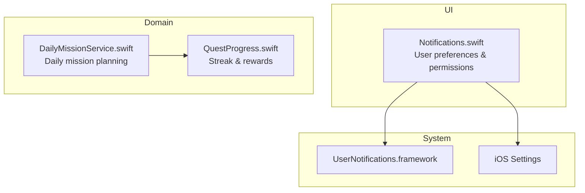
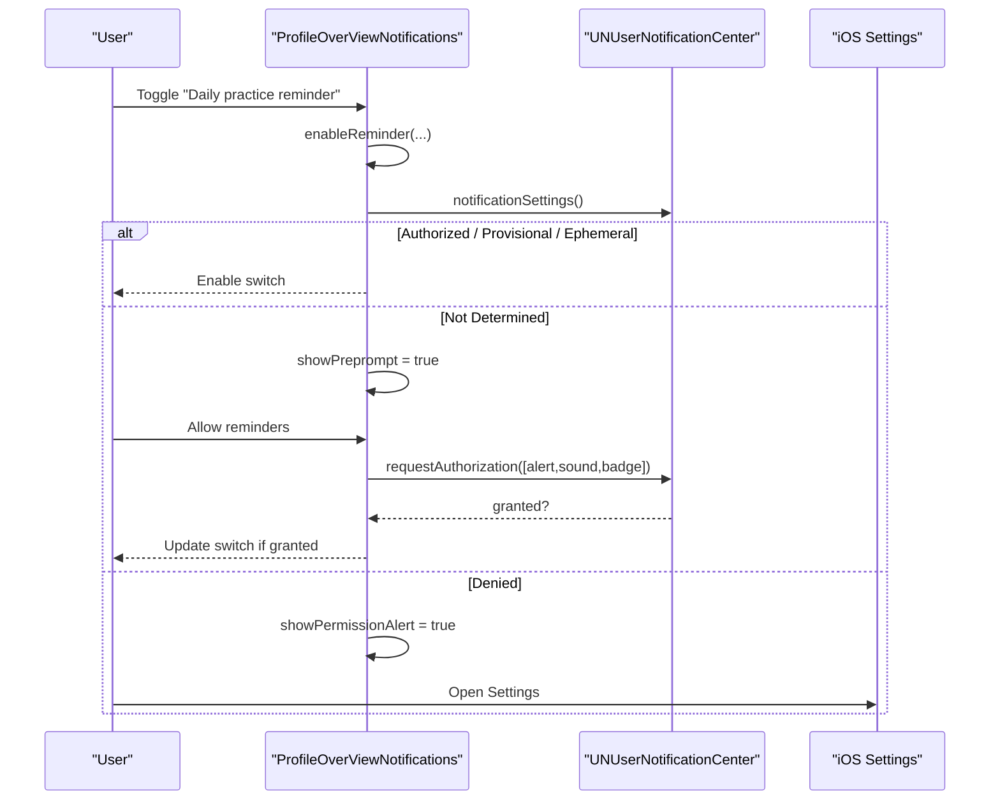
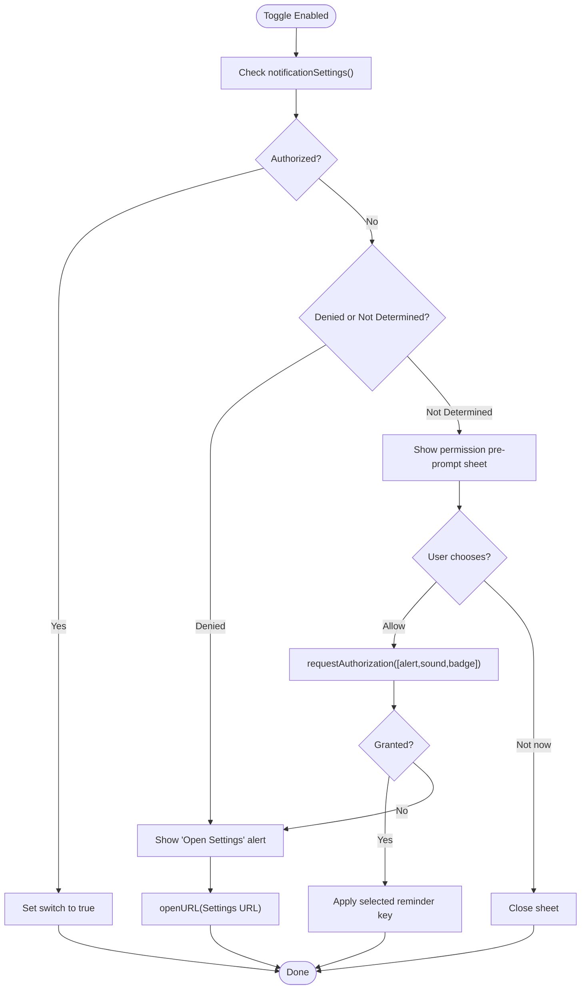
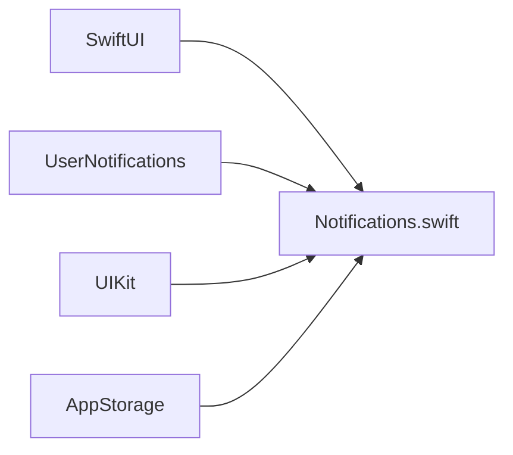

# Notifications & Reminders

<cite>
**Referenced Files in This Document**
- [Notifications.swift](file://Moko/Moko/UIScreens/homeScreens/ProfileOverView/Notifications.swift)
- [Info.plist](file://Moko/Moko/Info.plist)
- [QuestProgress.swift](file://Moko/Moko/Models/QuestProgress.swift)
- [DailyMissionService.swift](file://Moko/Moko/Features/AFM/DailyMissionService.swift)
- [DebriefSoundPlayer.swift](file://Moko/Moko/Features/Audio/DebriefSoundPlayer.swift)
</cite>

## Table of Contents
1. [Introduction](#introduction)
2. [Project Structure](#project-structure)
3. [Core Components](#core-components)
4. [Architecture Overview](#architecture-overview)
5. [Detailed Component Analysis](#detailed-component-analysis)
6. [Dependency Analysis](#dependency-analysis)
7. [Performance Considerations](#performance-considerations)
8. [Troubleshooting Guide](#troubleshooting-guide)
9. [Conclusion](#conclusion)

## Introduction
This document explains the Notifications and Reminders system for the Moko iOS app. It focuses on how users manage push notification preferences, how reminders are categorized (daily practice, streak at risk, new quests and scenarios, cooldown breathing), and how the app integrates with iOS LocalNotifications via UserNotifications. It also covers permission handling, user preference storage, scheduling concepts, templates, custom sounds, deep linking considerations, accessibility, Do Not Disturb compatibility, and battery optimization strategies.

## Project Structure
The notifications feature is implemented as a SwiftUI screen that manages user toggles and permission prompts. Related models and services provide context for when reminders should be triggered (for example, daily missions and streak updates).

**Diagram sources**
- [Notifications.swift:15-209](file://Moko/Moko/UIScreens/homeScreens/ProfileOverView/Notifications.swift#L15-L209)
- [QuestProgress.swift:17-47](file://Moko/Moko/Models/QuestProgress.swift#L17-L47)
- [DailyMissionService.swift:125-225](file://Moko/Moko/Features/AFM/DailyMissionService.swift#L125-L225)

**Section sources**
- [Notifications.swift:15-209](file://Moko/Moko/UIScreens/homeScreens/ProfileOverView/Notifications.swift#L15-L209)
- [QuestProgress.swift:17-47](file://Moko/Moko/Models/QuestProgress.swift#L17-L47)
- [DailyMissionService.swift:125-225](file://Moko/Moko/Features/AFM/DailyMissionService.swift#L125-L225)

## Core Components
- Notification Preferences Screen: Presents toggles for reminder categories and handles permission prompts and system settings navigation.
- Permission Handling: Uses UserNotifications to request authorization and read current status; opens iOS Settings when needed.
- User Preference Storage: Persists toggle states using AppStorage keys.
- Reminder Categories: Daily practice reminder, Streak at risk, New quests & scenarios, Cooldown breathing.
- Scheduling Context: Daily mission planning and streak calculations inform when reminders may be relevant.

Key responsibilities:
- Present and persist user choices for each reminder category.
- Request and track notification authorization.
- Provide clear UX when notifications are denied or not yet determined.
- Integrate with iOS permission flow and Settings.

**Section sources**
- [Notifications.swift:20-34](file://Moko/Moko/UIScreens/homeScreens/ProfileOverView/Notifications.swift#L20-L34)
- [Notifications.swift:36-107](file://Moko/Moko/UIScreens/homeScreens/ProfileOverView/Notifications.swift#L36-L107)
- [Notifications.swift:111-178](file://Moko/Moko/UIScreens/homeScreens/ProfileOverView/Notifications.swift#L111-L178)
- [Notifications.swift:183-209](file://Moko/Moko/UIScreens/homeScreens/ProfileOverView/Notifications.swift#L183-L209)

## Architecture Overview
The Notifications component is a UI-driven controller that:
- Reads and writes user preferences locally.
- Interacts with UserNotifications for permission requests and status checks.
- Navigates to iOS Settings when required.
- Coordinates with domain logic indirectly through reminder categories (e.g., daily missions and streaks).

**Diagram sources**
- [Notifications.swift:111-178](file://Moko/Moko/UIScreens/homeScreens/ProfileOverView/Notifications.swift#L111-L178)
- [Notifications.swift:183-209](file://Moko/Moko/UIScreens/homeScreens/ProfileOverView/Notifications.swift#L183-L209)

## Detailed Component Analysis

### Notifications Screen and Permission Flow
- Displays a list of reminder toggles.
- When a toggle is enabled:
  - If already authorized, enables the switch.
  - If not determined, shows a pre-prompt sheet before requesting authorization.
  - If denied, shows an alert and offers to open Settings.
- On app activation, refreshes authorization status and resets switches if system-level notifications are off.

**Diagram sources**
- [Notifications.swift:111-178](file://Moko/Moko/UIScreens/homeScreens/ProfileOverView/Notifications.swift#L111-L178)
- [Notifications.swift:183-209](file://Moko/Moko/UIScreens/homeScreens/ProfileOverView/Notifications.swift#L183-L209)

**Section sources**
- [Notifications.swift:36-107](file://Moko/Moko/UIScreens/homeScreens/ProfileOverView/Notifications.swift#L36-L107)
- [Notifications.swift:111-178](file://Moko/Moko/UIScreens/homeScreens/ProfileOverView/Notifications.swift#L111-L178)
- [Notifications.swift:183-209](file://Moko/Moko/UIScreens/homeScreens/ProfileOverView/Notifications.swift#L183-L209)

### User Preference Storage
- Four AppStorage keys store user choices:
  - notifyDaily
  - notifyStreak
  - notifyQuests
  - notifyCooldown
- Values are reset to false when system notifications are disabled to keep UI state consistent with device settings.

**Section sources**
- [Notifications.swift:20-25](file://Moko/Moko/UIScreens/homeScreens/ProfileOverView/Notifications.swift#L20-L25)
- [Notifications.swift:183-195](file://Moko/Moko/UIScreens/homeScreens/ProfileOverView/Notifications.swift#L183-L195)

### Notification Types and Categorization
- Daily practice reminder: Aligns with daily mission generation and overview activity.
- Streak at risk: Tied to streak progression and rest-day rules.
- New quests & scenarios: Relates to newly generated or upcoming quests.
- Cooldown breathing: A relaxation-focused reminder type.

These categories map directly to the toggles presented to the user.

**Section sources**
- [Notifications.swift:58-75](file://Moko/Moko/UIScreens/homeScreens/ProfileOverView/Notifications.swift#L58-L75)
- [DailyMissionService.swift:125-225](file://Moko/Moko/Features/AFM/DailyMissionService.swift#L125-L225)
- [QuestProgress.swift:17-47](file://Moko/Moko/Models/QuestProgress.swift#L17-L47)

### Integration with iOS LocalNotifications
- The app uses UserNotifications for permission management.
- Authorization options include alert, sound, and badge.
- When notifications are denied, the UI guides users to open iOS Settings.

Note: Actual scheduling of local notifications is not present in the analyzed files; this section documents the integration points available for future scheduling implementation.

**Section sources**
- [Notifications.swift:153-178](file://Moko/Moko/UIScreens/homeScreens/ProfileOverView/Notifications.swift#L153-L178)
- [Notifications.swift:183-209](file://Moko/Moko/UIScreens/homeScreens/ProfileOverView/Notifications.swift#L183-L209)

### Background Processing
- The Notifications screen refreshes authorization status when the app becomes active.
- No background tasks for scheduling are present in the analyzed code; any scheduled reminders would rely on iOS mechanisms.

**Section sources**
- [Notifications.swift:82-90](file://Moko/Moko/UIScreens/homeScreens/ProfileOverView/Notifications.swift#L82-L90)

### Deep Linking
- The Info.plist defines URL schemes for Google authentication but does not define a custom scheme for deep linking into notification targets.
- To support deep linking from notifications, add a custom URL scheme or universal link configuration and handle it in the app’s routing layer.

**Section sources**
- [Info.plist:9-19](file://Moko/Moko/Info.plist#L9-L19)

### Custom Sounds
- The app includes a debrief success sound player that loads audio from the bundle.
- For notification sounds, integrate a custom sound file and reference it in the notification payload. Ensure the sound file is included in the app bundle and referenced by name.

**Section sources**
- [DebriefSoundPlayer.swift:12-49](file://Moko/Moko/Features/Audio/DebriefSoundPlayer.swift#L12-L49)

### Accessibility Considerations
- The Notifications screen provides clear labels and descriptions for toggles and alerts.
- To enhance accessibility for announcements:
  - Add accessibility labels/hints to toggle rows describing their effect.
  - Announce permission outcomes via VoiceOver-friendly messages.
  - Respect Reduce Motion where applicable.

[No sources needed since this section provides general guidance]

### Do Not Disturb Compatibility
- The app requests alert and sound capabilities. iOS will respect system-wide Do Not Disturb and Focus modes; ensure notification content is concise and actionable.
- Badge capability is requested; consider whether badges are necessary for each reminder type.

**Section sources**
- [Notifications.swift:153-178](file://Moko/Moko/UIScreens/homeScreens/ProfileOverView/Notifications.swift#L153-L178)

### Battery Optimization Strategies
- Avoid frequent polling; rely on iOS scheduling for time-based reminders.
- Batch operations and minimize work during permission flows.
- Use minimal vibration and short sounds to reduce energy usage.

[No sources needed since this section provides general guidance]

## Dependency Analysis
The Notifications component depends on:
- UserNotifications framework for permission and settings access.
- UIKit for opening system settings.
- SwiftUI environment values for scene phase and URL handling.
- AppStorage for persistent preferences.

**Diagram sources**
- [Notifications.swift:11-13](file://Moko/Moko/UIScreens/homeScreens/ProfileOverView/Notifications.swift#L11-L13)
- [Notifications.swift:20-25](file://Moko/Moko/UIScreens/homeScreens/ProfileOverView/Notifications.swift#L20-L25)

**Section sources**
- [Notifications.swift:11-13](file://Moko/Moko/UIScreens/homeScreens/ProfileOverView/Notifications.swift#L11-L13)
- [Notifications.swift:20-25](file://Moko/Moko/UIScreens/homeScreens/ProfileOverView/Notifications.swift#L20-L25)

## Performance Considerations
- Permission requests should be infrequent and only when the user explicitly enables a reminder.
- Refreshing authorization status on app activation is lightweight but should avoid unnecessary network calls.
- Keep notification payloads small and avoid heavy processing in foreground/background handlers.

[No sources needed since this section provides general guidance]

## Troubleshooting Guide
Common issues and resolutions:
- Switches remain off after enabling:
  - Cause: System notifications are disabled.
  - Resolution: Open iOS Settings and allow notifications for the app; the UI will reset stored switches accordingly.
- Permission prompt not shown:
  - Cause: Already determined or denied.
  - Resolution: Direct users to iOS Settings to change permissions.
- Alerts do not appear:
  - Cause: Alert permission not granted or focus mode suppresses them.
  - Resolution: Verify authorization options and system focus settings.

Operational references:
- Opening Settings: Uses UIApplication.openSettingsURLString.
- Authorization statuses handled: authorized, provisional, ephemeral, denied, notDetermined.

**Section sources**
- [Notifications.swift:183-209](file://Moko/Moko/UIScreens/homeScreens/ProfileOverView/Notifications.swift#L183-L209)
- [Notifications.swift:197-204](file://Moko/Moko/UIScreens/homeScreens/ProfileOverView/Notifications.swift#L197-L204)

## Conclusion
The Notifications and Reminders system centers on a user-facing preferences screen that manages reminder categories and integrates with iOS permission flows. While actual scheduling of local notifications is not implemented in the analyzed files, the foundation is in place for adding scheduled reminders tied to daily missions and streak milestones. Future enhancements can include deep linking to specific app sections, custom notification sounds, and richer accessibility announcements while respecting Do Not Disturb and battery constraints.