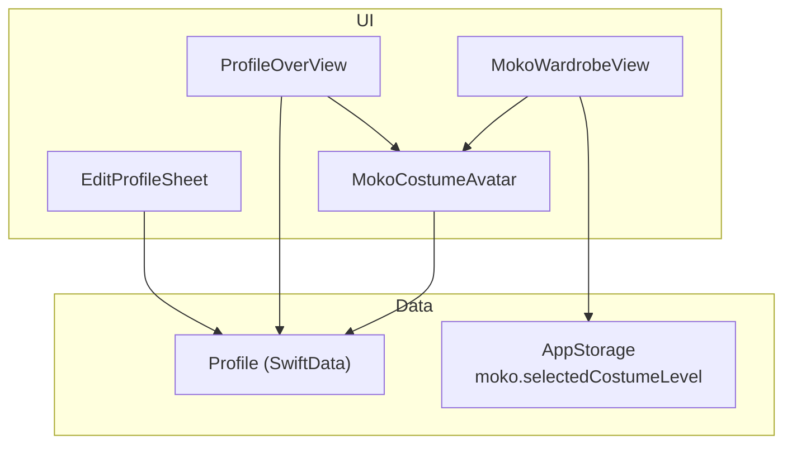
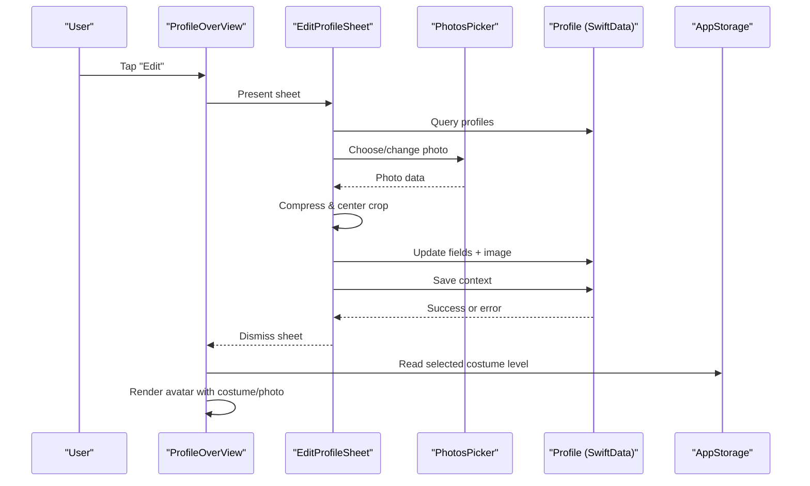
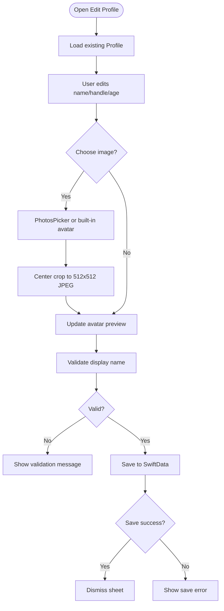
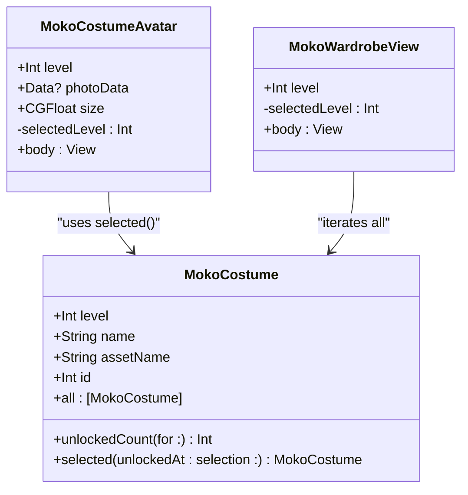
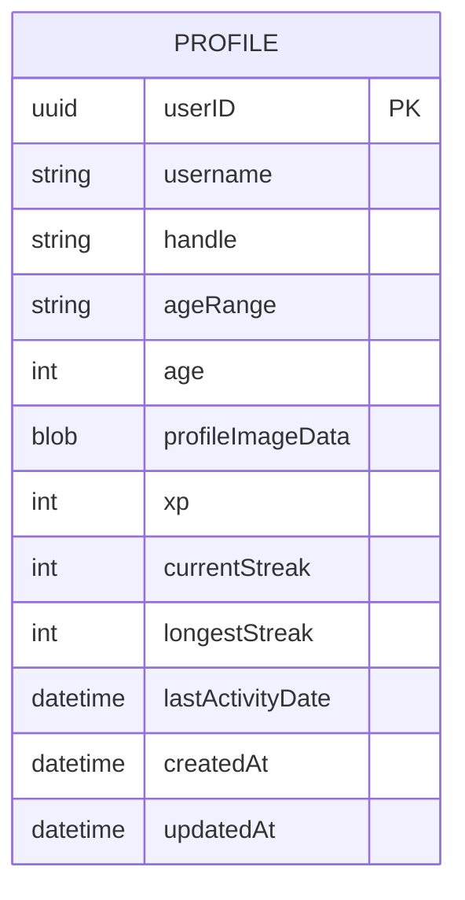
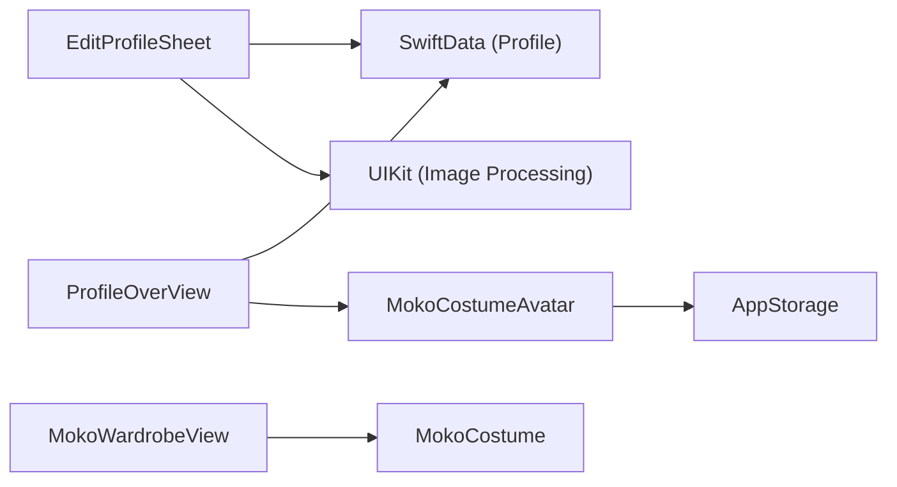

# Profile Editing

<cite>
**Referenced Files in This Document**
- [EditProfileSheet.swift](file://Moko/Moko/UIScreens/homeScreens/ProfileOverView/EditProfileSheet.swift)
- [MokoCostume.swift](file://Moko/Moko/UIScreens/homeScreens/ProfileOverView/MokoCostume.swift)
- [ProfileOverView.swift](file://Moko/Moko/UIScreens/homeScreens/ProfileOverView.swift)
- [Profile.swift](file://Moko/Moko/Models/Profile.swift)
</cite>

## Table of Contents
1. [Introduction](#introduction)
2. [Project Structure](#project-structure)
3. [Core Components](#core-components)
4. [Architecture Overview](#architecture-overview)
5. [Detailed Component Analysis](#detailed-component-analysis)
6. [Dependency Analysis](#dependency-analysis)
7. [Performance Considerations](#performance-considerations)
8. [Troubleshooting Guide](#troubleshooting-guide)
9. [Conclusion](#conclusion)

## Introduction
This document explains Moko’s profile editing and wardrobe system. It covers:
- The EditProfileSheet component for customizing display name, optional username, age range, and profile image or avatar.
- The MokoCostume system for wardrobe management, costume unlocking based on level progression, and visual customization.
- Profile data persistence using SwiftData, input validation rules, and real-time preview behavior.
- Image handling, costume state management, and integration with the level/XP system.
- Accessibility considerations, error handling, and data synchronization across app components.

## Project Structure
The profile editing feature spans UI screens, models, and shared assets:
- EditProfileSheet handles user input, image selection, validation, and saving to SwiftData.
- MokoCostume defines costumes, unlocks, and rendering logic.
- ProfileOverView displays the profile header, XP/level, badges, growth charts, and links to the wardrobe.
- Profile is the SwiftData model storing profile fields, images, and progress metrics.

**Diagram sources**
- [EditProfileSheet.swift:6-249](file://Moko/Moko/UIScreens/homeScreens/ProfileOverView/EditProfileSheet.swift#L6-L249)
- [MokoCostume.swift:4-143](file://Moko/Moko/UIScreens/homeScreens/ProfileOverView/MokoCostume.swift#L4-L143)
- [ProfileOverView.swift:6-118](file://Moko/Moko/UIScreens/homeScreens/ProfileOverView.swift#L6-L118)
- [Profile.swift:12-59](file://Moko/Moko/Models/Profile.swift#L12-L59)

**Section sources**
- [EditProfileSheet.swift:6-249](file://Moko/Moko/UIScreens/homeScreens/ProfileOverView/EditProfileSheet.swift#L6-L249)
- [MokoCostume.swift:4-143](file://Moko/Moko/UIScreens/homeScreens/ProfileOverView/MokoCostume.swift#L4-L143)
- [ProfileOverView.swift:6-118](file://Moko/Moko/UIScreens/homeScreens/ProfileOverView.swift#L6-L118)
- [Profile.swift:12-59](file://Moko/Moko/Models/Profile.swift#L12-L59)

## Core Components
- EditProfileSheet: A modal sheet for editing profile details and avatar. It reads from and writes to SwiftData, validates inputs, and previews selected images.
- MokoCostume: Defines a fixed catalog of costumes with unlock thresholds tied to levels. Provides helpers to compute unlocked count and selected costume.
- MokoCostumeAvatar: Renders either a user-uploaded profile photo or a default costume image, depending on availability.
- MokoWardrobeView: Lists all costumes, shows unlock status, and lets users select an unlocked costume. Selection persists via AppStorage.
- ProfileOverView: Displays the profile header with avatar, level, XP, streaks, badges, growth chart, and navigation to wardrobe and edit profile.

Key responsibilities:
- Input validation and normalization for display name and optional username.
- Real-time image preview and compression to a centered square JPEG.
- Level-based costume unlocking and persistent selection.
- Data synchronization between UI and SwiftData model.

**Section sources**
- [EditProfileSheet.swift:6-249](file://Moko/Moko/UIScreens/homeScreens/ProfileOverView/EditProfileSheet.swift#L6-L249)
- [MokoCostume.swift:4-143](file://Moko/Moko/UIScreens/homeScreens/ProfileOverView/MokoCostume.swift#L4-L143)
- [ProfileOverView.swift:6-118](file://Moko/Moko/UIScreens/homeScreens/ProfileOverView.swift#L6-L118)
- [Profile.swift:12-59](file://Moko/Moko/Models/Profile.swift#L12-L59)

## Architecture Overview
The profile editing flow integrates SwiftUI views, SwiftData, and AppStorage:

**Diagram sources**
- [ProfileOverView.swift:94-107](file://Moko/Moko/UIScreens/homeScreens/ProfileOverView.swift#L94-L107)
- [EditProfileSheet.swift:145-147](file://Moko/Moko/UIScreens/homeScreens/ProfileOverView/EditProfileSheet.swift#L145-L147)
- [EditProfileSheet.swift:198-220](file://Moko/Moko/UIScreens/homeScreens/ProfileOverView/EditProfileSheet.swift#L198-L220)
- [EditProfileSheet.swift:222-244](file://Moko/Moko/UIScreens/homeScreens/ProfileOverView/EditProfileSheet.swift#L222-L244)
- [MokoCostume.swift:42-44](file://Moko/Moko/UIScreens/homeScreens/ProfileOverView/MokoCostume.swift#L42-L44)

## Detailed Component Analysis

### EditProfileSheet: User Profile Customization
Responsibilities:
- Load existing profile data into local state.
- Provide controls for display name, optional username, and age range.
- Allow choosing or removing a profile photo, or selecting built-in avatars.
- Validate display name length and emptiness.
- Persist changes to SwiftData and handle save errors.

Validation rules:
- Display name must not be empty after trimming whitespace.
- Display name must be 30 characters or fewer; input is truncated at 30 characters.
- Username is optional and normalized by trimming whitespace; stored as nil when empty.
- Age range maps to a representative integer age for storage.

Image handling:
- PhotosPicker provides transferable image data.
- Selected images are converted to a centered square JPEG at 512x512 pixels with compression quality tuned for balance between size and clarity.
- Built-in avatars are compressed similarly before assignment.

Real-time preview:
- The avatar preview updates immediately when a new photo is chosen or a built-in avatar is selected.
- The preview shows the final cropped square that will be saved.

Persistence:
- On save, the view updates the first Profile record if present, otherwise inserts a new Profile.
- Updates include username, handle, ageRange, age, profileImageData, and updatedAt timestamp.
- Errors during save are surfaced to the user.

Accessibility:
- Preview has an accessibility label describing it as a profile photo.
- Error messages are marked as static text for screen readers.

**Diagram sources**
- [EditProfileSheet.swift:168-174](file://Moko/Moko/UIScreens/homeScreens/ProfileOverView/EditProfileSheet.swift#L168-L174)
- [EditProfileSheet.swift:198-220](file://Moko/Moko/UIScreens/homeScreens/ProfileOverView/EditProfileSheet.swift#L198-L220)
- [EditProfileSheet.swift:222-244](file://Moko/Moko/UIScreens/homeScreens/ProfileOverView/EditProfileSheet.swift#L222-L244)

**Section sources**
- [EditProfileSheet.swift:6-249](file://Moko/Moko/UIScreens/homeScreens/ProfileOverView/EditProfileSheet.swift#L6-L249)

### MokoCostume System: Wardrobe Management and Unlocking
Core concepts:
- Costume catalog: A fixed list of costumes, each with a required level, display name, and asset name.
- Unlocking: Costumes are unlocked when the user’s current level meets or exceeds the costume’s required level.
- Selection: Users can select any unlocked costume; selection persists via AppStorage under a dedicated key.
- Rendering: MokoCostumeAvatar renders either a user-uploaded profile photo or the selected costume image.

Unlock logic:
- Unlocked count is computed by counting costumes whose required level is less than or equal to the user’s current level.
- Selected costume resolves to the explicitly chosen unlocked costume; if none is chosen, it falls back to the highest unlocked costume.

Wardrobe UI:
- Shows the currently selected costume and its name.
- Displays unlock status per costume and disables locked items.
- Indicates selection with a checkmark and locks for unavailable costumes.

Integration with level/XP:
- ProfileOverView calculates level from XP (level = floor(XP / 400) + 1).
- Wardrobe link shows how many costumes are unlocked out of total.

**Diagram sources**
- [MokoCostume.swift:4-36](file://Moko/Moko/UIScreens/homeScreens/ProfileOverView/MokoCostume.swift#L4-L36)
- [MokoCostume.swift:38-65](file://Moko/Moko/UIScreens/homeScreens/ProfileOverView/MokoCostume.swift#L38-L65)
- [MokoCostume.swift:67-143](file://Moko/Moko/UIScreens/homeScreens/ProfileOverView/MokoCostume.swift#L67-L143)

**Section sources**
- [MokoCostume.swift:4-143](file://Moko/Moko/UIScreens/homeScreens/ProfileOverView/MokoCostume.swift#L4-L143)
- [ProfileOverView.swift:22-28](file://Moko/Moko/UIScreens/homeScreens/ProfileOverView.swift#L22-L28)
- [ProfileOverView.swift:458-475](file://Moko/Moko/UIScreens/homeScreens/ProfileOverView.swift#L458-L475)

### Profile Data Persistence with SwiftData
Model structure:
- Profile stores user identity (username, handle), demographic hints (ageRange, age), profile image data, and progress metrics (xp, streaks, lastActivityDate, timestamps).
- Profile image data is annotated for external storage, allowing large binary payloads to be managed outside the primary database file.

Editing flow:
- EditProfileSheet loads the first Profile record and populates local state.
- On save, it updates the existing record or creates a new one, then calls modelContext.save().
- Errors are caught and displayed to the user.

Synchronization:
- ProfileOverView queries Profile records to render the header, including avatar and level/XP.
- Changes made in EditProfileSheet propagate to ProfileOverView through SwiftData’s reactive query mechanism.

**Diagram sources**
- [Profile.swift:12-59](file://Moko/Moko/Models/Profile.swift#L12-L59)

**Section sources**
- [Profile.swift:12-59](file://Moko/Moko/Models/Profile.swift#L12-L59)
- [EditProfileSheet.swift:168-174](file://Moko/Moko/UIScreens/homeScreens/ProfileOverView/EditProfileSheet.swift#L168-L174)
- [EditProfileSheet.swift:222-244](file://Moko/Moko/UIScreens/homeScreens/ProfileOverView/EditProfileSheet.swift#L222-L244)
- [ProfileOverView.swift:22-28](file://Moko/Moko/UIScreens/homeScreens/ProfileOverView.swift#L22-L28)

### Real-Time Preview and Image Handling
Preview behavior:
- When a photo is selected via PhotosPicker, the view asynchronously loads transferable data and converts it to a centered square JPEG.
- Built-in avatars are also compressed to the same format before being assigned to the preview.
- The avatar preview updates immediately upon successful conversion.

Image processing details:
- Target size: 512x512 pixels.
- Compression quality is set to balance file size and visual fidelity.
- Cropping centers the image within the square frame.

Error handling:
- If image loading fails, the preview remains unchanged.
- Save errors are surfaced to the user with a clear message.

**Section sources**
- [EditProfileSheet.swift:198-220](file://Moko/Moko/UIScreens/homeScreens/ProfileOverView/EditProfileSheet.swift#L198-L220)
- [EditProfileSheet.swift:151-166](file://Moko/Moko/UIScreens/homeScreens/ProfileOverView/EditProfileSheet.swift#L151-L166)
- [EditProfileSheet.swift:222-244](file://Moko/Moko/UIScreens/homeScreens/ProfileOverView/EditProfileSheet.swift#L222-L244)

### Integration with Level/XP System
Level calculation:
- Level is derived from XP using integer division and modulo operations.
- Progress toward the next level is shown via a progress bar indicating remaining XP.

Wardrobe linkage:
- The wardrobe link shows the number of unlocked costumes relative to the total catalog.
- Costume unlocking is determined by comparing the user’s level against each costume’s required level.

Avatar rendering:
- The profile header uses MokoCostumeAvatar to show either a user-uploaded photo or the selected costume image.
- The selected costume is read from AppStorage and constrained by unlock status.

**Section sources**
- [ProfileOverView.swift:22-28](file://Moko/Moko/UIScreens/homeScreens/ProfileOverView.swift#L22-L28)
- [ProfileOverView.swift:120-142](file://Moko/Moko/UIScreens/homeScreens/ProfileOverView.swift#L120-L142)
- [ProfileOverView.swift:458-475](file://Moko/Moko/UIScreens/homeScreens/ProfileOverView.swift#L458-L475)
- [MokoCostume.swift:28-35](file://Moko/Moko/UIScreens/homeScreens/ProfileOverView/MokoCostume.swift#L28-L35)

### Accessibility Considerations
- Profile photo preview includes an accessibility label.
- Locked and selected states in the wardrobe use accessibility labels for lock and selection indicators.
- Error messages are marked as static text to ensure proper screen reader announcements.
- The profile screen respects reduced motion preferences for animations.

**Section sources**
- [EditProfileSheet.swift:165-166](file://Moko/Moko/UIScreens/homeScreens/ProfileOverView/EditProfileSheet.swift#L165-L166)
- [MokoCostume.swift:114-122](file://Moko/Moko/UIScreens/homeScreens/ProfileOverView/MokoCostume.swift#L114-L122)
- [ProfileOverView.swift:10-11](file://Moko/Moko/UIScreens/homeScreens/ProfileOverView.swift#L10-L11)

### Error Handling for Invalid Inputs
- Display name validation prevents saving with an empty or overly long name.
- Save failures are caught and presented to the user with a friendly message.
- Locked costumes cannot be selected; attempts are ignored.

**Section sources**
- [EditProfileSheet.swift:20-25](file://Moko/Moko/UIScreens/homeScreens/ProfileOverView/EditProfileSheet.swift#L20-L25)
- [EditProfileSheet.swift:222-244](file://Moko/Moko/UIScreens/homeScreens/ProfileOverView/EditProfileSheet.swift#L222-L244)
- [MokoCostume.swift:90-93](file://Moko/Moko/UIScreens/homeScreens/ProfileOverView/MokoCostume.swift#L90-L93)

## Dependency Analysis
Component relationships:
- EditProfileSheet depends on SwiftData for reading/writing Profile records and UIKit for image processing.
- MokoCostumeAvatar depends on AppStorage for selected costume level and Profile palette for styling.
- ProfileOverView depends on SwiftData for querying Profile, Quest, CalmDownModel, InsightsModel, and OnboardingState.
- MokoWardrobeView depends on MokoCostume for catalog and unlock logic.

Coupling and cohesion:
- EditProfileSheet is cohesive around profile editing concerns and tightly coupled to Profile model fields.
- MokoCostume encapsulates costume catalog and unlock logic, promoting reuse across avatar and wardrobe views.
- ProfileOverView orchestrates multiple data sources but delegates specific rendering to focused components.

Potential circular dependencies:
- None observed; dependencies flow from UI to data and utilities without cycles.

External integrations:
- PhotosUI for image selection.
- SwiftData for persistence.
- AppStorage for lightweight settings (costume selection).

**Diagram sources**
- [EditProfileSheet.swift:1-4](file://Moko/Moko/UIScreens/homeScreens/ProfileOverView/EditProfileSheet.swift#L1-L4)
- [MokoCostume.swift:1-2](file://Moko/Moko/UIScreens/homeScreens/ProfileOverView/MokoCostume.swift#L1-L2)
- [ProfileOverView.swift:1-4](file://Moko/Moko/UIScreens/homeScreens/ProfileOverView.swift#L1-L4)

**Section sources**
- [EditProfileSheet.swift:1-4](file://Moko/Moko/UIScreens/homeScreens/ProfileOverView/EditProfileSheet.swift#L1-L4)
- [MokoCostume.swift:1-2](file://Moko/Moko/UIScreens/homeScreens/ProfileOverView/MokoCostume.swift#L1-L2)
- [ProfileOverView.swift:1-4](file://Moko/Moko/UIScreens/homeScreens/ProfileOverView.swift#L1-L4)

## Performance Considerations
- Image compression to 512x512 JPEG reduces memory footprint and improves load times.
- Using @Query ensures efficient reactivity to SwiftData changes without manual refreshes.
- AppStorage provides lightweight persistence for costume selection without heavy database overhead.
- Avoid unnecessary recomputation by keeping derived values (e.g., trimmed name, inferred age range) as computed properties.

[No sources needed since this section provides general guidance]

## Troubleshooting Guide
Common issues and resolutions:
- Display name validation errors: Ensure the name is non-empty and within the character limit.
- Save failures: Check network or device storage constraints; retry saving and inspect error messages.
- Image not updating: Verify that PhotosPicker returns valid data and that image conversion succeeds.
- Costume not selectable: Confirm the user’s level meets the costume’s requirement; locked costumes remain disabled.

**Section sources**
- [EditProfileSheet.swift:20-25](file://Moko/Moko/UIScreens/homeScreens/ProfileOverView/EditProfileSheet.swift#L20-L25)
- [EditProfileSheet.swift:222-244](file://Moko/Moko/UIScreens/homeScreens/ProfileOverView/EditProfileSheet.swift#L222-L244)
- [MokoCostume.swift:90-93](file://Moko/Moko/UIScreens/homeScreens/ProfileOverView/MokoCostume.swift#L90-L93)

## Conclusion
Moko’s profile editing and wardrobe systems provide a cohesive experience for personalization and progression. EditProfileSheet offers robust input validation, real-time image preview, and reliable persistence via SwiftData. The MokoCostume system ties visual customization to level progression, ensuring rewards feel earned. Together, these components deliver accessible, performant, and well-integrated functionality across the app.

[No sources needed since this section summarizes without analyzing specific files]