# User Profile Management

<cite>
**Referenced Files in This Document**
- [Profile.swift](file://Moko/Moko/Models/Profile.swift)
- [QuestProgress.swift](file://Moko/Moko/Models/QuestProgress.swift)
- [InsightsModel.swift](file://Moko/Moko/Models/InsightsModel.swift)
- [CalmDownModel.swift](file://Moko/Moko/Models/CalmDownModel.swift)
- [AchievementsList.swift](file://Moko/Moko/UIScreens/homeScreens/ProfileOverView/AchievementsList.swift)
- [AchievementDetailUnlocked.swift](file://Moko/Moko/UIScreens/homeScreens/ProfileOverView/AchievementDetailUnlocked.swift)
- [EditProfileSheet.swift](file://Moko/Moko/UIScreens/homeScreens/ProfileOverView/EditProfileSheet.swift)
- [AccountAndData.swift](file://Moko/Moko/UIScreens/homeScreens/ProfileOverView/AccountAndData.swift)
- [MokoCostume.swift](file://Moko/Moko/UIScreens/homeScreens/ProfileOverView/MokoCostume.swift)
- [Notifications.swift](file://Moko/Moko/UIScreens/homeScreens/ProfileOverView/Notifications.swift)
- [DeleteAccountConfirm.swift](file://Moko/Moko/UIScreens/homeScreens/ProfileOverView/DeleteAccountConfirm.swift)
- [DeleteAccountFinalConfirm.swift](file://Moko/Moko/UIScreens/homeScreens/ProfileOverView/DeleteAccountFinalConfirm.swift)
</cite>

## Table of Contents
1. [Introduction](#introduction)
2. [Project Structure](#project-structure)
3. [Core Components](#core-components)
4. [Architecture Overview](#architecture-overview)
5. [Detailed Component Analysis](#detailed-component-analysis)
6. [Dependency Analysis](#dependency-analysis)
7. [Performance Considerations](#performance-considerations)
8. [Troubleshooting Guide](#troubleshooting-guide)
9. [Security and Privacy Compliance](#security-and-privacy-compliance)
10. [Conclusion](#conclusion)

## Introduction
This document explains Moko’s User Profile Management system. It covers the profile data model, achievement and badge logic, account settings, privacy controls, streak tracking, costume customization, notification preferences, and account deletion workflows. The implementation uses SwiftData for local persistence, SwiftUI for user interfaces, and integrates with a quest system to drive progress and achievements.

## Project Structure
The profile management feature spans models and UI screens under the home screen profile area:

- Models define persistent entities such as the user profile, insights, calm sessions, and shared quest progression logic.
- UI components provide the achievements gallery, profile editing, account and data management, wardrobe selection, notifications, and account deletion flows.

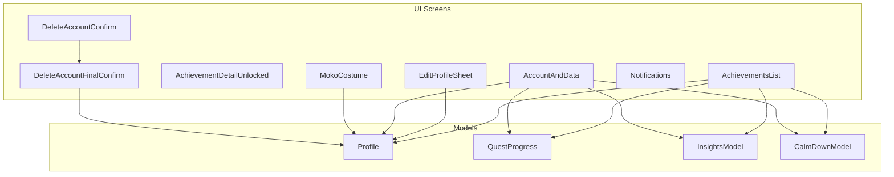

**Diagram sources**
- [Profile.swift:12-58](file://Moko/Moko/Models/Profile.swift#L12-L58)
- [QuestProgress.swift:17-139](file://Moko/Moko/Models/QuestProgress.swift#L17-L139)
- [InsightsModel.swift:11-26](file://Moko/Moko/Models/InsightsModel.swift#L11-L26)
- [CalmDownModel.swift:12-37](file://Moko/Moko/Models/CalmDownModel.swift#L12-L37)
- [AchievementsList.swift:10-199](file://Moko/Moko/UIScreens/homeScreens/ProfileOverView/AchievementsList.swift#L10-L199)
- [AchievementDetailUnlocked.swift:3-52](file://Moko/Moko/UIScreens/homeScreens/ProfileOverView/AchievementDetailUnlocked.swift#L3-L52)
- [EditProfileSheet.swift:6-245](file://Moko/Moko/UIScreens/homeScreens/ProfileOverView/EditProfileSheet.swift#L6-L245)
- [AccountAndData.swift:5-114](file://Moko/Moko/UIScreens/homeScreens/ProfileOverView/AccountAndData.swift#L5-L114)
- [MokoCostume.swift:4-143](file://Moko/Moko/UIScreens/homeScreens/ProfileOverView/MokoCostume.swift#L4-L143)
- [Notifications.swift:15-249](file://Moko/Moko/UIScreens/homeScreens/ProfileOverView/Notifications.swift#L15-L249)
- [DeleteAccountConfirm.swift:4-104](file://Moko/Moko/UIScreens/homeScreens/ProfileOverView/DeleteAccountConfirm.swift#L4-L104)
- [DeleteAccountFinalConfirm.swift:4-79](file://Moko/Moko/UIScreens/homeScreens/ProfileOverView/DeleteAccountFinalConfirm.swift#L4-L79)

**Section sources**
- [Profile.swift:12-58](file://Moko/Moko/Models/Profile.swift#L12-L58)
- [AchievementsList.swift:10-199](file://Moko/Moko/UIScreens/homeScreens/ProfileOverView/AchievementsList.swift#L10-L199)
- [EditProfileSheet.swift:6-245](file://Moko/Moko/UIScreens/homeScreens/ProfileOverView/EditProfileSheet.swift#L6-L245)
- [AccountAndData.swift:5-114](file://Moko/Moko/UIScreens/homeScreens/ProfileOverView/AccountAndData.swift#L5-L114)
- [MokoCostume.swift:4-143](file://Moko/Moko/UIScreens/homeScreens/ProfileOverView/MokoCostume.swift#L4-L143)
- [Notifications.swift:15-249](file://Moko/Moko/UIScreens/homeScreens/ProfileOverView/Notifications.swift#L15-L249)
- [DeleteAccountConfirm.swift:4-104](file://Moko/Moko/UIScreens/homeScreens/ProfileOverView/DeleteAccountConfirm.swift#L4-L104)
- [DeleteAccountFinalConfirm.swift:4-79](file://Moko/Moko/UIScreens/homeScreens/ProfileOverView/DeleteAccountFinalConfirm.swift#L4-L79)

## Core Components
- Profile model stores identity, avatar image data, experience points, streaks, timestamps, and optional fields like handle and age range.
- QuestProgress centralizes streak calculation, XP awarding, debrief insight creation, and safe persistence.
- InsightsModel records courage, clarity, presence, warmth scores over time.
- CalmDownModel records completed calm exercises with duration and timestamp.
- AchievementsList computes unlocked badges from quests, insights, calm sessions, onboarding state, and profile streaks.
- EditProfileSheet manages display name, handle, age range, and profile photo or Moko avatar selection.
- AccountAndData shows sign-in method, provides data export, sign-out, and navigation to delete account.
- MokoCostume defines unlockable costumes by level and selected costume via AppStorage.
- Notifications manages reminder toggles, permission prompts, and system settings redirection.
- DeleteAccountConfirm and DeleteAccountFinalConfirm implement reauthentication and final deletion with local cleanup.

**Section sources**
- [Profile.swift:12-58](file://Moko/Moko/Models/Profile.swift#L12-L58)
- [QuestProgress.swift:17-139](file://Moko/Moko/Models/QuestProgress.swift#L17-L139)
- [InsightsModel.swift:11-26](file://Moko/Moko/Models/InsightsModel.swift#L11-L26)
- [CalmDownModel.swift:12-37](file://Moko/Moko/Models/CalmDownModel.swift#L12-L37)
- [AchievementsList.swift:10-199](file://Moko/Moko/UIScreens/homeScreens/ProfileOverView/AchievementsList.swift#L10-L199)
- [EditProfileSheet.swift:6-245](file://Moko/Moko/UIScreens/homeScreens/ProfileOverView/EditProfileSheet.swift#L6-L245)
- [AccountAndData.swift:5-114](file://Moko/Moko/UIScreens/homeScreens/ProfileOverView/AccountAndData.swift#L5-L114)
- [MokoCostume.swift:4-143](file://Moko/Moko/UIScreens/homeScreens/ProfileOverView/MokoCostume.swift#L4-L143)
- [Notifications.swift:15-249](file://Moko/Moko/UIScreens/homeScreens/ProfileOverView/Notifications.swift#L15-L249)
- [DeleteAccountConfirm.swift:4-104](file://Moko/Moko/UIScreens/homeScreens/ProfileOverView/DeleteAccountConfirm.swift#L4-L104)
- [DeleteAccountFinalConfirm.swift:4-79](file://Moko/Moko/UIScreens/homeScreens/ProfileOverView/DeleteAccountFinalConfirm.swift#L4-L79)

## Architecture Overview
The profile system is centered around SwiftData models and SwiftUI views. Quest completion updates the profile’s XP and streaks; insights and calm sessions feed into achievement calculations. The UI exposes editing, exporting, and deletion capabilities while respecting user permissions for notifications.

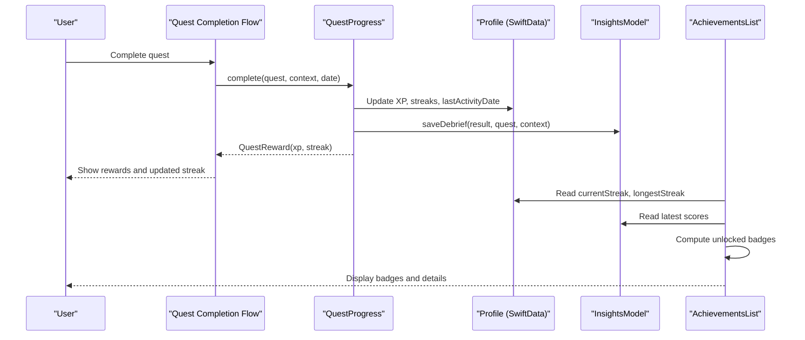

**Diagram sources**
- [QuestProgress.swift:49-119](file://Moko/Moko/Models/QuestProgress.swift#L49-L119)
- [Profile.swift:12-58](file://Moko/Moko/Models/Profile.swift#L12-L58)
- [InsightsModel.swift:11-26](file://Moko/Moko/Models/InsightsModel.swift#L11-L26)
- [AchievementsList.swift:19-178](file://Moko/Moko/UIScreens/homeScreens/ProfileOverView/AchievementsList.swift#L19-L178)

## Detailed Component Analysis

### Profile Data Model and Persistence
- Identity and personalization: username, optional handle, age range, age, and profile image data stored externally.
- Progress metrics: xp, currentStreak, longestStreak, lastActivityDate.
- Timestamps: createdAt and updatedAt for auditability.
- Persistence: SwiftData @Model ensures automatic change tracking and saving through ModelContext.

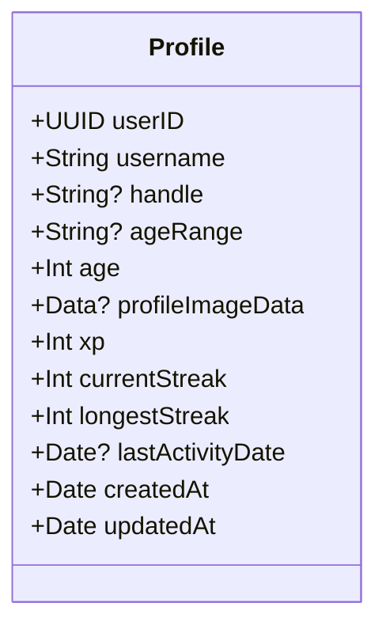

**Diagram sources**
- [Profile.swift:12-58](file://Moko/Moko/Models/Profile.swift#L12-L58)

**Section sources**
- [Profile.swift:12-58](file://Moko/Moko/Models/Profile.swift#L12-L58)

### Streak Tracking Mechanics
- nextStreak calculates the new streak based on last activity date, allowing one rest day after seven active days.
- complete marks a quest done once, awards XP, updates streaks, and persists changes.
- saveDebrief creates an InsightsModel entry if not already recorded, ensuring no duplicate debriefs.

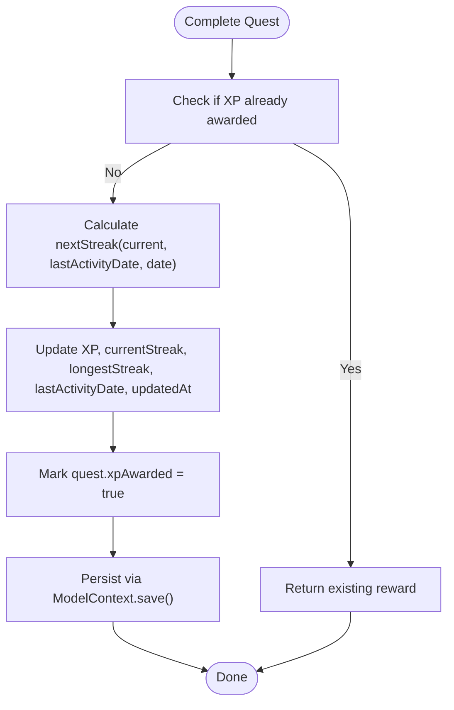

**Diagram sources**
- [QuestProgress.swift:22-83](file://Moko/Moko/Models/QuestProgress.swift#L22-L83)

**Section sources**
- [QuestProgress.swift:22-83](file://Moko/Moko/Models/QuestProgress.swift#L22-L83)

### Achievement System and Badge Unlocking
- Achievement catalog includes categories: streak, quest, skill, calm.
- Unlock conditions derive from:
  - Completed quests count and categories (friends, family, work, dating).
  - Insight score thresholds per tier.
  - Calm session counts and durations.
  - Weekly steadiness and comeback patterns.
  - Onboarding completion.
- Badges are displayed with shape and tier visuals; locked badges show placeholders.

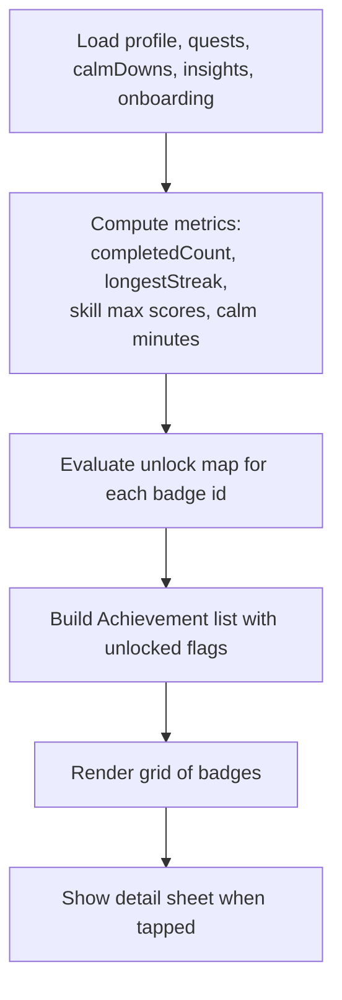

**Diagram sources**
- [AchievementsList.swift:19-178](file://Moko/Moko/UIScreens/homeScreens/ProfileOverView/AchievementsList.swift#L19-L178)
- [AchievementDetailUnlocked.swift:3-52](file://Moko/Moko/UIScreens/homeScreens/ProfileOverView/AchievementDetailUnlocked.swift#L3-L52)

**Section sources**
- [AchievementsList.swift:10-199](file://Moko/Moko/UIScreens/homeScreens/ProfileOverView/AchievementsList.swift#L10-L199)
- [AchievementDetailUnlocked.swift:3-52](file://Moko/Moko/UIScreens/homeScreens/ProfileOverView/AchievementDetailUnlocked.swift#L3-L52)

### EditProfileSheet for User Customization
- Inputs: display name (required, max length), optional handle, optional age range picker.
- Photo handling: PhotosPicker integration, centered square JPEG compression, preview, remove option.
- Avatar choices: built-in Moko avatars selectable via confirmation dialog.
- Persistence: Updates existing Profile or inserts new Profile; saves via ModelContext.

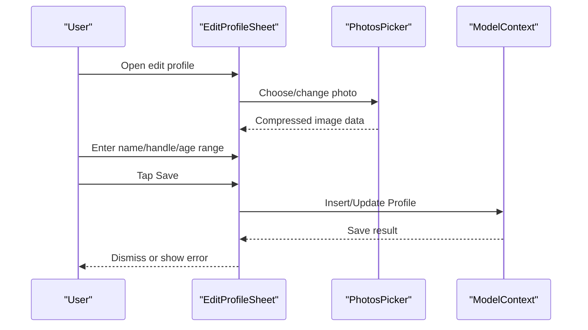

**Diagram sources**
- [EditProfileSheet.swift:6-245](file://Moko/Moko/UIScreens/homeScreens/ProfileOverView/EditProfileSheet.swift#L6-L245)

**Section sources**
- [EditProfileSheet.swift:6-245](file://Moko/Moko/UIScreens/homeScreens/ProfileOverView/EditProfileSheet.swift#L6-L245)

### AccountAndData for Privacy and Data Management
- Displays sign-in method and current email or device-only status.
- Provides “Export my data” using ShareLink with JSON payload including profile, quests, calm sessions, insights, and onboarding responses.
- Sign out flow calls AuthService and triggers app session callback.
- Navigation to delete account confirmation.

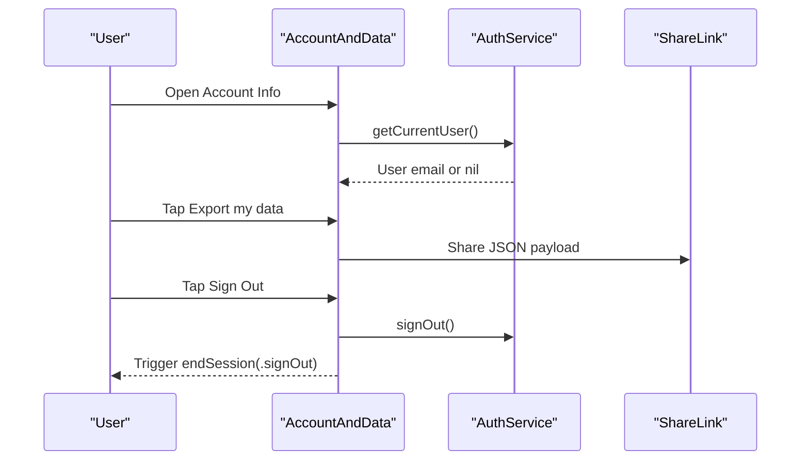

**Diagram sources**
- [AccountAndData.swift:5-114](file://Moko/Moko/UIScreens/homeScreens/ProfileOverView/AccountAndData.swift#L5-L114)

**Section sources**
- [AccountAndData.swift:5-114](file://Moko/Moko/UIScreens/homeScreens/ProfileOverView/AccountAndData.swift#L5-L114)

### Costume Customization
- MokoCostume defines levels and asset names; unlocks based on user level.
- Selected costume persisted via AppStorage key.
- MokoCostumeAvatar renders either custom photo or default costume image.
- MokoWardrobeView lists available costumes, locks unavailable ones, and allows selection.

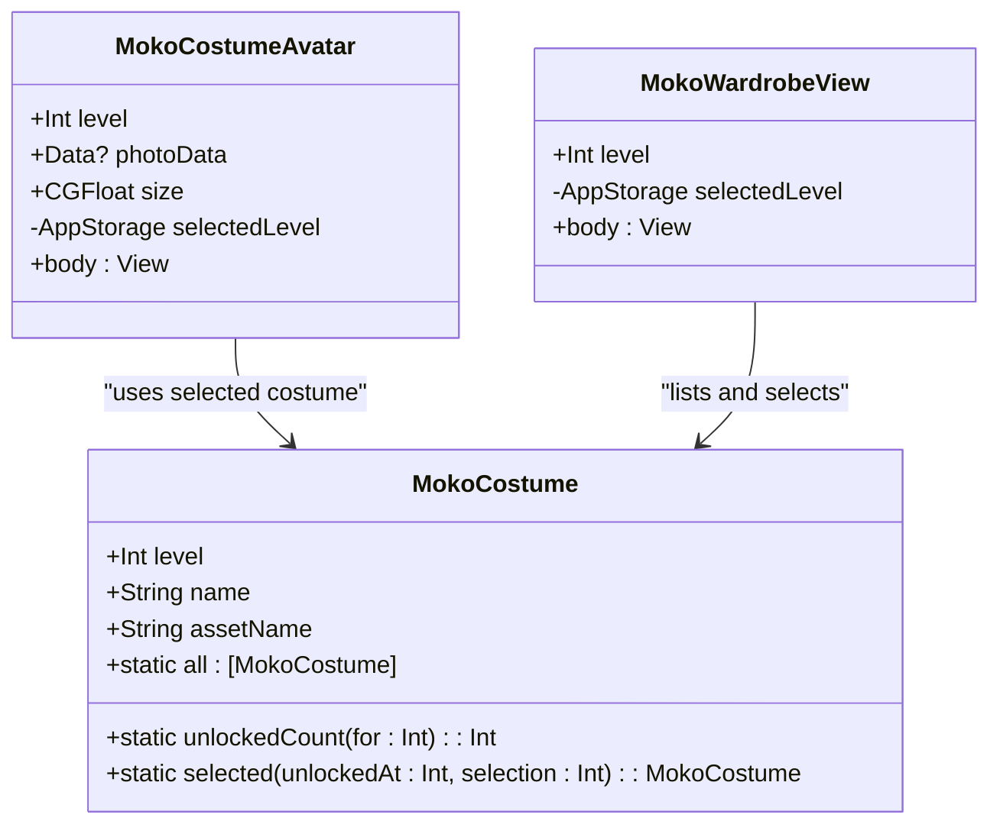

**Diagram sources**
- [MokoCostume.swift:4-143](file://Moko/Moko/UIScreens/homeScreens/ProfileOverView/MokoCostume.swift#L4-L143)

**Section sources**
- [MokoCostume.swift:4-143](file://Moko/Moko/UIScreens/homeScreens/ProfileOverView/MokoCostume.swift#L4-L143)

### Notification Preferences
- Toggles for daily practice reminders, streak at risk, new quests & scenarios, cooldown breathing.
- Permission-aware binding prevents enabling reminders unless iOS grants permission.
- Pre-prompt sheet explains benefits before requesting authorization.
- Redirects to system Settings when denied.

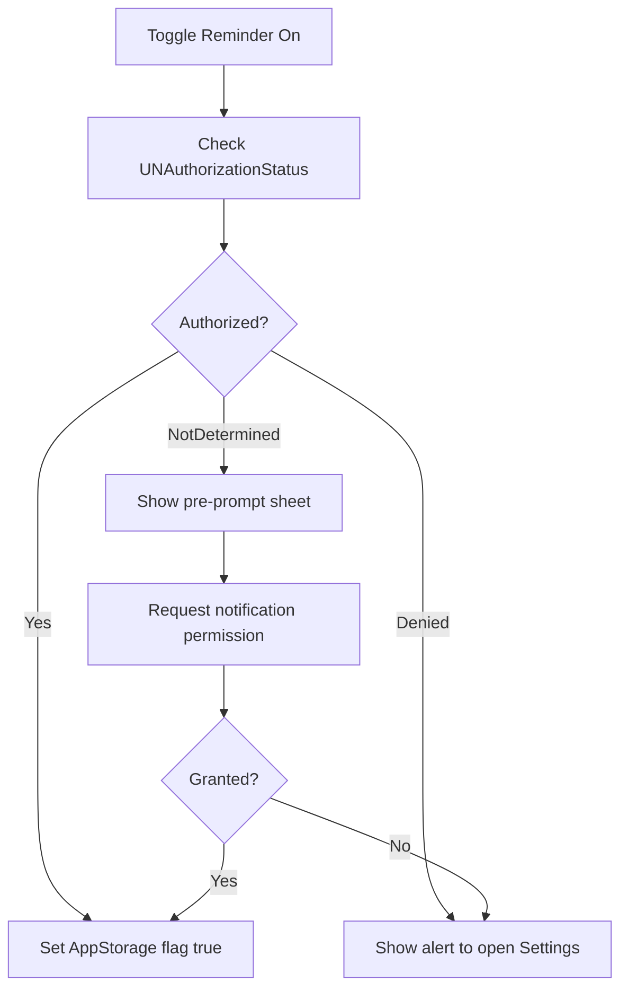

**Diagram sources**
- [Notifications.swift:111-178](file://Moko/Moko/UIScreens/homeScreens/ProfileOverView/Notifications.swift#L111-L178)

**Section sources**
- [Notifications.swift:15-249](file://Moko/Moko/UIScreens/homeScreens/ProfileOverView/Notifications.swift#L15-L249)

### Account Deletion Workflow
- DeleteAccountConfirm explains what will be deleted and requires reauthentication.
- Reauthentication verifies email/password via AuthService.
- DeleteAccountFinalConfirmation performs server-side deletion and clears local SwiftData models, AppStorage keys, and resets app state.

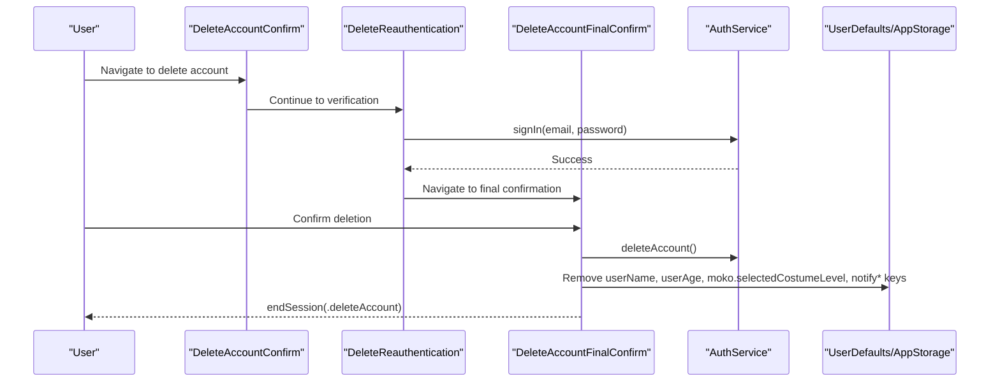

**Diagram sources**
- [DeleteAccountConfirm.swift:4-104](file://Moko/Moko/UIScreens/homeScreens/ProfileOverView/DeleteAccountConfirm.swift#L4-L104)
- [DeleteAccountFinalConfirm.swift:4-79](file://Moko/Moko/UIScreens/homeScreens/ProfileOverView/DeleteAccountFinalConfirm.swift#L4-L79)

**Section sources**
- [DeleteAccountConfirm.swift:4-104](file://Moko/Moko/UIScreens/homeScreens/ProfileOverView/DeleteAccountConfirm.swift#L4-L104)
- [DeleteAccountFinalConfirm.swift:4-79](file://Moko/Moko/UIScreens/homeScreens/ProfileOverView/DeleteAccountFinalConfirm.swift#L4-L79)

## Dependency Analysis
- AchievementsList depends on multiple SwiftData queries: Profile, Quest, CalmDownModel, InsightsModel, OnboardingState.
- QuestProgress reads and writes Profile and InsightsModel, ensuring consistent streak and XP updates.
- AccountAndData composes export JSON from multiple models and interacts with AuthService for sign-out.
- Notifications relies on UserNotifications framework and AppStorage for preference persistence.
- MokoCostume uses AppStorage for selected costume and references static asset names.

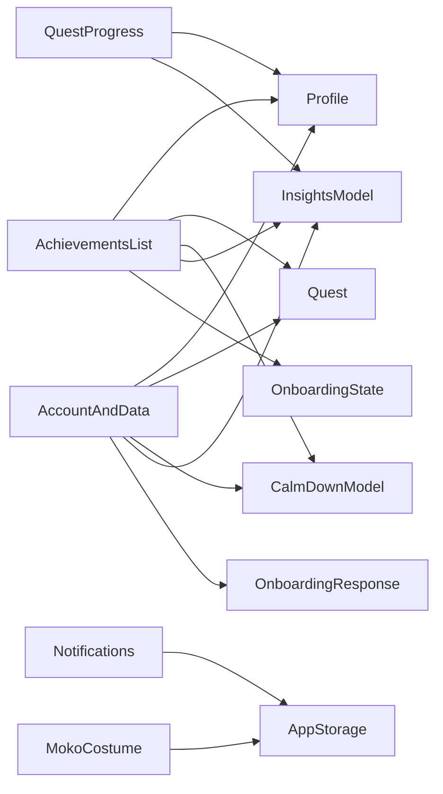

**Diagram sources**
- [AchievementsList.swift:275-286](file://Moko/Moko/UIScreens/homeScreens/ProfileOverView/AchievementsList.swift#L275-L286)
- [QuestProgress.swift:121-139](file://Moko/Moko/Models/QuestProgress.swift#L121-L139)
- [AccountAndData.swift:18-44](file://Moko/Moko/UIScreens/homeScreens/ProfileOverView/AccountAndData.swift#L18-L44)
- [Notifications.swift:22-25](file://Moko/Moko/UIScreens/homeScreens/ProfileOverView/Notifications.swift#L22-L25)
- [MokoCostume.swift:42-44](file://Moko/Moko/UIScreens/homeScreens/ProfileOverView/MokoCostume.swift#L42-L44)

**Section sources**
- [AchievementsList.swift:275-286](file://Moko/Moko/UIScreens/homeScreens/ProfileOverView/AchievementsList.swift#L275-L286)
- [QuestProgress.swift:121-139](file://Moko/Moko/Models/QuestProgress.swift#L121-L139)
- [AccountAndData.swift:18-44](file://Moko/Moko/UIScreens/homeScreens/ProfileOverView/AccountAndData.swift#L18-L44)
- [Notifications.swift:22-25](file://Moko/Moko/UIScreens/homeScreens/ProfileOverView/Notifications.swift#L22-L25)
- [MokoCostume.swift:42-44](file://Moko/Moko/UIScreens/homeScreens/ProfileOverView/MokoCostume.swift#L42-L44)

## Performance Considerations
- Avoid recomputing large achievement catalogs frequently by caching derived values where appropriate.
- Use efficient filtering and grouping for quests and insights; consider indexing by category or date ranges.
- Compress images before storing to reduce storage footprint; ensure JPEG quality balances clarity and size.
- Batch model saves to minimize I/O overhead during bulk operations like account deletion.
- Respect calendar boundaries for streak calculations to avoid off-by-one errors across time zones.

[No sources needed since this section provides general guidance]

## Troubleshooting Guide
- If achievements do not update:
  - Verify that quests are marked completed and have valid dates.
  - Ensure insights and calm sessions are persisted.
  - Confirm onboarding completion state is present.
- If profile edits fail:
  - Check validation messages for required fields and character limits.
  - Inspect ModelContext save errors and network availability if syncing occurs elsewhere.
- If notifications do not trigger:
  - Confirm iOS permission status and redirect to Settings when denied.
  - Validate AppStorage flags match user toggles.
- If account deletion does not clear local data:
  - Ensure server deletion succeeds before clearing SwiftData and AppStorage.
  - Verify endSession callback is invoked to reset app state.

**Section sources**
- [AchievementsList.swift:19-178](file://Moko/Moko/UIScreens/homeScreens/ProfileOverView/AchievementsList.swift#L19-L178)
- [EditProfileSheet.swift:222-244](file://Moko/Moko/UIScreens/homeScreens/ProfileOverView/EditProfileSheet.swift#L222-L244)
- [Notifications.swift:127-178](file://Moko/Moko/UIScreens/homeScreens/ProfileOverView/Notifications.swift#L127-L178)
- [DeleteAccountFinalConfirm.swift:56-77](file://Moko/Moko/UIScreens/homeScreens/ProfileOverView/DeleteAccountFinalConfirm.swift#L56-L77)

## Security and Privacy Compliance
- Sensitive data handling:
  - Profile image data is stored locally via external storage attribute; ensure encryption at rest is configured in the app’s data container.
  - Passwords are handled securely through AuthService; never log or expose credentials.
- Data export:
  - JSON export includes profile, quests, calm sessions, insights, and onboarding responses; users can share it via ShareLink.
  - Consider adding redaction options for sensitive fields and providing downloadable files with consent.
- Privacy controls:
  - Notifications require explicit iOS permission; defaults are off until granted.
  - Account deletion removes service-side data and clears local SwiftData models and AppStorage keys.
- Compliance considerations:
  - Provide clear notices about data collection and retention.
  - Honor right-to-deletion requests promptly and verify identity before irreversible actions.
  - Maintain audit logs for critical operations like account deletion and data export.

**Section sources**
- [Profile.swift:21-22](file://Moko/Moko/Models/Profile.swift#L21-L22)
- [AccountAndData.swift:18-44](file://Moko/Moko/UIScreens/homeScreens/ProfileOverView/AccountAndData.swift#L18-L44)
- [Notifications.swift:22-25](file://Moko/Moko/UIScreens/homeScreens/ProfileOverView/Notifications.swift#L22-L25)
- [DeleteAccountFinalConfirm.swift:56-77](file://Moko/Moko/UIScreens/homeScreens/ProfileOverView/DeleteAccountFinalConfirm.swift#L56-L77)

## Conclusion
Moko’s User Profile Management system combines robust SwiftData models with intuitive SwiftUI interfaces to manage identity, progress, achievements, and privacy. Streak tracking and quest integration drive meaningful engagement, while achievement calculations reflect diverse behaviors across quests, insights, and calm sessions. The system supports secure account operations, comprehensive data export, and thoughtful privacy controls aligned with user expectations and regulatory requirements.

[No sources needed since this section summarizes without analyzing specific files]