# Data Layer

<cite>
**Referenced Files in This Document**
- [Profile.swift](file://Moko/Moko/Models/Profile.swift)
- [InsightsModel.swift](file://Moko/Moko/Models/InsightsModel.swift)
- [CalmDownModel.swift](file://Moko/Moko/Models/CalmDownModel.swift)
- [QuestModels.swift](file://Moko/Moko/Models/QuestModels.swift)
- [QuestLibraryModels.swift](file://Moko/Moko/Models/QuestLibraryModels.swift)
- [OverviewData.swift](file://Moko/Moko/Models/OverviewData.swift)
- [QuestProgress.swift](file://Moko/Moko/Models/QuestProgress.swift)
- [DailyMissionService.swift](file://Moko/Moko/Features/AFM/DailyMissionService.swift)
- [QuestLibraryService.swift](file://Moko/Moko/Features/QuestLibrary/QuestLibraryService.swift)
- [SupabaseManager.swift](file://Moko/Moko/SupabaseManager.swift)
- [20261101120000_create_quest_library.sql](file://supabase/migrations/20261101120000_create_quest_library.sql)
- [20261101130000_add_quest_image_url_and_storage.sql](file://supabase/migrations/20261101130000_add_quest_image_url_and_storage.sql)
- [20261103120000_create_imagery_guides.sql](file://supabase/migrations/20261103120000_create_imagery_guides.sql)
- [20261106120000_remove_imagery_guide_detail_columns.sql](file://supabase/migrations/20261106120000_remove_imagery_guide_detail_columns.sql)
- [20261106130000_add_imagery_guide_audio_url.sql](file://supabase/migrations/20261106130000_add_imagery_guide_audio_url.sql)
</cite>

## Table of Contents
1. [Introduction](#introduction)
2. [Project Structure](#project-structure)
3. [Core Components](#core-components)
4. [Architecture Overview](#architecture-overview)
5. [Detailed Component Analysis](#detailed-component-analysis)
6. [Dependency Analysis](#dependency-analysis)
7. [Performance Considerations](#performance-considerations)
8. [Troubleshooting Guide](#troubleshooting-guide)
9. [Conclusion](#conclusion)
10. [Appendices](#appendices)

## Introduction
This document describes Moko’s data layer, focusing on SwiftData models and Supabase-backed content. It explains the local data model (Profile, InsightsModel, CalmDownModel, Quest), cloud content schema (quest library and imagery guides), persistence strategies, synchronization boundaries, migration handling, seed data, query patterns, caching, lifecycle management, privacy controls, security considerations, and common CRUD operations.

## Project Structure
The data layer is split into:
- Local persistence with SwiftData for user-owned activity and progress
- Cloud content via Supabase for read-only library and imagery guides
- Services that orchestrate queries, updates, and UI state

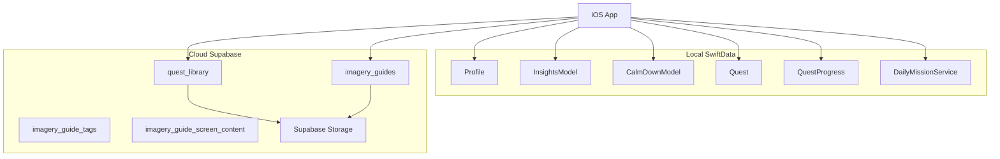

**Diagram sources**
- [Profile.swift:12-59](file://Moko/Moko/Models/Profile.swift#L12-L59)
- [InsightsModel.swift:11-26](file://Moko/Moko/Models/InsightsModel.swift#L11-L26)
- [CalmDownModel.swift:12-37](file://Moko/Moko/Models/CalmDownModel.swift#L12-L37)
- [QuestModels.swift:51-166](file://Moko/Moko/Models/QuestModels.swift#L51-L166)
- [QuestProgress.swift:17-139](file://Moko/Moko/Models/QuestProgress.swift#L17-L139)
- [DailyMissionService.swift:19-307](file://Moko/Moko/Features/AFM/DailyMissionService.swift#L19-L307)
- [20261101120000_create_quest_library.sql:6-41](file://supabase/migrations/20261101120000_create_quest_library.sql#L6-L41)
- [20261103120000_create_imagery_guides.sql:7-47](file://supabase/migrations/20261103120000_create_imagery_guides.sql#L7-L47)

**Section sources**
- [Profile.swift:12-59](file://Moko/Moko/Models/Profile.swift#L12-L59)
- [QuestModels.swift:51-166](file://Moko/Moko/Models/QuestModels.swift#L51-L166)
- [20261101120000_create_quest_library.sql:6-41](file://supabase/migrations/20261101120000_create_quest_library.sql#L6-L41)
- [20261103120000_create_imagery_guides.sql:7-47](file://supabase/migrations/20261103120000_create_imagery_guides.sql#L7-L47)

## Core Components
- Profile: User profile with identity, growth metrics, streaks, and last activity timestamp. Image data is stored externally to keep the model lightweight.
- InsightsModel: Daily emotional scores used for analytics and adaptive mission selection.
- CalmDownModel: Records of completed relaxation exercises with duration and date.
- Quest: User-owned quests with scheduling, completion, debriefing, and XP/streak integration.
- Library content: Read-only quest library and imagery guides served from Supabase.

Key responsibilities:
- Local persistence and updates: Profile, InsightsModel, CalmDownModel, Quest
- Content delivery: QuestLibraryService and related models
- Orchestration: DailyMissionService and QuestProgress

**Section sources**
- [Profile.swift:12-59](file://Moko/Moko/Models/Profile.swift#L12-L59)
- [InsightsModel.swift:11-26](file://Moko/Moko/Models/InsightsModel.swift#L11-L26)
- [CalmDownModel.swift:12-37](file://Moko/Moko/Models/CalmDownModel.swift#L12-L37)
- [QuestModels.swift:51-166](file://Moko/Moko/Models/QuestModels.swift#L51-L166)
- [QuestLibraryModels.swift:12-83](file://Moko/Moko/Models/QuestLibraryModels.swift#L12-L83)
- [QuestLibraryService.swift:13-32](file://Moko/Moko/Features/QuestLibrary/QuestLibraryService.swift#L13-L32)

## Architecture Overview
Moko uses a hybrid architecture:
- Local-first: SwiftData stores user activity and progress.
- Cloud-backed content: Supabase serves read-only library and imagery content.
- Sync boundary: The app does not write user activity to Supabase; it reads content and writes local records only.

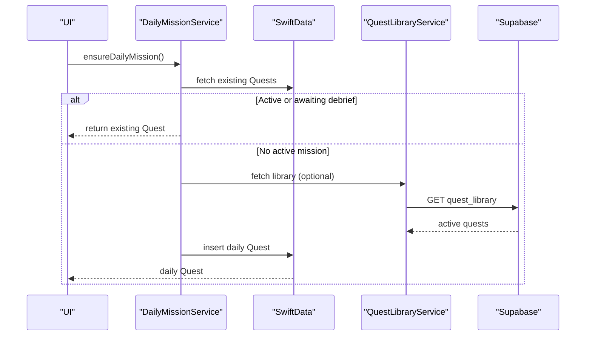

**Diagram sources**
- [DailyMissionService.swift:129-224](file://Moko/Moko/Features/AFM/DailyMissionService.swift#L129-L224)
- [QuestLibraryService.swift:20-31](file://Moko/Moko/Features/QuestLibrary/QuestLibraryService.swift#L20-L31)
- [QuestModels.swift:151-166](file://Moko/Moko/Models/QuestModels.swift#L151-L166)

## Detailed Component Analysis

### SwiftData Models

#### Profile
- Purpose: Stores user identity, growth metrics (XP), streaks, and timestamps.
- Constraints and validation:
  - userID defaults to UUID
  - profileImageData marked external storage
  - Numeric fields default to zero where appropriate
- Relationships:
  - Updated by QuestProgress when completing quests
  - Used to compute next streak and longest streak

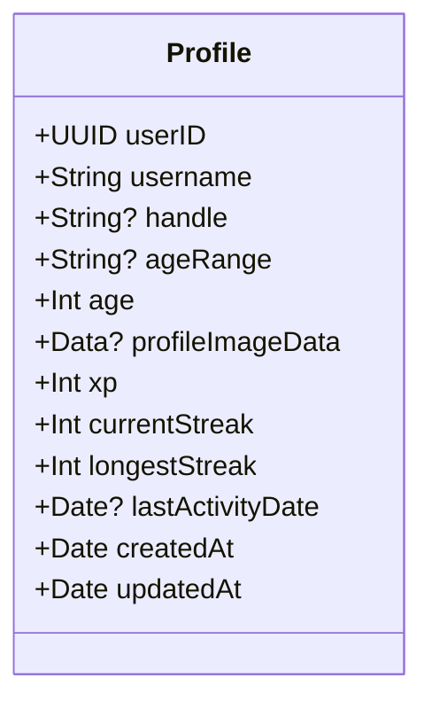

**Diagram sources**
- [Profile.swift:12-59](file://Moko/Moko/Models/Profile.swift#L12-L59)

**Section sources**
- [Profile.swift:12-59](file://Moko/Moko/Models/Profile.swift#L12-L59)

#### InsightsModel
- Purpose: Captures daily emotional scores (courage, clarity, presence, warmth).
- Usage:
  - Aggregated for overview insights
  - Used by DailyMissionService to target lowest-scored parameter

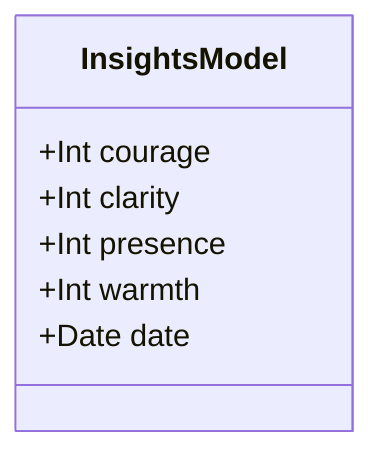

**Diagram sources**
- [InsightsModel.swift:11-26](file://Moko/Moko/Models/InsightsModel.swift#L11-L26)

**Section sources**
- [InsightsModel.swift:11-26](file://Moko/Moko/Models/InsightsModel.swift#L11-L26)
- [DailyMissionService.swift:39-58](file://Moko/Moko/Features/AFM/DailyMissionService.swift#L39-L58)

#### CalmDownModel
- Purpose: Logs completed calm-down sessions with title, duration, and date.
- Persistence helper: ModelContext extension logs and saves entries.

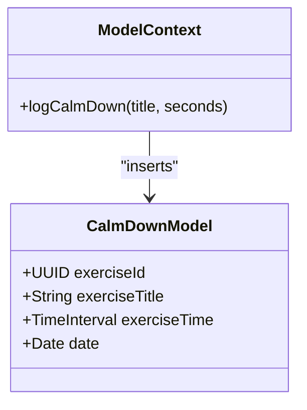

**Diagram sources**
- [CalmDownModel.swift:12-37](file://Moko/Moko/Models/CalmDownModel.swift#L12-L37)

**Section sources**
- [CalmDownModel.swift:12-37](file://Moko/Moko/Models/CalmDownModel.swift#L12-L37)

#### Quest
- Purpose: Represents user-owned quests with scheduling, completion, debriefing, and XP awards.
- Key attributes:
  - Unique id, ownerID, title, notes
  - Intensity and category enums
  - Scheduled date, creation time
  - Completion flags and timestamps
  - Optional explicit XP for library-derived quests
- Behavior:
  - overviewMission selects the most relevant quest for the Overview screen
  - CurrentUser provides device-scoped identity
  - MokoDatabase configures SwiftData container

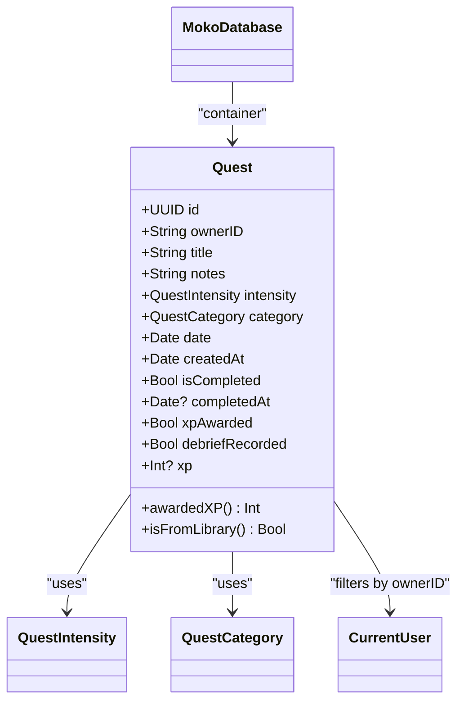

**Diagram sources**
- [QuestModels.swift:13-48](file://Moko/Moko/Models/QuestModels.swift#L13-L48)
- [QuestModels.swift:51-166](file://Moko/Moko/Models/QuestModels.swift#L51-L166)

**Section sources**
- [QuestModels.swift:13-48](file://Moko/Moko/Models/QuestModels.swift#L13-L48)
- [QuestModels.swift:51-166](file://Moko/Moko/Models/QuestModels.swift#L51-L166)

#### Library Models (Read-only)
- LibraryQuest: Decodes rows from quest_library table, maps XP to intensity, resolves tint color, and builds asset URLs.
- QuestSection: Groups quests by category while preserving server order.

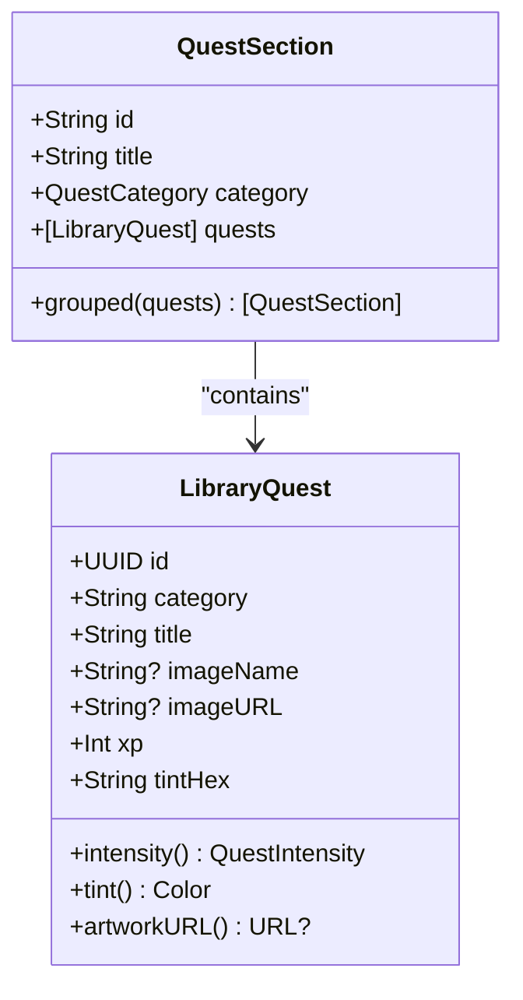

**Diagram sources**
- [QuestLibraryModels.swift:12-83](file://Moko/Moko/Models/QuestLibraryModels.swift#L12-L83)

**Section sources**
- [QuestLibraryModels.swift:12-83](file://Moko/Moko/Models/QuestLibraryModels.swift#L12-L83)

### Data Flow and Processing Logic

#### Overview Data Computation
Aggregates today’s insights average and calm-down minutes across the last six days.

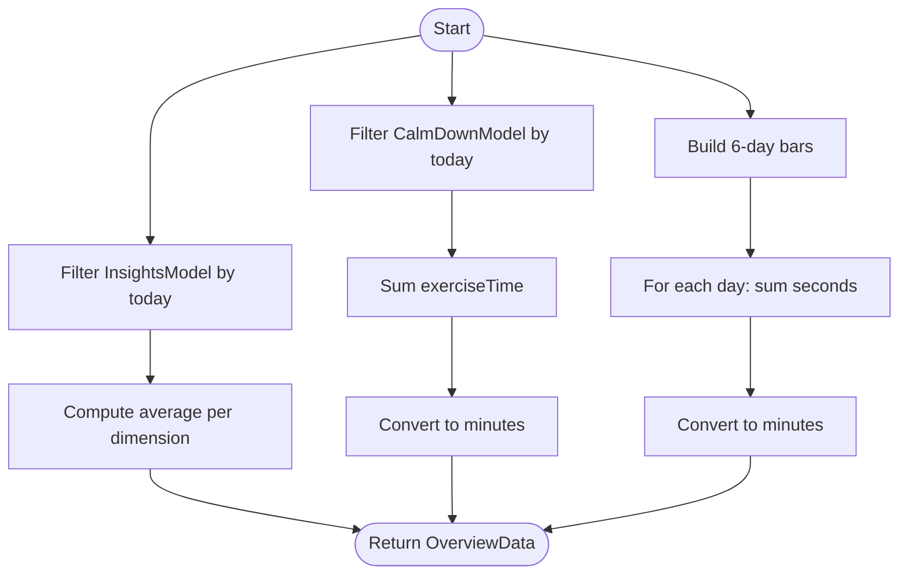

**Diagram sources**
- [OverviewData.swift:11-42](file://Moko/Moko/Models/OverviewData.swift#L11-L42)

**Section sources**
- [OverviewData.swift:11-42](file://Moko/Moko/Models/OverviewData.swift#L11-L42)

#### Quest Completion and Debrief
Ensures one-time XP award, streak update, and optional Insights recording.

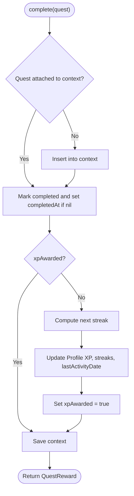

**Diagram sources**
- [QuestProgress.swift:49-83](file://Moko/Moko/Models/QuestProgress.swift#L49-L83)

**Section sources**
- [QuestProgress.swift:49-83](file://Moko/Moko/Models/QuestProgress.swift#L49-L83)

#### Daily Mission Selection
Determines the featured mission based on existing quests, upcoming custom quests, and lowest-scored insight parameter.

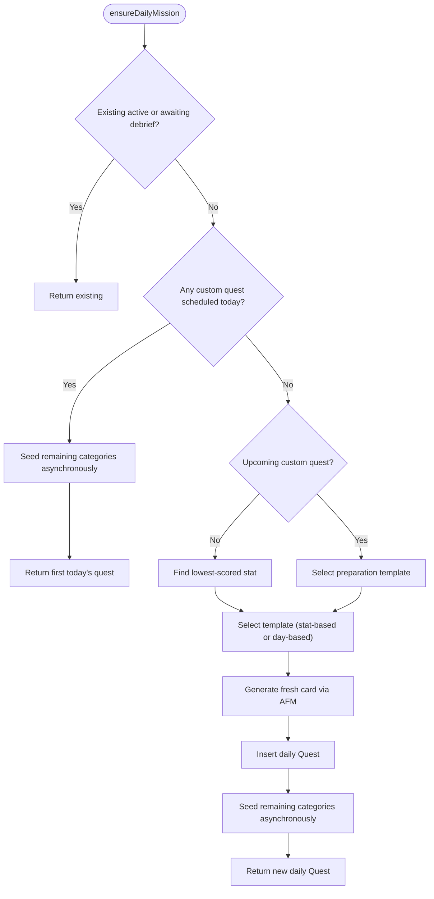

**Diagram sources**
- [DailyMissionService.swift:129-224](file://Moko/Moko/Features/AFM/DailyMissionService.swift#L129-L224)

**Section sources**
- [DailyMissionService.swift:129-224](file://Moko/Moko/Features/AFM/DailyMissionService.swift#L129-L224)

### Database Schema Design (Supabase)

#### Quest Library
- Table: public.quest_library
- Columns include category, sort orders, title, image_name, xp, tint_hex, sort_order, is_active, timestamps
- Constraints:
  - Primary key on id
  - Unique constraint on (category, title)
  - Check constraint ensuring xp > 0
- Index:
  - quest_library_order_idx on (category_sort_order, category, sort_order)
- Security:
  - Row-level security enabled
  - Public read policy filtered by is_active = true
  - Write access restricted to service role

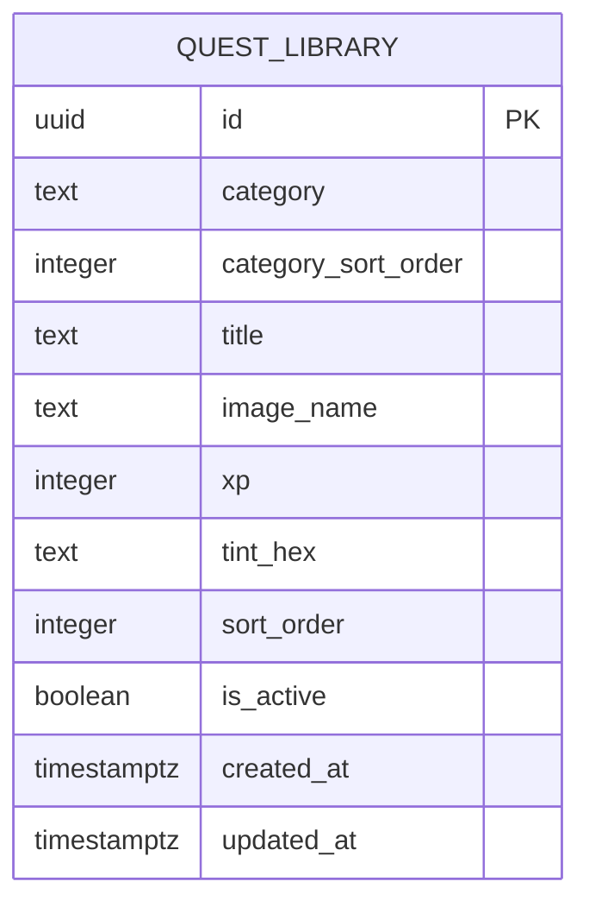

**Diagram sources**
- [20261101120000_create_quest_library.sql:6-41](file://supabase/migrations/20261101120000_create_quest_library.sql#L6-L41)

**Section sources**
- [20261101120000_create_quest_library.sql:6-41](file://supabase/migrations/20261101120000_create_quest_library.sql#L6-L41)

#### Imagery Guides
- Tables:
  - imagery_guide_tags: filter chips with icon, sort order, active flag
  - imagery_guides: guide cards with metadata, media URLs, steps JSONB, duration, sort order, active flag
  - imagery_guide_screen_content: shared labels and copy for the imagery feature
- Constraints:
  - imagery_guides.tag references imagery_guide_tags.title
  - imagery_guides.duration_seconds > 0
  - imagery_guide_screen_content.id fixed to 1
- Index:
  - imagery_guides_order_idx on sort_order
- Security:
  - Row-level security enabled on all three tables
  - Public read policies filtered by is_active where applicable
  - Storage buckets configured for images and audio

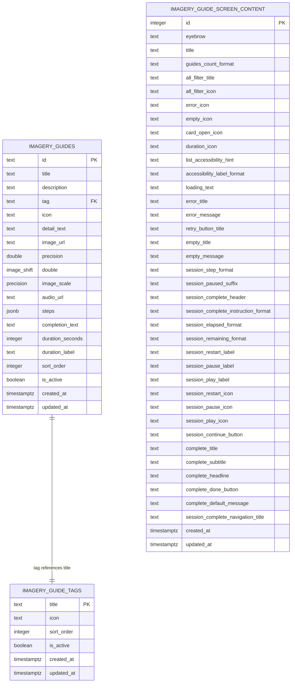

**Diagram sources**
- [20261103120000_create_imagery_guides.sql:7-47](file://supabase/migrations/20261103120000_create_imagery_guides.sql#L7-L47)
- [20261103120000_create_imagery_guides.sql:65-105](file://supabase/migrations/20261103120000_create_imagery_guides.sql#L65-L105)

**Section sources**
- [20261103120000_create_imagery_guides.sql:7-47](file://supabase/migrations/20261103120000_create_imagery_guides.sql#L7-L47)
- [20261103120000_create_imagery_guides.sql:65-105](file://supabase/migrations/20261103120000_create_imagery_guides.sql#L65-L105)

### Data Persistence Strategies

- Local storage (SwiftData):
  - Container configuration via MokoDatabase for production and preview contexts
  - Models: Profile, InsightsModel, CalmDownModel, Quest
  - Context save operations are wrapped with error logging
- Cloud synchronization:
  - Supabase client initialized via SupabaseManager
  - Read-only access to quest_library and imagery guides
  - No write path from iOS to Supabase for user activity

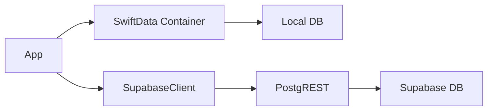

**Diagram sources**
- [QuestModels.swift:151-166](file://Moko/Moko/Models/QuestModels.swift#L151-L166)
- [SupabaseManager.swift:6-19](file://Moko/Moko/SupabaseManager.swift#L6-L19)
- [QuestLibraryService.swift:13-32](file://Moko/Moko/Features/QuestLibrary/QuestLibraryService.swift#L13-L32)

**Section sources**
- [QuestModels.swift:151-166](file://Moko/Moko/Models/QuestModels.swift#L151-L166)
- [SupabaseManager.swift:6-19](file://Moko/Moko/SupabaseManager.swift#L6-L19)
- [QuestLibraryService.swift:13-32](file://Moko/Moko/Features/QuestLibrary/QuestLibraryService.swift#L13-L32)

### Data Migration Handling
- Server-side migrations:
  - Create and alter tables for quest library and imagery guides
  - Add/remove columns over time (e.g., image_url, audio_url, removal of unused columns)
  - Enable row-level security and define policies for read/write access
  - Create indexes for ordering and performance
- Client-side considerations:
  - SwiftData models evolve independently; no explicit migration code present
  - Default values and nullable fields help tolerate schema drift

**Section sources**
- [20261101120000_create_quest_library.sql:6-78](file://supabase/migrations/20261101120000_create_quest_library.sql#L6-L78)
- [20261101130000_add_quest_image_url_and_storage.sql:6-35](file://supabase/migrations/20261101130000_add_quest_image_url_and_storage.sql#L6-L35)
- [20261103120000_create_imagery_guides.sql:7-206](file://supabase/migrations/20261103120000_create_imagery_guides.sql#L7-L206)
- [20261106120000_remove_imagery_guide_detail_columns.sql:4-9](file://supabase/migrations/20261106120000_remove_imagery_guide_detail_columns.sql#L4-L9)
- [20261106130000_add_imagery_guide_audio_url.sql:4-10](file://supabase/migrations/20261106130000_add_imagery_guide_audio_url.sql#L4-L10)

### Seed Data Management
- Server-side seed:
  - Imagery guides seed file exists at supabase/imagery_guides_seed.sql
- Client-side seeding:
  - DailyMissionService seeds daily missions and variety quests locally
  - Uses MissionBank templates and AFM to generate content

**Section sources**
- [DailyMissionService.swift:129-224](file://Moko/Moko/Features/AFM/DailyMissionService.swift#L129-L224)
- [DailyMissionService.swift:231-273](file://Moko/Moko/Features/AFM/DailyMissionService.swift#L231-L273)

### Query Optimization Techniques
- Server-side:
  - Indexes on ordering columns (category_sort_order, category, sort_order; sort_order for imagery guides)
  - Row-level security filters reduce payload size by returning only active rows
- Client-side:
  - FetchDescriptor sorts by date for insights aggregation
  - Grouping logic in QuestSection preserves server-defined order

**Section sources**
- [20261101120000_create_quest_library.sql:40-41](file://supabase/migrations/20261101120000_create_quest_library.sql#L40-L41)
- [20261103120000_create_imagery_guides.sql:143-144](file://supabase/migrations/20261103120000_create_imagery_guides.sql#L143-L144)
- [DailyMissionService.swift:39-58](file://Moko/Moko/Features/AFM/DailyMissionService.swift#L39-L58)
- [QuestLibraryModels.swift:64-82](file://Moko/Moko/Models/QuestLibraryModels.swift#L64-L82)

### Data Access Patterns and Caching
- SwiftData access:
  - Direct inserts and updates via ModelContext
  - Convenience methods like logCalmDown encapsulate persistence
- Supabase access:
  - QuestLibraryService fetches active quests once per session with a simple load guard
  - Store maintains isLoading, errorMessage, and hasAttemptedLoad to control UI states

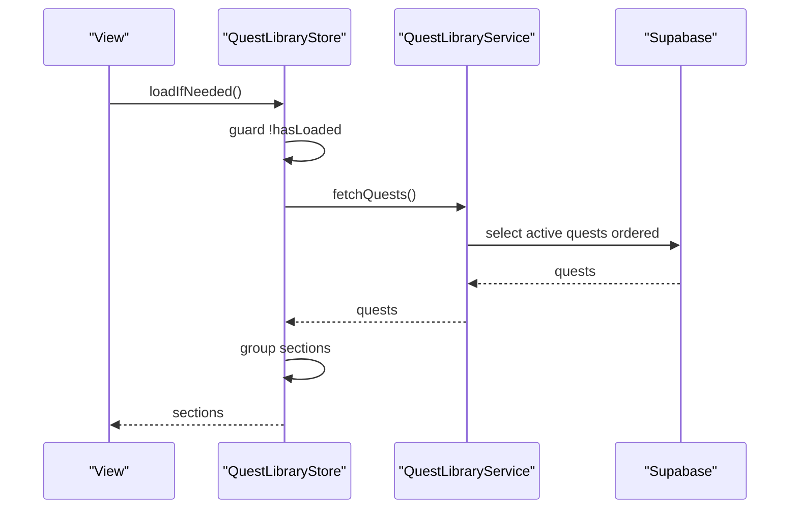

**Diagram sources**
- [QuestLibraryService.swift:50-81](file://Moko/Moko/Features/QuestLibrary/QuestLibraryService.swift#L50-L81)

**Section sources**
- [CalmDownModel.swift:27-37](file://Moko/Moko/Models/CalmDownModel.swift#L27-L37)
- [QuestLibraryService.swift:50-81](file://Moko/Moko/Features/QuestLibrary/QuestLibraryService.swift#L50-L81)

### Performance Considerations
- Local:
  - Batch updates within a single context save to minimize disk writes
  - Avoid heavy computations on main thread; use background tasks where possible
- Cloud:
  - Leverage server-side filtering (is_active) and indexes to reduce network payloads
  - Cache library content per session to avoid repeated network calls

[No sources needed since this section provides general guidance]

### Data Lifecycle Management, Retention Policies, and Privacy Controls
- Lifecycle:
  - Profiles auto-created on first progress update
  - Quests persist until user deletes account or clears app data
  - Insights and CalmDown records accumulate indefinitely unless explicitly removed
- Retention:
  - No automatic purging logic found in the codebase
- Privacy controls:
  - Profile image data stored externally
  - Device-local user ID persisted in UserDefaults for quest ownership

**Section sources**
- [QuestProgress.swift:121-129](file://Moko/Moko/Models/QuestProgress.swift#L121-L129)
- [Profile.swift:21-22](file://Moko/Moko/Models/Profile.swift#L21-L22)
- [QuestModels.swift:133-149](file://Moko/Moko/Models/QuestModels.swift#L133-L149)

### Data Security Measures and Compliance
- Network security:
  - Supabase client configured with URL and publishable key
- Row-level security:
  - Read policies restrict to active content
  - Write access limited to service role
- Storage policies:
  - Public read access for specific buckets (quest-library, imagery-guide)
  - Allowed MIME types constrained for uploads

**Section sources**
- [SupabaseManager.swift:6-19](file://Moko/Moko/SupabaseManager.swift#L6-L19)
- [20261101120000_create_quest_library.sql:62-74](file://supabase/migrations/20261101120000_create_quest_library.sql#L62-L74)
- [20261101130000_add_quest_image_url_and_storage.sql:12-32](file://supabase/migrations/20261101130000_add_quest_image_url_and_storage.sql#L12-L32)
- [20261103120000_create_imagery_guides.sql:146-202](file://supabase/migrations/20261103120000_create_imagery_guides.sql#L146-L202)

### Common Data Operations and CRUD Patterns

#### Create
- Create a new CalmDown record:
  - Use ModelContext.logCalmDown(title, seconds)
- Create a new Quest:
  - Instantiate Quest with required fields and insert via ModelContext

**Section sources**
- [CalmDownModel.swift:27-37](file://Moko/Moko/Models/CalmDownModel.swift#L27-L37)
- [QuestModels.swift:79-99](file://Moko/Moko/Models/QuestModels.swift#L79-L99)

#### Read
- Fetch Insights and CalmDown for overview:
  - Aggregate using OverviewData
- Fetch library quests:
  - QuestLibraryStore.load() -> QuestLibraryService.fetchQuests()

**Section sources**
- [OverviewData.swift:11-42](file://Moko/Moko/Models/OverviewData.swift#L11-L42)
- [QuestLibraryService.swift:20-31](file://Moko/Moko/Features/QuestLibrary/QuestLibraryService.swift#L20-L31)

#### Update
- Complete a quest and apply rewards:
  - QuestProgress.complete(quest, context)
- Record debrief and create Insights:
  - QuestProgress.saveDebrief(result, quest, context)

**Section sources**
- [QuestProgress.swift:49-83](file://Moko/Moko/Models/QuestProgress.swift#L49-L83)
- [QuestProgress.swift:85-119](file://Moko/Moko/Models/QuestProgress.swift#L85-L119)

#### Delete
- No explicit delete operations found in the analyzed files
- Account deletion flows exist in UI screens but are not part of the data model analysis here

[No sources needed since this section summarizes without analyzing specific files]

## Dependency Analysis

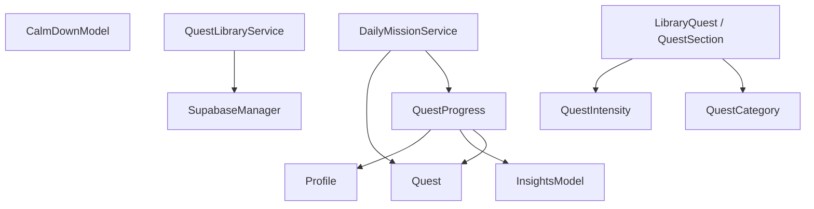

**Diagram sources**
- [QuestProgress.swift:17-139](file://Moko/Moko/Models/QuestProgress.swift#L17-L139)
- [DailyMissionService.swift:19-307](file://Moko/Moko/Features/AFM/DailyMissionService.swift#L19-L307)
- [QuestLibraryService.swift:13-32](file://Moko/Moko/Features/QuestLibrary/QuestLibraryService.swift#L13-L32)
- [QuestLibraryModels.swift:12-83](file://Moko/Moko/Models/QuestLibraryModels.swift#L12-L83)
- [SupabaseManager.swift:6-19](file://Moko/Moko/SupabaseManager.swift#L6-L19)

**Section sources**
- [QuestProgress.swift:17-139](file://Moko/Moko/Models/QuestProgress.swift#L17-L139)
- [DailyMissionService.swift:19-307](file://Moko/Moko/Features/AFM/DailyMissionService.swift#L19-L307)
- [QuestLibraryService.swift:13-32](file://Moko/Moko/Features/QuestLibrary/QuestLibraryService.swift#L13-L32)
- [QuestLibraryModels.swift:12-83](file://Moko/Moko/Models/QuestLibraryModels.swift#L12-L83)
- [SupabaseManager.swift:6-19](file://Moko/Moko/SupabaseManager.swift#L6-L19)

## Performance Considerations
- Prefer batched context saves to reduce I/O overhead
- Use server-side filters and indexes to minimize network transfer
- Cache library content per session to avoid redundant requests
- Avoid heavy computation on the main thread; offload to background tasks

[No sources needed since this section provides general guidance]

## Troubleshooting Guide
- SwiftData save failures:
  - Inspect print statements around save operations in CalmDownModel and QuestProgress
- Supabase connectivity issues:
  - Verify SupabaseManager configuration and network availability
  - Check RLS policies and bucket permissions if assets fail to load

**Section sources**
- [CalmDownModel.swift:31-35](file://Moko/Moko/Models/CalmDownModel.swift#L31-L35)
- [QuestProgress.swift:131-137](file://Moko/Moko/Models/QuestProgress.swift#L131-L137)
- [SupabaseManager.swift:6-19](file://Moko/Moko/SupabaseManager.swift#L6-L19)

## Conclusion
Moko’s data layer combines robust local persistence with reliable cloud-backed content. SwiftData models capture user activity and progress, while Supabase delivers curated, secure, and indexed content. The design emphasizes clear separation of concerns, efficient querying, and safe defaults. Future enhancements could include explicit retention policies, encrypted local storage, and bidirectional sync for user-generated content.

[No sources needed since this section summarizes without analyzing specific files]

## Appendices

### Example Workflows

#### Creating and Completing a Quest
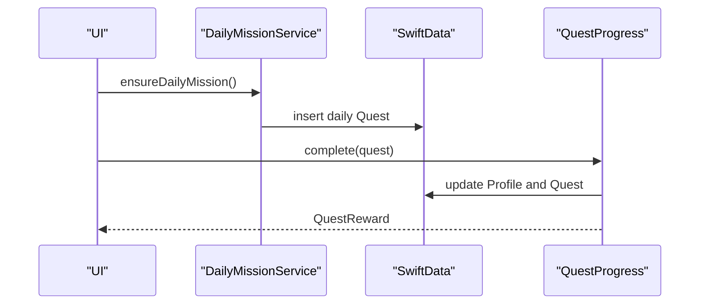

**Diagram sources**
- [DailyMissionService.swift:129-224](file://Moko/Moko/Features/AFM/DailyMissionService.swift#L129-L224)
- [QuestProgress.swift:49-83](file://Moko/Moko/Models/QuestProgress.swift#L49-L83)