# Data Persistence

<cite>
**Referenced Files in This Document**
- [MokoApp.swift](file://Moko/Moko/MokoApp.swift)
- [QuestModels.swift](file://Moko/Moko/Models/QuestModels.swift)
- [Profile.swift](file://Moko/Moko/Models/Profile.swift)
- [InsightsModel.swift](file://Moko/Moko/Models/InsightsModel.swift)
- [QuestProgress.swift](file://Moko/Moko/Models/QuestProgress.swift)
- [DailyMissionService.swift](file://Moko/Moko/Features/AFM/DailyMissionService.swift)
- [SupabaseManager.swift](file://Moko/Moko/SupabaseManager.swift)
- [AuthService.swift](file://Moko/Moko/AuthService.swift)
- [GoogleAuthService.swift](file://Moko/Moko/GoogleAuthService.swift)
- [QuestLibraryService.swift](file://Moko/Moko/Features/QuestLibrary/QuestLibraryService.swift)
</cite>

## Table of Contents
1. [Introduction](#introduction)
2. [Project Structure](#project-structure)
3. [Core Components](#core-components)
4. [Architecture Overview](#architecture-overview)
5. [Detailed Component Analysis](#detailed-component-analysis)
6. [Dependency Analysis](#dependency-analysis)
7. [Performance Considerations](#performance-considerations)
8. [Troubleshooting Guide](#troubleshooting-guide)
9. [Conclusion](#conclusion)

## Introduction
This document explains Moko’s hybrid data persistence architecture. It covers:
- SwiftData local storage configuration, model registration, and transaction handling.
- Supabase cloud integration for authentication and library content retrieval.
- Service-layer abstractions through `SupabaseManager`, `AuthService`, `GoogleAuthService`, `QuestLibraryService`, and `DailyMissionService`.
- Error handling, retry behavior, and consistency guarantees.
- Performance optimizations such as batching, caching, and memory management.
- Common persistence patterns for create, read, update, delete, and complex queries.
- Data lifecycle from creation to archival or deletion.

The application uses an offline-first approach: user-generated quests, profile state, streaks, XP, and debrief insights are persisted locally with SwiftData. Cloud features include authentication via Supabase and fetching the curated Quest Library from a Supabase table.

## Project Structure
The persistence-related code is organized around:
- App-level SwiftData container setup.
- Domain models for quests, profile, and insights.
- Services that orchestrate local data operations and cloud interactions.
- A shared Supabase client wrapper.

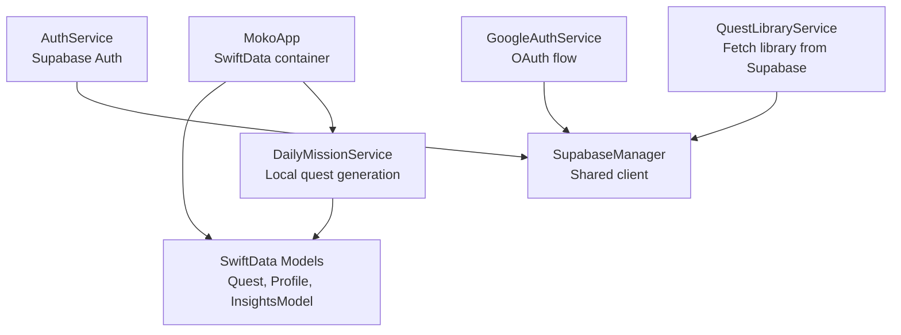

**Diagram sources**
- [MokoApp.swift:31-44](file://Moko/Moko/MokoApp.swift#L31-L44)
- [QuestModels.swift:50-166](file://Moko/Moko/Models/QuestModels.swift#L50-L166)
- [DailyMissionService.swift:17-225](file://Moko/Moko/Features/AFM/DailyMissionService.swift#L17-L225)
- [AuthService.swift:15-58](file://Moko/Moko/AuthService.swift#L15-L58)
- [GoogleAuthService.swift:8-60](file://Moko/Moko/GoogleAuthService.swift#L8-L60)
- [QuestLibraryService.swift:13-31](file://Moko/Moko/Features/QuestLibrary/QuestLibraryService.swift#L13-L31)
- [SupabaseManager.swift:6-19](file://Moko/Moko/SupabaseManager.swift#L6-L19)

**Section sources**
- [MokoApp.swift:31-44](file://Moko/Moko/MokoApp.swift#L31-L44)
- [QuestModels.swift:50-166](file://Moko/Moko/Models/QuestModels.swift#L50-L166)
- [DailyMissionService.swift:17-225](file://Moko/Moko/Features/AFM/DailyMissionService.swift#L17-L225)
- [AuthService.swift:15-58](file://Moko/Moko/AuthService.swift#L15-L58)
- [GoogleAuthService.swift:8-60](file://Moko/Moko/GoogleAuthService.swift#L8-L60)
- [QuestLibraryService.swift:13-31](file://Moko/Moko/Features/QuestLibrary/QuestLibraryService.swift#L13-L31)
- [SupabaseManager.swift:6-19](file://Moko/Moko/SupabaseManager.swift#L6-L19)

## Core Components
- SwiftData container and models:
  - Container configured at app launch with registered models.
  - Models include `Quest`, `Profile`, `InsightsModel`, plus onboarding and calm-down models.
- Service layer:
  - `DailyMissionService` orchestrates daily mission selection and local persistence.
  - `QuestLibraryService` fetches curated library content from Supabase.
  - `AuthService` and `GoogleAuthService` manage authentication flows using Supabase.
  - `SupabaseManager` provides a singleton client instance.

Key responsibilities:
- Local persistence: Create, update, and query quests; maintain profile and insights; compute streaks and XP.
- Cloud synchronization: Authenticate users; retrieve library content; call edge functions for account deletion.
- Offline-first UX: Provide fallback missions and ensure UI never shows empty placeholders.

**Section sources**
- [MokoApp.swift:31-44](file://Moko/Moko/MokoApp.swift#L31-L44)
- [QuestModels.swift:50-166](file://Moko/Moko/Models/QuestModels.swift#L50-L166)
- [DailyMissionService.swift:17-225](file://Moko/Moko/Features/AFM/DailyMissionService.swift#L17-L225)
- [QuestLibraryService.swift:13-31](file://Moko/Moko/Features/QuestLibrary/QuestLibraryService.swift#L13-L31)
- [AuthService.swift:15-58](file://Moko/Moko/AuthService.swift#L15-L58)
- [GoogleAuthService.swift:8-60](file://Moko/Moko/GoogleAuthService.swift#L8-L60)
- [SupabaseManager.swift:6-19](file://Moko/Moko/SupabaseManager.swift#L6-L19)

## Architecture Overview
Moko implements a hybrid persistence strategy:
- Local-first: All user-generated data (quests, profile, insights) is stored in SwiftData.
- Cloud-backed: Authentication and curated library content are fetched from Supabase.
- Service abstraction: Each domain area has a service that encapsulates data operations and cloud calls.

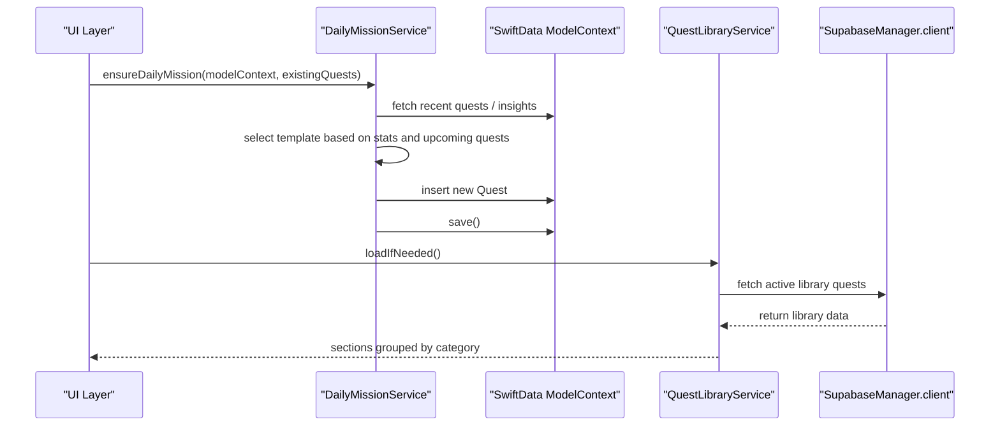

**Diagram sources**
- [DailyMissionService.swift:127-225](file://Moko/Moko/Features/AFM/DailyMissionService.swift#L127-L225)
- [QuestLibraryService.swift:20-31](file://Moko/Moko/Features/QuestLibrary/QuestLibraryService.swift#L20-L31)
- [SupabaseManager.swift:6-19](file://Moko/Moko/SupabaseManager.swift#L6-L19)

## Detailed Component Analysis

### SwiftData Local Storage Configuration
- Container registration:
  - The app registers all persistent models in the main window group.
  - Models include onboarding state, profile, calm-down data, quests, and insights.
- Preview support:
  - A separate preview container is provided for Xcode previews.

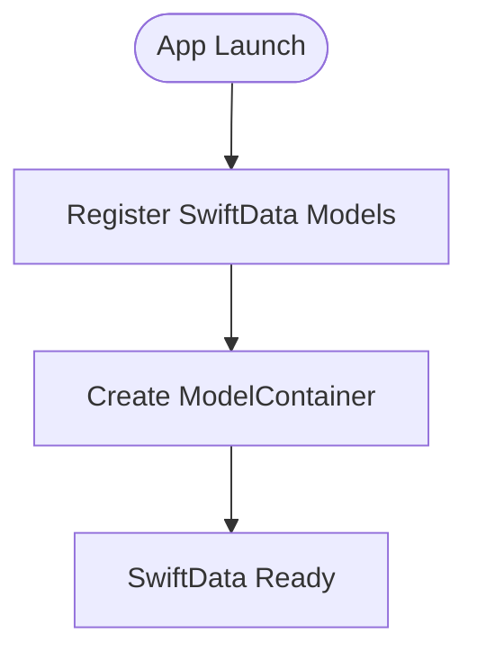

**Diagram sources**
- [MokoApp.swift:31-44](file://Moko/Moko/MokoApp.swift#L31-L44)
- [QuestModels.swift:151-166](file://Moko/Moko/Models/QuestModels.swift#L151-L166)

**Section sources**
- [MokoApp.swift:31-44](file://Moko/Moko/MokoApp.swift#L31-L44)
- [QuestModels.swift:151-166](file://Moko/Moko/Models/QuestModels.swift#L151-L166)

### SwiftData Models
- Quest:
  - Represents a user-owned task with metadata including intensity, category, scheduling, completion flags, and XP tracking.
  - Includes helper logic to determine the overview mission and whether it originates from the library.
- Profile:
  - Stores user identity fields, external image data, XP, streaks, and timestamps.
- InsightsModel:
  - Captures debrief scores across courage, clarity, presence, and warmth with a date.

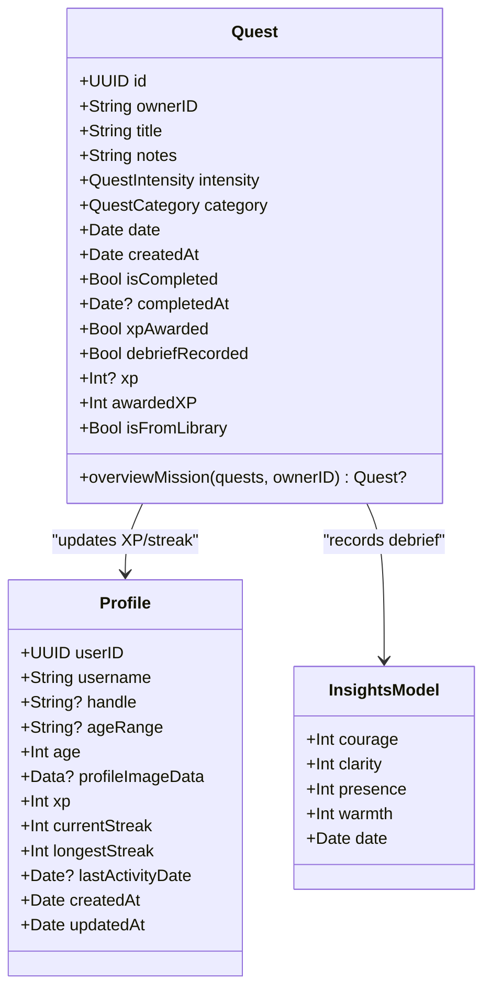

**Diagram sources**
- [QuestModels.swift:50-127](file://Moko/Moko/Models/QuestModels.swift#L50-L127)
- [Profile.swift:12-59](file://Moko/Moko/Models/Profile.swift#L12-L59)
- [InsightsModel.swift:11-26](file://Moko/Moko/Models/InsightsModel.swift#L11-L26)

**Section sources**
- [QuestModels.swift:50-127](file://Moko/Moko/Models/QuestModels.swift#L50-L127)
- [Profile.swift:12-59](file://Moko/Moko/Models/Profile.swift#L12-L59)
- [InsightsModel.swift:11-26](file://Moko/Moko/Models/InsightsModel.swift#L11-L26)

### Transaction Management and Data Consistency
- Local writes:
  - `DailyMissionService.ensureDailyMission` inserts a new quest and saves the context.
  - `QuestProgress.complete` marks a quest complete, updates profile XP and streak, and saves once.
  - `QuestProgress.saveDebrief` ensures debrief scores are recorded without duplication and persists changes.
- Error handling:
  - Save operations catch errors and log them; they do not crash the app.
- Idempotency:
  - Debrief recording checks `debriefRecorded` to prevent duplicate insights entries.
  - XP awarding checks `xpAwarded` to avoid double-counting.

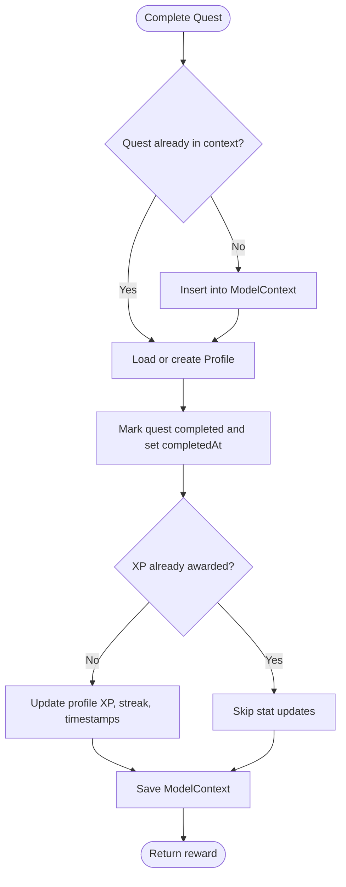

**Diagram sources**
- [QuestProgress.swift:49-83](file://Moko/Moko/Models/QuestProgress.swift#L49-L83)

**Section sources**
- [DailyMissionService.swift:202-225](file://Moko/Moko/Features/AFM/DailyMissionService.swift#L202-L225)
- [QuestProgress.swift:49-137](file://Moko/Moko/Models/QuestProgress.swift#L49-L137)

### Supabase Cloud Synchronization Strategy
- Authentication:
  - `AuthService` wraps email/password sign-up/sign-in/sign-out and retrieving the current user.
  - `GoogleAuthService` performs OAuth with Google and exchanges tokens via Supabase.
- Library content:
  - `QuestLibraryService.fetchQuests` retrieves active library quests ordered by category and sort order.
- Edge function:
  - `AuthService.deleteAccount` calls a deployed Supabase Edge Function with bearer token and API key.

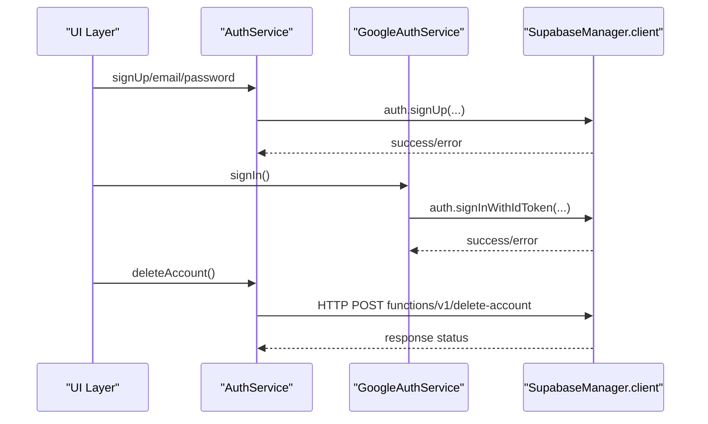

**Diagram sources**
- [AuthService.swift:15-58](file://Moko/Moko/AuthService.swift#L15-L58)
- [GoogleAuthService.swift:8-60](file://Moko/Moko/GoogleAuthService.swift#L8-L60)
- [SupabaseManager.swift:6-19](file://Moko/Moko/SupabaseManager.swift#L6-L19)

**Section sources**
- [AuthService.swift:15-58](file://Moko/Moko/AuthService.swift#L15-L58)
- [GoogleAuthService.swift:8-60](file://Moko/Moko/GoogleAuthService.swift#L8-L60)
- [QuestLibraryService.swift:20-31](file://Moko/Moko/Features/QuestLibrary/QuestLibraryService.swift#L20-L31)
- [SupabaseManager.swift:6-19](file://Moko/Moko/SupabaseManager.swift#L6-L19)

### Service Layer Abstraction
- `SupabaseManager`:
  - Provides a singleton `SupabaseClient` instance used across services.
- `AuthService` and `GoogleAuthService`:
  - Encapsulate authentication flows and error propagation.
- `QuestLibraryService`:
  - Fetches and groups library content; exposes a store with loading states and error messages.
- `DailyMissionService`:
  - Orchestrates daily mission selection and local persistence; integrates with AFM logic and Mission Bank templates.

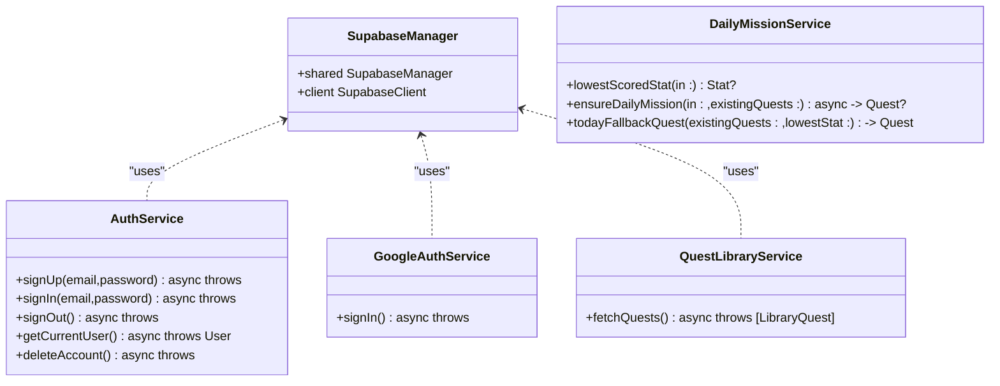

**Diagram sources**
- [SupabaseManager.swift:6-19](file://Moko/Moko/SupabaseManager.swift#L6-L19)
- [AuthService.swift:15-58](file://Moko/Moko/AuthService.swift#L15-L58)
- [GoogleAuthService.swift:8-60](file://Moko/Moko/GoogleAuthService.swift#L8-L60)
- [QuestLibraryService.swift:13-31](file://Moko/Moko/Features/QuestLibrary/QuestLibraryService.swift#L13-L31)
- [DailyMissionService.swift:37-225](file://Moko/Moko/Features/AFM/DailyMissionService.swift#L37-L225)

**Section sources**
- [SupabaseManager.swift:6-19](file://Moko/Moko/SupabaseManager.swift#L6-L19)
- [AuthService.swift:15-58](file://Moko/Moko/AuthService.swift#L15-L58)
- [GoogleAuthService.swift:8-60](file://Moko/Moko/GoogleAuthService.swift#L8-L60)
- [QuestLibraryService.swift:13-31](file://Moko/Moko/Features/QuestLibrary/QuestLibraryService.swift#L13-L31)
- [DailyMissionService.swift:37-225](file://Moko/Moko/Features/AFM/DailyMissionService.swift#L37-L225)

### Error Handling Strategies and Retry Mechanisms
- Network errors:
  - `QuestLibraryStore.load` catches cancellation and general errors, sets an error message, and keeps the loader visible for a minimum duration.
- Authentication errors:
  - `AuthService` and `GoogleAuthService` throw errors when network or token exchange fails; callers should handle these appropriately.
- Local persistence errors:
  - `QuestProgress.save` catches and logs save failures without crashing.
- Retry mechanisms:
  - No explicit retry loops are implemented; higher layers can implement exponential backoff if needed.

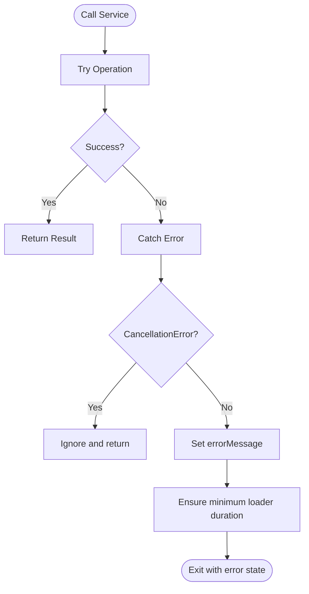

**Diagram sources**
- [QuestLibraryService.swift:56-89](file://Moko/Moko/Features/QuestLibrary/QuestLibraryService.swift#L56-L89)
- [QuestProgress.swift:131-137](file://Moko/Moko/Models/QuestProgress.swift#L131-L137)

**Section sources**
- [QuestLibraryService.swift:56-89](file://Moko/Moko/Features/QuestLibrary/QuestLibraryService.swift#L56-L89)
- [AuthService.swift:15-58](file://Moko/Moko/AuthService.swift#L15-L58)
- [GoogleAuthService.swift:8-60](file://Moko/Moko/GoogleAuthService.swift#L8-L60)
- [QuestProgress.swift:131-137](file://Moko/Moko/Models/QuestProgress.swift#L131-L137)

### Performance Optimizations
- Batching operations:
  - `seedRemainingCategories` creates multiple quests per category in a single loop and saves once after insertion.
- Caching strategies:
  - `QuestLibraryStore.hasLoaded` prevents repeated loads; refresh button triggers explicit reload.
- Memory management:
  - External storage attribute on profile image data reduces database size.
  - Preview container uses in-memory storage to avoid disk I/O during development.

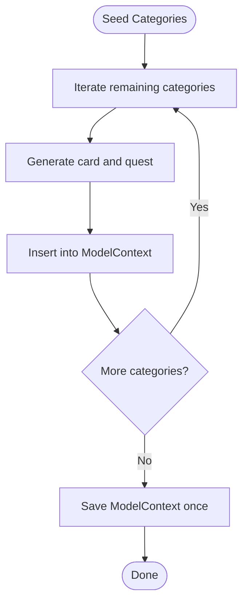

**Diagram sources**
- [DailyMissionService.swift:231-273](file://Moko/Moko/Features/AFM/DailyMissionService.swift#L231-L273)
- [Profile.swift:21-22](file://Moko/Moko/Models/Profile.swift#L21-L22)
- [QuestModels.swift:151-166](file://Moko/Moko/Models/QuestModels.swift#L151-L166)

**Section sources**
- [DailyMissionService.swift:231-273](file://Moko/Moko/Features/AFM/DailyMissionService.swift#L231-L273)
- [QuestLibraryService.swift:50-89](file://Moko/Moko/Features/QuestLibrary/QuestLibraryService.swift#L50-L89)
- [Profile.swift:21-22](file://Moko/Moko/Models/Profile.swift#L21-L22)
- [QuestModels.swift:151-166](file://Moko/Moko/Models/QuestModels.swift#L151-L166)

### Common Persistence Patterns

#### Create Operations
- Daily mission creation:
  - `DailyMissionService.ensureDailyMission` selects a template, generates a card, inserts a new `Quest`, and saves the context.
- Profile creation:
  - `QuestProgress.profile` lazily creates a default profile if none exists.

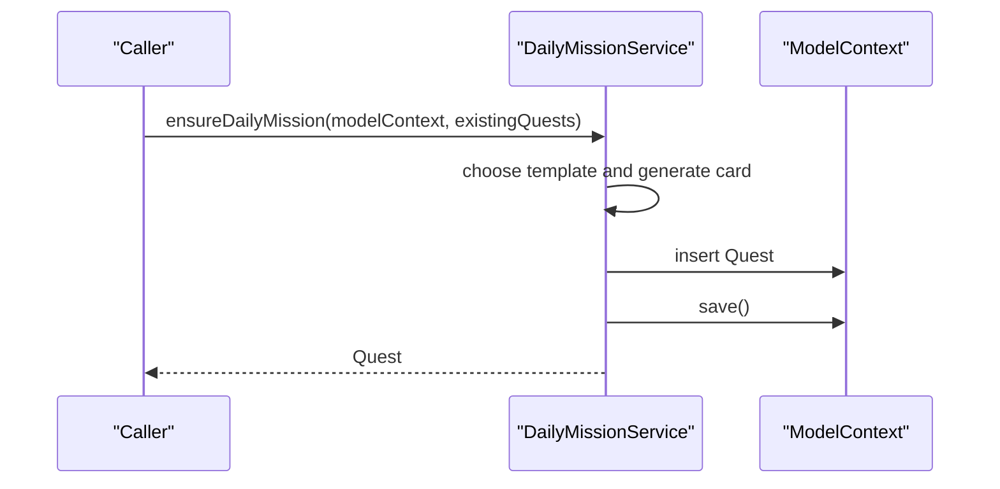

**Diagram sources**
- [DailyMissionService.swift:127-225](file://Moko/Moko/Features/AFM/DailyMissionService.swift#L127-L225)
- [QuestProgress.swift:121-129](file://Moko/Moko/Models/QuestProgress.swift#L121-L129)

**Section sources**
- [DailyMissionService.swift:127-225](file://Moko/Moko/Features/AFM/DailyMissionService.swift#L127-L225)
- [QuestProgress.swift:121-129](file://Moko/Moko/Models/QuestProgress.swift#L121-L129)

#### Read Operations
- Overview mission selection:
  - `Quest.overviewMission` filters out library quests, prioritizes awaiting debrief, then picks the soonest incomplete quest for today or overdue.
- Library reading:
  - `QuestLibraryService.fetchQuests` retrieves active library quests ordered by category and sort order.

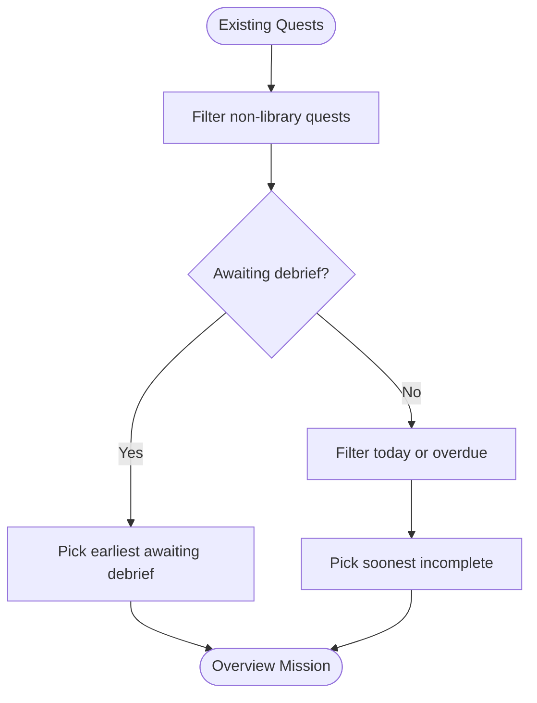

**Diagram sources**
- [QuestModels.swift:102-127](file://Moko/Moko/Models/QuestModels.swift#L102-L127)
- [QuestLibraryService.swift:20-31](file://Moko/Moko/Features/QuestLibrary/QuestLibraryService.swift#L20-L31)

**Section sources**
- [QuestModels.swift:102-127](file://Moko/Moko/Models/QuestModels.swift#L102-L127)
- [QuestLibraryService.swift:20-31](file://Moko/Moko/Features/QuestLibrary/QuestLibraryService.swift#L20-L31)

#### Update Operations
- Completing a quest:
  - `QuestProgress.complete` marks completion, updates profile XP and streak, and persists changes.
- Recording debrief:
  - `QuestProgress.saveDebrief` ensures debrief scores are recorded once and updates quest flags.

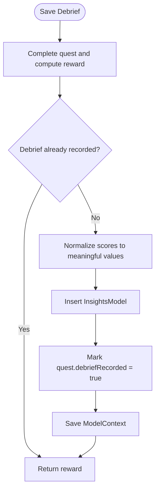

**Diagram sources**
- [QuestProgress.swift:85-119](file://Moko/Moko/Models/QuestProgress.swift#L85-L119)

**Section sources**
- [QuestProgress.swift:49-119](file://Moko/Moko/Models/QuestProgress.swift#L49-L119)

#### Delete Operations
- Account deletion:
  - `AuthService.deleteAccount` calls a Supabase Edge Function to remove the account server-side.
- Local cleanup:
  - `CurrentUser.reset` clears the local user identifier, preparing for fresh local data.

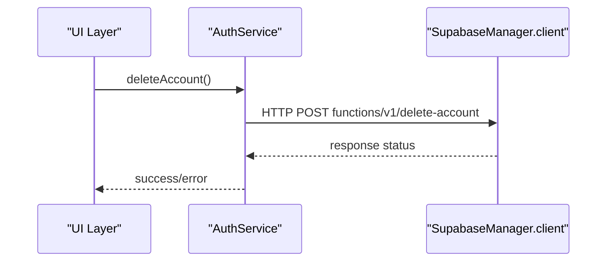

**Diagram sources**
- [AuthService.swift:44-58](file://Moko/Moko/AuthService.swift#L44-L58)
- [QuestModels.swift:145-148](file://Moko/Moko/Models/QuestModels.swift#L145-L148)

**Section sources**
- [AuthService.swift:44-58](file://Moko/Moko/AuthService.swift#L44-L58)
- [QuestModels.swift:145-148](file://Moko/Moko/Models/QuestModels.swift#L145-L148)

#### Complex Queries
- Lowest-scored parameter analysis:
  - `DailyMissionService.lowestScoredStat` computes average scores across recent insights and returns the lowest metric.
- Category rotation and preparation templates:
  - Logic alternates between foundational and similar-situation templates to prepare for upcoming custom quests.

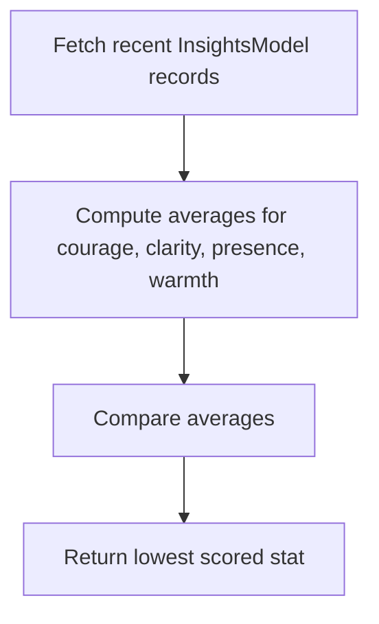

**Diagram sources**
- [DailyMissionService.swift:37-58](file://Moko/Moko/Features/AFM/DailyMissionService.swift#L37-L58)

**Section sources**
- [DailyMissionService.swift:37-58](file://Moko/Moko/Features/AFM/DailyMissionService.swift#L37-L58)
- [DailyMissionService.swift:85-123](file://Moko/Moko/Features/AFM/DailyMissionService.swift#L85-L123)

### Data Lifecycle Management
- Creation:
  - Daily missions are created via `DailyMissionService.ensureDailyMission`; profile is lazily created in `QuestProgress.profile`.
- Active use:
  - Quests are marked complete and debriefed; profile tracks XP and streaks.
- Archival or deletion:
  - Completed quests remain for history; debriefs are recorded once.
  - Account deletion removes server-side data; local user ID is reset.

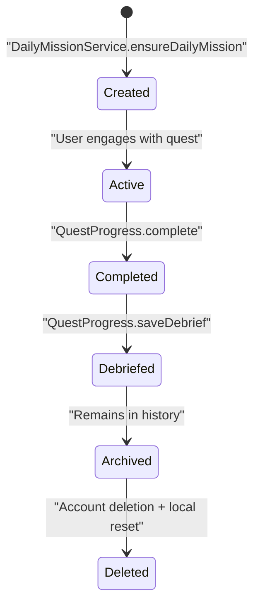

**Diagram sources**
- [DailyMissionService.swift:127-225](file://Moko/Moko/Features/AFM/DailyMissionService.swift#L127-L225)
- [QuestProgress.swift:49-119](file://Moko/Moko/Models/QuestProgress.swift#L49-L119)
- [AuthService.swift:44-58](file://Moko/Moko/AuthService.swift#L44-L58)
- [QuestModels.swift:145-148](file://Moko/Moko/Models/QuestModels.swift#L145-L148)

**Section sources**
- [DailyMissionService.swift:127-225](file://Moko/Moko/Features/AFM/DailyMissionService.swift#L127-L225)
- [QuestProgress.swift:49-119](file://Moko/Moko/Models/QuestProgress.swift#L49-L119)
- [AuthService.swift:44-58](file://Moko/Moko/AuthService.swift#L44-L58)
- [QuestModels.swift:145-148](file://Moko/Moko/Models/QuestModels.swift#L145-L148)

## Dependency Analysis
- Local dependencies:
  - `DailyMissionService` depends on SwiftData models (`Quest`, `InsightsModel`) and utility enums (`QuestCategory`, `QuestIntensity`).
  - `QuestProgress` depends on `Profile` and `InsightsModel`.
- Cloud dependencies:
  - `AuthService`, `GoogleAuthService`, and `QuestLibraryService` depend on `SupabaseManager.shared.client`.

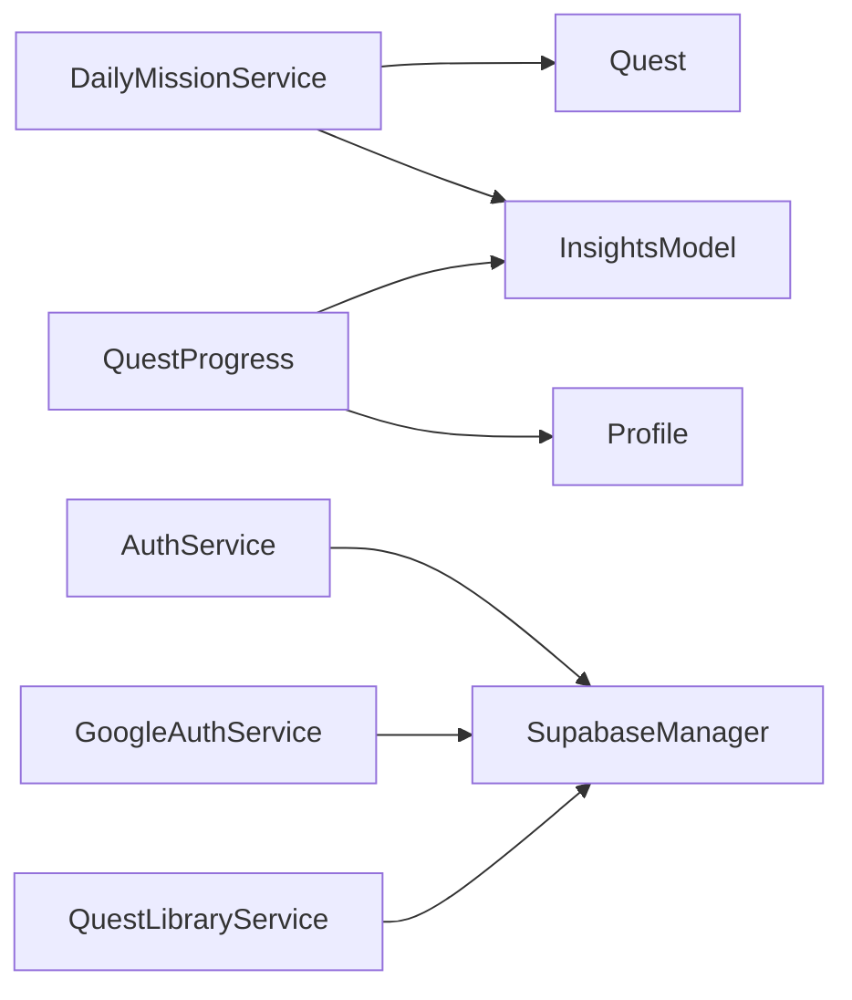

**Diagram sources**
- [DailyMissionService.swift:17-225](file://Moko/Moko/Features/AFM/DailyMissionService.swift#L17-L225)
- [QuestProgress.swift:49-137](file://Moko/Moko/Models/QuestProgress.swift#L49-L137)
- [AuthService.swift:15-58](file://Moko/Moko/AuthService.swift#L15-L58)
- [GoogleAuthService.swift:8-60](file://Moko/Moko/GoogleAuthService.swift#L8-L60)
- [QuestLibraryService.swift:13-31](file://Moko/Moko/Features/QuestLibrary/QuestLibraryService.swift#L13-L31)
- [SupabaseManager.swift:6-19](file://Moko/Moko/SupabaseManager.swift#L6-L19)

**Section sources**
- [DailyMissionService.swift:17-225](file://Moko/Moko/Features/AFM/DailyMissionService.swift#L17-L225)
- [QuestProgress.swift:49-137](file://Moko/Moko/Models/QuestProgress.swift#L49-L137)
- [AuthService.swift:15-58](file://Moko/Moko/AuthService.swift#L15-L58)
- [GoogleAuthService.swift:8-60](file://Moko/Moko/GoogleAuthService.swift#L8-L60)
- [QuestLibraryService.swift:13-31](file://Moko/Moko/Features/QuestLibrary/QuestLibraryService.swift#L13-L31)
- [SupabaseManager.swift:6-19](file://Moko/Moko/SupabaseManager.swift#L6-L19)

## Performance Considerations
- Batch inserts:
  - Use loops to insert multiple entities and call `save()` once to reduce transaction overhead.
- Avoid redundant network calls:
  - Cache loaded library data and guard against repeated loads.
- Minimize database size:
  - Store large binary data externally where possible.
- In-memory containers:
  - Use in-memory containers for previews and tests to speed up iteration.

[No sources needed since this section provides general guidance]

## Troubleshooting Guide
- SwiftData save failures:
  - Check logs for save errors; verify model relationships and required attributes.
- Network errors:
  - Inspect error messages in `QuestLibraryStore.errorMessage`; ensure connectivity and correct Supabase configuration.
- Authentication issues:
  - Validate provider configuration and token exchange; handle thrown errors gracefully.
- Empty UI states:
  - Ensure fallback missions are available when no active quests exist.

**Section sources**
- [QuestProgress.swift:131-137](file://Moko/Moko/Models/QuestProgress.swift#L131-L137)
- [QuestLibraryService.swift:56-89](file://Moko/Moko/Features/QuestLibrary/QuestLibraryService.swift#L56-L89)
- [AuthService.swift:15-58](file://Moko/Moko/AuthService.swift#L15-L58)
- [GoogleAuthService.swift:8-60](file://Moko/Moko/GoogleAuthService.swift#L8-L60)

## Conclusion
Moko’s persistence layer combines robust local storage with selective cloud synchronization. SwiftData manages user-generated data with clear transaction boundaries and idempotent operations. Supabase handles authentication and curated content retrieval. Service abstractions provide clean interfaces for UI and business logic. The design supports offline-first experiences, performance-conscious operations, and resilient error handling. Future enhancements could include explicit retry policies, conflict resolution strategies for multi-device sync, and more granular caching policies.

[No sources needed since this section summarizes without analyzing specific files]