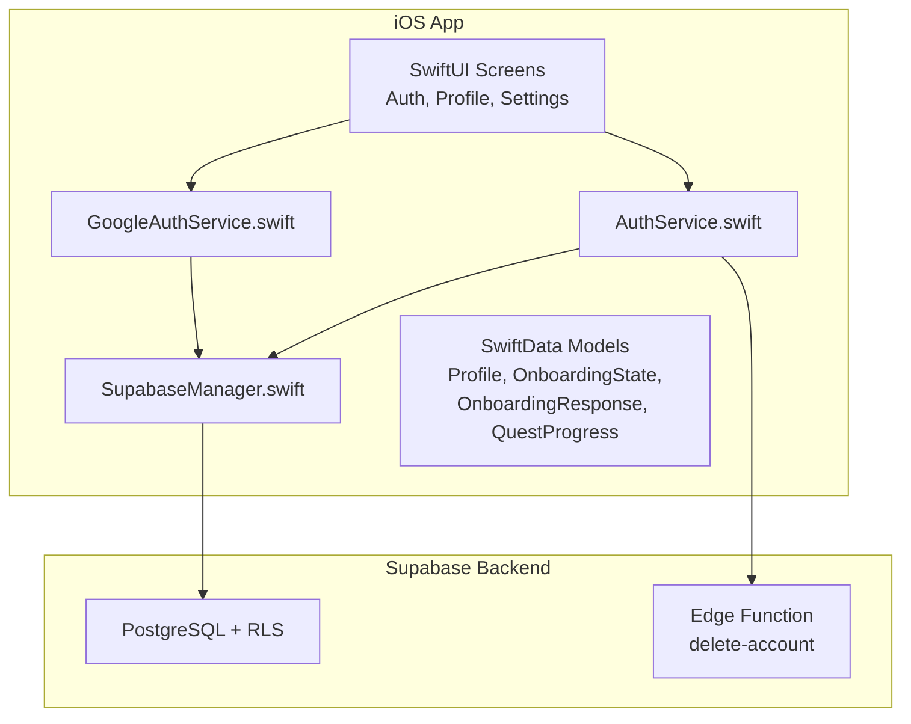
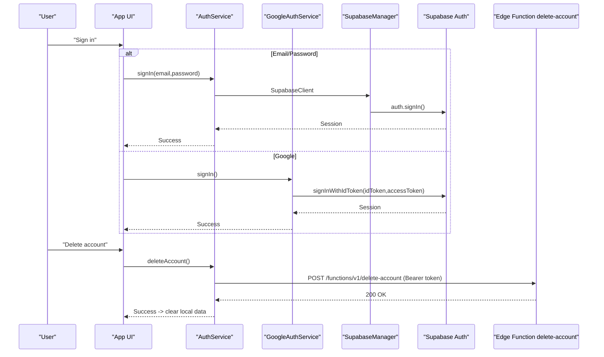
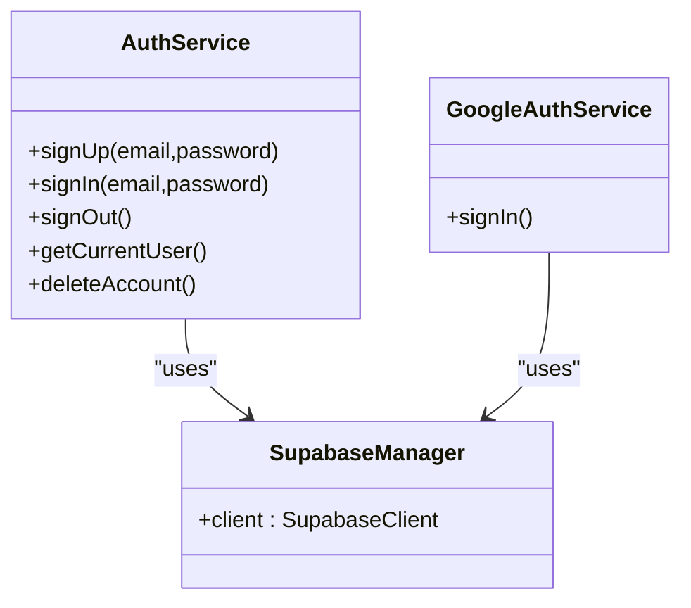
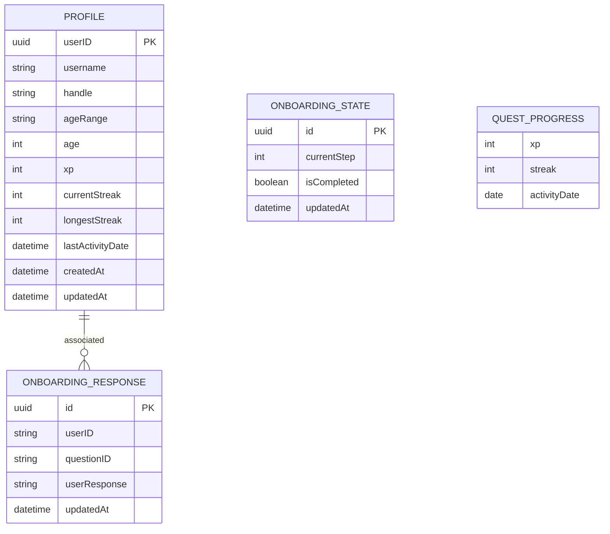
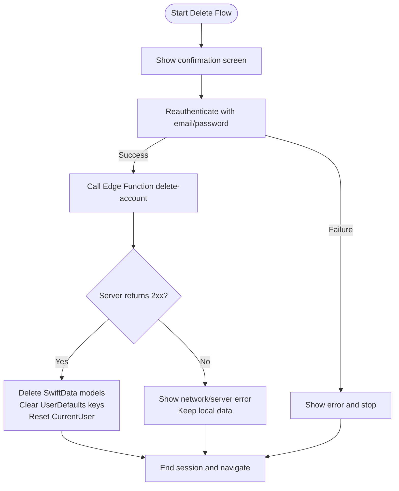
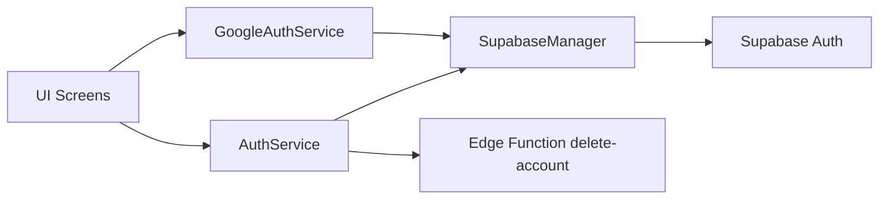

# Data Security & Privacy

<cite>
**Referenced Files in This Document**
- [README.md](file://README.md)
- [APP_STORE_CONNECT_PRIVACY_CHECKLIST.md](file://Moko/APP_STORE_CONNECT_PRIVACY_CHECKLIST.md)
- [AuthService.swift](file://Moko/Moko/AuthService.swift)
- [GoogleAuthService.swift](file://Moko/Moko/GoogleAuthService.swift)
- [SupabaseManager.swift](file://Moko/Moko/SupabaseManager.swift)
- [Profile.swift](file://Moko/Moko/Models/Profile.swift)
- [Onboarding_state.swift](file://Moko/Moko/Models/Onboarding_state.swift)
- [Onboarding_Response.swift](file://Moko/Moko/Models/Onboarding_Response.swift)
- [QuestProgress.swift](file://Moko/Moko/Models/QuestProgress.swift)
- [ContentView.swift](file://Moko/Moko/ContentView.swift)
- [SettingsInfoScreens.swift](file://Moko/Moko/UIScreens/homeScreens/ProfileOverView/SettingsInfoScreens.swift)
- [DeleteAccountConfirm.swift](file://Moko/Moko/UIScreens/homeScreens/ProfileOverView/DeleteAccountConfirm.swift)
- [DeleteAccountFinalConfirm.swift](file://Moko/Moko/UIScreens/homeScreens/ProfileOverView/DeleteAccountFinalConfirm.swift)
- [AccountAndData.swift](file://Moko/Moko/UIScreens/homeScreens/ProfileOverView/AccountAndData.swift)
- [supabase README.md](file://supabase/README.md)
</cite>

## Table of Contents
1. Introduction
2. Project Structure
3. Core Components
4. Architecture Overview
5. Detailed Component Analysis
6. Dependency Analysis
7. Performance Considerations
8. Troubleshooting Guide
9. Conclusion
10. Appendices

## Introduction
This document describes Moko’s data security and privacy posture, focusing on local-first storage, minimal data collection, authentication and session handling, encryption considerations, compliance guidance, deletion and retention policies, and secure coding practices. It is intended for developers, reviewers, and stakeholders who need a clear understanding of how user data is handled across the app and Supabase backend.

## Project Structure
Moko is an iOS SwiftUI application with:
- Local data persistence using SwiftData for onboarding, profile, quests, insights, and calm-session history.
- Authentication via Supabase (email/password and Google Sign-In).
- A Supabase Edge Function for account deletion.
- App Store privacy documentation and checklists.

**Diagram sources**
- [AuthService.swift:15-58](file://Moko/Moko/AuthService.swift#L15-L58)
- [GoogleAuthService.swift:8-59](file://Moko/Moko/GoogleAuthService.swift#L8-L59)
- [SupabaseManager.swift:6-18](file://Moko/Moko/SupabaseManager.swift#L6-L18)
- [Profile.swift:12-58](file://Moko/Moko/Models/Profile.swift#L12-L58)
- [Onboarding_state.swift:4-22](file://Moko/Moko/Models/Onboarding_state.swift#L4-L22)
- [Onboarding_Response.swift:11-34](file://Moko/Moko/Models/Onboarding_Response.swift#L11-L34)
- [QuestProgress.swift:17-138](file://Moko/Moko/Models/QuestProgress.swift#L17-L138)

**Section sources**
- [README.md:151-163](file://README.md#L151-L163)
- [README.md:299-309](file://README.md#L299-L309)

## Core Components
- Authentication service: email/password sign-in/sign-up/sign-out and account deletion via Supabase.
- Google Sign-In integration: exchanges Google tokens for a Supabase session.
- Supabase client manager: centralizes client configuration.
- Local data models: SwiftData entities for profile, onboarding state, responses, and quest progress.
- Account deletion flow: reauthentication, server-side deletion, and local cleanup.

Key responsibilities:
- Keep sensitive credentials out of the app binary; use environment or build-time secrets where possible.
- Minimize network calls to only what is required for authentication and shared content.
- Persist private user data locally by default.

**Section sources**
- [AuthService.swift:15-58](file://Moko/Moko/AuthService.swift#L15-L58)
- [GoogleAuthService.swift:8-59](file://Moko/Moko/GoogleAuthService.swift#L8-L59)
- [SupabaseManager.swift:6-18](file://Moko/Moko/SupabaseManager.swift#L6-L18)
- [Profile.swift:12-58](file://Moko/Moko/Models/Profile.swift#L12-L58)
- [Onboarding_state.swift:4-22](file://Moko/Moko/Models/Onboarding_state.swift#L4-L22)
- [Onboarding_Response.swift:11-34](file://Moko/Moko/Models/Onboarding_Response.swift#L11-L34)
- [QuestProgress.swift:17-138](file://Moko/Moko/Models/QuestProgress.swift#L17-L138)

## Architecture Overview
The app follows a local-first architecture with optional cloud-backed authentication:
- User data such as profile, reflections, quests, streaks, and insights are stored on-device using SwiftData.
- Authentication uses Supabase; only account-related data is sent to the server.
- Sensitive operations like account deletion call a server-side Edge Function that requires a service role key.

**Diagram sources**
- [AuthService.swift:19-58](file://Moko/Moko/AuthService.swift#L19-L58)
- [GoogleAuthService.swift:12-59](file://Moko/Moko/GoogleAuthService.swift#L12-L59)
- [SupabaseManager.swift:11-18](file://Moko/Moko/SupabaseManager.swift#L11-L18)

## Detailed Component Analysis

### Authentication and Session Handling
- Email/password authentication: sign up, sign in, sign out, and current user retrieval are exposed through AuthService.
- Google Sign-In: obtains Google ID and access tokens and signs into Supabase via OpenID Connect.
- Session management: Supabase SDK manages sessions; the app clears in-memory state when signing out or deleting an account.

Security notes:
- The app sends the Supabase anon key over HTTPS; ensure it is the least-privileged key.
- Avoid logging tokens or PII.
- Reauthenticate before destructive actions like account deletion.

**Diagram sources**
- [AuthService.swift:15-58](file://Moko/Moko/AuthService.swift#L15-L58)
- [GoogleAuthService.swift:8-59](file://Moko/Moko/GoogleAuthService.swift#L8-L59)
- [SupabaseManager.swift:6-18](file://Moko/Moko/SupabaseManager.swift#L6-L18)

**Section sources**
- [AuthService.swift:15-58](file://Moko/Moko/AuthService.swift#L15-L58)
- [GoogleAuthService.swift:8-59](file://Moko/Moko/GoogleAuthService.swift#L8-L59)
- [ContentView.swift:227-248](file://Moko/Moko/ContentView.swift#L227-L248)

### Local Data Storage and Privacy-First Design
- Local-first: onboarding answers, profile, quests, insights, and calm-session history are stored on-device with SwiftData.
- Minimal collection: only authentication-related data is sent to Supabase.
- Explicit permissions: microphone and reminders are optional and not used in this build.

Data model highlights:
- Profile stores user identity and gamification metrics.
- OnboardingState tracks onboarding progress.
- OnboardingResponse stores individual question answers.
- QuestProgress updates XP, streaks, and debrief insights.

**Diagram sources**
- [Profile.swift:12-58](file://Moko/Moko/Models/Profile.swift#L12-L58)
- [Onboarding_state.swift:4-22](file://Moko/Moko/Models/Onboarding_state.swift#L4-L22)
- [Onboarding_Response.swift:11-34](file://Moko/Moko/Models/Onboarding_Response.swift#L11-L34)
- [QuestProgress.swift:17-138](file://Moko/Moko/Models/QuestProgress.swift#L17-L138)

**Section sources**
- [README.md:303-307](file://README.md#L303-L307)
- [SettingsInfoScreens.swift:150-176](file://Moko/Moko/UIScreens/homeScreens/ProfileOverView/SettingsInfoScreens.swift#L150-L176)
- [SettingsInfoScreens.swift:241-267](file://Moko/Moko/UIScreens/homeScreens/ProfileOverView/SettingsInfoScreens.swift#L241-L267)
- [Profile.swift:12-58](file://Moko/Moko/Models/Profile.swift#L12-L58)
- [Onboarding_state.swift:4-22](file://Moko/Moko/Models/Onboarding_state.swift#L4-L22)
- [Onboarding_Response.swift:11-34](file://Moko/Moko/Models/Onboarding_Response.swift#L11-L34)
- [QuestProgress.swift:17-138](file://Moko/Moko/Models/QuestProgress.swift#L17-L138)

### Data Deletion, Account Removal, and Retention
- Account deletion flow:
  - User confirms deletion.
  - Reauthentication step ensures the user is who they claim to be.
  - App calls the authenticated Edge Function to delete the account.
  - On success, the app deletes all local SwiftData records and resets local preferences.
  - On failure, local data remains intact and the user sees an error.

- Retention policy:
  - Local content stays on the device until the user deletes their account or removes the app.
  - Signing out does not erase local history.
  - Supabase retains account credentials until successful deletion.

**Diagram sources**
- [DeleteAccountConfirm.swift:38-103](file://Moko/Moko/UIScreens/homeScreens/ProfileOverView/DeleteAccountConfirm.swift#L38-L103)
- [DeleteAccountFinalConfirm.swift:56-77](file://Moko/Moko/UIScreens/homeScreens/ProfileOverView/DeleteAccountFinalConfirm.swift#L56-L77)
- [AuthService.swift:44-58](file://Moko/Moko/AuthService.swift#L44-L58)
- [APP_STORE_CONNECT_PRIVACY_CHECKLIST.md:25-31](file://Moko/APP_STORE_CONNECT_PRIVACY_CHECKLIST.md#L25-L31)

**Section sources**
- [DeleteAccountConfirm.swift:38-103](file://Moko/Moko/UIScreens/homeScreens/ProfileOverView/DeleteAccountConfirm.swift#L38-L103)
- [DeleteAccountFinalConfirm.swift:56-77](file://Moko/Moko/UIScreens/homeScreens/ProfileOverView/DeleteAccountFinalConfirm.swift#L56-L77)
- [SettingsInfoScreens.swift:241-267](file://Moko/Moko/UIScreens/homeScreens/ProfileOverView/SettingsInfoScreens.swift#L241-L267)
- [APP_STORE_CONNECT_PRIVACY_CHECKLIST.md:25-31](file://Moko/APP_STORE_CONNECT_PRIVACY_CHECKLIST.md#L25-L31)

### Encryption and Secure Communication
- In transit:
  - All Supabase communication occurs over HTTPS.
  - Authentication uses Supabase SDK which handles TLS and session tokens.
- At rest:
  - Private user data is stored locally via SwiftData.
  - No explicit app-level encryption is implemented in the referenced files; consider enabling iOS Data Protection and Keychain for sensitive values if needed.

Recommendations:
- Use Keychain for any additional secrets beyond the public anon key.
- Enable iOS Data Protection for app containers holding sensitive SwiftData.
- Validate server responses and avoid storing raw tokens longer than necessary.

**Section sources**
- [AuthService.swift:44-58](file://Moko/Moko/AuthService.swift#L44-L58)
- [GoogleAuthService.swift:37-59](file://Moko/Moko/GoogleAuthService.swift#L37-L59)
- [SupabaseManager.swift:11-18](file://Moko/Moko/SupabaseManager.swift#L11-L18)

### Compliance and Transparency
- App Store privacy checklist:
  - Requires a published privacy policy URL and matching App Store Connect entries.
  - Confirms local storage of user content and no tracking in the inspected build.
  - Documents the account deletion reviewer steps and Edge Function requirements.
- Regulatory planning:
  - The project references Apple App Store Review Guidelines and India’s Digital Personal Data Protection Act as part of compliance planning.
- Transparency:
  - In-app privacy overview explains what is stored locally, what goes to Supabase, and user choices.

**Section sources**
- [APP_STORE_CONNECT_PRIVACY_CHECKLIST.md:1-39](file://Moko/APP_STORE_CONNECT_PRIVACY_CHECKLIST.md#L1-L39)
- [README.md:303-309](file://README.md#L303-L309)
- [SettingsInfoScreens.swift:150-176](file://Moko/Moko/UIScreens/homeScreens/ProfileOverView/SettingsInfoScreens.swift#L150-L176)
- [SettingsInfoScreens.swift:241-267](file://Moko/Moko/UIScreens/homeScreens/ProfileOverView/SettingsInfoScreens.swift#L241-L267)

### Data Export and User Controls
- Users can export local data as JSON from the profile area.
- Microphone and notification settings are managed in iOS Settings; voice recording is not available in this build.
- Users can manage notifications and skip microphone access.

**Section sources**
- [AccountAndData.swift:18-44](file://Moko/Moko/UIScreens/homeScreens/ProfileOverView/AccountAndData.swift#L18-L44)
- [SettingsInfoScreens.swift:150-176](file://Moko/Moko/UIScreens/homeScreens/ProfileOverView/SettingsInfoScreens.swift#L150-L176)
- [SettingsInfoScreens.swift:241-267](file://Moko/Moko/UIScreens/homeScreens/ProfileOverView/SettingsInfoScreens.swift#L241-L267)

### Secure Coding Patterns and Vulnerability Prevention
Patterns observed:
- Centralized Supabase client initialization.
- Reauthentication before destructive actions.
- Clear separation between local data and authentication.

Recommended patterns:
- Never log tokens, passwords, or PII.
- Validate all server responses and handle non-2xx errors gracefully.
- Use least-privilege API keys; do not embed service-role keys in the app.
- Sanitize inputs and avoid executing untrusted data.
- Prefer Keychain for secrets; avoid hardcoding URLs or keys.
- Apply Row Level Security (RLS) on the backend to restrict data access.

Backend security note:
- Supabase RLS is enabled; anonymous and authenticated roles have limited access, while writes require the service role.

**Section sources**
- [SupabaseManager.swift:11-18](file://Moko/Moko/SupabaseManager.swift#L11-L18)
- [DeleteAccountConfirm.swift:93-103](file://Moko/Moko/UIScreens/homeScreens/ProfileOverView/DeleteAccountConfirm.swift#L93-L103)
- [supabase README.md:181-186](file://supabase/README.md#L181-L186)

## Dependency Analysis
The following diagram shows runtime dependencies among core components:

**Diagram sources**
- [AuthService.swift:15-58](file://Moko/Moko/AuthService.swift#L15-L58)
- [GoogleAuthService.swift:8-59](file://Moko/Moko/GoogleAuthService.swift#L8-L59)
- [SupabaseManager.swift:6-18](file://Moko/Moko/SupabaseManager.swift#L6-L18)

**Section sources**
- [AuthService.swift:15-58](file://Moko/Moko/AuthService.swift#L15-L58)
- [GoogleAuthService.swift:8-59](file://Moko/Moko/GoogleAuthService.swift#L8-L59)
- [SupabaseManager.swift:6-18](file://Moko/Moko/SupabaseManager.swift#L6-L18)

## Performance Considerations
- Local-first design reduces network latency and improves reliability.
- SwiftData provides efficient on-device persistence for structured user data.
- Avoid unnecessary network calls; batch operations where appropriate.
- Keep animations decoupled from timing-critical logic to prevent dropped frames from affecting timers.

[No sources needed since this section provides general guidance]

## Troubleshooting Guide
Common issues and resolutions:
- Authentication failures:
  - Verify email/password and network connectivity.
  - Ensure Google Sign-In configuration is correct and tokens are returned.
- Account deletion fails:
  - Check network connectivity and Edge Function deployment.
  - If deletion fails, local data remains intact; retry after resolving connectivity.
- Data not exported:
  - Ensure the user has completed onboarding and created local records.

Operational checks:
- Confirm Supabase client URL and anon key are correct.
- Verify Edge Function is deployed and configured with the service role secret.
- Validate App Store privacy labels match actual behavior.

**Section sources**
- [AuthService.swift:44-58](file://Moko/Moko/AuthService.swift#L44-L58)
- [GoogleAuthService.swift:37-59](file://Moko/Moko/GoogleAuthService.swift#L37-L59)
- [DeleteAccountFinalConfirm.swift:56-77](file://Moko/Moko/UIScreens/homeScreens/ProfileOverView/DeleteAccountFinalConfirm.swift#L56-L77)
- [APP_STORE_CONNECT_PRIVACY_CHECKLIST.md:33-39](file://Moko/APP_STORE_CONNECT_PRIVACY_CHECKLIST.md#L33-L39)

## Conclusion
Moko adopts a privacy-first, local-first approach: personal data remains on-device unless explicitly synchronized for authentication. Authentication is delegated to Supabase with minimal data transfer. The app provides transparent controls, including data export and account deletion, and aligns its documentation with App Store privacy requirements. For stronger protection, consider enabling iOS Data Protection and Keychain usage for sensitive values, and continue validating backend RLS and Edge Function security.

[No sources needed since this section summarizes without analyzing specific files]

## Appendices

### Data Deletion Checklist
- Deploy and verify the delete-account Edge Function in production.
- Test the full deletion flow with a real account.
- Confirm local SwiftData records are cleared on success.
- Ensure App Store privacy labels and policy URL are accurate.

**Section sources**
- [APP_STORE_CONNECT_PRIVACY_CHECKLIST.md:25-39](file://Moko/APP_STORE_CONNECT_PRIVACY_CHECKLIST.md#L25-L39)