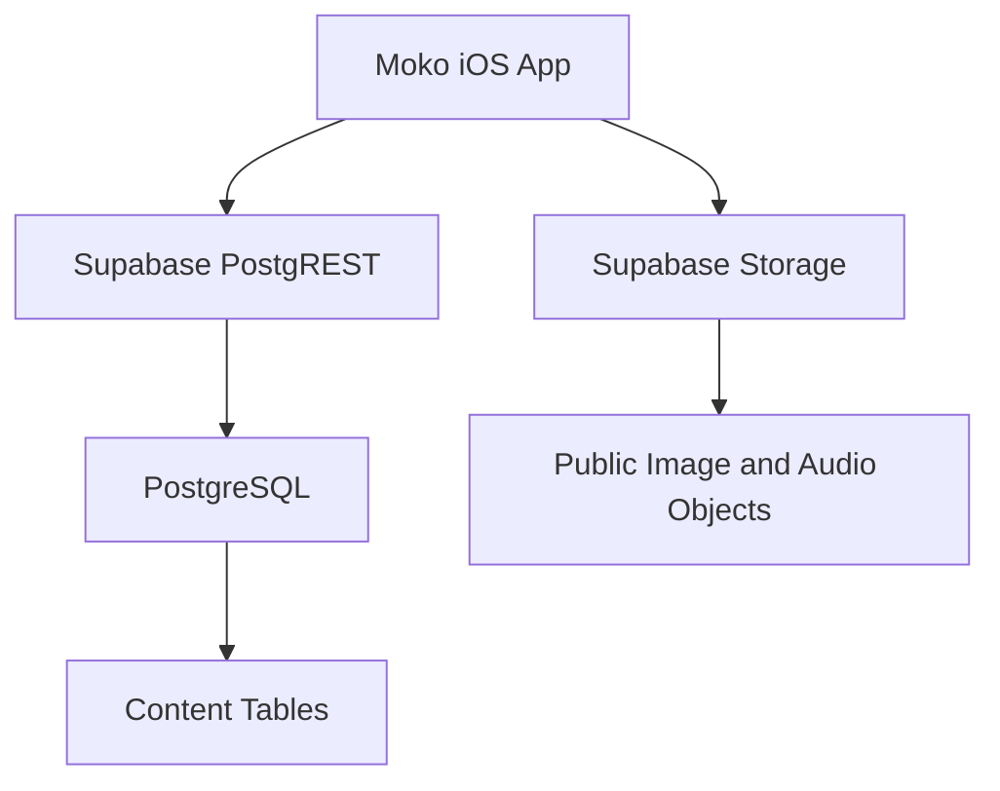
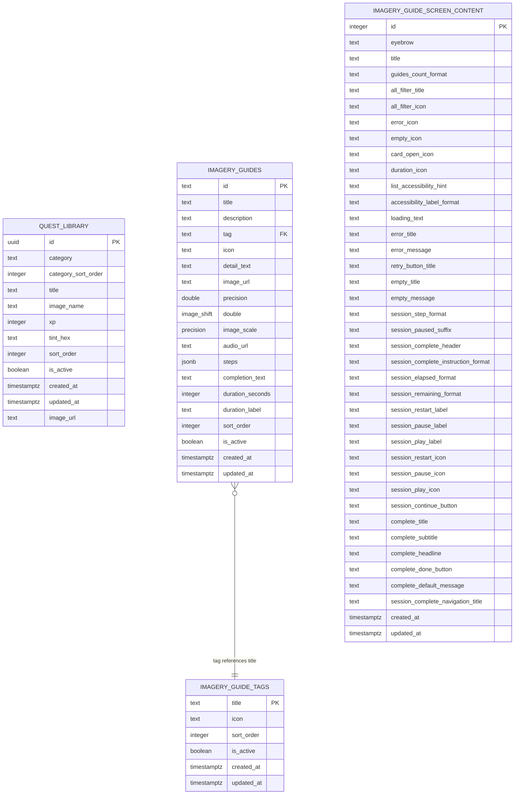
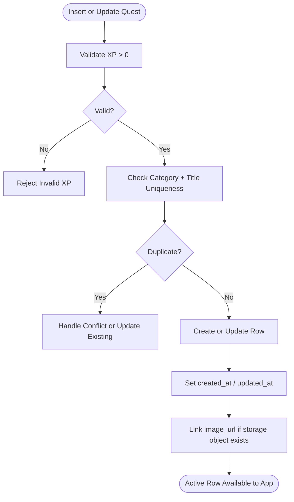
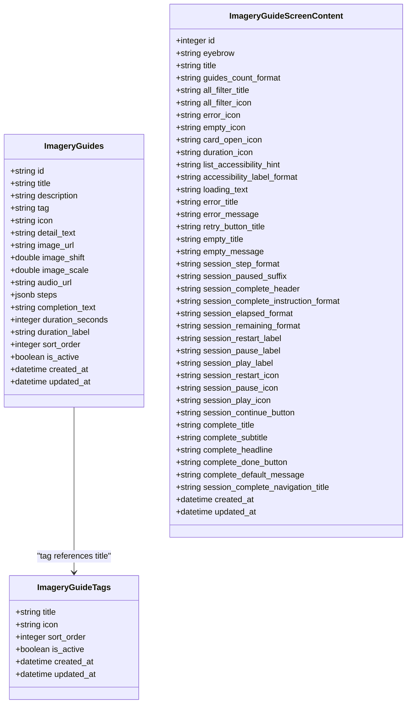
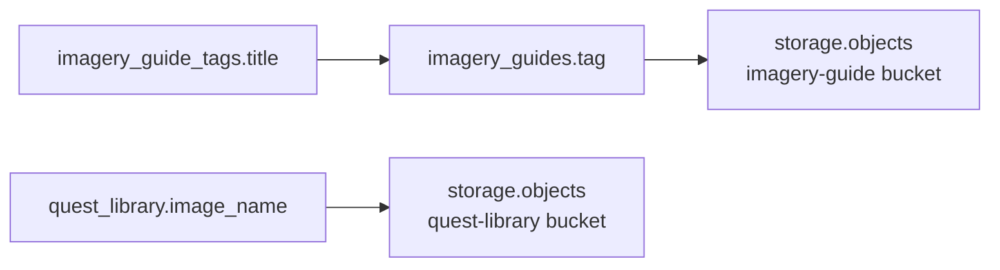

# Database Schema

<cite>
**Referenced Files in This Document**
- [supabase/README.md](file://supabase/README.md)
- [20261101120000_create_quest_library.sql](file://supabase/migrations/20261101120000_create_quest_library.sql)
- [20261101130000_add_quest_image_url_and_storage.sql](file://supabase/migrations/20261101130000_add_quest_image_url_and_storage.sql)
- [20261103120000_create_imagery_guides.sql](file://supabase/migrations/20261103120000_create_imagery_guides.sql)
- [20261106120000_remove_imagery_guide_detail_columns.sql](file://supabase/migrations/20261106120000_remove_imagery_guide_detail_columns.sql)
- [20261106130000_add_imagery_guide_audio_url.sql](file://supabase/migrations/20261106130000_add_imagery_guide_audio_url.sql)
- [seed.sql](file://supabase/seed.sql)
- [imagery_guides_seed.sql](file://supabase/imagery_guides_seed.sql)
</cite>

## Table of Contents
1. [Introduction](#introduction)
2. [Project Structure](#project-structure)
3. [Core Components](#core-components)
4. [Architecture Overview](#architecture-overview)
5. [Detailed Component Analysis](#detailed-component-analysis)
6. [Dependency Analysis](#dependency-analysis)
7. [Performance Considerations](#performance-considerations)
8. [Troubleshooting Guide](#troubleshooting-guide)
9. [Conclusion](#conclusion)
10. [Appendices](#appendices)

## Introduction
This document describes the Supabase-backed database schema used by Moko’s iOS app for read-only content. The app consumes two main content areas:
- Quest Library, shown under Explore.
- Imagery Guides, shown under Relax.

The database is intentionally designed as a content store: the iOS application reads from these tables and does not write to them. Content authors update rows through the Supabase dashboard or SQL tooling, allowing new quests, imagery guides, labels, and artwork to be published without releasing a new app build.

## Project Structure
The database definition lives under `supabase/`:
- `supabase/migrations/` contains ordered migration files that create and evolve the schema.
- `supabase/seed.sql` seeds the Quest Library.
- `supabase/imagery_guides_seed.sql` seeds imagery guide tags, guides, shared screen copy, and links uploaded storage assets.
- `supabase/README.md` documents how to apply migrations, seed data, edit content, and configure security.

**Diagram sources**
- [supabase/README.md:1-186](file://supabase/README.md#L1-L186)

**Section sources**
- [supabase/README.md:1-48](file://supabase/README.md#L1-L48)

## Core Components
The schema centers on three functional areas:

| Area | Tables | Purpose |
|---|---|---|
| Quest Library | `public.quest_library` | Read-only cards grouped by category for the Explore tab. |
| Imagery Guides | `public.imagery_guides`, `public.imagery_guide_tags` | Guided imagery sessions and filter chips. |
| Shared UI Copy | `public.imagery_guide_screen_content` | Localized-style labels and templates for imagery screens. |

All content is read-only from the app. Writes require the service role. Row-level security policies restrict public access to active rows and shared screen copy.

**Section sources**
- [supabase/README.md:50-186](file://supabase/README.md#L50-L186)
- [20261101120000_create_quest_library.sql:6-27](file://supabase/migrations/20261101120000_create_quest_library.sql#L6-L27)
- [20261103120000_create_imagery_guides.sql:7-105](file://supabase/migrations/20261103120000_create_imagery_guides.sql#L7-L105)

## Architecture Overview
The database architecture separates content metadata from media assets:

- Metadata lives in PostgreSQL tables.
- Images and audio live in Supabase Storage buckets referenced by URL columns.
- The app fetches metadata via PostgREST and loads media directly from public storage URLs.
- Migrations define schema evolution; seed scripts populate initial content and link uploaded assets.

**Diagram sources**
- [20261101120000_create_quest_library.sql:6-27](file://supabase/migrations/20261101120000_create_quest_library.sql#L6-L27)
- [20261101130000_add_quest_image_url_and_storage.sql:6-10](file://supabase/migrations/20261101130000_add_quest_image_url_and_storage.sql#L6-L10)
- [20261103120000_create_imagery_guides.sql:7-105](file://supabase/migrations/20261103120000_create_imagery_guides.sql#L7-L105)
- [20261106130000_add_imagery_guide_audio_url.sql:4-5](file://supabase/migrations/20261106130000_add_imagery_guide_audio_url.sql#L4-L5)

## Detailed Component Analysis

### Quest Library Table
`public.quest_library` stores quest cards grouped by category. It is the only table consumed by the Explore tab.

| Column | Type | Constraints | Meaning |
|---|---|---|---|
| `id` | `uuid` | Primary key, default random UUID | Stable row identifier. |
| `category` | `text` | Not null | Section heading such as Work, Dating, Friends, Family, Others. |
| `category_sort_order` | `integer` | Not null, default 0 | Controls section order; gaps allow insertion without renumbering. |
| `title` | `text` | Not null | Display name of the quest. |
| `image_name` | `text` | Nullable | Stable slug matching an asset bundle or storage file. |
| `xp` | `integer` | Not null, check greater than zero | Experience points awarded when completing the quest. |
| `tint_hex` | `text` | Not null, default `#FAEDD9` | Card background tint in hex color format. |
| `sort_order` | `integer` | Not null, default 0 | Controls card order inside its category. |
| `is_active` | `boolean` | Not null, default true | Hides the quest from the app when false. |
| `created_at` | `timestamptz` | Not null, default current timestamp | Creation time. |
| `updated_at` | `timestamptz` | Not null, default current timestamp | Updated time, maintained by trigger. |
| `image_url` | `text` | Nullable | Public Supabase Storage URL for the card artwork. |

Key constraints and indexes:
- Unique constraint on `(category, title)` prevents duplicate quest titles within a category.
- Composite index on `(category_sort_order, category, sort_order)` supports efficient section and card ordering.
- A before-update trigger sets `updated_at`.
- Row-level security allows anonymous and authenticated users to select only active rows.

Storage integration:
- The `quest-library` storage bucket is created with public read access.
- Allowed MIME types include PNG, JPEG, WebP, HEIC, and AVIF.
- Seed logic links uploaded objects whose base filename matches `image_name`.

**Diagram sources**
- [20261101120000_create_quest_library.sql:6-27](file://supabase/migrations/20261101120000_create_quest_library.sql#L6-L27)
- [20261101120000_create_quest_library.sql:40-41](file://supabase/migrations/20261101120000_create_quest_library.sql#L40-L41)
- [20261101120000_create_quest_library.sql:44-60](file://supabase/migrations/20261101120000_create_quest_library.sql#L44-L60)
- [20261101120000_create_quest_library.sql:64-74](file://supabase/migrations/20261101120000_create_quest_library.sql#L64-L74)
- [20261101130000_add_quest_image_url_and_storage.sql:6-32](file://supabase/migrations/20261101130000_add_quest_image_url_and_storage.sql#L6-L32)
- [seed.sql:5-50](file://supabase/seed.sql#L5-L50)

**Section sources**
- [20261101120000_create_quest_library.sql:6-78](file://supabase/migrations/20261101120000_create_quest_library.sql#L6-L78)
- [20261101130000_add_quest_image_url_and_storage.sql:1-35](file://supabase/migrations/20261101130000_add_quest_image_url_and_storage.sql#L1-L35)
- [seed.sql:1-51](file://supabase/seed.sql#L1-L51)
- [supabase/README.md:50-102](file://supabase/README.md#L50-L102)

### Imagery Guide Tags Table
`public.imagery_guide_tags` defines filter chips above the imagery guide list.

| Column | Type | Constraints | Meaning |
|---|---|---|---|
| `title` | `text` | Primary key | Filter chip label. |
| `icon` | `text` | Not null | SF Symbol name displayed next to the chip. |
| `sort_order` | `integer` | Not null, default 0 | Chip ordering. |
| `is_active` | `boolean` | Not null, default true | Hides the tag from the app when false. |
| `created_at` | `timestamptz` | Not null, default current timestamp | Creation time. |
| `updated_at` | `timestamptz` | Not null, default current timestamp | Updated time, maintained by trigger. |

Security:
- Row-level security allows anonymous and authenticated users to select only active tags.

**Section sources**
- [20261103120000_create_imagery_guides.sql:7-19](file://supabase/migrations/20261103120000_create_imagery_guides.sql#L7-L19)
- [20261103120000_create_imagery_guides.sql:169-176](file://supabase/migrations/20261103120000_create_imagery_guides.sql#L169-L176)

### Imagery Guides Table
`public.imagery_guides` stores guided imagery sessions. Each row represents one card and session configuration.

| Column | Type | Constraints | Meaning |
|---|---|---|---|
| `id` | `text` | Primary key | Stable slug used by the app and storage filenames. |
| `title` | `text` | Not null | Display title of the guide. |
| `description` | `text` | Not null | Short description shown on the card. |
| `tag` | `text` | Not null, foreign key to `imagery_guide_tags.title` | Filter chip association. |
| `icon` | `text` | Not null | SF Symbol name for the guide card and detail view. |
| `detail_text` | `text` | Not null | Longer instruction text for the guide. |
| `image_url` | `text` | Nullable | Public storage URL for the full-screen session artwork. |
| `image_shift` | `double precision` | Not null, default 0 | Framing shift applied to the session image. |
| `image_scale` | `double precision` | Not null, default 1 | Scaling factor applied to the session image. |
| `audio_url` | `text` | Nullable | Public storage URL for ambient background music. |
| `steps` | `jsonb` | Not null, default empty array | Ordered instructions shown while the timer runs. |
| `completion_text` | `text` | Not null | Message shown after completing the session. |
| `duration_seconds` | `integer` | Not null, default 120, check greater than zero | Timer length in seconds. |
| `duration_label` | `text` | Not null, default `2 min` | Short duration label shown on the card. |
| `sort_order` | `integer` | Not null, default 0 | Ordering of guides in the list. |
| `is_active` | `boolean` | Not null, default true | Hides the guide from the app when false. |
| `created_at` | `timestamptz` | Not null, default current timestamp | Creation time. |
| `updated_at` | `timestamptz` | Not null, default current timestamp | Updated time, maintained by trigger. |

Indexes and relationships:
- Index on `sort_order` supports ordered retrieval.
- Foreign key `tag` references `imagery_guide_tags.title` with cascade updates.
- No delete cascade is defined; deleting a tag would fail referential integrity unless the tag is removed from guides first.

Security:
- Row-level security allows anonymous and authenticated users to select only active guides.
- The `imagery-guide` storage bucket is publicly readable.

**Diagram sources**
- [20261103120000_create_imagery_guides.sql:7-105](file://supabase/migrations/20261103120000_create_imagery_guides.sql#L7-L105)
- [20261106130000_add_imagery_guide_audio_url.sql:4-8](file://supabase/migrations/20261106130000_add_imagery_guide_audio_url.sql#L4-L8)

**Section sources**
- [20261103120000_create_imagery_guides.sql:22-144](file://supabase/migrations/20261103120000_create_imagery_guides.sql#L22-L144)
- [20261103120000_create_imagery_guides.sql:147-165](file://supabase/migrations/20261103120000_create_imagery_guides.sql#L147-L165)
- [20261103120000_create_imagery_guides.sql:169-185](file://supabase/migrations/20261103120000_create_imagery_guides.sql#L169-L185)
- [20261106130000_add_imagery_guide_audio_url.sql:1-11](file://supabase/migrations/20261106130000_add_imagery_guide_audio_url.sql#L1-L11)

### Shared Screen Content Table
`public.imagery_guide_screen_content` holds shared labels and template strings for imagery screens. It always has exactly one row with `id = 1`.

| Column Group | Examples | Purpose |
|---|---|---|
| Header and branding | `eyebrow`, `title` | Top-of-screen labels. |
| List UI | `guides_count_format`, `all_filter_title`, `all_filter_icon` | Toolbar count and filter chip labels. |
| Error and empty states | `error_icon`, `empty_icon`, `loading_text`, `error_title`, `error_message`, `retry_button_title`, `empty_title`, `empty_message` | User-facing error and empty-state messages. |
| Session UI | `session_step_format`, `session_paused_suffix`, `session_elapsed_format`, `session_remaining_format`, `session_restart_label`, `session_pause_label`, `session_play_label`, icons, `session_continue_button` | Labels for the guided session flow. |
| Completion UI | `complete_title`, `complete_subtitle`, `complete_headline`, `complete_done_button`, `complete_default_message`, `session_complete_navigation_title` | Messages shown after finishing a session. |

Constraints:
- `id` is constrained to exactly `1`.
- All fields are required so the app can render consistent UI without fallback defaults.

Security:
- Row-level security allows anonymous and authenticated users to select this table unconditionally because it contains shared UI copy rather than user-specific content.

**Section sources**
- [20261103120000_create_imagery_guides.sql:65-108](file://supabase/migrations/20261103120000_create_imagery_guides.sql#L65-L108)
- [20261103120000_create_imagery_guides.sql:187-194](file://supabase/migrations/20261103120000_create_imagery_guides.sql#L187-L194)
- [imagery_guides_seed.sql:123-213](file://supabase/imagery_guides_seed.sql#L123-L213)

## Dependency Analysis
The primary dependency is between imagery guides and their filter tags:

- `imagery_guides.tag` references `imagery_guide_tags.title`.
- Updates to a tag title cascade to guides.
- Deleting a tag is not allowed if any guide still references it.
- The app expects `tag` values to match existing titles in `imagery_guide_tags`.

Other relationships are logical rather than enforced by foreign keys:
- `quest_library.image_url` and `imagery_guides.image_url` reference public storage objects but do not have database foreign keys.
- `imagery_guides.audio_url` similarly references public storage objects.
- `seed.sql` and `imagery_guides_seed.sql` link uploaded storage objects to rows using filename conventions.

**Diagram sources**
- [20261103120000_create_imagery_guides.sql:27-27](file://supabase/migrations/20261103120000_create_imagery_guides.sql#L27-L27)
- [20261101130000_add_quest_image_url_and_storage.sql:14-32](file://supabase/migrations/20261101130000_add_quest_image_url_and_storage.sql#L14-L32)
- [20261103120000_create_imagery_guides.sql:147-165](file://supabase/migrations/20261103120000_create_imagery_guides.sql#L147-L165)
- [seed.sql:45-50](file://supabase/seed.sql#L45-L50)
- [imagery_guides_seed.sql:215-222](file://supabase/imagery_guides_seed.sql#L215-L222)

**Section sources**
- [20261103120000_create_imagery_guides.sql:22-47](file://supabase/migrations/20261103120000_create_imagery_guides.sql#L22-L47)
- [seed.sql:45-50](file://supabase/seed.sql#L45-L50)
- [imagery_guides_seed.sql:215-222](file://supabase/imagery_guides_seed.sql#L215-L222)

## Performance Considerations

### Indexing Strategy
- `quest_library` uses a composite index on `(category_sort_order, category, sort_order)` to efficiently load sections and cards in display order.
- `imagery_guides` uses an index on `sort_order` to support ordered listing.
- Both tables rely on `is_active` filtering at the application or policy level rather than dedicated indexes. If query volume grows, consider adding filtered indexes for active rows.

### Query Optimization
- Prefer queries that filter by `is_active = true` early.
- For the Quest Library, query by category and sort order to avoid scanning inactive rows unnecessarily.
- For Imagery Guides, use `sort_order` for stable list rendering.
- Avoid selecting unused columns when fetching large lists; request only needed fields through PostgREST.

### Storage Allocation
- Storage buckets limit file size to 5 MB.
- Allowed MIME types include common image formats plus HEIC and AVIF.
- Audio files referenced by `audio_url` should remain reasonably sized since they loop during sessions.
- Large images increase bandwidth and memory usage on the device; prefer optimized PNG/JPEG/WebP assets.

### Security Impact on Performance
- Row-level security policies add a small per-query cost but provide important isolation.
- Public storage policies allow direct client access to media without authentication overhead.

[No sources needed since this section provides general guidance]

## Troubleshooting Guide

### Common Issues

| Symptom | Likely Cause | Resolution |
|---|---|---|
| Quest cards appear blank | Missing or broken `image_url`; `image_name` may also be missing. | Upload the asset to the `quest-library` bucket and ensure the filename matches `image_name.png`. Re-run seed linking logic. |
| Imagery guide image is missing | `image_url` does not point to an existing object in `imagery-guide`. | Upload the correct file and verify the filename mapping (`cozy-room` becomes `cozy_room.png`). |
| Guide cannot be selected by tag | Tag value does not exist in `imagery_guide_tags`. | Insert or update the tag title to match the guide’s `tag`. |
| Updating a tag fails | A guide still references the old tag title. | Update the guide’s `tag` first, then update the tag title. |
| App cannot read content | Row-level security blocks inactive rows. | Ensure `is_active = true` for rows intended for the app. |
| PostgREST does not see new tables | Schema reload notification was not processed. | Run migrations again or restart PostgREST if necessary. |

### Rollback Procedures
Migrations are additive and generally safe to rerun where they use `if not exists`, `on conflict`, or idempotent patterns. However, there is no explicit rollback script collection. Recommended approach:

1. Keep migration files versioned and ordered by timestamp prefix.
2. Before applying a migration, back up the relevant schema or database.
3. Test migrations against a staging environment first.
4. For destructive changes like column drops, prepare a reverse migration file that restores the previous state.
5. Use the Supabase dashboard or CLI to run migrations in the documented order.

**Section sources**
- [supabase/README.md:8-48](file://supabase/README.md#L8-L48)
- [20261106120000_remove_imagery_guide_detail_columns.sql:1-10](file://supabase/migrations/20261106120000_remove_imagery_guide_detail_columns.sql#L1-L10)

## Conclusion
Moko’s Supabase backend is a focused, read-only content layer. The schema cleanly separates:
- Quest Library metadata and artwork references.
- Imagery guide metadata, tags, and shared UI copy.
- Public storage assets referenced by URL.

The design emphasizes safe content editing, predictable ordering, and graceful fallbacks when artwork is missing. Migrations and seed scripts make schema evolution and content management repeatable. Future improvements should focus on monitoring query performance, expanding filtered indexes if needed, and maintaining clear ownership of storage assets alongside database rows.

[No sources needed since this section summarizes without analyzing specific files]

## Appendices

### Migration History and Version Control
Migrations are named with timestamps and applied in order:

| File | Description |
|---|---|
| `20261101120000_create_quest_library.sql` | Creates `quest_library`, triggers, indexes, and RLS. |
| `20261101130000_add_quest_image_url_and_storage.sql` | Adds `image_url` and creates the `quest-library` storage bucket. |
| `20261103120000_create_imagery_guides.sql` | Creates tags, guides, shared screen content, triggers, indexes, storage bucket, and RLS. |
| `20261106120000_remove_imagery_guide_detail_columns.sql` | Drops unused detail screen columns from shared screen content. |
| `20261106130000_add_imagery_guide_audio_url.sql` | Adds `audio_url` for ambient session music. |

**Section sources**
- [supabase/README.md:8-48](file://supabase/README.md#L8-L48)
- [20261101120000_create_quest_library.sql:1-78](file://supabase/migrations/20261101120000_create_quest_library.sql#L1-L78)
- [20261101130000_add_quest_image_url_and_storage.sql:1-35](file://supabase/migrations/20261101130000_add_quest_image_url_and_storage.sql#L1-L35)
- [20261103120000_create_imagery_guides.sql:1-206](file://supabase/migrations/20261103120000_create_imagery_guides.sql#L1-L206)
- [20261106120000_remove_imagery_guide_detail_columns.sql:1-10](file://supabase/migrations/20261106120000_remove_imagery_guide_detail_columns.sql#L1-L10)
- [20261106130000_add_imagery_guide_audio_url.sql:1-11](file://supabase/migrations/20261106130000_add_imagery_guide_audio_url.sql#L1-L11)

### Seed Data Management
Seed scripts are idempotent and update existing rows instead of failing on duplicates.

- `seed.sql` inserts or updates quest rows by `(category, title)` and links uploaded quest artwork.
- `imagery_guides_seed.sql` inserts or updates tags, guides, shared screen content, and links uploaded imagery assets.

Recommended workflow:
1. Apply migrations first.
2. Run `seed.sql`.
3. Run `imagery_guides_seed.sql`.
4. Upload storage assets.
5. Re-run seed scripts to refresh links and content.

**Section sources**
- [supabase/README.md:47-48](file://supabase/README.md#L47-L48)
- [seed.sql:1-51](file://supabase/seed.sql#L1-L51)
- [imagery_guides_seed.sql:1-222](file://supabase/imagery_guides_seed.sql#L1-L222)

### Common Queries and Retrieval Patterns
These examples describe typical retrieval patterns used by the app. They are conceptual and should be adapted to PostgREST or your preferred client.

- Load active quest cards grouped by category:
  - Select from `quest_library` where `is_active = true`.
  - Order by `category_sort_order`, then `category`, then `sort_order`.

- Load imagery guides with their tags:
  - Select from `imagery_guides` where `is_active = true`.
  - Join with `imagery_guide_tags` on `tag = title`.
  - Order by `sort_order`.

- Load shared imagery screen copy:
  - Select from `imagery_guide_screen_content` where `id = 1`.

- Filter imagery guides by tag:
  - Select guides where `tag` equals the desired tag title.

- Retrieve artwork URLs:
  - Use `image_url` when present.
  - Fall back to `image_name` or category/icon when the URL is missing.

[No sources needed since this section provides general guidance]