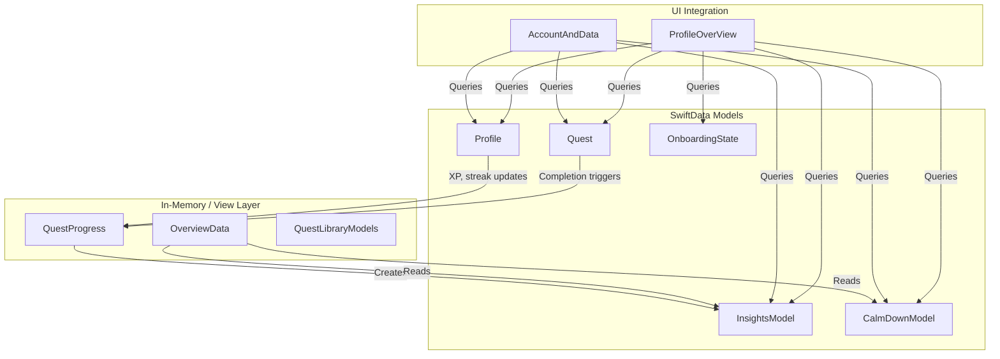
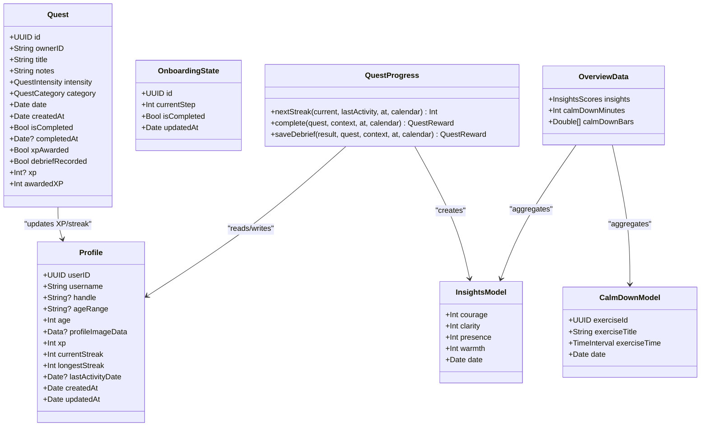
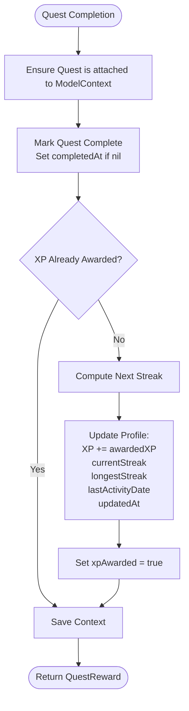
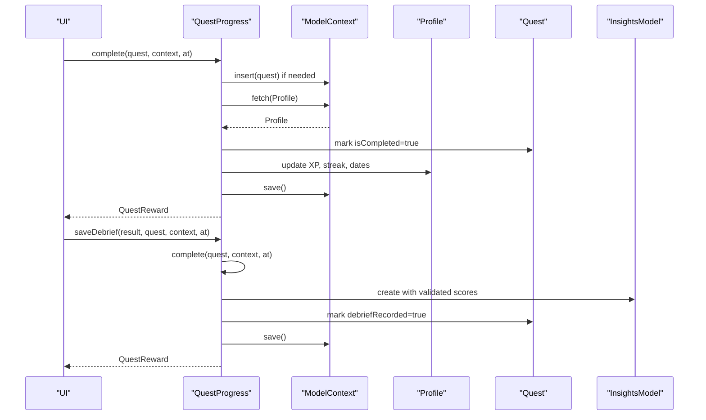
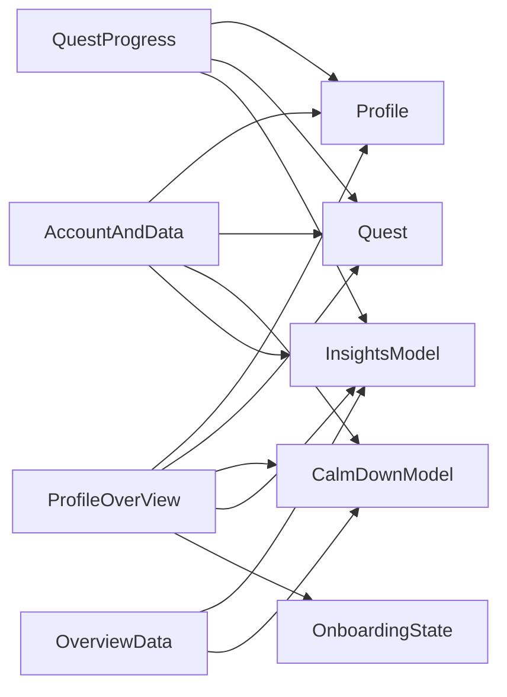
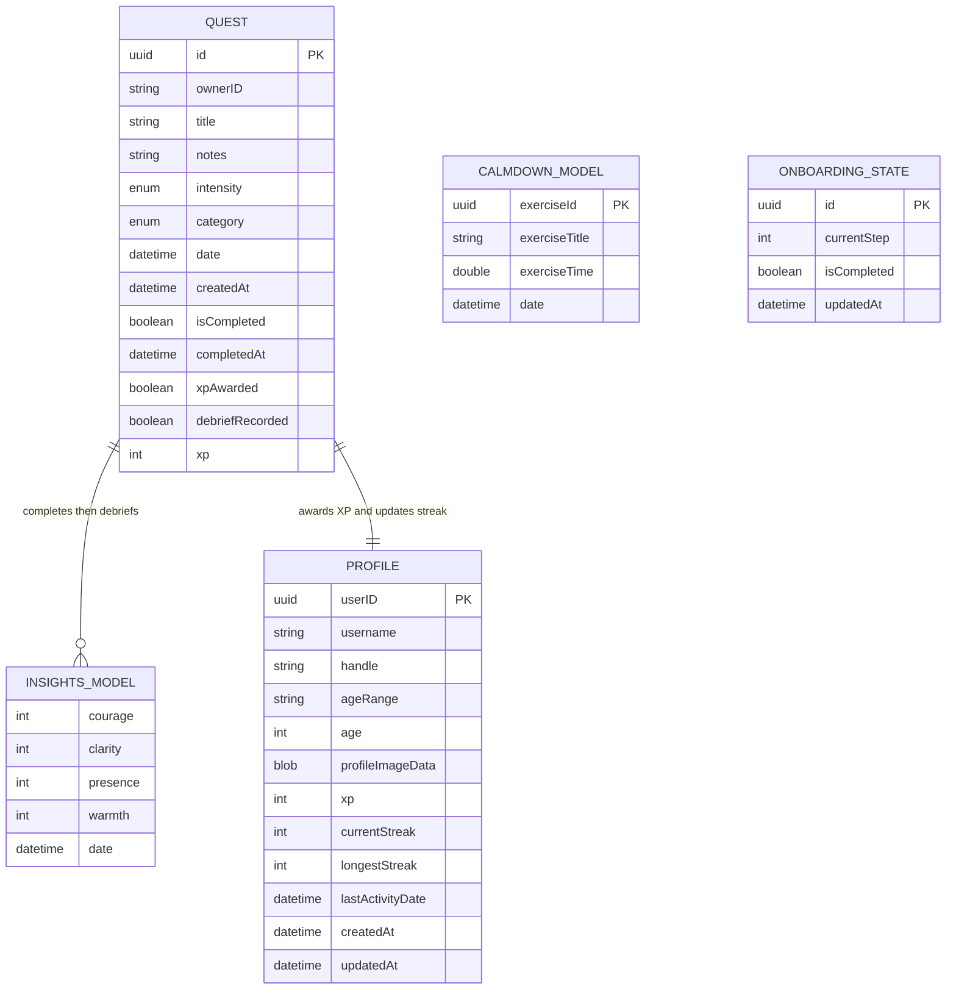

# SwiftData Models

<cite>
**Referenced Files in This Document**
- [Profile.swift](file://Moko/Moko/Models/Profile.swift)
- [InsightsModel.swift](file://Moko/Moko/Models/InsightsModel.swift)
- [QuestModels.swift](file://Moko/Moko/Models/QuestModels.swift)
- [CalmDownModel.swift](file://Moko/Moko/Models/CalmDownModel.swift)
- [Onboarding_state.swift](file://Moko/Moko/Models/Onboarding_state.swift)
- [OverviewData.swift](file://Moko/Moko/Models/OverviewData.swift)
- [QuestProgress.swift](file://Moko/Moko/Models/QuestProgress.swift)
- [QuestLibraryModels.swift](file://Moko/Moko/Models/QuestLibraryModels.swift)
- [AccountAndData.swift](file://Moko/Moko/UIScreens/homeScreens/ProfileOverView/AccountAndData.swift)
- [ProfileOverView.swift](file://Moko/Moko/UIScreens/homeScreens/ProfileOverView.swift)
</cite>

## Table of Contents
1. [Introduction](#introduction)
2. [Project Structure](#project-structure)
3. [Core Components](#core-components)
4. [Architecture Overview](#architecture-overview)
5. [Detailed Component Analysis](#detailed-component-analysis)
6. [Dependency Analysis](#dependency-analysis)
7. [Performance Considerations](#performance-considerations)
8. [Troubleshooting Guide](#troubleshooting-guide)
9. [Conclusion](#conclusion)
10. [Appendices](#appendices)

## Introduction
This document provides comprehensive data model documentation for Moko’s SwiftData models. It focuses on the core domain entities and related types: Profile, InsightsModel, Quest, CalmDownModel, OnboardingState, OverviewData, and QuestProgress. The goal is to explain entity relationships, field definitions, data types, validation rules, primary keys, constraints, database schema implications, data access patterns, query optimization techniques, performance considerations, common CRUD operations, relationship navigation, persistence patterns, migration strategies, versioning approaches, and backward compatibility considerations.

The models are primarily defined under the Moko app’s Models directory. Some models are persisted with SwiftData, while others are in-memory or view-layer structures used to compute summaries and UI state.

## Project Structure
The relevant SwiftData-related files are organized by feature area:
- Core domain models: Profile, InsightsModel, Quest, CalmDownModel, OnboardingState
- Computed overview data: OverviewData
- Progress and reward logic: QuestProgress
- Library quest content (non-persisted): QuestLibraryModels
- UI integration points that query these models: AccountAndData, ProfileOverView

**Diagram sources**
- [Profile.swift:12-59](file://Moko/Moko/Models/Profile.swift#L12-L59)
- [QuestModels.swift:51-100](file://Moko/Moko/Models/QuestModels.swift#L51-L100)
- [InsightsModel.swift:11-26](file://Moko/Moko/Models/InsightsModel.swift#L11-L26)
- [CalmDownModel.swift:12-25](file://Moko/Moko/Models/CalmDownModel.swift#L12-L25)
- [Onboarding_state.swift:4-23](file://Moko/Moko/Models/Onboarding_state.swift#L4-L23)
- [OverviewData.swift:11-42](file://Moko/Moko/Models/OverviewData.swift#L11-L42)
- [QuestProgress.swift:17-138](file://Moko/Moko/Models/QuestProgress.swift#L17-L138)
- [QuestLibraryModels.swift:12-83](file://Moko/Moko/Models/QuestLibraryModels.swift#L12-L83)
- [AccountAndData.swift:18-44](file://Moko/Moko/UIScreens/homeScreens/ProfileOverView/AccountAndData.swift#L18-L44)
- [ProfileOverView.swift:11-15](file://Moko/Moko/UIScreens/homeScreens/ProfileOverView.swift#L11-L15)

**Section sources**
- [Profile.swift:12-59](file://Moko/Moko/Models/Profile.swift#L12-L59)
- [QuestModels.swift:51-100](file://Moko/Moko/Models/QuestModels.swift#L51-L100)
- [InsightsModel.swift:11-26](file://Moko/Moko/Models/InsightsModel.swift#L11-L26)
- [CalmDownModel.swift:12-25](file://Moko/Moko/Models/CalmDownModel.swift#L12-L25)
- [Onboarding_state.swift:4-23](file://Moko/Moko/Models/Onboarding_state.swift#L4-L23)
- [OverviewData.swift:11-42](file://Moko/Moko/Models/OverviewData.swift#L11-L42)
- [QuestProgress.swift:17-138](file://Moko/Moko/Models/QuestProgress.swift#L17-L138)
- [QuestLibraryModels.swift:12-83](file://Moko/Moko/Models/QuestLibraryModels.swift#L12-L83)
- [AccountAndData.swift:18-44](file://Moko/Moko/UIScreens/homeScreens/ProfileOverView/AccountAndData.swift#L18-L44)
- [ProfileOverView.swift:11-15](file://Moko/Moko/UIScreens/homeScreens/ProfileOverView.swift#L11-L15)

## Core Components
This section summarizes each core model, its fields, types, constraints, and responsibilities.

### Profile
- Purpose: Represents a user profile with identity, activity metrics, and optional image data.
- Key fields:
  - userID: UUID (primary identifier)
  - username: String
  - handle: Optional String
  - ageRange: Optional String
  - age: Int
  - profileImageData: Optional Data stored externally via @Attribute(.externalStorage)
  - xp: Int
  - currentStreak: Int
  - longestStreak: Int
  - lastActivityDate: Optional Date
  - createdAt: Date
  - updatedAt: Date
- Constraints and behavior:
  - External storage attribute for large binary data to avoid bloating the main store.
  - Defaults provided in initializer for convenience.
- Relationship usage:
  - Updated by QuestProgress when quests are completed.

**Section sources**
- [Profile.swift:12-59](file://Moko/Moko/Models/Profile.swift#L12-L59)

### Quest
- Purpose: Persisted custom quest belonging to a user, including scheduling, completion state, XP awards, and debrief linkage.
- Key fields:
  - id: UUID with unique constraint
  - ownerID: String linking to a user context (CurrentUser.localID)
  - title: String
  - notes: String
  - intensity: Enum (Easy/Medium/Hard)
  - category: Enum (Work/Dating/Friends/Family/Others)
  - date: Date (scheduled time)
  - createdAt: Date
  - isCompleted: Bool (default false)
  - completedAt: Optional Date
  - xpAwarded: Bool
  - debriefRecorded: Bool
  - xp: Optional Int (library quests may override default intensity XP)
  - awardedXP: Computed property returning effective XP
- Constraints and behavior:
  - Unique id ensures uniqueness at the database level.
  - ownerID ties quests to a specific user session; CurrentUser manages local ID persistence.
  - overviewMission selects the next mission based on completion and debrief status.
- Relationship usage:
  - Completed through QuestProgress.complete, which updates Profile and optionally creates InsightsModel.

**Section sources**
- [QuestModels.swift:51-100](file://Moko/Moko/Models/QuestModels.swift#L51-L100)
- [QuestModels.swift:102-127](file://Moko/Moko/Models/QuestModels.swift#L102-L127)
- [QuestModels.swift:129-149](file://Moko/Moko/Models/QuestModels.swift#L129-L149)

### InsightsModel
- Purpose: Stores debrief scores recorded after completing a quest.
- Key fields:
  - courage: Int
  - clarity: Int
  - presence: Int
  - warmth: Int
  - date: Date
- Validation:
  - Scores are clamped to minimum values by QuestProgress.saveDebrief to ensure meaningful measurements.
- Relationship usage:
  - Created by QuestProgress.saveDebrief when a quest debrief is saved.

**Section sources**
- [InsightsModel.swift:11-26](file://Moko/Moko/Models/InsightsModel.swift#L11-L26)
- [QuestProgress.swift:85-119](file://Moko/Moko/Models/QuestProgress.swift#L85-L119)

### CalmDownModel
- Purpose: Records completed calm-down exercises with duration and timestamp.
- Key fields:
  - exerciseId: UUID (identifier)
  - exerciseTitle: String
  - exerciseTime: TimeInterval (seconds)
  - date: Date
- Behavior:
  - ModelContext extension provides logCalmDown helper to insert and save records.

**Section sources**
- [CalmDownModel.swift:12-25](file://Moko/Moko/Models/CalmDownModel.swift#L12-L25)
- [CalmDownModel.swift:27-37](file://Moko/Moko/Models/CalmDownModel.swift#L27-L37)

### OnboardingState
- Purpose: Tracks onboarding progress per device session.
- Key fields:
  - id: UUID
  - currentStep: Int
  - isCompleted: Bool
  - updatedAt: Date

**Section sources**
- [Onboarding_state.swift:4-23](file://Moko/Moko/Models/Onboarding_state.swift#L4-L23)

### OverviewData
- Purpose: In-memory aggregation of today’s insights average and calm-down minutes, plus a six-day bar chart series.
- Key fields:
  - insights: InsightsScores (computed from InsightsModel records)
  - calmDownMinutes: Int (today’s total minutes)
  - calmDownBars: [Double] (last six days’ minutes, oldest first)
- Behavior:
  - Filters records by calendar day and aggregates durations.

**Section sources**
- [OverviewData.swift:11-42](file://Moko/Moko/Models/OverviewData.swift#L11-L42)

### QuestProgress
- Purpose: Shared logic for updating XP, streaks, and debrief insights upon quest completion.
- Key behaviors:
  - nextStreak: Computes new streak based on last activity and calendar rules.
  - complete: Marks quest complete, awards XP once, updates Profile metrics, saves changes.
  - saveDebrief: Creates InsightsModel entry with validated scores and marks quest debrief recorded.
  - profile: Fetches or creates a Profile record within the given ModelContext.
  - save: Persists changes with error logging.

**Section sources**
- [QuestProgress.swift:17-138](file://Moko/Moko/Models/QuestProgress.swift#L17-L138)

## Architecture Overview
The application uses SwiftData for persistent storage of core entities and in-memory structures for computed views. Relationships are mostly logical rather than declared foreign keys:
- Quest.ownerID references a user context managed by CurrentUser.
- QuestProgress.complete updates Profile and may create InsightsModel.
- OverviewData reads InsightsModel and CalmDownModel to compute summary metrics.
- UI components query multiple models using @Query.

**Diagram sources**
- [Profile.swift:12-59](file://Moko/Moko/Models/Profile.swift#L12-L59)
- [QuestModels.swift:51-100](file://Moko/Moko/Models/QuestModels.swift#L51-L100)
- [InsightsModel.swift:11-26](file://Moko/Moko/Models/InsightsModel.swift#L11-L26)
- [CalmDownModel.swift:12-25](file://Moko/Moko/Models/CalmDownModel.swift#L12-L25)
- [Onboarding_state.swift:4-23](file://Moko/Moko/Models/Onboarding_state.swift#L4-L23)
- [OverviewData.swift:11-42](file://Moko/Moko/Models/OverviewData.swift#L11-L42)
- [QuestProgress.swift:17-138](file://Moko/Moko/Models/QuestProgress.swift#L17-L138)

## Detailed Component Analysis

### Profile Model
- Primary key: userID (UUID). While not explicitly marked as primary key, it serves as the unique identifier for the profile.
- Field types and defaults:
  - userID: UUID (auto-generated)
  - username: String (default empty)
  - handle: Optional String
  - ageRange: Optional String
  - age: Int
  - profileImageData: Optional Data with external storage attribute
  - xp: Int (default 0)
  - currentStreak: Int (default 0)
  - longestStreak: Int (default 0)
  - lastActivityDate: Optional Date
  - createdAt: Date (default now)
  - updatedAt: Date (default now)
- Validation rules:
  - No explicit validation in the model; business logic elsewhere enforces constraints (e.g., non-negative streaks).
- External storage:
  - profileImageData uses @Attribute(.externalStorage), indicating large binary data is stored outside the main SQLite store to optimize performance.

**Section sources**
- [Profile.swift:12-59](file://Moko/Moko/Models/Profile.swift#L12-L59)

### Quest Model
- Primary key: id (UUID) with unique constraint.
- Foreign key-like relationship:
  - ownerID: String referencing CurrentUser.localID. There is no declared foreign key constraint; the relationship is enforced logically by filtering queries by ownerID.
- Enums:
  - QuestIntensity: Easy/Medium/Hard with associated XP values.
  - QuestCategory: Work/Dating/Friends/Family/Others with symbol mappings.
- State flags:
  - isCompleted, completedAt, xpAwarded, debriefRecorded control lifecycle and awarding logic.
- Computed properties:
  - awardedXP returns effective XP based on library override or intensity default.
  - isFromLibrary indicates whether XP was set by library content.
- Query helpers:
  - overviewMission selects the next mission considering completion and debrief status.

**Diagram sources**
- [QuestProgress.swift:49-83](file://Moko/Moko/Models/QuestProgress.swift#L49-L83)

**Section sources**
- [QuestModels.swift:51-100](file://Moko/Moko/Models/QuestModels.swift#L51-L100)
- [QuestModels.swift:102-127](file://Moko/Moko/Models/QuestModels.swift#L102-L127)
- [QuestModels.swift:129-149](file://Moko/Moko/Models/QuestModels.swift#L129-L149)

### InsightsModel
- Fields:
  - courage, clarity, presence, warmth: Int scores
  - date: Date of recording
- Validation:
  - Minimum score clamping applied during saveDebrief to ensure meaningful measurements.
- Creation:
  - Created by QuestProgress.saveDebrief after quest completion.

**Section sources**
- [InsightsModel.swift:11-26](file://Moko/Moko/Models/InsightsModel.swift#L11-L26)
- [QuestProgress.swift:85-119](file://Moko/Moko/Models/QuestProgress.swift#L85-L119)

### CalmDownModel
- Fields:
  - exerciseId: UUID
  - exerciseTitle: String
  - exerciseTime: TimeInterval (seconds)
  - date: Date
- Persistence helper:
  - ModelContext.logCalmDown inserts and saves a new record.

**Section sources**
- [CalmDownModel.swift:12-25](file://Moko/Moko/Models/CalmDownModel.swift#L12-L25)
- [CalmDownModel.swift:27-37](file://Moko/Moko/Models/CalmDownModel.swift#L27-L37)

### OnboardingState
- Fields:
  - id: UUID
  - currentStep: Int
  - isCompleted: Bool
  - updatedAt: Date
- Usage:
  - Tracked across onboarding flows; queried by UI components.

**Section sources**
- [Onboarding_state.swift:4-23](file://Moko/Moko/Models/Onboarding_state.swift#L4-L23)

### OverviewData
- Aggregation logic:
  - Computes today’s average insight scores from InsightsModel records.
  - Calculates today’s calm-down minutes and a six-day bar series.
- Inputs:
  - InsightsModel records and CalmDownModel records filtered by calendar day.

**Section sources**
- [OverviewData.swift:11-42](file://Moko/Moko/Models/OverviewData.swift#L11-L42)

### QuestProgress
- Logic highlights:
  - nextStreak implements streak rules allowing one rest day after a week-long streak.
  - complete ensures XP is awarded only once and updates Profile accordingly.
  - saveDebrief validates scores and creates InsightsModel entries.
  - profile fetches or creates a Profile record within the context.
  - save persists changes with error logging.

**Diagram sources**
- [QuestProgress.swift:49-119](file://Moko/Moko/Models/QuestProgress.swift#L49-L119)

**Section sources**
- [QuestProgress.swift:17-138](file://Moko/Moko/Models/QuestProgress.swift#L17-L138)

## Dependency Analysis
- Logical dependencies:
  - QuestProgress depends on Profile and Quest to update metrics and state.
  - OverviewData depends on InsightsModel and CalmDownModel for aggregated metrics.
  - UI components depend on all models via @Query.
- No declared foreign keys:
  - Relationships are enforced by application logic (e.g., ownerID filtering, flag checks).
- External storage:
  - Profile.profileImageData uses external storage to reduce database size.

**Diagram sources**
- [QuestProgress.swift:17-138](file://Moko/Moko/Models/QuestProgress.swift#L17-L138)
- [OverviewData.swift:11-42](file://Moko/Moko/Models/OverviewData.swift#L11-L42)
- [AccountAndData.swift:18-44](file://Moko/Moko/UIScreens/homeScreens/ProfileOverView/AccountAndData.swift#L18-L44)
- [ProfileOverView.swift:11-15](file://Moko/Moko/UIScreens/homeScreens/ProfileOverView.swift#L11-L15)

**Section sources**
- [QuestProgress.swift:17-138](file://Moko/Moko/Models/QuestProgress.swift#L17-L138)
- [OverviewData.swift:11-42](file://Moko/Moko/Models/OverviewData.swift#L11-L42)
- [AccountAndData.swift:18-44](file://Moko/Moko/UIScreens/homeScreens/ProfileOverView/AccountAndData.swift#L18-L44)
- [ProfileOverView.swift:11-15](file://Moko/Moko/UIScreens/homeScreens/ProfileOverView.swift#L11-L15)

## Performance Considerations
- External storage for large binary data:
  - Profile.profileImageData uses @Attribute(.externalStorage) to avoid bloating the main store.
- Efficient querying:
  - Use @Query to bind model lists to SwiftUI views, enabling reactive updates.
  - Filter by ownerID for Quest to isolate user-specific data.
- Aggregation efficiency:
  - OverviewData filters by calendar day and reduces durations; consider indexing date fields if queries become frequent.
- Avoid redundant computations:
  - Quest.awardedXP is computed; ensure UI does not repeatedly recompute expensive derived data.
- Database configuration:
  - MokoDatabase.shared uses a persistent ModelContainer; MokoDatabase.preview uses in-memory for previews.

[No sources needed since this section provides general guidance]

## Troubleshooting Guide
- Common issues:
  - Quest not attached to ModelContext: QuestProgress.complete handles insertion if missing.
  - Duplicate XP awards: Quest.xpAwarded prevents repeated awards.
  - Missing Insights entries: Quest.debriefRecorded prevents duplicate debrief recordings.
  - Save failures: Error logs printed in QuestProgress.save and CalmDownModel.logCalmDown.
- Debugging tips:
  - Inspect ModelContext errors during save operations.
  - Verify ownerID matches CurrentUser.localID for Quest filtering.
  - Ensure Calendar-based date comparisons align with device timezone settings.

**Section sources**
- [QuestProgress.swift:131-137](file://Moko/Moko/Models/QuestProgress.swift#L131-L137)
- [CalmDownModel.swift:27-37](file://Moko/Moko/Models/CalmDownModel.swift#L27-L37)

## Conclusion
Moko’s SwiftData models define a clear separation between persisted entities and in-memory computation. Profile, Quest, InsightsModel, CalmDownModel, and OnboardingState provide the foundational data structures, while OverviewData and QuestProgress encapsulate business logic and aggregation. Relationships are enforced logically through identifiers and flags rather than declared foreign keys. Performance optimizations include external storage for large data and efficient querying patterns. Migration and versioning should account for default values and schema evolution, particularly for newly added fields like isCompleted and debriefRecorded.

[No sources needed since this section summarizes without analyzing specific files]

## Appendices

### Database Schema Diagram
This conceptual diagram illustrates the relationships among persisted models and their cardinality. Note that foreign keys are not declared in code; relationships are enforced by application logic.

**Diagram sources**
- [Profile.swift:12-59](file://Moko/Moko/Models/Profile.swift#L12-L59)
- [QuestModels.swift:51-100](file://Moko/Moko/Models/QuestModels.swift#L51-L100)
- [InsightsModel.swift:11-26](file://Moko/Moko/Models/InsightsModel.swift#L11-L26)
- [CalmDownModel.swift:12-25](file://Moko/Moko/Models/CalmDownModel.swift#L12-L25)
- [Onboarding_state.swift:4-23](file://Moko/Moko/Models/Onboarding_state.swift#L4-L23)

### Data Access Patterns and CRUD Examples
- Create:
  - Insert a new Quest via ModelContext.insert and save().
  - Log a CalmDownModel via ModelContext.logCalmDown.
- Read:
  - Use @Query to observe lists of Profile, Quest, CalmDownModel, InsightsModel, OnboardingState in SwiftUI views.
- Update:
  - Mark Quest.isCompleted and call QuestProgress.complete to update Profile and persist changes.
  - Save debrief via QuestProgress.saveDebrief to create InsightsModel and mark debriefRecorded.
- Delete:
  - Remove records via ModelContext.delete and save(); ensure referential integrity by handling dependent data (e.g., InsightsModel linked to Quest).

**Section sources**
- [QuestModels.swift:151-166](file://Moko/Moko/Models/QuestModels.swift#L151-L166)
- [CalmDownModel.swift:27-37](file://Moko/Moko/Models/CalmDownModel.swift#L27-L37)
- [QuestProgress.swift:49-119](file://Moko/Moko/Models/QuestProgress.swift#L49-L119)
- [AccountAndData.swift:18-44](file://Moko/Moko/UIScreens/homeScreens/ProfileOverView/AccountAndData.swift#L18-L44)
- [ProfileOverView.swift:11-15](file://Moko/Moko/UIScreens/homeScreens/ProfileOverView.swift#L11-L15)

### Migration Strategies and Versioning
- Default values:
  - Fields like isCompleted and debriefRecorded have default values to support schema evolution without breaking existing rows.
- Backward compatibility:
  - When adding new fields, provide sensible defaults in initializers to prevent migration failures.
- External storage:
  - For large binary data, use @Attribute(.externalStorage) to keep the main store lean and avoid migration complexity.
- Preview vs production:
  - Use MokoDatabase.preview for in-memory testing and MokoDatabase.shared for persistent storage.

**Section sources**
- [QuestModels.swift:63-74](file://Moko/Moko/Models/QuestModels.swift#L63-L74)
- [Profile.swift:21-22](file://Moko/Moko/Models/Profile.swift#L21-L22)
- [QuestModels.swift:151-166](file://Moko/Moko/Models/QuestModels.swift#L151-L166)