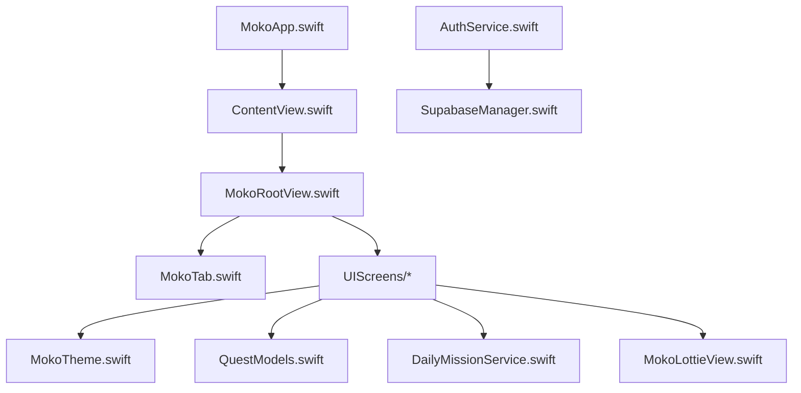
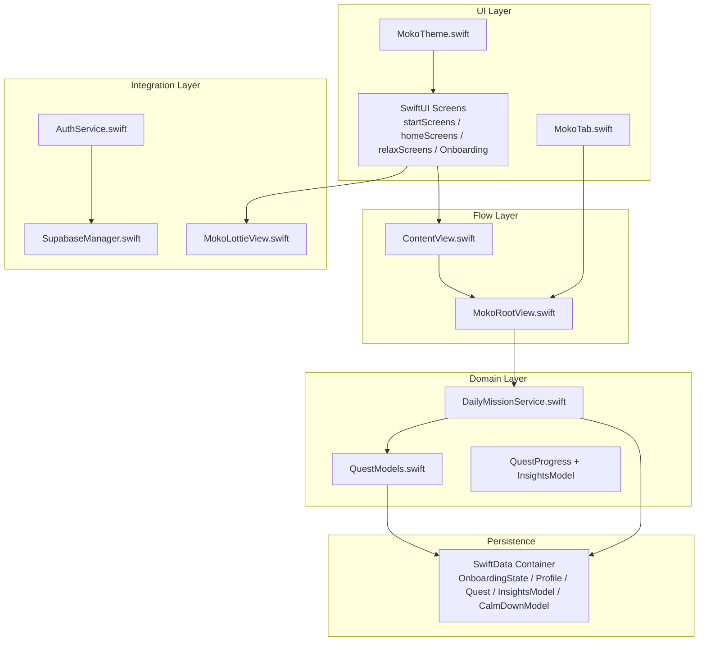
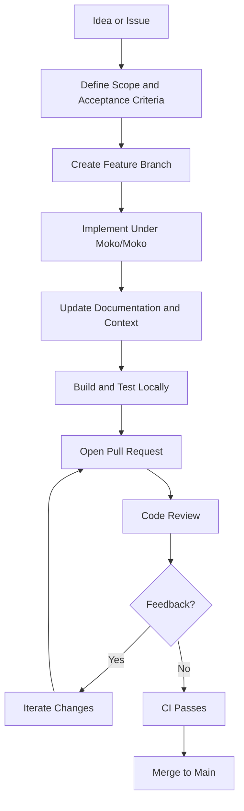
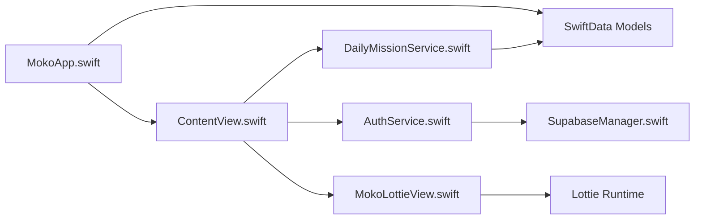
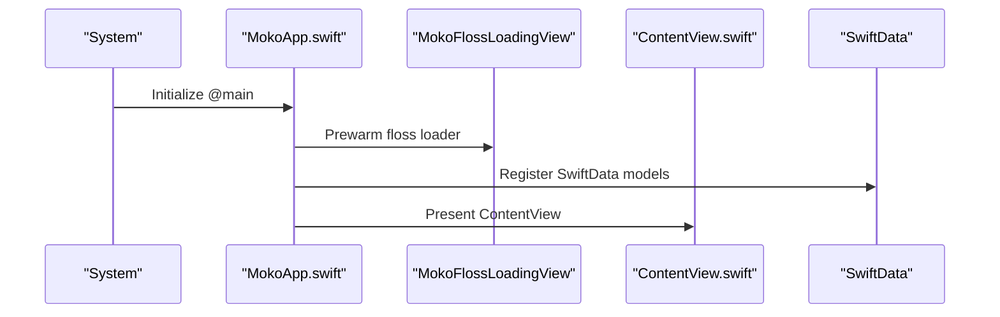
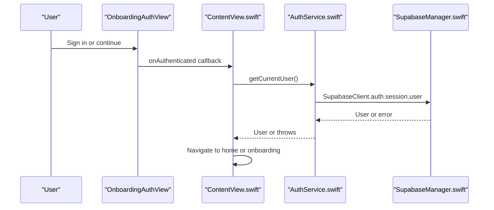
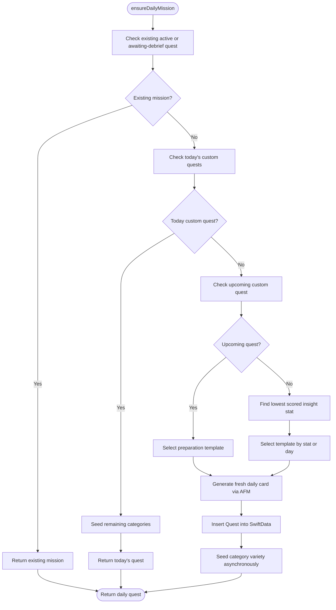

# Development Guidelines

<cite>
**Referenced Files in This Document**
- [README.md](file://README.md)
- [context.md](file://context.md)
- [.github/workflows/swift.yml](file://.github/workflows/swift.yml)
- [MokoApp.swift](file://Moko/Moko/MokoApp.swift)
- [ContentView.swift](file://Moko/Moko/ContentView.swift)
- [MokoTab.swift](file://Moko/Moko/Models/MokoTab.swift)
- [MokoTheme.swift](file://Moko/Moko/UIScreens/startScreens/MokoTheme.swift)
- [QuestModels.swift](file://Moko/Moko/Models/QuestModels.swift)
- [AuthService.swift](file://Moko/Moko/AuthService.swift)
- [SupabaseManager.swift](file://Moko/Moko/SupabaseManager.swift)
- [DailyMissionService.swift](file://Moko/Moko/Features/AFM/DailyMissionService.swift)
- [MokoLottieView.swift](file://Moko/Moko/Features/Animation/MokoLottieView.swift)
</cite>

## Table of Contents
1. [Introduction](#introduction)
2. [Project Structure](#project-structure)
3. [Core Components](#core-components)
4. [Architecture Overview](#architecture-overview)
5. [Detailed Component Analysis](#detailed-component-analysis)
6. [Dependency Analysis](#dependency-analysis)
7. [Performance Considerations](#performance-considerations)
8. [Troubleshooting Guide](#troubleshooting-guide)
9. [Conclusion](#conclusion)
10. [Appendices](#appendices)

## Introduction
This document defines the development guidelines for contributing to Moko, an iOS native wellness app built with SwiftUI and SwiftData. It consolidates coding standards, branch strategy, commit conventions, pull request workflow, code review gates, acceptance criteria, feature addition and refactoring rules, backward compatibility practices, debugging and performance guidance, documentation standards, collaboration protocols, and the end-to-end contribution flow from idea to merged code.

The repository is a single Xcode project targeting iOS 26.5 with Swift 5.0 language mode. The active source tree is under `Moko/Moko/`. External tooling includes Supabase for authentication and remote content, Lottie and Rive for animations, and Apple Foundation Models (AFM) for mission generation and debrief coaching where available.

## Project Structure
Moko uses a flat, feature-oriented structure inside the compiled target:

- `Moko/Moko/` — compiled application sources and resources.
- `Moko/Moko/Models/` — data models, enums, formatting helpers, and shared value types.
- `Moko/Moko/Features/` — cross-cutting features such as AFM, Animation, Audio, and QuestLibrary.
- `Moko/Moko/UIScreens/` — SwiftUI screens grouped by user flow.
- `Moko/Moko/Resources/Animations/` — Lottie JSON and Rive assets.
- `supabase/` — SQL migrations and seeds for remote content.
- `.github/workflows/swift.yml` — GitHub Actions workflow file.

Important build rule: the app target uses a synchronized root group at `Moko/Moko/`, so only files under that path are compiled into the app. Duplicate folders such as `Moko/Features/` or `Moko/RiveProjects/` are not part of the app target.

**Diagram sources**
- [MokoApp.swift:11-45](file://Moko/Moko/MokoApp.swift#L11-L45)
- [ContentView.swift:12-213](file://Moko/Moko/ContentView.swift#L12-L213)
- [MokoTab.swift:10-17](file://Moko/Moko/Models/MokoTab.swift#L10-L17)
- [MokoTheme.swift:10-89](file://Moko/Moko/UIScreens/startScreens/MokoTheme.swift#L10-L89)
- [QuestModels.swift:51-127](file://Moko/Moko/Models/QuestModels.swift#L51-L127)
- [DailyMissionService.swift:19-225](file://Moko/Moko/Features/AFM/DailyMissionService.swift#L19-L225)
- [MokoLottieView.swift:5-23](file://Moko/Moko/Features/Animation/MokoLottieView.swift#L5-L23)
- [AuthService.swift:15-58](file://Moko/Moko/AuthService.swift#L15-L58)
- [SupabaseManager.swift:6-19](file://Moko/Moko/SupabaseManager.swift#L6-L19)

**Section sources**
- [context.md:46-58](file://context.md#L46-L58)
- [context.md:77-111](file://context.md#L77-L111)
- [README.md:180-207](file://README.md#L180-L207)

## Core Components
This section summarizes the core components contributors will touch most often.

- Application entry and data container: `MokoApp.swift` initializes global UI appearance, prewarms the floss loader, and registers SwiftData models.
- App flow controller: `ContentView.swift` drives the state machine across splash, intro, auth, onboarding, reflection, microphone permission, account deletion, and home.
- Navigation model: `MokoTab.swift` is the single source of truth for tabs.
- Design system: `MokoTheme.swift` centralizes colors, semantic tokens, haptic feedback helpers, primary button style, and decorative ornament.
- Data models and progression: `QuestModels.swift` defines quest-related enums, SwiftData models, current user identity, database helpers, styling, and date formatting utilities.
- Authentication service: `AuthService.swift` wraps Supabase sign-up, sign-in, sign-out, current user retrieval, and account deletion via an edge function.
- Remote client configuration: `SupabaseManager.swift` provides the shared Supabase client instance.
- Daily mission planning: `DailyMissionService.swift` ensures a daily mission exists, selects templates based on lowest scored insight parameters, prepares missions for upcoming custom quests, and seeds category variety.
- Mascot animation: `MokoLottieView.swift` renders Lottie animations through a SwiftUI representable with fallback bundle search paths.

**Section sources**
- [MokoApp.swift:11-45](file://Moko/Moko/MokoApp.swift#L11-L45)
- [ContentView.swift:12-213](file://Moko/Moko/ContentView.swift#L12-L213)
- [MokoTab.swift:10-17](file://Moko/Moko/Models/MokoTab.swift#L10-L17)
- [MokoTheme.swift:10-131](file://Moko/Moko/UIScreens/startScreens/MokoTheme.swift#L10-L131)
- [QuestModels.swift:13-127](file://Moko/Moko/Models/QuestModels.swift#L13-L127)
- [AuthService.swift:15-58](file://Moko/Moko/AuthService.swift#L15-L58)
- [SupabaseManager.swift:6-19](file://Moko/Moko/SupabaseManager.swift#L6-L19)
- [DailyMissionService.swift:19-303](file://Moko/Moko/Features/AFM/DailyMissionService.swift#L19-L303)
- [MokoLottieView.swift:5-83](file://Moko/Moko/Features/Animation/MokoLottieView.swift#L5-L83)

## Architecture Overview
Moko follows a layered SwiftUI architecture:

- UI layer: SwiftUI views organized by screen area and feature.
- Flow layer: `ContentView` orchestrates high-level navigation states.
- Domain layer: SwiftData models and services such as `DailyMissionService` and `QuestProgress` encapsulate business logic.
- Integration layer: `AuthService` and `SupabaseManager` integrate with Supabase; animation layers integrate Lottie and Rive.
- Data persistence: SwiftData stores onboarding, profile, insights, calm-down sessions, and quests.

**Diagram sources**
- [ContentView.swift:12-213](file://Moko/Moko/ContentView.swift#L12-L213)
- [MokoTab.swift:10-17](file://Moko/Moko/Models/MokoTab.swift#L10-L17)
- [MokoTheme.swift:10-89](file://Moko/Moko/UIScreens/startScreens/MokoTheme.swift#L10-L89)
- [QuestModels.swift:51-127](file://Moko/Moko/Models/QuestModels.swift#L51-L127)
- [DailyMissionService.swift:19-225](file://Moko/Moko/Features/AFM/DailyMissionService.swift#L19-L225)
- [AuthService.swift:15-58](file://Moko/Moko/AuthService.swift#L15-L58)
- [SupabaseManager.swift:6-19](file://Moko/Moko/SupabaseManager.swift#L6-L19)
- [MokoLottieView.swift:5-83](file://Moko/Moko/Features/Animation/MokoLottieView.swift#L5-L83)
- [MokoApp.swift:31-44](file://Moko/Moko/MokoApp.swift#L31-L44)

## Detailed Component Analysis

### Coding Standards for Swift and SwiftUI
- Naming conventions
  - Use PascalCase for types, enums, structs, classes, and view names.
  - Use camelCase for properties, methods, and local variables.
  - Keep enum cases readable and consistent with surrounding code.
  - Prefer descriptive file names matching the type they contain.
- Code organization
  - Place new SwiftUI views under `Moko/Moko/UIScreens/<area>/`.
  - Put domain logic in `Moko/Moko/Features/<feature>/` or `Moko/Moko/Models/`.
  - Avoid adding duplicate copies outside `Moko/Moko/`; only that subtree compiles.
- State management
  - Use `@State`, `@Binding`, `@Environment`, and `@AppStorage` appropriately.
  - Keep cross-screen actions through environment values rather than passing large view models.
- Actors and concurrency
  - Shared services should be `@MainActor enum` or `@MainActor @Observable final class` when they mutate UI state.
  - Value types crossing actor boundaries should be marked `nonisolated` when safe.
- Error handling
  - Expose loading, empty, and error states for network-backed screens.
  - Throw typed errors from services and render user-facing messages in views.
- Accessibility and motion
  - Respect `accessibilityReduceMotion`.
  - Add `accessibilityLabel` for decorative animations and meaningful controls.
- Documentation
  - Use concise file headers and comments explaining why, not just what.
  - Update `context.md` when behavior changes.

**Section sources**
- [context.md:270-287](file://context.md#L270-L287)
- [context.md:249-251](file://context.md#L249-L251)
- [context.md:284-285](file://context.md#L284-L285)

### Branch Strategy and Commit Messages
- Branch naming
  - `feature/<short-name>` for new functionality.
  - `fix/<short-name>` for bug fixes.
  - `chore/<short-name>` for maintenance tasks.
- Base branch
  - Branch from `main`.
- Commit message format
  - Use imperative present tense.
  - Keep commits small and focused.
  - Example pattern: `Add pause state to breathing timer`.

**Section sources**
- [README.md:313-320](file://README.md#L313-L320)

### Pull Request Process and Quality Gates
- Open a pull request against `main`.
- Include screenshots or screen recordings for UI changes.
- CI must pass before merge.
- Required quality gates
  - Builds without new warnings.
  - Changes are inside `Moko/Moko/**`.
  - New SwiftData properties have defaults.
  - Supabase-backed screens show loading, empty, and error states.
  - AFM paths degrade to static fallbacks.
  - Reduce Motion and accessibility labels are respected.
  - No secrets added; no `service_role` key on the client.
  - `context.md` updated when relevant behavior changes.

**Section sources**
- [README.md:313-320](file://README.md#L313-L320)
- [context.md:341-350](file://context.md#L341-L350)

### Acceptance Criteria
A change is ready for review when:
- It builds locally and passes CI.
- It affects only the intended target directory.
- It preserves existing flows and does not break onboarding completion.
- It handles offline, network failure, and empty-state scenarios.
- It degrades gracefully when Apple Foundation Models are unavailable.
- It respects motion preferences and accessibility requirements.
- It avoids committing secrets or sensitive data.
- It updates documentation and context when behavior changes.

**Section sources**
- [context.md:341-350](file://context.md#L341-L350)

### Adding New Features
Guidelines:
- Start from `main` and create a feature branch.
- Implement UI in `UIScreens`, domain logic in `Features` or `Models`.
- If adding a SwiftData model, provide default values for migration safety.
- If integrating Supabase, expose loading, empty, and error states.
- If using AFM, ensure a static fallback path exists.
- Add animations only if they respect Reduce Motion and include accessibility labels.
- Update `context.md` with the new feature’s location and behavior.

**Section sources**
- [context.md:341-350](file://context.md#L341-L350)
- [context.md:270-287](file://context.md#L270-L287)

### Refactoring Existing Code
Guidelines:
- Preserve public behavior unless explicitly breaking and documented.
- Keep SwiftData migrations implicit by providing defaults.
- Consolidate duplicated token sets under `MokoTheme`.
- Avoid renaming files within a folder unless the whole folder is being normalized.
- Keep networking services consistent: loading, error, and attempt tracking.

**Section sources**
- [context.md:239-244](file://context.md#L239-L244)
- [context.md:286-287](file://context.md#L286-L287)
- [context.md:328-329](file://context.md#L328-L329)

### Maintaining Backward Compatibility
- SwiftData
  - Always add default values to new properties.
  - Do not assume schema versioning; rely on implicit migration safety.
- UI
  - Keep tab bar configuration stable.
  - Preserve deep navigation patterns such as debrief resume and overview modes.
- AFM
  - Never block UI on model availability; always use fallback logic.

**Section sources**
- [context.md:328-329](file://context.md#L328-L329)
- [context.md:323-324](file://context.md#L323-L324)
- [context.md:327-327](file://context.md#L327-L327)

### Debugging Strategies
- Build and run
  - Use Xcode scheme `Moko` and an iPhone simulator.
  - Verify target membership is under `Moko/Moko/`.
- Logging
  - Use print statements sparingly; remove noisy logs before merging.
  - For animation loading, check bundle path resolution and asset names.
- Network
  - Validate Supabase URL and anon key configuration.
  - Confirm edge functions require server-side service role keys.
- AFM
  - Test both live AFM and static fallback paths.
  - Ensure UI remains responsive when model calls fail.

**Section sources**
- [context.md:60-73](file://context.md#L60-L73)
- [context.md:311-337](file://context.md#L311-L337)
- [MokoLottieView.swift:33-76](file://Moko/Moko/Features/Animation/MokoLottieView.swift#L33-L76)
- [AuthService.swift:44-58](file://Moko/Moko/AuthService.swift#L44-L58)

### Profiling Tools and Performance Optimization Techniques
- Instruments
  - Time Profiler for CPU hotspots.
  - Allocations and Leaks for memory issues.
  - Energy Log for battery impact.
  - Core Animation for rendering stalls.
- SwiftUI performance
  - Minimize unnecessary view recomputation.
  - Avoid heavy work on the main thread.
  - Use `Task` for background operations.
- Animation performance
  - Keep mascot animations purely presentational.
  - Respect Reduce Motion.
  - Preload expensive loaders where appropriate.
- Data access
  - Use `@Query` and `modelContext` instead of custom database wrappers.
  - Avoid blocking UI on AFM or network calls.

**Section sources**
- [context.md:255-267](file://context.md#L255-L267)
- [context.md:270-287](file://context.md#L270-L287)
- [README.md:111-148](file://README.md#L111-L148)

### Examples of Well-Structured Code
- Centralized design tokens
  - Use `MokoTheme` for colors, semantics, and haptics.
- Shared tab model
  - Define tabs once in `MokoTab` and consume them across views.
- Service-based mission planning
  - Use `DailyMissionService` to compute daily missions deterministically.
- Safe animation integration
  - Wrap Lottie in a SwiftUI view with clear fallback behavior.

**Section sources**
- [MokoTheme.swift:10-131](file://Moko/Moko/UIScreens/startScreens/MokoTheme.swift#L10-L131)
- [MokoTab.swift:10-17](file://Moko/Moko/Models/MokoTab.swift#L10-L17)
- [DailyMissionService.swift:19-303](file://Moko/Moko/Features/AFM/DailyMissionService.swift#L19-L303)
- [MokoLottieView.swift:5-83](file://Moko/Moko/Features/Animation/MokoLottieView.swift#L5-L83)

### Proper Error Handling Patterns
- Services throw errors for network and configuration failures.
- Views render error states and do not crash on missing data.
- Account deletion requires a deployed edge function and server-side secret; never place service role keys in the app.

**Section sources**
- [AuthService.swift:44-58](file://Moko/Moko/AuthService.swift#L44-L58)
- [context.md:319-322](file://context.md#L319-L322)

### Documentation Standards
- Keep `context.md` factual and up to date.
- Record toolchain, target membership, feature status, pitfalls, and checklist outcomes.
- Update the change log after each session.
- Avoid including personal data, real user information, or secrets in issues, PRs, or screenshots.

**Section sources**
- [context.md:1-5](file://context.md#L1-L5)
- [context.md:354-360](file://context.md#L354-L360)
- [README.md:320-320](file://README.md#L320-L320)

### Team Collaboration Practices
- Issue reporting
  - Reproduce steps clearly.
  - Attach device, iOS version, and build info.
  - Avoid sensitive data.
- Communication
  - Reference related issues and PRs.
  - Explain trade-offs in PR descriptions.
  - Keep discussions focused on code, UX, and privacy.
- Review expectations
  - Reviewers verify quality gates, accessibility, performance, and security.
  - Authors respond to feedback promptly and update branches.

**Section sources**
- [README.md:313-320](file://README.md#L313-L320)
- [context.md:341-350](file://context.md#L341-L350)

### Contribution Workflow From Idea to Merged Code
1. Create an issue describing the problem or proposed feature.
2. Discuss scope, risks, and acceptance criteria.
3. Branch from `main` using `feature/<short-name>`.
4. Implement changes under `Moko/Moko/`.
5. Add tests where feasible and update documentation.
6. Run local build and test commands.
7. Open a pull request with description, screenshots, and links to related issues.
8. Address review feedback.
9. Ensure CI passes.
10. Merge after approvals and verification.

[No sources needed since this diagram shows conceptual workflow, not actual code structure]

## Dependency Analysis
Key dependencies and their roles:

- Supabase
  - Authentication and remote content.
  - Client configured in `SupabaseManager.swift`.
  - Edge function used for account deletion.
- Lottie
  - Legacy mascot animations rendered through `MokoLottieView`.
- Rive
  - Current mascot and badge animations.
- SwiftData
  - Local persistence for onboarding, profile, insights, calm-down sessions, and quests.
- SwiftUI
  - Primary UI framework.

**Diagram sources**
- [MokoApp.swift:31-44](file://Moko/Moko/MokoApp.swift#L31-L44)
- [ContentView.swift:12-213](file://Moko/Moko/ContentView.swift#L12-L213)
- [AuthService.swift:15-58](file://Moko/Moko/AuthService.swift#L15-L58)
- [SupabaseManager.swift:6-19](file://Moko/Moko/SupabaseManager.swift#L6-L19)
- [DailyMissionService.swift:19-225](file://Moko/Moko/Features/AFM/DailyMissionService.swift#L19-L225)
- [MokoLottieView.swift:5-83](file://Moko/Moko/Features/Animation/MokoLottieView.swift#L5-L83)

**Section sources**
- [context.md:34-44](file://context.md#L34-L44)
- [context.md:174-189](file://context.md#L174-L189)

## Performance Considerations
- Keep animations lightweight and optional.
- Avoid synchronous network calls on the main thread.
- Use SwiftData queries efficiently and avoid unnecessary reloads.
- Preload non-critical resources like the floss loader during splash.
- Respect Reduce Motion to improve perceived performance for users who prefer reduced animation.
- Monitor memory usage when loading multiple animations or images.

**Section sources**
- [context.md:255-267](file://context.md#L255-L267)
- [context.md:249-251](file://context.md#L249-L251)
- [MokoApp.swift:14-17](file://Moko/Moko/MokoApp.swift#L14-L17)

## Troubleshooting Guide
Common issues and resolutions:

- Editing the wrong copy
  - Only files under `Moko/Moko/` compile. Duplicates in `Moko/Features/` do not affect the app.
- README is stale
  - Trust `context.md` and the Xcode project for deployment target and toolchain details.
- CI is broken
  - The workflow runs `swift build` and `swift test` at the repo root, but there is no `Package.swift`. Fix or ignore knowingly until the workflow is corrected.
- No shared scheme or tests
  - Tests cannot run without a test target. Add tests and a proper scheme when possible.
- Secrets are hardcoded
  - Move secrets out of source. Never add a `service_role` key to the client.
- AFM unavailable
  - Always verify fallback behavior; do not block UI on model availability.
- Library quests not appearing as daily missions
  - Library quests are intentionally filtered from daily mission selection.
- Tab-bar quirks
  - Keep required tab bar modifiers for search activation.
- SwiftData migrations
  - Add defaults to new properties to support implicit migration.
- Assets incomplete
  - Provide fallbacks when image names are missing from the asset catalog.
- Supabase artifacts split
  - SQL migrations are at the repo root; edge functions are under `Moko/Moko/supabase/functions/`.

**Section sources**
- [context.md:311-337](file://context.md#L311-L337)

## Conclusion
Moko’s development guidelines emphasize clarity, safety, and consistency. Contributors should follow the established naming and organization conventions, keep changes inside the compiled target, handle errors and loading states explicitly, respect accessibility and motion preferences, and maintain backward compatibility through SwiftData defaults. The contribution workflow moves from idea to issue, scoped implementation, documentation, local validation, pull request review, CI verification, and merge. By adhering to these standards, the team can evolve Moko’s wellness experience while preserving reliability, privacy, and a calm user interface.

## Appendices

### Appendix A: Key Entry Points and Control Flows

#### App Initialization and Data Container

**Diagram sources**
- [MokoApp.swift:11-45](file://Moko/Moko/MokoApp.swift#L11-L45)
- [ContentView.swift:12-213](file://Moko/Moko/ContentView.swift#L12-L213)

#### Authentication Flow

**Diagram sources**
- [ContentView.swift:100-133](file://Moko/Moko/ContentView.swift#L100-L133)
- [AuthService.swift:39-42](file://Moko/Moko/AuthService.swift#L39-L42)
- [SupabaseManager.swift:6-19](file://Moko/Moko/SupabaseManager.swift#L6-L19)

#### Daily Mission Selection Logic

**Diagram sources**
- [DailyMissionService.swift:129-225](file://Moko/Moko/Features/AFM/DailyMissionService.swift#L129-L225)