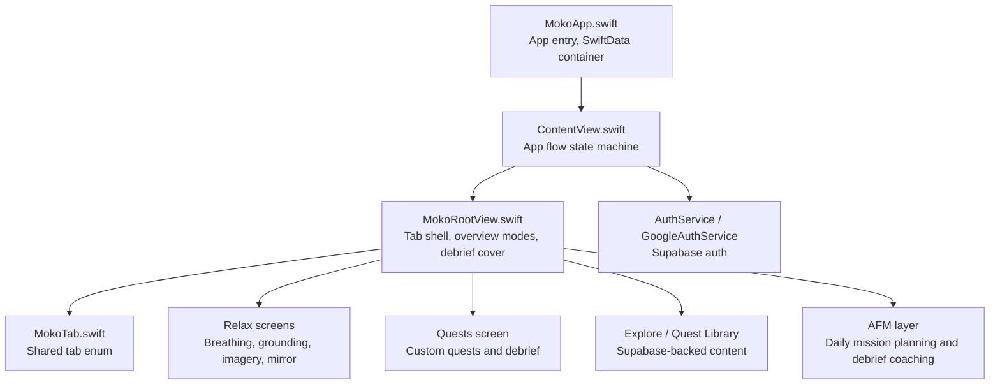
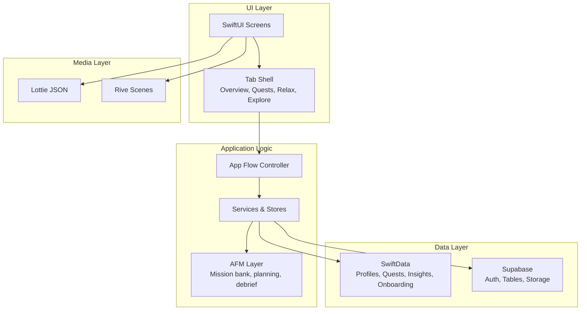
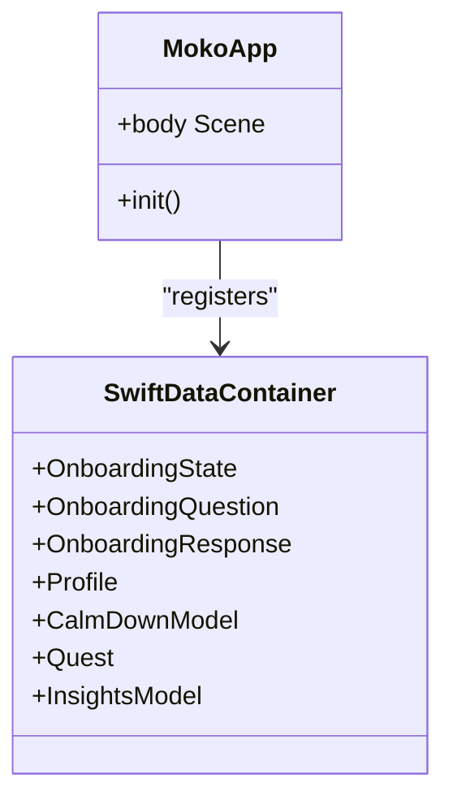
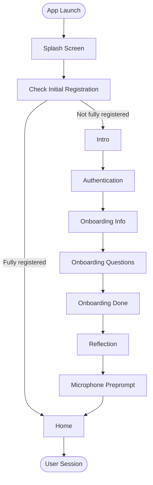
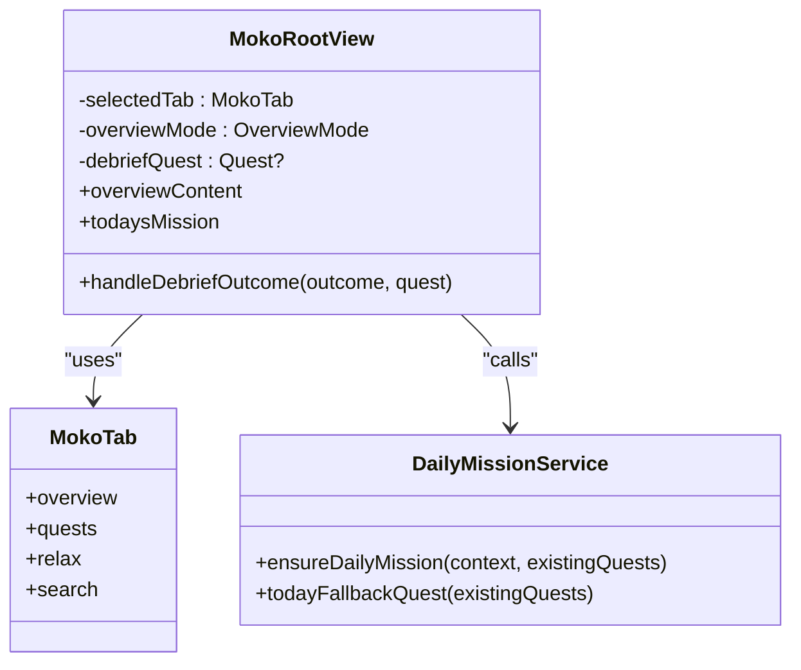
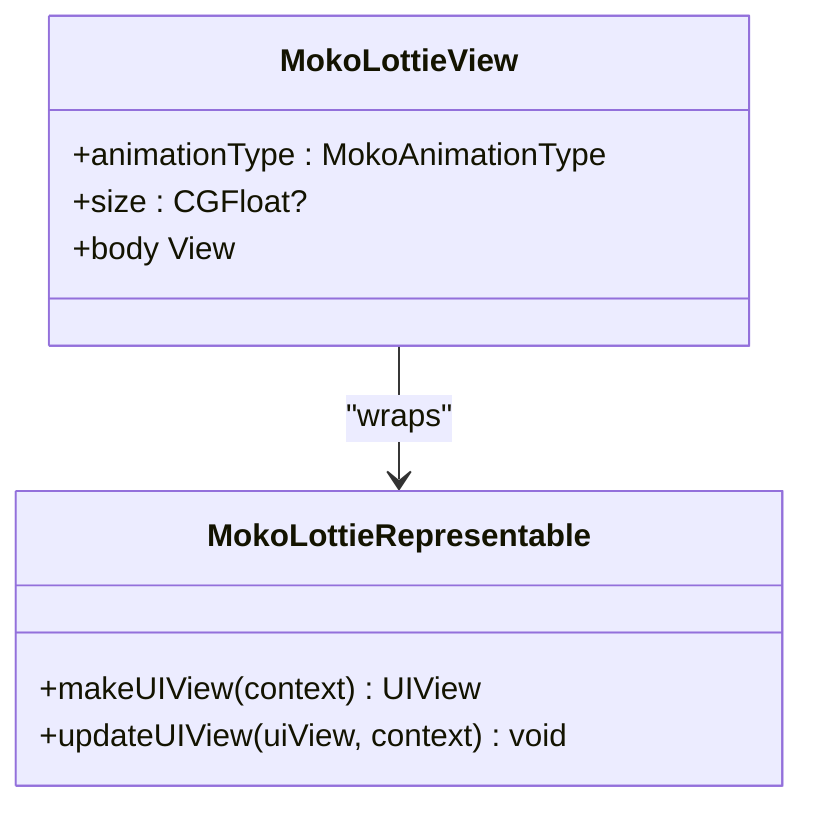
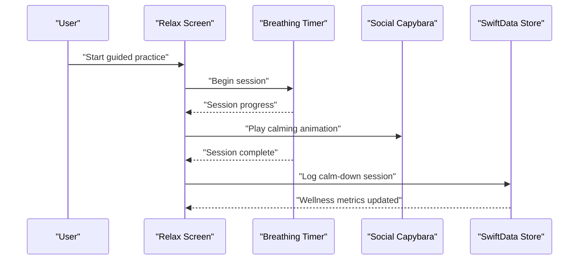
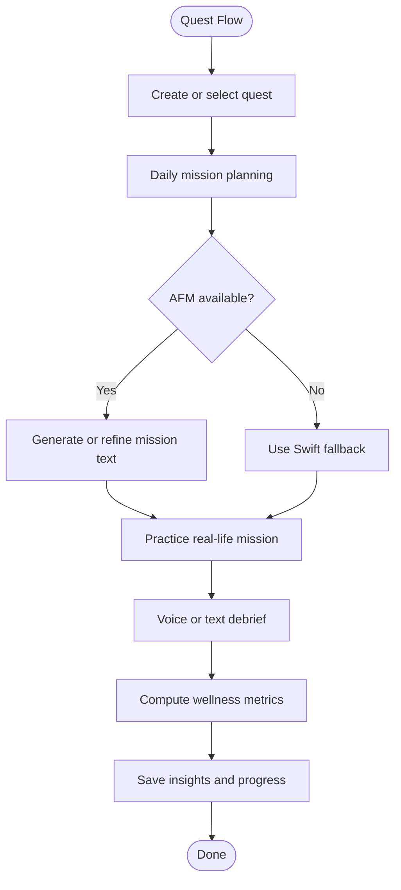
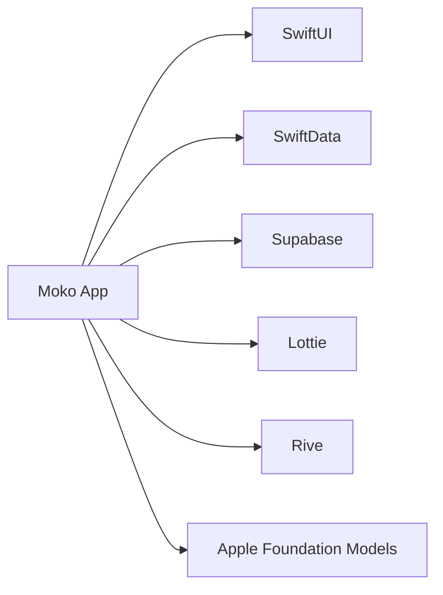

# Project Overview

<cite>
**Referenced Files in This Document**
- [README.md](file://README.md)
- [context.md](file://context.md)
- [MOKO_AFM_README.md](file://MOKO_AFM_README.md)
- [MokoApp.swift](file://Moko/Moko/MokoApp.swift)
- [ContentView.swift](file://Moko/Moko/ContentView.swift)
- [MokoRootView.swift](file://Moko/Moko/MokoRootView.swift)
- [MokoTab.swift](file://Moko/Moko/Models/MokoTab.swift)
- [MokoLottieView.swift](file://Moko/Moko/Features/Animation/MokoLottieView.swift)
</cite>

## Table of Contents
1. [Introduction](#introduction)
2. [Project Structure](#project-structure)
3. [Core Components](#core-components)
4. [Architecture Overview](#architecture-overview)
5. [Detailed Component Analysis](#detailed-component-analysis)
6. [Dependency Analysis](#dependency-analysis)
7. [Performance Considerations](#performance-considerations)
8. [Troubleshooting Guide](#troubleshooting-guide)
9. [Conclusion](#conclusion)

## Introduction
Moko is a native iOS social-wellness application centered on a calm capybara mascot that guides users through breathing exercises, reflection activities, and confidence-building missions. The app frames self-improvement as approachable daily practices rather than clinical interventions. Its core idea is simple: a friendly social capybara appears at meaningful moments to help users practice real-life social interactions, reflect afterward, and build emotional wellness over time.

The product is explicitly not a medical device and does not diagnose, treat, or prevent conditions. It focuses on guided practices, personal insights, and light gamification such as XP, streaks, and badges, while keeping privacy by default.

Key product principles include:
- Emotional wellness: helping users notice and name what they feel.
- Social confidence: building comfort in everyday interactions through small steps.
- Guided self-improvement: turning growth into structured activities that fit into a day.
- Gamification with restraint: rewarding consistency without punishing missed days.
- Privacy by default: keeping onboarding and reflection data under user control.

Target audience:
- People who want gentle, structured support for social confidence and emotional awareness.
- Users who prefer Apple-native interfaces, calming visuals, and non-punishing progress tracking.
- Anyone looking for short, guided practices like breathing, grounding, imagery, and mirror reflection.

How Moko differs from other wellness apps:
- The social capybara is presentational and supportive rather than intrusive.
- Real-life social missions are paired with voice or text debriefing and insight scores.
- Wellness metrics focus on Courage, Clarity, Presence, and Warmth instead of generic mood-only tracking.
- Local-first storage keeps private data on-device unless the user chooses otherwise.
- Gamification is intentionally restrained; streaks and badges reward consistency but do not shame absence.

**Section sources**
- [README.md:41-52](file://README.md#L41-L52)
- [README.md:79-90](file://README.md#L79-L90)
- [context.md:11-20](file://context.md#L11-L20)
- [context.md:291-307](file://context.md#L291-L307)

## Project Structure
At a high level, the project is an Xcode single-app target named `Moko`. The active source tree compiled into the app lives under `Moko/Moko/`, while supporting assets, Rive projects, and documentation live alongside it.

Important structural facts:
- The app entry point is `MokoApp.swift`, which registers SwiftData models and starts the root view.
- App flow state is managed in `ContentView.swift`, moving users from splash through intro, authentication, onboarding, reflection, and finally home.
- The signed-in shell is `MokoRootView.swift`, which owns the tab bar and overview modes.
- Tabs are defined once in `MokoTab.swift` so navigation has a single source of truth.
- Animation assets use Lottie JSON files and Rive scenes, rendered through helper views.
- Supabase provides authentication and remote content such as the quest library and imagery guides.

**Diagram sources**
- [MokoApp.swift:11-45](file://Moko/Moko/MokoApp.swift#L11-L45)
- [ContentView.swift:21-32](file://Moko/Moko/ContentView.swift#L21-L32)
- [MokoRootView.swift:14-58](file://Moko/Moko/MokoRootView.swift#L14-L58)
- [MokoTab.swift:10-17](file://Moko/Moko/Models/MokoTab.swift#L10-L17)

**Section sources**
- [context.md:24-58](file://context.md#L24-L58)
- [context.md:77-111](file://context.md#L77-L111)
- [README.md:151-207](file://README.md#L151-L207)

## Core Components
This section summarizes the main product components visible in the codebase.

| Component | Responsibility | Current status |
|---|---|---|
| App entry and data container | Initializes the app, prewarms loading helpers, and registers SwiftData models | Implemented |
| App flow controller | Drives splash, intro, authentication, onboarding, reflection, and home | Implemented |
| Tab shell | Manages Overview, Quests, Relax, and Explore tabs | Implemented |
| Social capybara mascot | Provides animated presence through Lottie and Rive | Integrated and being refined |
| Guided practices | Breathing, grounding, imagery, and mirror reflection | Partially implemented |
| Quest system | Custom missions, daily missions, and exploration cards | Implemented |
| Debrief and insights | Voice/text debrief, scoring, and wellness metrics | Implemented with AFM fallbacks |
| Profile and progression | XP, streaks, badges, costumes, settings, and account management | In progress |
| Authentication | Supabase email/password and Google sign-in | Architecture defined and partially integrated |
| Remote content | Quest library and imagery guides from Supabase | Implemented |

Wellness metrics are tracked per debrief and include Courage, Clarity, Presence, and Warmth. Calm-down sessions are also recorded locally as part of the wellness metrics and profile history.

**Section sources**
- [MokoApp.swift:11-45](file://Moko/Moko/MokoApp.swift#L11-L45)
- [ContentView.swift:21-32](file://Moko/Moko/ContentView.swift#L21-L32)
- [MokoRootView.swift:14-58](file://Moko/Moko/MokoRootView.swift#L14-L58)
- [context.md:145-190](file://context.md#L145-L190)
- [context.md:291-307](file://context.md#L291-L307)

## Architecture Overview
Moko follows a layered, Apple-native architecture:

- UI layer: SwiftUI screens and navigation.
- Application logic: Swift services, stores, and state machines.
- Local persistence: SwiftData for onboarding, profiles, quests, calm-down sessions, and insights.
- Authentication and remote content: Supabase for sign-in, tables, and storage buckets.
- Animation layer: Lottie JSON animations and Rive scenes for the social capybara mascot.
- Optional AI layer: Apple Foundation Models (AFM) for mission invention, card generation, and debrief coaching, with safe Swift fallbacks.

**Diagram sources**
- [MokoApp.swift:31-45](file://Moko/Moko/MokoApp.swift#L31-L45)
- [ContentView.swift:73-210](file://Moko/Moko/ContentView.swift#L73-L210)
- [MokoRootView.swift:14-99](file://Moko/Moko/MokoRootView.swift#L14-L99)
- [context.md:145-218](file://context.md#L145-L218)

## Detailed Component Analysis

### App Entry and Data Container
`MokoApp.swift` is the app’s entry point. It prewarms the local vector loader used by the floss animation, sets up segmented control appearance, creates the root `ContentView`, and registers SwiftData models including onboarding state, profiles, calm-down records, quests, and insights.

**Diagram sources**
- [MokoApp.swift:11-45](file://Moko/Moko/MokoApp.swift#L11-L45)

**Section sources**
- [MokoApp.swift:11-45](file://Moko/Moko/MokoApp.swift#L11-L45)

### App Flow Controller
`ContentView.swift` implements the top-level app flow as a state machine. It moves users through splash, intro, authentication, onboarding information, onboarding questions, completion, reflection, microphone permission, and finally home. It also handles session end reasons such as sign-out and account deletion.

**Diagram sources**
- [ContentView.swift:21-32](file://Moko/Moko/ContentView.swift#L21-L32)
- [ContentView.swift:73-210](file://Moko/Moko/ContentView.swift#L73-L210)

**Section sources**
- [ContentView.swift:21-32](file://Moko/Moko/ContentView.swift#L21-L32)
- [ContentView.swift:73-210](file://Moko/Moko/ContentView.swift#L73-L210)
- [context.md:115-143](file://context.md#L115-L143)

### Tab Shell and Navigation
`MokoRootView.swift` owns the tab shell and three overview modes: todo, resume, and debrief done. Tabs are defined once in `MokoTab.swift`, ensuring consistent navigation across the app. The overview guarantees a daily mission, supports resuming unfinished debriefs, and integrates with the AFM daily mission service.

**Diagram sources**
- [MokoRootView.swift:14-99](file://Moko/Moko/MokoRootView.swift#L14-L99)
- [MokoRootView.swift:136-145](file://Moko/Moko/MokoRootView.swift#L136-L145)
- [MokoTab.swift:10-17](file://Moko/Moko/Models/MokoTab.swift#L10-L17)

**Section sources**
- [MokoRootView.swift:14-99](file://Moko/Moko/MokoRootView.swift#L14-L99)
- [MokoRootView.swift:136-173](file://Moko/Moko/MokoRootView.swift#L136-L173)
- [MokoTab.swift:10-17](file://Moko/Moko/Models/MokoTab.swift#L10-L17)

### Social Capybara Mascot and Animations
The social capybara is a presentational mascot that appears during welcome, breathing sessions, completion states, idle states, and profile milestones. Animations are provided by Lottie JSON files and Rive scenes. `MokoLottieView.swift` wraps Lottie animations inside a fixed SwiftUI viewport and respects accessibility preferences.

**Diagram sources**
- [MokoLottieView.swift:5-22](file://Moko/Moko/Features/Animation/MokoLottieView.swift#L5-L22)
- [MokoLottieView.swift:25-82](file://Moko/Moko/Features/Animation/MokoLottieView.swift#L25-L82)

**Section sources**
- [README.md:111-148](file://README.md#L111-L148)
- [MokoLottieView.swift:5-82](file://Moko/Moko/Features/Animation/MokoLottieView.swift#L5-L82)
- [context.md:255-267](file://context.md#L255-L267)

### Guided Practices and Wellness Metrics
Guided practices include breathing, grounding, imagery, and mirror reflection. Breathing sessions have start, pause, resume, reset, and completion states. Calm-down sessions are stored locally and contribute to wellness metrics. Insights are scored per debrief using Courage, Clarity, Presence, and Warmth.

**Diagram sources**
- [README.md:79-90](file://README.md#L79-L90)
- [context.md:145-173](file://context.md#L145-L173)

**Section sources**
- [README.md:79-90](file://README.md#L79-L90)
- [context.md:145-173](file://context.md#L145-L173)

### Quest System and AFM Coaching
The quest system supports custom missions, daily missions, and library scenarios. Apple Foundation Models can generate mission text, review invented missions, and coach debriefs, but every AFM call has a Swift fallback. The debrief engine runs a fixed sequence of questions and computes evidence-weighted final scores.

**Diagram sources**
- [MOKO_AFM_README.md:17-23](file://MOKO_AFM_README.md#L17-L23)
- [MOKO_AFM_README.md:36-45](file://MOKO_AFM_README.md#L36-L45)
- [context.md:193-218](file://context.md#L193-L218)

**Section sources**
- [MOKO_AFM_README.md:1-63](file://MOKO_AFM_README.md#L1-L63)
- [context.md:193-218](file://context.md#L193-L218)

## Dependency Analysis
The app depends on several key technologies:

- SwiftUI for screens and navigation.
- SwiftData for local persistence.
- Supabase for authentication and remote content.
- Lottie for legacy JSON mascot animations.
- Rive for current mascot and badge animations.
- Apple Foundation Models for optional AI-assisted mission and debrief features.

**Diagram sources**
- [README.md:151-162](file://README.md#L151-L162)
- [context.md:34-44](file://context.md#L34-L44)

**Section sources**
- [README.md:151-162](file://README.md#L151-L162)
- [context.md:34-44](file://context.md#L34-L44)

## Performance Considerations
- The breathing timer is independent of the mascot animation, so dropped frames do not affect timing accuracy.
- Lottie animations are presentational and should not block core logic.
- AFM calls must never block the UI; every call has a Swift fallback.
- Remote content loaders intentionally delay to avoid flicker and provide a smooth experience.
- Reduce Motion and accessibility labels are respected across animations and interactive elements.

[No sources needed since this section provides general guidance]

## Troubleshooting Guide
Common issues and their context:

- Editing the wrong copy: Only files under `Moko/Moko/` are compiled into the app. Duplicate files under `Moko/Features/` are not part of the build.
- README drift: The repository README may describe older toolchain requirements; trust the project configuration and context file when they disagree.
- CI configuration: The workflow references commands that may not match the current project layout; verify before relying on automated builds.
- Secrets handling: Do not commit secrets or client-side service role keys. Supabase and Google credentials should be configured securely.
- AFM availability: Apple Foundation Models require eligible devices; always test fallback paths.
- SwiftData migrations: New model properties should have defaults to allow implicit migration.

**Section sources**
- [context.md:311-335](file://context.md#L311-L335)

## Conclusion
Moko positions itself as a calm, socially focused wellness app where a social capybara helps users practice real-life confidence, reflect on experiences, and track wellness metrics over time. Its architecture combines SwiftUI, SwiftData, Supabase, Lottie, Rive, and optional Apple Foundation Models. The app emphasizes emotional wellness, guided self-improvement, restrained gamification, and privacy by default. While many core flows are implemented, some areas remain in progress, including deeper insights summaries, full authentication integration, widgets, Live Activities, and automated testing.

[No sources needed since this section summarizes without analyzing specific files]