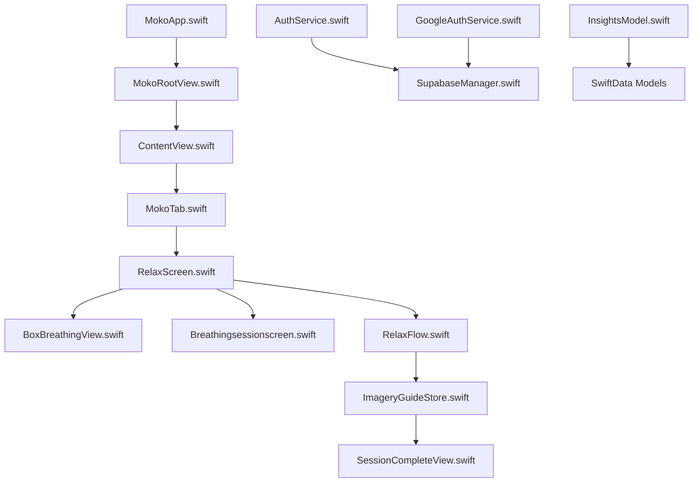
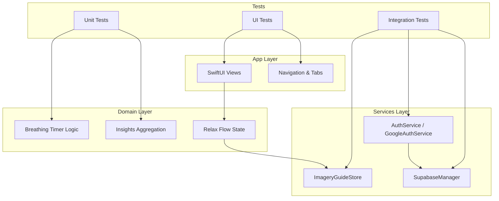
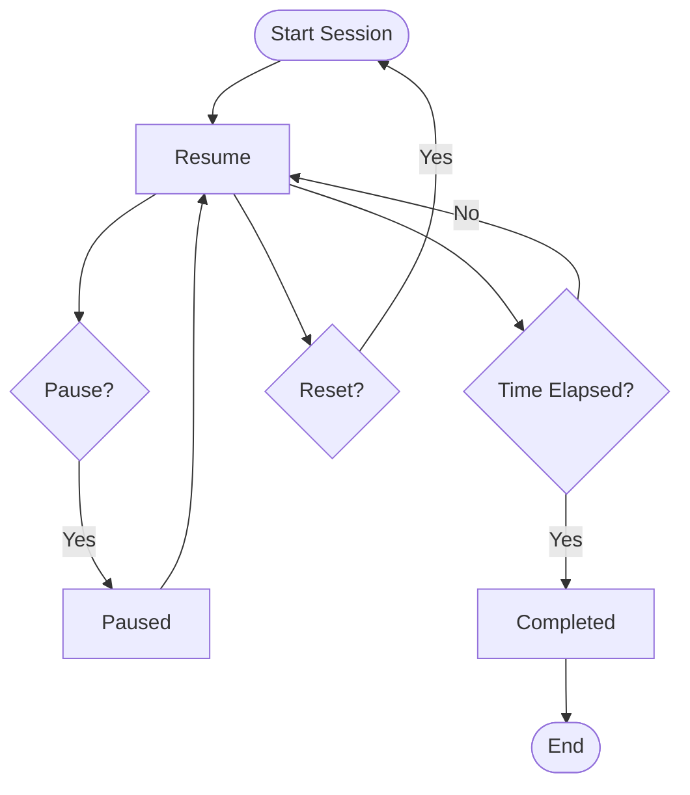
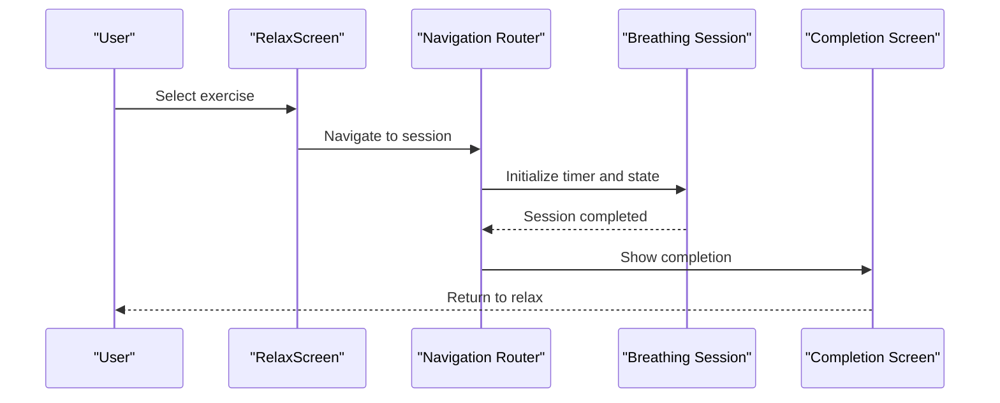
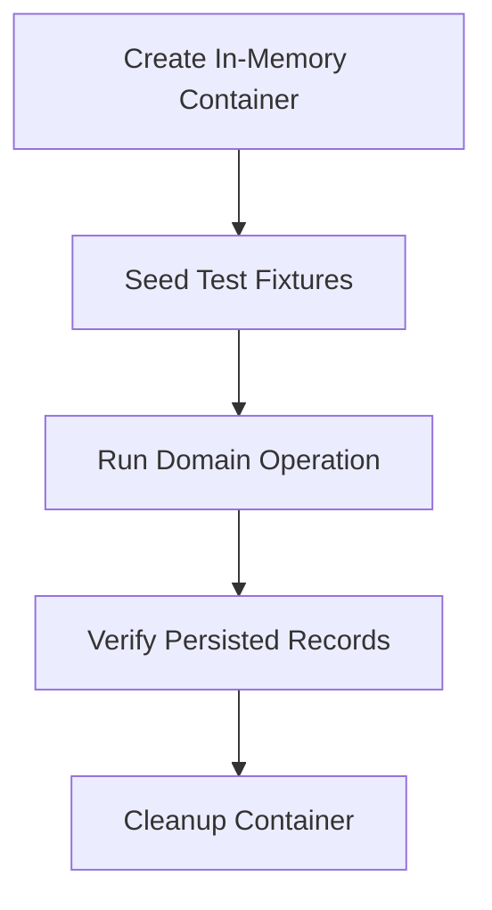
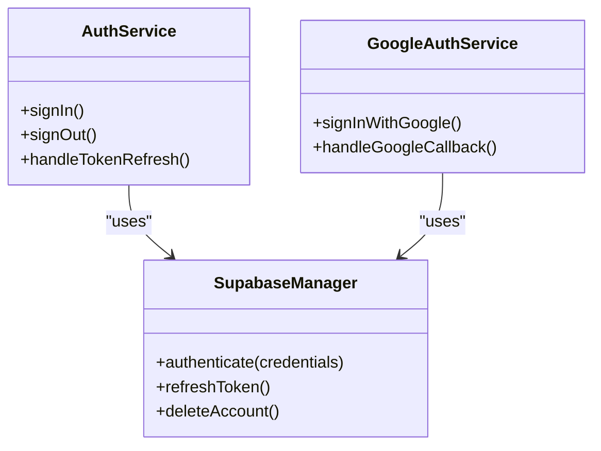
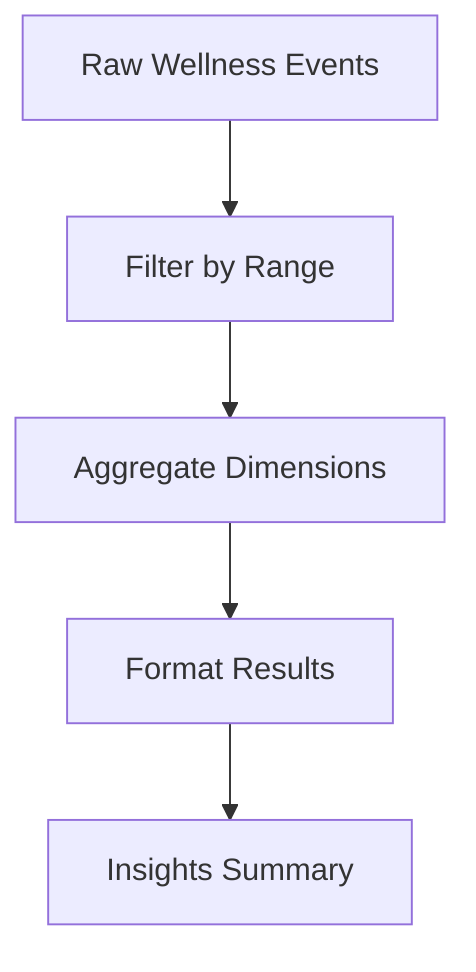
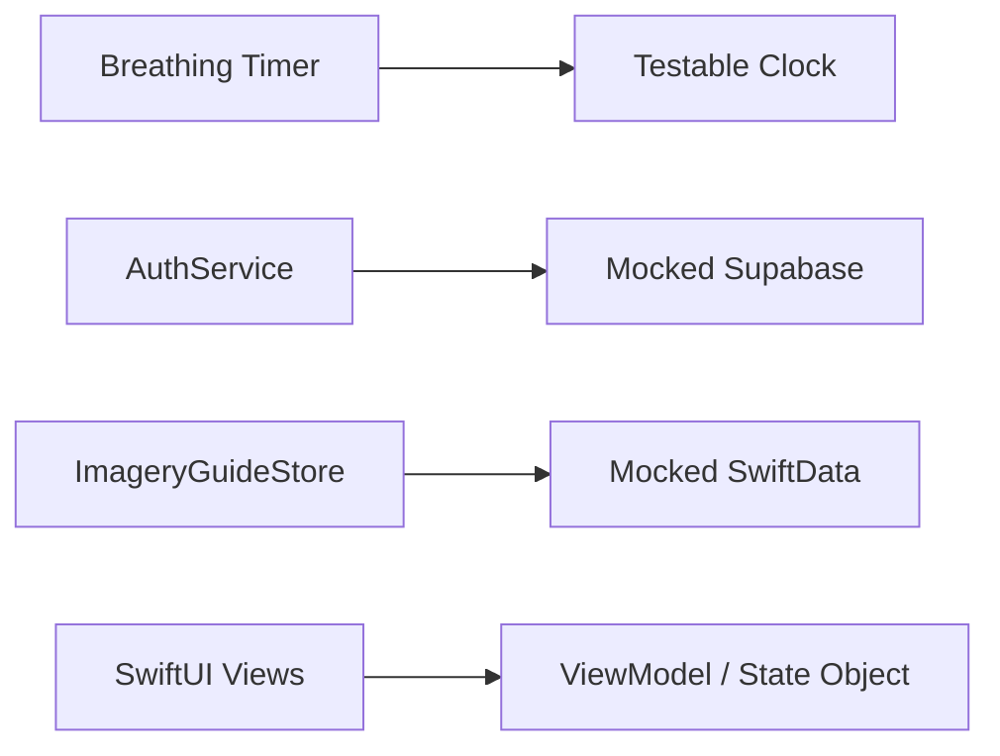

# Testing Strategy

<cite>
**Referenced Files in This Document**
- [README.md](file://README.md)
- [.github/workflows/swift.yml](file://.github/workflows/swift.yml)
- [MokoApp.swift](file://Moko/Moko/MokoApp.swift)
- [ContentView.swift](file://Moko/Moko/ContentView.swift)
- [MokoRootView.swift](file://Moko/Moko/MokoRootView.swift)
- [MokoTab.swift](file://Moko/Moko/Models/MokoTab.swift)
- [RelaxScreen.swift](file://Moko/Moko/UIScreens/relaxScreens/RelaxScreen.swift)
- [BoxBreathingView.swift](file://Moko/Moko/UIScreens/relaxScreens/BoxBreathing/BoxBreathingView.swift)
- [BoxBreathingInfoView.swift](file://Moko/Moko/UIScreens/relaxScreens/BoxBreathing/BoxBreathingInfoView.swift)
- [Breathingsessionscreen.swift](file://Moko/Moko/UIScreens/relaxScreens/Breathing/Breathingsessionscreen.swift)
- [ImageryGuideStore.swift](file://Moko/Moko/UIScreens/relaxScreens/ImageryGuide/ImageryGuideStore.swift)
- [RelaxFlow.swift](file://Moko/Moko/UIScreens/relaxScreens/ImageryGuide/RelaxFlow.swift)
- [SessionCompleteView.swift](file://Moko/Moko/UIScreens/relaxScreens/ImageryGuide/SessionCompleteView.swift)
- [InsightsModel.swift](file://Moko/Moko/Models/InsightsModel.swift)
- [AuthService.swift](file://Moko/Moko/AuthService.swift)
- [GoogleAuthService.swift](file://Moko/Moko/GoogleAuthService.swift)
- [SupabaseManager.swift](file://Moko/Moko/SupabaseManager.swift)
</cite>

## Table of Contents
1. [Introduction](#introduction)
2. [Project Structure](#project-structure)
3. [Core Components](#core-components)
4. [Architecture Overview](#architecture-overview)
5. [Detailed Component Analysis](#detailed-component-analysis)
6. [Dependency Analysis](#dependency-analysis)
7. [Performance Considerations](#performance-considerations)
8. [Troubleshooting Guide](#troubleshooting-guide)
9. [Conclusion](#conclusion)
10. [Appendices](#appendices)

## Introduction
This document defines the testing strategy for the Moko iOS app. It explains how unit tests, integration tests, and UI tests should be organized; how to mock external dependencies such as authentication and persistence; how test data should be managed; and how GitHub Actions integrates with automated testing. It also provides best practices for SwiftUI components, SwiftData models, service layers, breathing timer logic, navigation flows, and data persistence. Finally, it covers performance testing, memory leak detection, continuous integration monitoring, and guidelines for maintaining reliable tests.

The project is a native SwiftUI iOS application that uses Lottie animations, Supabase for authentication, and SwiftData for local private data. The README documents the current testing command, planned snapshot tests, and CI workflow behavior.

**Section sources**
- [README.md:244-261](file://README.md#L244-L261)
- [README.md:265-295](file://README.md#L265-L295)

## Project Structure
The repository contains the iOS app under `Moko/Moko`, feature modules under `Features`, UI screens under `UIScreens`, models under `Models`, and resources under `Resources`. The CI configuration lives under `.github/workflows`.

**Diagram sources**
- [MokoApp.swift](file://Moko/Moko/MokoApp.swift)
- [MokoRootView.swift](file://Moko/Moko/MokoRootView.swift)
- [ContentView.swift](file://Moko/Moko/ContentView.swift)
- [MokoTab.swift](file://Moko/Moko/Models/MokoTab.swift)
- [RelaxScreen.swift](file://Moko/Moko/UIScreens/relaxScreens/RelaxScreen.swift)
- [BoxBreathingView.swift](file://Moko/Moko/UIScreens/relaxScreens/BoxBreathing/BoxBreathingView.swift)
- [Breathingsessionscreen.swift](file://Moko/Moko/UIScreens/relaxScreens/Breathing/Breathingsessionscreen.swift)
- [RelaxFlow.swift](file://Moko/Moko/UIScreens/relaxScreens/ImageryGuide/RelaxFlow.swift)
- [ImageryGuideStore.swift](file://Moko/Moko/UIScreens/relaxScreens/ImageryGuide/ImageryGuideStore.swift)
- [SessionCompleteView.swift](file://Moko/Moko/UIScreens/relaxScreens/ImageryGuide/SessionCompleteView.swift)
- [AuthService.swift](file://Moko/Moko/AuthService.swift)
- [GoogleAuthService.swift](file://Moko/Moko/GoogleAuthService.swift)
- [SupabaseManager.swift](file://Moko/Moko/SupabaseManager.swift)
- [InsightsModel.swift](file://Moko/Moko/Models/InsightsModel.swift)

**Section sources**
- [README.md:180-207](file://README.md#L180-L207)
- [README.md:151-166](file://README.md#L151-L166)

## Core Components
The following components are central to testing:

- **App entry point and root view:** `MokoApp.swift` and `MokoRootView.swift` define the app lifecycle and top-level navigation. Tests should avoid launching the full app unless necessary; prefer isolated component tests.
- **Content and tab navigation:** `ContentView.swift` and `MokoTab.swift` manage shared tabs. Navigation tests should assert tab selection and route transitions without relying on system UI.
- **Relax flow:** `RelaxScreen.swift` hosts breathing, imagery, grounding, and mirror exercises. The breathing timer is independent from animation, which simplifies timing tests.
- **Breathing UI:** `BoxBreathingView.swift` and `BoxBreathingInfoView.swift` present box breathing guidance. Timer state transitions (start, pause, resume, reset, complete) should be tested through a dedicated timer abstraction or service.
- **Breathing session screen:** `Breathingsessionscreen.swift` coordinates timed sessions and completion.
- **Imagery guide flow:** `RelaxFlow.swift` and `ImageryGuideStore.swift` manage imagery guide state and session progression. `SessionCompleteView.swift` shows completion results.
- **Insights model:** `InsightsModel.swift` aggregates wellness metrics. Unit tests should verify aggregation logic across time ranges.
- **Authentication services:** `AuthService.swift` and `GoogleAuthService.swift` integrate with Supabase. Integration tests should mock network calls and token handling.
- **Supabase manager:** `SupabaseManager.swift` encapsulates remote operations. Service-layer tests should inject a mock implementation.

**Section sources**
- [MokoApp.swift](file://Moko/Moko/MokoApp.swift)
- [MokoRootView.swift](file://Moko/Moko/MokoRootView.swift)
- [ContentView.swift](file://Moko/Moko/ContentView.swift)
- [MokoTab.swift](file://Moko/Moko/Models/MokoTab.swift)
- [RelaxScreen.swift](file://Moko/Moko/UIScreens/relaxScreens/RelaxScreen.swift)
- [BoxBreathingView.swift](file://Moko/Moko/UIScreens/relaxScreens/BoxBreathing/BoxBreathingView.swift)
- [BoxBreathingInfoView.swift](file://Moko/Moko/UIScreens/relaxScreens/BoxBreathing/BoxBreathingInfoView.swift)
- [Breathingsessionscreen.swift](file://Moko/Moko/UIScreens/relaxScreens/Breathing/Breathingsessionscreen.swift)
- [RelaxFlow.swift](file://Moko/Moko/UIScreens/relaxScreens/ImageryGuide/RelaxFlow.swift)
- [ImageryGuideStore.swift](file://Moko/Moko/UIScreens/relaxScreens/ImageryGuide/ImageryGuideStore.swift)
- [SessionCompleteView.swift](file://Moko/Moko/UIScreens/relaxScreens/ImageryGuide/SessionCompleteView.swift)
- [InsightsModel.swift](file://Moko/Moko/Models/InsightsModel.swift)
- [AuthService.swift](file://Moko/Moko/AuthService.swift)
- [GoogleAuthService.swift](file://Moko/Moko/GoogleAuthService.swift)
- [SupabaseManager.swift](file://Moko/Moko/SupabaseManager.swift)

## Architecture Overview
The testing architecture follows a layered approach:

- **Unit tests:** Pure logic for timers, insights aggregation, validation, and domain rules.
- **Integration tests:** Services interacting with mocked persistence and network layers.
- **UI tests:** SwiftUI view rendering, navigation flows, and user interactions using XCTest UI automation.

[No diagram sources needed since this diagram shows conceptual testing architecture, not actual code structure]

## Detailed Component Analysis

### Breathing Timer Logic
The breathing timer is independent from animation, making it suitable for deterministic unit tests. Recommended test coverage includes:

- Start, pause, resume, reset, and completion transitions.
- Time accumulation and phase boundaries.
- Cancellation and cleanup when the session ends or the view disappears.
- Edge cases: rapid taps, zero duration, negative durations, and very long sessions.

**Diagram sources**
- [BoxBreathingView.swift](file://Moko/Moko/UIScreens/relaxScreens/BoxBreathing/BoxBreathingView.swift)
- [Breathingsessionscreen.swift](file://Moko/Moko/UIScreens/relaxScreens/Breathing/Breathingsessionscreen.swift)

**Section sources**
- [README.md:79-90](file://README.md#L79-L90)
- [BoxBreathingView.swift](file://Moko/Moko/UIScreens/relaxScreens/BoxBreathing/BoxBreathingView.swift)
- [Breathingsessionscreen.swift](file://Moko/Moko/UIScreens/relaxScreens/Breathing/Breathingsessionscreen.swift)

### Navigation Flows
Navigation is driven by shared tabs and step enums. Tests should assert:

- Tab selection via `MokoTab`.
- Transition from relax list to session and completion states.
- Back navigation and state preservation.

**Diagram sources**
- [MokoTab.swift](file://Moko/Moko/Models/MokoTab.swift)
- [RelaxScreen.swift](file://Moko/Moko/UIScreens/relaxScreens/RelaxScreen.swift)
- [Breathingsessionscreen.swift](file://Moko/Moko/UIScreens/relaxScreens/Breathing/Breathingsessionscreen.swift)
- [SessionCompleteView.swift](file://Moko/Moko/UIScreens/relaxScreens/ImageryGuide/SessionCompleteView.swift)

**Section sources**
- [README.md:164-179](file://README.md#L164-L179)
- [MokoTab.swift](file://Moko/Moko/Models/MokoTab.swift)
- [RelaxScreen.swift](file://Moko/Moko/UIScreens/relaxScreens/RelaxScreen.swift)

### Data Persistence and SwiftData
Local private data uses SwiftData. Recommended testing strategies:

- Use an in-memory or temporary container for SwiftData during tests.
- Seed deterministic fixtures for onboarding responses, reflections, and progress.
- Assert persistence transactions succeed and roll back on errors.
- Validate schema migrations and default values.

[No diagram sources needed since this diagram shows conceptual persistence testing workflow]

**Section sources**
- [README.md:70-71](file://README.md#L70-L71)
- [README.md:303-308](file://README.md#L303-L308)

### Authentication and Service Layers
Authentication integrates with Supabase. Recommended testing strategies:

- Mock `SupabaseManager` for network calls and token handling.
- Inject a fake `AuthService` into views and flows.
- Test sign-in success, failure, token refresh, and account deletion flows.
- Ensure secrets are never committed and only public anon keys are used in client code.

**Diagram sources**
- [AuthService.swift](file://Moko/Moko/AuthService.swift)
- [GoogleAuthService.swift](file://Moko/Moko/GoogleAuthService.swift)
- [SupabaseManager.swift](file://Moko/Moko/SupabaseManager.swift)

**Section sources**
- [AuthService.swift](file://Moko/Moko/AuthService.swift)
- [GoogleAuthService.swift](file://Moko/Moko/GoogleAuthService.swift)
- [SupabaseManager.swift](file://Moko/Moko/SupabaseManager.swift)
- [README.md:228-239](file://README.md#L228-L239)

### Insights Aggregation
Insights aggregate presence, courage, clarity, and warmth dimensions. Unit tests should cover:

- Day, week, month, and year aggregations.
- Missing data handling and defaults.
- Rounding and formatting rules.
- Performance with large datasets.

**Diagram sources**
- [InsightsModel.swift](file://Moko/Moko/Models/InsightsModel.swift)

**Section sources**
- [README.md:255-260](file://README.md#L255-L260)
- [InsightsModel.swift](file://Moko/Moko/Models/InsightsModel.swift)

## Dependency Analysis
Testing must isolate dependencies to ensure reliability:

- External networks: Mock Supabase endpoints.
- System permissions: Mock microphone, camera, and location where applicable.
- Animations: Use reduced motion or static frames in tests.
- Time-based logic: Use a testable clock abstraction for timers.

[No diagram sources needed since this diagram shows conceptual dependency isolation]

**Section sources**
- [README.md:79-90](file://README.md#L79-L90)
- [README.md:303-308](file://README.md#L303-L308)

## Performance Considerations
Recommended performance testing practices:

- Measure timer accuracy over long sessions using simulated time.
- Profile SwiftUI view updates and animation rendering.
- Detect memory leaks using Xcode Instruments and Leaks instrument.
- Avoid heavy work on the main thread; offload network and persistence tasks.
- Monitor CI build times and optimize slow tests.

[No sources needed since this section provides general guidance]

## Troubleshooting Guide
Common issues and resolutions:

- **Flaky UI tests:** Stabilize asynchronous operations with explicit waits and assertions. Avoid relying on animation timing.
- **Network failures in integration tests:** Always mock Supabase; do not call real endpoints.
- **SwiftData conflicts:** Use isolated containers per test case and clean up after each run.
- **Secrets exposure:** Ensure `Secrets.xcconfig` is not committed and only anon keys are used in client code.
- **CI failures:** Verify Xcode version and simulator destination match the workflow configuration.

**Section sources**
- [README.md:228-239](file://README.md#L228-L239)
- [README.md:265-295](file://README.md#L265-L295)

## Conclusion
The Moko iOS app should adopt a comprehensive testing strategy covering unit, integration, and UI tests. Focus on deterministic timer logic, robust navigation flows, isolated service layers, and reliable data persistence. Integrate automated testing into GitHub Actions, enforce coverage requirements, and continuously monitor CI health. Maintain tests with clear naming, focused assertions, and stable mocks to ensure long-term reliability.

[No sources needed since this section summarizes without analyzing specific files]

## Appendices

### Test Execution Commands
Use the documented commands to run tests locally or in CI:

- Local execution:
  - Press ⌘U in Xcode.
  - Or run: `xcodebuild test -project Moko/Moko.xcodeproj -scheme Moko -destination 'platform=iOS Simulator,name=iPhone 15'`

- CI execution:
  - The workflow builds and tests on macOS runners using Xcode 15.4 and iPhone 15 simulator.

**Section sources**
- [README.md:244-253](file://README.md#L244-L253)
- [README.md:265-295](file://README.md#L265-L295)
- [.github/workflows/swift.yml:1-23](file://.github/workflows/swift.yml#L1-L23)

### Coverage Requirements
- Enforce minimum line and branch coverage thresholds in CI.
- Track coverage trends over time to detect regressions.
- Prioritize coverage for timer logic, insights aggregation, and service contracts.

[No sources needed since this section provides general guidance]

### Best Practices for SwiftUI Components
- Keep views thin; move logic to view models or services.
- Use property wrappers and state objects for predictable updates.
- Test user interactions with XCTest UI automation but avoid brittle coordinate-based assertions.
- Respect Reduce Motion and accessibility settings in tests.

[No sources needed since this section provides general guidance]

### Best Practices for SwiftData Models
- Use in-memory containers for tests.
- Seed deterministic fixtures.
- Validate constraints and migrations.
- Wrap transactions in helper methods for consistent setup and teardown.

[No sources needed since this section provides general guidance]

### Best Practices for Service Layers
- Define protocols for external dependencies.
- Inject mocks in tests.
- Handle errors explicitly and assert error propagation.
- Avoid global singletons; use dependency injection.

[No sources needed since this section provides general guidance]

### Examples of Effective Tests
- Breathing timer logic:
  - Assert state transitions on start, pause, resume, reset, and completion.
  - Verify elapsed time accumulation and phase boundaries.
  - Confirm cleanup on cancellation.

- Navigation flows:
  - Assert tab selection and route transitions.
  - Verify back navigation and state preservation.

- Data persistence:
  - Insert fixtures, perform operations, and assert persisted records.
  - Validate rollback on transaction failure.

[No sources needed since this section provides general guidance]

### Continuous Integration Monitoring
- Monitor CI job status and flakiness rates.
- Add notifications for failed builds.
- Archive test reports and coverage summaries.
- Review slow tests and split large test targets.

**Section sources**
- [.github/workflows/swift.yml:1-23](file://.github/workflows/swift.yml#L1-L23)