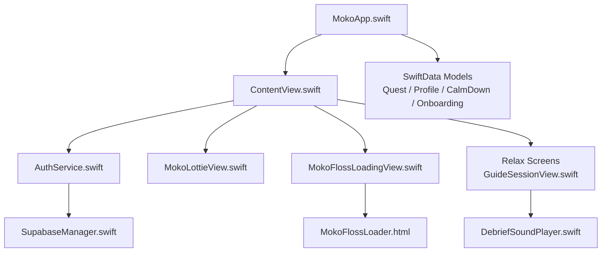
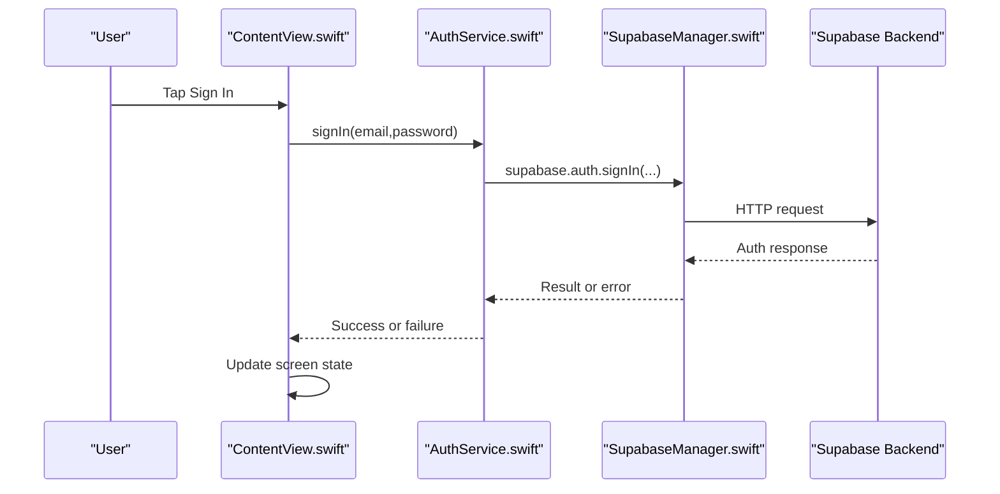
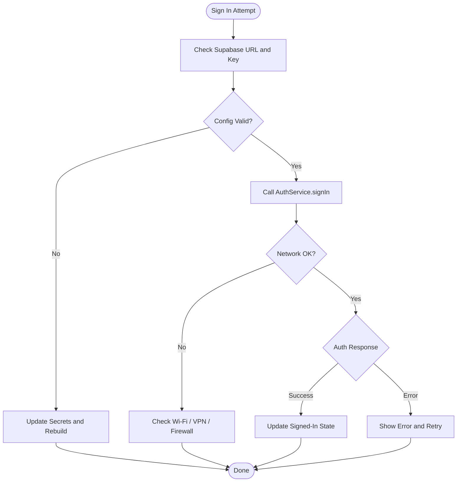
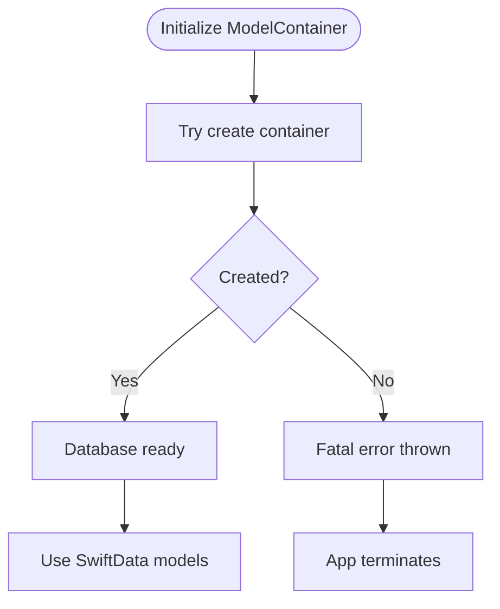
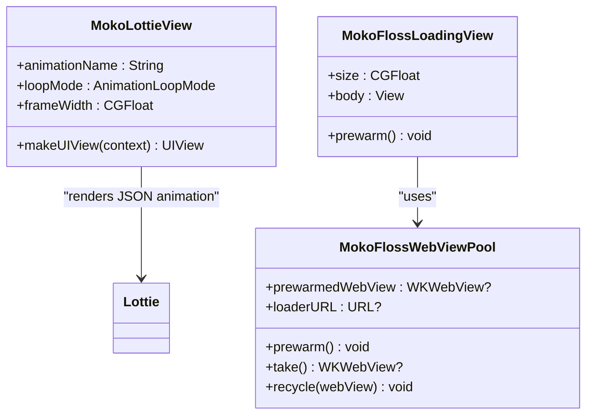
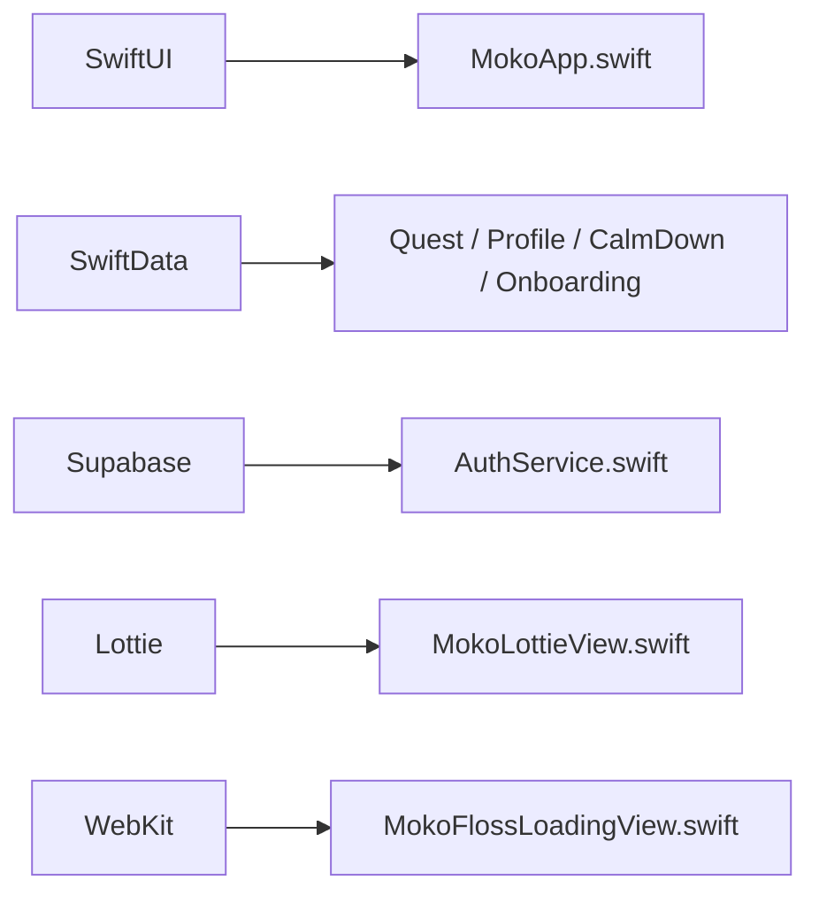

# Troubleshooting & FAQ

<cite>
**Referenced Files in This Document**   
- [README.md](file://README.md)
- [MOKO_AFM_README.md](file://MOKO_AFM_README.md)
- [MokoApp.swift](file://Moko/Moko/MokoApp.swift)
- [ContentView.swift](file://Moko/Moko/ContentView.swift)
- [AuthService.swift](file://Moko/Moko/AuthService.swift)
- [SupabaseManager.swift](file://Moko/Moko/SupabaseManager.swift)
- [Secrets.example.xcconfig](file://Secrets.example.xcconfig)
- [QuestModels.swift](file://Moko/Moko/Models/QuestModels.swift)
- [CalmDownModel.swift](file://Moko/Moko/Models/CalmDownModel.swift)
- [Profile.swift](file://Moko/Moko/Models/Profile.swift)
- [MokoLottieView.swift](file://Moko/Moko/Features/Animation/MokoLottieView.swift)
- [MokoFlossLoadingView.swift](file://Moko/Moko/Features/Animation/MokoFlossLoadingView.swift)
- [MokoFlossLoader.html](file://Moko/Moko/MokoFlossLoader.html)
- [DebriefSoundPlayer.swift](file://Moko/Moko/Features/Audio/DebriefSoundPlayer.swift)
- [GuideSessionView.swift](file://Moko/Moko/UIScreens/relaxScreens/ImageryGuide/GuideSessionView.swift)
- [ImageryGuideStore.swift](file://Moko/Moko/UIScreens/relaxScreens/ImageryGuide/ImageryGuideStore.swift)
- [SettingsInfoScreens.swift](file://Moko/Moko/UIScreens/homeScreens/ProfileOverView/SettingsInfoScreens.swift)
</cite>

## Table of Contents
1. [Introduction](#introduction)
2. [Project Structure](#project-structure)
3. [Core Components](#core-components)
4. [Architecture Overview](#architecture-overview)
5. [Detailed Component Analysis](#detailed-component-analysis)
6. [Dependency Analysis](#dependency-analysis)
7. [Performance Considerations](#performance-considerations)
8. [Troubleshooting Guide](#troubleshooting-guide)
9. [Conclusion](#conclusion)
10. [Appendices](#appendices)

## Introduction
This document is a practical troubleshooting and FAQ guide for the Moko iOS app. It focuses on setup problems, build errors, runtime exceptions, authentication issues, data sync behavior, animation performance, memory management, debugging strategies, known limitations, workarounds, platform-specific concerns, and support resources. The guidance maps directly to the repository’s Swift code, configuration files, animations, and local data models.

## Project Structure
Moko is an iOS SwiftUI application with:
- UI screens under `Moko/Moko/UIScreens`
- Feature modules such as Animation, Audio, AFM, and QuestLibrary
- Local data models using SwiftData
- Supabase-based authentication
- Lottie JSON animations and a custom WebKit-based floss loader

**Diagram sources**
- [MokoApp.swift:11-45](file://Moko/Moko/MokoApp.swift#L11-L45)
- [ContentView.swift:227-261](file://Moko/Moko/ContentView.swift#L227-L261)
- [AuthService.swift:15-42](file://Moko/Moko/AuthService.swift#L15-L42)
- [SupabaseManager.swift:6-19](file://Moko/Moko/SupabaseManager.swift#L6-L19)
- [MokoLottieView.swift:1-129](file://Moko/Moko/Features/Animation/MokoLottieView.swift#L1-L129)
- [MokoFlossLoadingView.swift:1-148](file://Moko/Moko/Features/Animation/MokoFlossLoadingView.swift#L1-L148)
- [MokoFlossLoader.html:1-119](file://Moko/Moko/MokoFlossLoader.html#L1-L119)
- [GuideSessionView.swift:281-348](file://Moko/Moko/UIScreens/relaxScreens/ImageryGuide/GuideSessionView.swift#L281-L348)
- [DebriefSoundPlayer.swift:30-30](file://Moko/Moko/Features/Audio/DebriefSoundPlayer.swift#L30-L30)

**Section sources**
- [README.md:151-207](file://README.md#L151-L207)
- [README.md:211-241](file://README.md#L211-L241)

## Core Components
- **App entry point**: Initializes global UI appearance and prewarms the vector floss loader before showing content.
- **Authentication**: Uses Supabase for sign-up, sign-in, sign-out, and current user retrieval.
- **Local data**: SwiftData stores quests, profiles, calm-down sessions, onboarding state, and insights.
- **Animations**: Lottie JSON animations and a lightweight WebKit SVG loader for loading states.
- **Relax flow**: Guided imagery and breathing sessions with optional audio playback and logging.

**Section sources**
- [MokoApp.swift:11-45](file://Moko/Moko/MokoApp.swift#L11-L45)
- [AuthService.swift:15-42](file://Moko/Moko/AuthService.swift#L15-L42)
- [QuestModels.swift:50-166](file://Moko/Moko/Models/QuestModels.swift#L50-L166)
- [MokoLottieView.swift:1-129](file://Moko/Moko/Features/Animation/MokoLottieView.swift#L1-L129)
- [MokoFlossLoadingView.swift:1-148](file://Moko/Moko/Features/Animation/MokoFlossLoadingView.swift#L1-L148)

## Architecture Overview
The app follows a layered approach:
- UI layer (SwiftUI views)
- Feature layer (animation, audio, AFM, quest library)
- Data layer (SwiftData models)
- Authentication layer (Supabase client)

**Diagram sources**
- [ContentView.swift:227-261](file://Moko/Moko/ContentView.swift#L227-L261)
- [AuthService.swift:26-32](file://Moko/Moko/AuthService.swift#L26-L32)
- [SupabaseManager.swift:11-19](file://Moko/Moko/SupabaseManager.swift#L11-L19)

## Detailed Component Analysis

### Authentication Setup and Runtime Issues
Common symptoms:
- Sign-in fails immediately
- Sign-up returns invalid credentials
- Current user cannot be retrieved after launch
- Google Sign-In is unavailable

Likely causes and resolutions:
- Missing or incorrect Supabase URL and publishable key
- Using a service role key in the app instead of the public anon/publishable key
- Network restrictions or firewall blocking Supabase endpoints
- Apple ID or Google Sign-In not configured in Xcode capabilities or project settings

Resolution steps:
- Verify Supabase configuration values are present and correct.
- Ensure only the public publishable key is included in the app bundle.
- Test network connectivity to the Supabase endpoint from the simulator or device.
- For Google Sign-In, confirm client IDs and Xcode signing configuration match your Google Cloud project.

**Diagram sources**
- [AuthService.swift:15-42](file://Moko/Moko/AuthService.swift#L15-L42)
- [SupabaseManager.swift:11-19](file://Moko/Moko/SupabaseManager.swift#L11-L19)
- [Secrets.example.xcconfig:1-4](file://Secrets.example.xcconfig#L1-L4)

**Section sources**
- [AuthService.swift:15-42](file://Moko/Moko/AuthService.swift#L15-L42)
- [SupabaseManager.swift:6-19](file://Moko/Moko/SupabaseManager.swift#L6-L19)
- [Secrets.example.xcconfig:1-4](file://Secrets.example.xcconfig#L1-L4)
- [README.md:227-239](file://README.md#L227-L239)

### SwiftData Initialization and Database Errors
Symptoms:
- App crashes at launch with a database creation error
- Preview container works but production container fails
- New fields do not appear in existing records

Root cause:
- The shared SwiftData container initialization catches errors and calls `fatalError`, which terminates the app if the container cannot be created.

Resolutions:
- Clean build folder and rebuild to ensure model changes are compiled.
- Validate that all SwiftData models are registered in the app’s `modelContainer(for:)`.
- If migrating schema, ensure backward-compatible defaults exist for new fields.
- Replace fatal crash handling with graceful recovery during development so you can log diagnostics without terminating the process.

**Diagram sources**
- [QuestModels.swift:151-166](file://Moko/Moko/Models/QuestModels.swift#L151-L166)
- [MokoApp.swift:31-45](file://Moko/Moko/MokoApp.swift#L31-L45)

**Section sources**
- [QuestModels.swift:151-166](file://Moko/Moko/Models/QuestModels.swift#L151-L166)
- [MokoApp.swift:31-45](file://Moko/Moko/MokoApp.swift#L31-L45)

### Animation Loading and Performance Problems
Symptoms:
- Lottie animation does not appear
- Loader shows static image but never transitions to animated floss
- Animations stutter or drop frames
- Reduce Motion setting affects animation unexpectedly

Diagnosis:
- Lottie JSON file name or path mismatch
- Missing `MokoFlossLoader.html` resource
- WebView pool not prewarmed
- Accessibility Reduce Motion preference disabling motion

Resolutions:
- Confirm the animation name matches the bundled Lottie file.
- Ensure `MokoFlossLoader.html` is included in the app bundle.
- Keep the prewarm call in the app initializer.
- Respect `UIAccessibility.isReduceMotionEnabled` and avoid heavy animations when reduced motion is enabled.

**Diagram sources**
- [MokoLottieView.swift:1-129](file://Moko/Moko/Features/Animation/MokoLottieView.swift#L1-L129)
- [MokoFlossLoadingView.swift:1-148](file://Moko/Moko/Features/Animation/MokoFlossLoadingView.swift#L1-L148)
- [MokoFlossLoader.html:1-119](file://Moko/Moko/MokoFlossLoader.html#L1-L119)

**Section sources**
- [MokoLottieView.swift:1-129](file://Moko/Moko/Features/Animation/MokoLottieView.swift#L1-L129)
- [MokoFlossLoadingView.swift:1-148](file://Moko/Moko/Features/Animation/MokoFlossLoadingView.swift#L1-L148)
- [MokoFlossLoader.html:76-119](file://Moko/Moko/MokoFlossLoader.html#L76-L119)

### Audio Playback and Relax Session Failures
Symptoms:
- Imagery guide audio does not play
- AVAudioSession configuration fails
- Sound effects fail to play

Likely causes:
- Missing audio URL for the selected guide
- AVAudioSession not configured correctly
- Background audio permissions or category not set

Resolutions:
- Verify the imagery guide has a valid audio URL.
- Log and inspect AVAudioSession configuration errors.
- Ensure background audio capability is configured if needed.
- Gracefully handle missing audio by falling back to visual-only mode.

**Section sources**
- [GuideSessionView.swift:281-348](file://Moko/Moko/UIScreens/relaxScreens/ImageryGuide/GuideSessionView.swift#L281-L348)
- [DebriefSoundPlayer.swift:30-30](file://Moko/Moko/Features/Audio/DebriefSoundPlayer.swift#L30-L30)

### Data Persistence and Sync Conflicts
Symptoms:
- Completed quests do not show debrief scores
- XP or streak values do not update
- Calm-down session logs disappear after restart

Behavioral notes:
- Profile and practice history are stored locally on the device.
- Account information and authentication session are handled by Supabase; passwords are not stored in the app.
- Some features like voice reflection recording are not available in this build.

Resolutions:
- Confirm SwiftData saves succeed and no silent failures occur.
- Clear local user identity only after account deletion or explicit sign-out.
- Avoid assuming cloud sync for practice data unless explicitly implemented.

**Section sources**
- [SettingsInfoScreens.swift:145-176](file://Moko/Moko/UIScreens/homeScreens/ProfileOverView/SettingsInfoScreens.swift#L145-L176)
- [CalmDownModel.swift:27-37](file://Moko/Moko/Models/CalmDownModel.swift#L27-L37)
- [QuestModels.swift:129-149](file://Moko/Moko/Models/QuestModels.swift#L129-L149)

### Known Limitations and Workarounds
- **Apple Foundation Models (AFM)**: Requires iOS 26+ and a device with Apple Intelligence. Calls have small context windows and must include fallbacks.
- **Google Sign-In**: Planned feature; may not be fully functional until configured.
- **Voice reflection recording**: Not available in this build.
- **Animations**: Sizing and rendering are being debugged; some screens may still refine animation integration.
- **Insights summaries**: Day/Week/Month/Year charts are planned.

Workarounds:
- Always provide safe fallbacks for AFM calls.
- Treat animations as presentational; timing logic should remain independent.
- Use local data for core flows while cloud features are added.

**Section sources**
- [MOKO_AFM_README.md:1-24](file://MOKO_AFM_README.md#L1-L24)
- [README.md:55-75](file://README.md#L55-L75)
- [README.md:111-149](file://README.md#L111-L149)

## Dependency Analysis
Key dependencies:
- SwiftUI for UI
- SwiftData for local persistence
- Supabase for authentication
- Lottie for mascot animations
- WebKit for the floss loader HTML page

**Diagram sources**
- [MokoApp.swift:11-45](file://Moko/Moko/MokoApp.swift#L11-L45)
- [AuthService.swift:15-42](file://Moko/Moko/AuthService.swift#L15-L42)
- [MokoLottieView.swift:1-129](file://Moko/Moko/Features/Animation/MokoLottieView.swift#L1-L129)
- [MokoFlossLoadingView.swift:1-148](file://Moko/Moko/Features/Animation/MokoFlossLoadingView.swift#L1-L148)

**Section sources**
- [README.md:151-163](file://README.md#L151-L163)

## Performance Considerations
- Prefer lightweight animations and respect Reduce Motion.
- Prewarm the floss loader once at app startup to reduce first-frame latency.
- Keep animation timing independent from business logic timers.
- Avoid heavy synchronous operations on the main thread.
- Use SwiftData transactions carefully and save only when necessary.
- Monitor memory usage when loading large Lottie assets or multiple web views.

[No sources needed since this section provides general guidance]

## Troubleshooting Guide

### Setup Problems
- **Xcode version mismatch**: Ensure Xcode meets the project target.
- **iOS deployment target too low**: SwiftData requires iOS 17+.
- **Missing package dependency**: Add Lottie via Xcode package manager.
- **Supabase secrets missing**: Copy and fill `Secrets.example.xcconfig`.

**Section sources**
- [README.md:211-241](file://README.md#L211-L241)

### Build Errors
- **SwiftData model container crash**: Review initialization and model registration.
- **Missing resource assertion**: Ensure `MokoFlossLoader.html` exists in the bundle.
- **Lottie asset not found**: Verify animation names and bundle paths.

**Section sources**
- [QuestModels.swift:151-166](file://Moko/Moko/Models/QuestModels.swift#L151-L166)
- [MokoFlossLoadingView.swift:60-68](file://Moko/Moko/Features/Animation/MokoFlossLoadingView.swift#L60-L68)
- [MokoLottieView.swift:33-50](file://Moko/Moko/Features/Animation/MokoLottieView.swift#L33-L50)

### Runtime Exceptions
- **Authentication failures**: Check Supabase URL/key, network, and auth provider configuration.
- **Audio playback failures**: Validate audio URLs and AVAudioSession configuration.
- **Data save failures**: Inspect print logs for SwiftData save errors.

**Section sources**
- [AuthService.swift:15-42](file://Moko/Moko/AuthService.swift#L15-L42)
- [GuideSessionView.swift:281-348](file://Moko/Moko/UIScreens/relaxScreens/ImageryGuide/GuideSessionView.swift#L281-L348)
- [CalmDownModel.swift:27-37](file://Moko/Moko/Models/CalmDownModel.swift#L27-L37)

### Debugging Strategies
- Enable console logging for animation load success/failure.
- Log imagery audio readiness and errors.
- Use Xcode debugger to inspect SwiftData contexts and saved objects.
- Validate Supabase client initialization and network requests.

**Section sources**
- [MokoLottieView.swift:49-75](file://Moko/Moko/Features/Animation/MokoLottieView.swift#L49-L75)
- [GuideSessionView.swift:317-348](file://Moko/Moko/UIScreens/relaxScreens/ImageryGuide/GuideSessionView.swift#L317-L348)

### Platform-Specific Issues
- **iOS version compatibility**: SwiftData requires iOS 17+.
- **Apple Intelligence availability**: AFM features require iOS 26+ and supported devices.
- **Accessibility preferences**: Respect Reduce Motion to avoid jarring animations.

**Section sources**
- [README.md:211-217](file://README.md#L211-L217)
- [MOKO_AFM_README.md:1-3](file://MOKO_AFM_README.md#L1-L3)
- [MokoFlossLoader.html:80-90](file://Moko/Moko/MokoFlossLoader.html#L80-L90)

### Support Resources
- Email support link is provided in the Terms of Service screen.
- Privacy and terms explain data storage and account handling.

**Section sources**
- [SettingsInfoScreens.swift:312-374](file://Moko/Moko/UIScreens/homeScreens/ProfileOverView/SettingsInfoScreens.swift#L312-L374)

## Conclusion
Most Moko issues fall into three categories: environment setup, animation/resource loading, and data/auth integration. By validating Supabase configuration, ensuring required resources are bundled, respecting accessibility preferences, and adding robust fallbacks for local and remote services, developers can resolve the majority of setup, build, and runtime problems. For advanced AI features, always design around device capability checks and safe fallbacks.

[No sources needed since this section summarizes without analyzing specific files]

## Appendices

### Frequently Asked Questions

**Q: Why does my app crash when creating the database?**  
A: The SwiftData container initialization throws a fatal error if it cannot create the container. Clean builds, verify model registration, and add safer error handling during development.

**Section sources**
- [QuestModels.swift:151-166](file://Moko/Moko/Models/QuestModels.swift#L151-L166)

**Q: Why doesn’t the floss loader animation start?**  
A: The HTML resource may be missing, or the WebView pool was not prewarmed. Ensure `MokoFlossLoader.html` is bundled and the app initializer calls prewarm.

**Section sources**
- [MokoFlossLoadingView.swift:127-148](file://Moko/Moko/Features/Animation/MokoFlossLoadingView.swift#L127-L148)
- [MokoApp.swift:14-18](file://Moko/Moko/MokoApp.swift#L14-L18)

**Q: Why is my Lottie animation not visible?**  
A: The animation name or path may be incorrect. Verify the animation name and bundle subdirectory search order.

**Section sources**
- [MokoLottieView.swift:33-50](file://Moko/Moko/Features/Animation/MokoLottieView.swift#L33-L50)

**Q: Why does audio not play in guided imagery?**  
A: The guide may lack an audio URL, or AVAudioSession configuration failed. Check logs and validate the audio source.

**Section sources**
- [GuideSessionView.swift:281-348](file://Moko/Moko/UIScreens/relaxScreens/ImageryGuide/GuideSessionView.swift#L281-L348)

**Q: Where is my practice data stored?**  
A: Practice history, profile, and reflections are stored locally on the device. Account details and authentication sessions are managed by Supabase.

**Section sources**
- [SettingsInfoScreens.swift:145-176](file://Moko/Moko/UIScreens/homeScreens/ProfileOverView/SettingsInfoScreens.swift#L145-L176)

**Q: Can I use Apple Foundation Models now?**  
A: AFM requires iOS 26+ and a device with Apple Intelligence. All AFM calls must include fallbacks and fresh sessions.

**Section sources**
- [MOKO_AFM_README.md:1-24](file://MOKO_AFM_README.md#L1-L24)