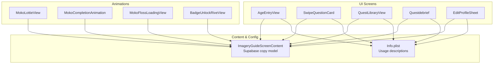
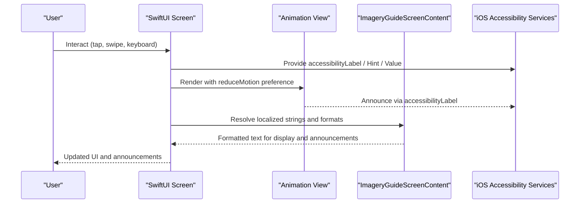
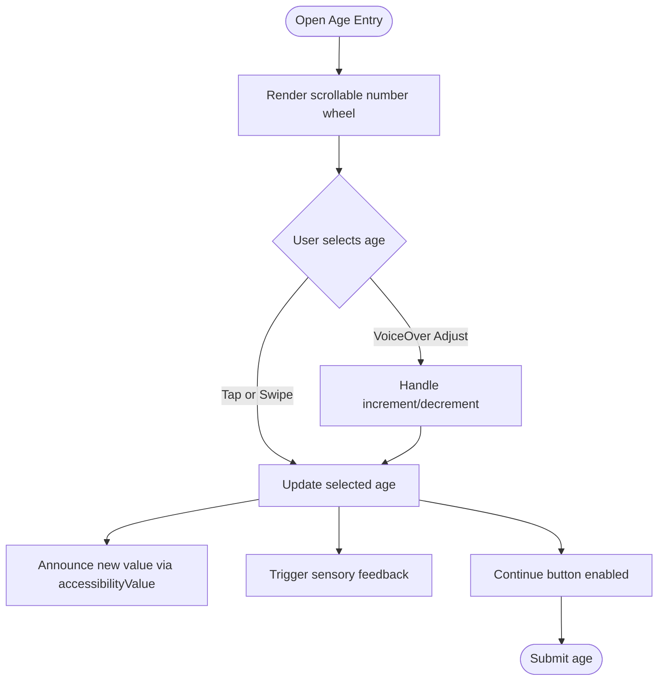
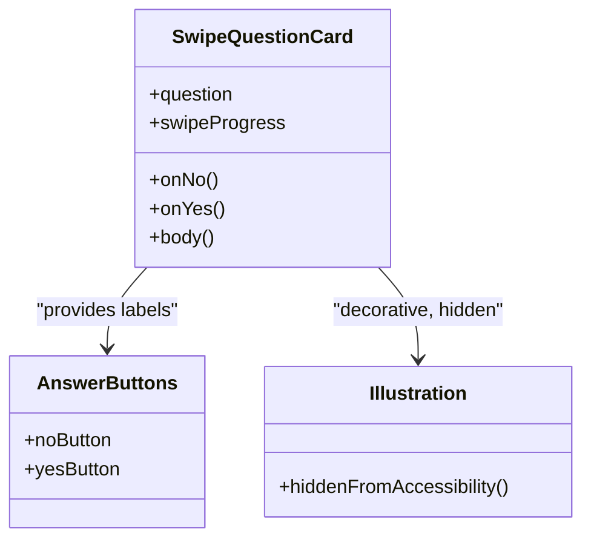
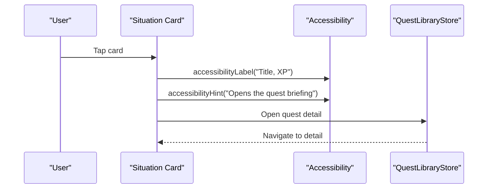
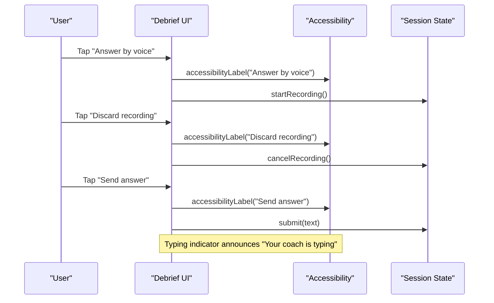
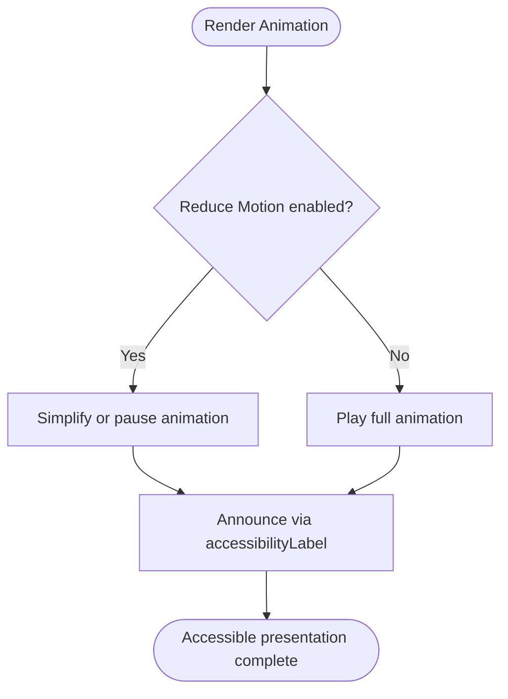
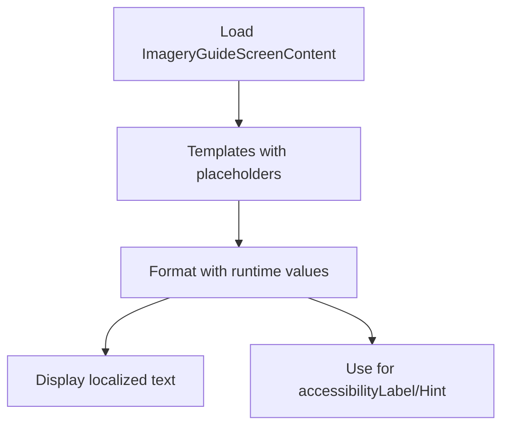
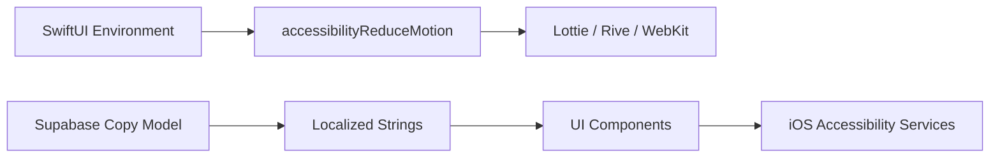

# Accessibility & Localization

<cite>
**Referenced Files in This Document**
- [README.md](file://README.md)
- [MokoLottieView.swift](file://Moko/Moko/Features/Animation/MokoLottieView.swift)
- [MokoCompletionAnimation.swift](file://Moko/Moko/Features/Animation/MokoCompletionAnimation.swift)
- [MokoFlossLoadingView.swift](file://Moko/Moko/Features/Animation/MokoFlossLoadingView.swift)
- [QuestLibraryView.swift](file://Moko/Moko/Features/QuestLibrary/QuestLibraryView.swift)
- [AgeEntryView.swift](file://Moko/Moko/UIScreens/Onboarding/AgeEntryView.swift)
- [SwipeQuestionCard.swift](file://Moko/Moko/UIScreens/Onboarding_Questions/SwipeQuestionCard.swift)
- [MicrophonePermissionView.swift](file://Moko/Moko/UIScreens/Onboarding_Questions/MicrophonePermissionView.swift)
- [ImageryGuide.swift](file://Moko/Moko/UIScreens/relaxScreens/ImageryGuide/ImageryGuide.swift)
- [Questdebrief.swift](file://Moko/Moko/UIScreens/Quests/Questdebrief.swift)
- [BadgeUnlockRiveView.swift](file://Moko/Moko/UIScreens/homeScreens/ProfileOverView/BadgeUnlockRiveView.swift)
- [EditProfileSheet.swift](file://Moko/Moko/UIScreens/homeScreens/ProfileOverView/EditProfileSheet.swift)
- [Info.plist](file://Moko/Moko/Info.plist)
</cite>

## Table of Contents
1. [Introduction](#introduction)
2. [Project Structure](#project-structure)
3. [Core Components](#core-components)
4. [Architecture Overview](#architecture-overview)
5. [Detailed Component Analysis](#detailed-component-analysis)
6. [Dependency Analysis](#dependency-analysis)
7. [Performance Considerations](#performance-considerations)
8. [Troubleshooting Guide](#troubleshooting-guide)
9. [Conclusion](#conclusion)
10. [Appendices](#appendices)

## Introduction
This document explains Moko’s accessibility and localization implementation across iOS SwiftUI screens, animations, and data-driven content. It covers VoiceOver support, dynamic type scaling, assistive technology compatibility, color contrast considerations, text alternatives for images, keyboard navigation patterns, localization infrastructure for string management and pluralization, right-to-left language support, testing strategies, WCAG compliance guidance, platform-specific considerations, translation workflow recommendations, performance implications, and inclusive design best practices.

The project is a native iOS app using SwiftUI, Lottie animations, Rive animations, SwiftData, and Supabase-backed content. The README describes the product goals, architecture, and animation behavior, including respect for Reduce Motion.

**Section sources**
- [README.md:41-75](file://README.md#L41-L75)
- [README.md:111-149](file://README.md#L111-L149)
- [README.md:151-207](file://README.md#L151-L207)

## Project Structure
Accessibility and localization are implemented across several layers:
- UI components with explicit accessibility labels, hints, values, and adjustable actions.
- Animation views that honor Reduce Motion and provide accessible descriptions.
- Data-driven screen copy from Supabase with placeholder formatting and accessibility fields.
- Permission strings declared in Info.plist for camera and microphone usage.

**Diagram sources**
- [AgeEntryView.swift:112-121](file://Moko/Moko/UIScreens/Onboarding/AgeEntryView.swift#L112-L121)
- [SwipeQuestionCard.swift:27-28](file://Moko/Moko/UIScreens/Onboarding_Questions/SwipeQuestionCard.swift#L27-L28)
- [QuestLibraryView.swift:106-115](file://Moko/Moko/Features/QuestLibrary/QuestLibraryView.swift#L106-L115)
- [Questdebrief.swift:759-820](file://Moko/Moko/UIScreens/Quests/Questdebrief.swift#L759-L820)
- [EditProfileSheet.swift:151-166](file://Moko/Moko/UIScreens/homeScreens/ProfileOverView/EditProfileSheet.swift#L151-L166)
- [MokoLottieView.swift:21-22](file://Moko/Moko/Features/Animation/MokoLottieView.swift#L21-L22)
- [MokoCompletionAnimation.swift:54-55](file://Moko/Moko/Features/Animation/MokoCompletionAnimation.swift#L54-L55)
- [MokoFlossLoadingView.swift:42-43](file://Moko/Moko/Features/Animation/MokoFlossLoadingView.swift#L42-L43)
- [BadgeUnlockRiveView.swift:49-50](file://Moko/Moko/UIScreens/homeScreens/ProfileOverView/BadgeUnlockRiveView.swift#L49-L50)
- [ImageryGuide.swift:82-118](file://Moko/Moko/UIScreens/relaxScreens/ImageryGuide/ImageryGuide.swift#L82-L118)
- [Info.plist:5-8](file://Moko/Moko/Info.plist#L5-L8)

**Section sources**
- [README.md:151-207](file://README.md#L151-L207)

## Core Components
This section summarizes how key UI and animation components implement accessibility and localization.

- Age wheel input
  - Exposes an accessible element with label, current value, and increment/decrement actions for VoiceOver and keyboard users.
  - Uses sensory feedback to reinforce selection changes.

- Onboarding question card
  - Decorative mascot and illustration are hidden from VoiceOver; interactive buttons have clear labels.

- Quest library cards
  - Each card exposes a descriptive label combining title and XP, plus a hint describing the action.
  - Refresh button has a concise label.

- Debrief interactions
  - Buttons for leaving, sending, discarding recording, and answering by voice all include explicit labels.
  - Coach typing indicator announces its state.
  - Confidence meter exposes a label that includes the score when available.

- Animations
  - Lottie view provides a simple accessibility label.
  - Completion animation ignores child elements and announces completion.
  - Loading view hides the underlying web view from accessibility and announces loading status.
  - Badge unlock animation sets a label based on achievement state and honors Reduce Motion.

- Dynamic type and motion
  - Views use system fonts and scalable layouts.
  - Multiple components read `accessibilityReduceMotion` to disable or simplify animations.

- Localization
  - Imagery guide screen copy is modeled as a single row fetched from Supabase, including accessibility-related strings and formatted templates.
  - Placeholder replacement supports localized messages with parameters.

- Permissions
  - Camera and microphone usage descriptions are declared in Info.plist.

**Section sources**
- [AgeEntryView.swift:112-121](file://Moko/Moko/UIScreens/Onboarding/AgeEntryView.swift#L112-L121)
- [SwipeQuestionCard.swift:27-28](file://Moko/Moko/UIScreens/Onboarding_Questions/SwipeQuestionCard.swift#L27-L28)
- [SwipeQuestionCard.swift:80-93](file://Moko/Moko/UIScreens/Onboarding_Questions/SwipeQuestionCard.swift#L80-L93)
- [QuestLibraryView.swift:106-115](file://Moko/Moko/Features/QuestLibrary/QuestLibraryView.swift#L106-L115)
- [QuestLibraryView.swift:214-215](file://Moko/Moko/Features/QuestLibrary/QuestLibraryView.swift#L214-L215)
- [Questdebrief.swift:759-820](file://Moko/Moko/UIScreens/Quests/Questdebrief.swift#L759-L820)
- [Questdebrief.swift:1078-1079](file://Moko/Moko/UIScreens/Quests/Questdebrief.swift#L1078-L1079)
- [Questdebrief.swift:967-968](file://Moko/Moko/UIScreens/Quests/Questdebrief.swift#L967-L968)
- [MokoLottieView.swift:21-22](file://Moko/Moko/Features/Animation/MokoLottieView.swift#L21-L22)
- [MokoCompletionAnimation.swift:54-55](file://Moko/Moko/Features/Animation/MokoCompletionAnimation.swift#L54-L55)
- [MokoFlossLoadingView.swift:42-43](file://Moko/Moko/Features/Animation/MokoFlossLoadingView.swift#L42-L43)
- [MokoFlossLoadingView.swift:169-170](file://Moko/Moko/Features/Animation/MokoFlossLoadingView.swift#L169-L170)
- [BadgeUnlockRiveView.swift:49-50](file://Moko/Moko/UIScreens/homeScreens/ProfileOverView/BadgeUnlockRiveView.swift#L49-L50)
- [ImageryGuide.swift:82-118](file://Moko/Moko/UIScreens/relaxScreens/ImageryGuide/ImageryGuide.swift#L82-L118)
- [Info.plist:5-8](file://Moko/Moko/Info.plist#L5-L8)

## Architecture Overview
The accessibility and localization architecture combines three pillars:
- Declarative SwiftUI accessibility attributes on interactive and informative elements.
- Animation integration that respects user motion preferences and provides accessible descriptions.
- Centralized, data-driven screen copy with placeholders and accessibility-oriented keys.

**Diagram sources**
- [QuestLibraryView.swift:106-115](file://Moko/Moko/Features/QuestLibrary/QuestLibraryView.swift#L106-L115)
- [MokoFlossLoadingView.swift:10-11](file://Moko/Moko/Features/Animation/MokoFlossLoadingView.swift#L10-L11)
- [MokoFlossLoadingView.swift:116-119](file://Moko/Moko/Features/Animation/MokoFlossLoadingView.swift#L116-L119)
- [ImageryGuide.swift:120-125](file://Moko/Moko/UIScreens/relaxScreens/ImageryGuide/ImageryGuide.swift#L120-L125)

## Detailed Component Analysis

### Age Entry Wheel
The age wheel is a custom picker that exposes:
- An accessible element with a semantic label.
- A dynamic accessibility value reflecting the selected age.
- Increment and decrement actions for VoiceOver and keyboard navigation.
- Sensory feedback to reinforce selection changes.

**Diagram sources**
- [AgeEntryView.swift:84-104](file://Moko/Moko/UIScreens/Onboarding/AgeEntryView.swift#L84-L104)
- [AgeEntryView.swift:112-121](file://Moko/Moko/UIScreens/Onboarding/AgeEntryView.swift#L112-L121)
- [AgeEntryView.swift:126-137](file://Moko/Moko/UIScreens/Onboarding/AgeEntryView.swift#L126-L137)

**Section sources**
- [AgeEntryView.swift:84-137](file://Moko/Moko/UIScreens/Onboarding/AgeEntryView.swift#L84-L137)

### Onboarding Question Card
The card separates decorative visuals from interactive controls:
- Mascot peek and illustration are marked hidden from accessibility.
- NO and YES buttons expose clear labels and are fully keyboard-accessible.

**Diagram sources**
- [SwipeQuestionCard.swift:17-29](file://Moko/Moko/UIScreens/Onboarding_Questions/SwipeQuestionCard.swift#L17-L29)
- [SwipeQuestionCard.swift:69-98](file://Moko/Moko/UIScreens/Onboarding_Questions/SwipeQuestionCard.swift#L69-L98)
- [SwipeQuestionCard.swift:100-110](file://Moko/Moko/UIScreens/Onboarding_Questions/SwipeQuestionCard.swift#L100-L110)

**Section sources**
- [SwipeQuestionCard.swift:17-110](file://Moko/Moko/UIScreens/Onboarding_Questions/SwipeQuestionCard.swift#L17-L110)

### Quest Library Cards
Each quest card is a Button with:
- A composite accessibility label combining title and XP.
- A hint explaining the interaction outcome.
- A refresh control with a concise label.

**Diagram sources**
- [QuestLibraryView.swift:207-216](file://Moko/Moko/Features/QuestLibrary/QuestLibraryView.swift#L207-L216)
- [QuestLibraryView.swift:95-107](file://Moko/Moko/Features/QuestLibrary/QuestLibraryView.swift#L95-L107)

**Section sources**
- [QuestLibraryView.swift:95-107](file://Moko/Moko/Features/QuestLibrary/QuestLibraryView.swift#L95-L107)
- [QuestLibraryView.swift:207-216](file://Moko/Moko/Features/QuestLibrary/QuestLibraryView.swift#L207-L216)

### Debrief Interaction Flow
Debrief buttons and indicators provide clear accessibility semantics:
- Leave debrief, send answer, discard recording, and answer by voice each have explicit labels.
- Typing indicator announces coach activity.
- Confidence footer exposes a label with the score when available.

**Diagram sources**
- [Questdebrief.swift:759-820](file://Moko/Moko/UIScreens/Quests/Questdebrief.swift#L759-L820)
- [Questdebrief.swift:1078-1079](file://Moko/Moko/UIScreens/Quests/Questdebrief.swift#L1078-L1079)
- [Questdebrief.swift:967-968](file://Moko/Moko/UIScreens/Quests/Questdebrief.swift#L967-L968)

**Section sources**
- [Questdebrief.swift:759-820](file://Moko/Moko/UIScreens/Quests/Questdebrief.swift#L759-L820)
- [Questdebrief.swift:1078-1079](file://Moko/Moko/UIScreens/Quests/Questdebrief.swift#L1078-L1079)
- [Questdebrief.swift:967-968](file://Moko/Moko/UIScreens/Quests/Questdebrief.swift#L967-L968)

### Animation Accessibility and Motion Preferences
- Lottie animation wrapper provides a simple label.
- Completion animation ignores child elements and announces completion.
- Loading view hides the WKWebView from accessibility and announces loading status.
- Badge unlock animation sets a label based on achievement state and passes Reduce Motion to the Rive runtime.

**Diagram sources**
- [MokoLottieView.swift:21-22](file://Moko/Moko/Features/Animation/MokoLottieView.swift#L21-L22)
- [MokoCompletionAnimation.swift:54-55](file://Moko/Moko/Features/Animation/MokoCompletionAnimation.swift#L54-L55)
- [MokoFlossLoadingView.swift:42-43](file://Moko/Moko/Features/Animation/MokoFlossLoadingView.swift#L42-L43)
- [MokoFlossLoadingView.swift:169-170](file://Moko/Moko/Features/Animation/MokoFlossLoadingView.swift#L169-L170)
- [BadgeUnlockRiveView.swift:49-50](file://Moko/Moko/UIScreens/homeScreens/ProfileOverView/BadgeUnlockRiveView.swift#L49-L50)

**Section sources**
- [MokoLottieView.swift:17-22](file://Moko/Moko/Features/Animation/MokoLottieView.swift#L17-L22)
- [MokoCompletionAnimation.swift:54-55](file://Moko/Moko/Features/Animation/MokoCompletionAnimation.swift#L54-L55)
- [MokoFlossLoadingView.swift:19-44](file://Moko/Moko/Features/Animation/MokoFlossLoadingView.swift#L19-L44)
- [BadgeUnlockRiveView.swift:22-50](file://Moko/Moko/UIScreens/homeScreens/ProfileOverView/BadgeUnlockRiveView.swift#L22-L50)

### Localization Infrastructure
- Screen copy for imagery guides is modeled as a single row containing titles, icons, accessibility hints, error messages, session labels, and completion messages.
- A format helper replaces placeholders in template strings with provided values.
- This approach centralizes copy and enables consistent localization and accessibility labeling.

**Diagram sources**
- [ImageryGuide.swift:82-118](file://Moko/Moko/UIScreens/relaxScreens/ImageryGuide/ImageryGuide.swift#L82-L118)
- [ImageryGuide.swift:120-125](file://Moko/Moko/UIScreens/relaxScreens/ImageryGuide/ImageryGuide.swift#L120-L125)

**Section sources**
- [ImageryGuide.swift:82-125](file://Moko/Moko/UIScreens/relaxScreens/ImageryGuide/ImageryGuide.swift#L82-L125)

### Permission Descriptions
Camera and microphone usage descriptions are declared in Info.plist to inform users why these permissions are needed.

**Section sources**
- [Info.plist:5-8](file://Moko/Moko/Info.plist#L5-L8)

## Dependency Analysis
Accessibility and localization depend on:
- SwiftUI environment values such as `accessibilityReduceMotion`.
- System accessibility services for VoiceOver and keyboard navigation.
- Supabase-backed content models providing localized strings and accessibility metadata.
- Animation runtimes (Lottie, Rive, WebKit) configured to respect motion preferences.

**Diagram sources**
- [MokoFlossLoadingView.swift:10-11](file://Moko/Moko/Features/Animation/MokoFlossLoadingView.swift#L10-L11)
- [MokoFlossLoadingView.swift:116-119](file://Moko/Moko/Features/Animation/MokoFlossLoadingView.swift#L116-L119)
- [ImageryGuide.swift:82-125](file://Moko/Moko/UIScreens/relaxScreens/ImageryGuide/ImageryGuide.swift#L82-L125)

**Section sources**
- [MokoFlossLoadingView.swift:10-11](file://Moko/Moko/Features/Animation/MokoFlossLoadingView.swift#L10-L11)
- [ImageryGuide.swift:82-125](file://Moko/Moko/UIScreens/relaxScreens/ImageryGuide/ImageryGuide.swift#L82-L125)

## Performance Considerations
- Prefer lightweight animations and avoid heavy rendering when Reduce Motion is enabled.
- Reuse web views and prewarm resources to minimize startup latency for loaders.
- Keep accessibility labels concise to reduce VoiceOver parsing overhead.
- Avoid unnecessary recompositions by separating animated regions from static content.
- Use system fonts and scalable layouts to leverage dynamic type efficiently.

[No sources needed since this section provides general guidance]

## Troubleshooting Guide
Common issues and resolutions:
- Missing animation assets
  - Symptom: Console logs indicate failure to load animation.
  - Resolution: Verify asset bundle paths and ensure required files are included.

- WebKit loader not ready
  - Symptom: Assertion failure if the HTML resource is missing.
  - Resolution: Ensure the loader HTML file exists in the bundle and URL resolution succeeds.

- Accessibility not announced
  - Symptom: VoiceOver does not announce expected text.
  - Resolution: Confirm accessibilityLabel, accessibilityHint, and accessibilityValue are set appropriately; ensure decorative elements are hidden.

- Motion not respected
  - Symptom: Animations continue despite Reduce Motion enabled.
  - Resolution: Read `accessibilityReduceMotion` and pass it to animation runtimes; simplify or pause animations accordingly.

- Permission descriptions unclear
  - Symptom: Users confused about camera/mic usage.
  - Resolution: Update Info.plist usage descriptions to be clear and specific.

**Section sources**
- [MokoLottieView.swift:49-50](file://Moko/Moko/Features/Animation/MokoLottieView.swift#L49-L50)
- [MokoLottieView.swift:75-76](file://Moko/Moko/Features/Animation/MokoLottieView.swift#L75-L76)
- [MokoFlossLoadingView.swift:67-68](file://Moko/Moko/Features/Animation/MokoFlossLoadingView.swift#L67-L68)
- [MokoFlossLoadingView.swift:127-129](file://Moko/Moko/Features/Animation/MokoFlossLoadingView.swift#L127-L129)
- [Info.plist:5-8](file://Moko/Moko/Info.plist#L5-L8)

## Conclusion
Moko implements accessibility through explicit SwiftUI attributes, animation-aware motion handling, and centralized, data-driven localization. Interactive components provide clear labels, hints, and values; animations respect Reduce Motion; and screen copy supports templated localization with accessibility-oriented fields. To maintain WCAG-aligned experiences, continue auditing contrast ratios, ensuring meaningful image descriptions, validating keyboard navigation, and testing with VoiceOver and Switch Control. For localization, adopt standard iOS localization workflows, pluralization rules, and right-to-left layout testing.

[No sources needed since this section summarizes without analyzing specific files]

## Appendices

### WCAG Compliance Checklist for Moko
- Text alternatives for images and illustrations.
- Sufficient color contrast for text and interactive elements.
- Keyboard navigability and focus order.
- Accessible names and roles for custom controls.
- Motion sensitivity and reduced motion support.
- Localized content remains accessible in all supported languages.

[No sources needed since this section provides general guidance]

### Platform-Specific Notes (iOS)
- Use SwiftUI’s built-in accessibility APIs.
- Honor `accessibilityReduceMotion` globally and per component.
- Declare permission descriptions in Info.plist.
- Test with VoiceOver, Switch Control, and keyboard navigation.
- Validate dynamic type scaling across all screens.

**Section sources**
- [Info.plist:5-8](file://Moko/Moko/Info.plist#L5-L8)
- [MokoFlossLoadingView.swift:10-11](file://Moko/Moko/Features/Animation/MokoFlossLoadingView.swift#L10-L11)

### Translation Workflow Recommendations
- Centralize copy in data models like `ImageryGuideScreenContent`.
- Use placeholder-based templates for parameterized messages.
- Maintain separate localization files per language.
- Include accessibility-focused keys alongside visible copy.
- Review pluralization rules and right-to-left layout for each locale.

**Section sources**
- [ImageryGuide.swift:82-125](file://Moko/Moko/UIScreens/relaxScreens/ImageryGuide/ImageryGuide.swift#L82-L125)