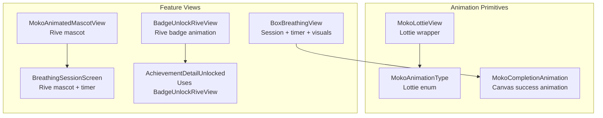
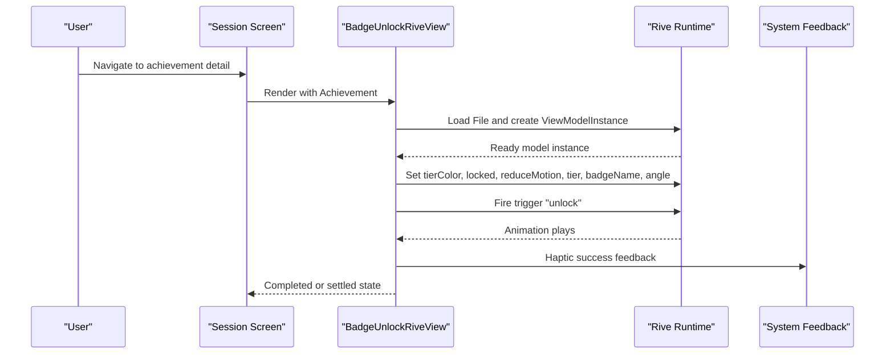
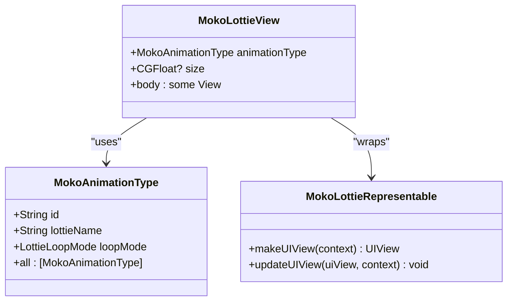
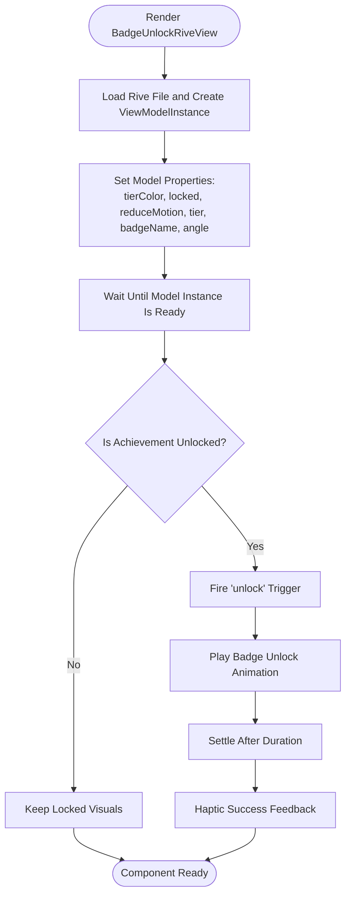
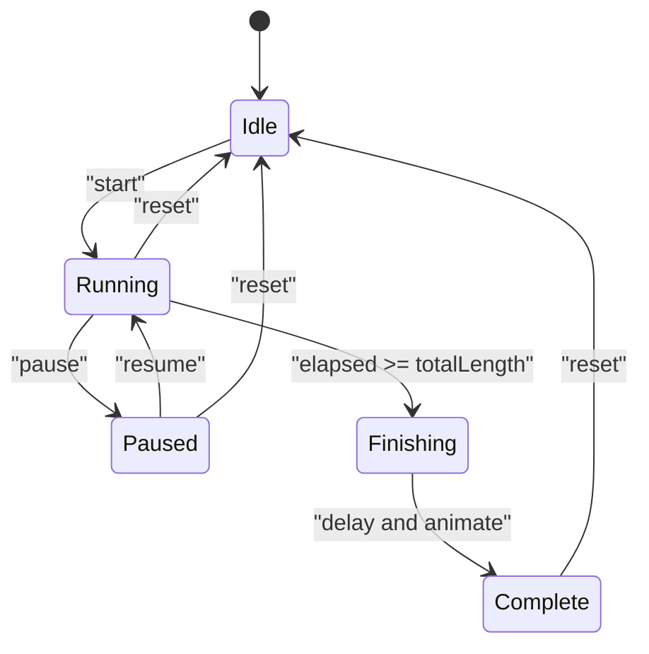
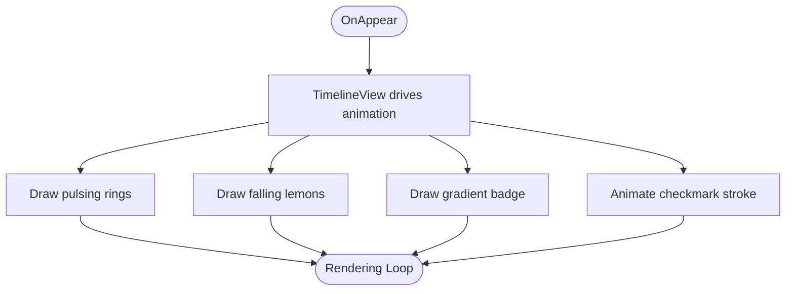
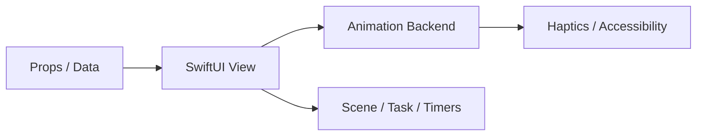
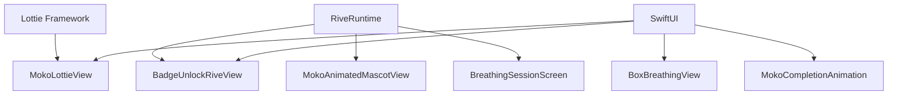

# Component Library

<cite>
**Referenced Files in This Document**
- [MokoLottieView.swift](file://Moko/Features/Animation/MokoLottieView.swift)
- [MokoLottieView.swift](file://Moko/Moko/Features/Animation/MokoLottieView.swift)
- [MokoAnimationTypes.swift](file://Moko/Moko/Features/Animation/MokoAnimationTypes.swift)
- [BadgeUnlockRiveView.swift](file://Moko/Moko/UIScreens/homeScreens/ProfileOverView/BadgeUnlockRiveView.swift)
- [BoxBreathingView.swift](file://Moko/Moko/UIScreens/relaxScreens/BoxBreathing/BoxBreathingView.swift)
- [MokoCompletionAnimation.swift](file://Moko/Moko/Features/Animation/MokoCompletionAnimation.swift)
- [AchievementDetailUnlocked.swift](file://Moko/Moko/UIScreens/homeScreens/ProfileOverView/AchievementDetailUnlocked.swift)
- [MokoAnimatedMascotView.swift](file://Moko/Moko/UIScreens/startScreens/MokoAnimatedMascotView.swift)
- [Breathingsessionscreen.swift](file://Moko/Moko/UIScreens/relaxScreens/Breathing/Breathingsessionscreen.swift)
- [SKILL.md](file://Moko/.agents/skills/rive-animation/SKILL.md)
</cite>

## Table of Contents
1. [Introduction](#introduction)
2. [Project Structure](#project-structure)
3. [Core Components](#core-components)
4. [Architecture Overview](#architecture-overview)
5. [Detailed Component Analysis](#detailed-component-analysis)
6. [Dependency Analysis](#dependency-analysis)
7. [Performance Considerations](#performance-considerations)
8. [Troubleshooting Guide](#troubleshooting-guide)
9. [Conclusion](#conclusion)
10. [Appendices](#appendices)

## Introduction
This document describes Moko’s reusable UI component library with a focus on animation-driven and interactive components:
- Lottie-based mascot animations through `MokoLottieView`.
- Rive-powered achievement animations through `BadgeUnlockRiveView`.
- A specialized, stateful breathing exercise screen through `BoxBreathingView`, including completion animations via `MokoCompletionAnimation`.

The goal is to help developers understand how these components are composed, how they handle props and events, how animations integrate with SwiftUI, and how to extend the library consistently while preserving performance, accessibility, and platform behavior.

## Project Structure
The relevant component code lives under two main areas:
- `Moko/Features/Animation`: shared animation primitives and types for Lottie.
- `Moko/Moko/...`: feature-specific views, including Rive integration and complex session screens.

**Diagram sources**
- [MokoLottieView.swift:1-83](file://Moko/Moko/Features/Animation/MokoLottieView.swift#L1-L83)
- [MokoAnimationTypes.swift:1-37](file://Moko/Moko/Features/Animation/MokoAnimationTypes.swift#L1-L37)
- [BadgeUnlockRiveView.swift:1-88](file://Moko/Moko/UIScreens/homeScreens/ProfileOverView/BadgeUnlockRiveView.swift#L1-L88)
- [BoxBreathingView.swift:1-588](file://Moko/Moko/UIScreens/relaxScreens/BoxBreathing/BoxBreathingView.swift#L1-L588)
- [MokoCompletionAnimation.swift:1-149](file://Moko/Moko/Features/Animation/MokoCompletionAnimation.swift#L1-L149)
- [MokoAnimatedMascotView.swift:1-27](file://Moko/Moko/UIScreens/startScreens/MokoAnimatedMascotView.swift#L1-L27)
- [Breathingsessionscreen.swift:137-162](file://Moko/Moko/UIScreens/relaxScreens/Breathing/Breathingsessionscreen.swift#L137-L162)
- [AchievementDetailUnlocked.swift:1-69](file://Moko/Moko/UIScreens/homeScreens/ProfileOverView/AchievementDetailUnlocked.swift#L1-L69)

**Section sources**
- [MokoLottieView.swift:1-83](file://Moko/Moko/Features/Animation/MokoLottieView.swift#L1-L83)
- [BadgeUnlockRiveView.swift:1-88](file://Moko/Moko/UIScreens/homeScreens/ProfileOverView/BadgeUnlockRiveView.swift#L1-L88)
- [BoxBreathingView.swift:1-588](file://Moko/Moko/UIScreens/relaxScreens/BoxBreathing/BoxBreathingView.swift#L1-L588)

## Core Components
This section summarizes the primary reusable components and their responsibilities.

- `MokoLottieView` (Lottie):
  - Renders Lottie JSON animations for the Moko mascot.
  - Provides an animation type enum that maps to file names and loop modes.
  - Offers both a SwiftUI view wrapper and a convenience extension for overlaying animations.

- `BadgeUnlockRiveView` (Rive):
  - Loads a Rive artboard and state machine for badge unlock animations.
  - Configures model properties such as tier color, locked state, symbol glyph, and angle.
  - Triggers the unlock sequence and supports haptic feedback and reduced motion.

- `BoxBreathingView`:
  - Implements a guided box-breathing session with phases, cycles, timer, and visual progress.
  - Uses custom shapes and transitions for the box edges, phase label, and completion celebration.
  - Integrates with system timers, scene lifecycle, and data logging.

- `MokoCompletionAnimation`:
  - Shared canvas-based completion illustration used across relaxation flows.
  - Draws animated rings, falling lemons, and a checkmark.

**Section sources**
- [MokoLottieView.swift:1-83](file://Moko/Moko/Features/Animation/MokoLottieView.swift#L1-L83)
- [MokoAnimationTypes.swift:1-37](file://Moko/Moko/Features/Animation/MokoAnimationTypes.swift#L1-L37)
- [BadgeUnlockRiveView.swift:1-88](file://Moko/Moko/UIScreens/homeScreens/ProfileOverView/BadgeUnlockRiveView.swift#L1-L88)
- [BoxBreathingView.swift:1-588](file://Moko/Moko/UIScreens/relaxScreens/BoxBreathing/BoxBreathingView.swift#L1-L588)
- [MokoCompletionAnimation.swift:1-149](file://Moko/Moko/Features/Animation/MokoCompletionAnimation.swift#L1-L149)

## Architecture Overview
The component library follows a layered approach:
- Presentation layer: SwiftUI views compose reusable components.
- Animation layer: Lottie and Rive provide rendering backends.
- State layer: View state drives UI updates; Rive models expose typed inputs and triggers.
- Integration layer: Session screens coordinate timers, lifecycle, and analytics/logging.

**Diagram sources**
- [BadgeUnlockRiveView.swift:23-73](file://Moko/Moko/UIScreens/homeScreens/ProfileOverView/BadgeUnlockRiveView.swift#L23-L73)
- [Breathingsessionscreen.swift:137-162](file://Moko/Moko/UIScreens/relaxScreens/Breathing/Breathingsessionscreen.swift#L137-L162)

## Detailed Component Analysis

### MokoLottieView
`MokoLottieView` wraps Lottie animations inside SwiftUI. It provides:
- An animation type enum mapping to Lottie file names and loop modes.
- A SwiftUI view that creates a UIViewRepresentable container.
- A convenience extension allowing overlays with configurable size and loop mode.

Key behaviors:
- Animation loading attempts multiple resource paths and logs success or failure.
- The animation view is constrained to fill its container and uses aspect-fit scaling.
- Accessibility labels are provided for screen readers.

**Diagram sources**
- [MokoLottieView.swift:1-83](file://Moko/Moko/Features/Animation/MokoLottieView.swift#L1-L83)
- [MokoAnimationTypes.swift:1-37](file://Moko/Moko/Features/Animation/MokoAnimationTypes.swift#L1-L37)

Prop interface summary:
- `animationType`: selects the animation and determines loop behavior.
- `size`: optional frame dimension; defaults to a fixed square.

Event handling:
- No explicit event callbacks; playback is controlled by the underlying Lottie configuration.

Accessibility:
- Sets an accessibility label describing the animation.

Platform adaptations:
- Uses main-thread rendering configuration for Lottie.

**Section sources**
- [MokoLottieView.swift:1-83](file://Moko/Moko/Features/Animation/MokoLottieView.swift#L1-L83)
- [MokoAnimationTypes.swift:1-37](file://Moko/Moko/Features/Animation/MokoAnimationTypes.swift#L1-L37)

### BadgeUnlockRiveView
`BadgeUnlockRiveView` renders a Rive badge animation and configures it based on an `Achievement` model.

Responsibilities:
- Asynchronously load the Rive file and create a view model instance.
- Map achievement data to Rive model properties: tier color, locked state, symbol glyph, tier number, badge name, and tilt angle.
- Trigger the unlock animation after a short delay when unlocked.
- Provide haptic feedback and respect reduced motion settings.

**Diagram sources**
- [BadgeUnlockRiveView.swift:23-73](file://Moko/Moko/UIScreens/homeScreens/ProfileOverView/BadgeUnlockRiveView.swift#L23-L73)

Prop interface summary:
- `achievement`: provides title, symbol, tier, and unlocked state.

Event handling:
- Drives Rive triggers and property changes.
- Responds to drag gestures to update tilt angle.

Accessibility:
- Provides an accessibility label indicating earned or locked status.

Platform adaptations:
- Respects `accessibilityReduceMotion` to shorten animation duration.

**Section sources**
- [BadgeUnlockRiveView.swift:1-88](file://Moko/Moko/UIScreens/homeScreens/ProfileOverView/BadgeUnlockRiveView.swift#L1-L88)

### BoxBreathingView
`BoxBreathingView` implements a guided breathing session with four phases per cycle: inhale, hold full, exhale, hold empty. It manages session state, timing, and visual feedback.

Responsibilities:
- Manage session states: idle, running, paused, finishing, complete.
- Compute current phase, cycle index, and time remaining.
- Draw a box with animated edge progress and corner dots.
- Provide controls to start, pause/resume, and reset.
- Log completed sessions and show a completion animation.

**Diagram sources**
- [BoxBreathingView.swift:17-23](file://Moko/Moko/UIScreens/relaxScreens/BoxBreathing/BoxBreathingView.swift#L17-L23)
- [BoxBreathingView.swift:331-386](file://Moko/Moko/UIScreens/relaxScreens/BoxBreathing/BoxBreathingView.swift#L331-L386)

Prop interface summary:
- `initialCycles`: number of breathing cycles.
- `onComplete`: callback invoked when the user completes the session.

Event handling:
- Scene phase changes pause active sessions.
- Sensory feedback triggers on phase changes and completion.
- Controls invoke start, togglePause, and reset.

Accessibility:
- Phase label combines elements for screen readers.
- Timer and controls use appropriate labels.

Platform adaptations:
- Hides tab bar during immersive sessions.
- Uses monospaced digits for consistent timer width.

**Section sources**
- [BoxBreathingView.swift:1-588](file://Moko/Moko/UIScreens/relaxScreens/BoxBreathing/BoxBreathingView.swift#L1-L588)

### MokoCompletionAnimation
`MokoCompletionAnimation` is a shared canvas-based success illustration used across relaxation flows.

Responsibilities:
- Draw animated ripples, falling lemons, and a badge.
- Animate a checkmark stroke over time.
- Provide accessibility labeling for screen readers.

**Diagram sources**
- [MokoCompletionAnimation.swift:17-59](file://Moko/Moko/Features/Animation/MokoCompletionAnimation.swift#L17-L59)
- [MokoCompletionAnimation.swift:61-137](file://Moko/Moko/Features/Animation/MokoCompletionAnimation.swift#L61-L137)

Accessibility:
- Declares children ignored and provides a descriptive label.

**Section sources**
- [MokoCompletionAnimation.swift:1-149](file://Moko/Moko/Features/Animation/MokoCompletionAnimation.swift#L1-L149)

### Conceptual Overview
These components share common patterns:
- Composition over inheritance: views combine smaller building blocks.
- Declarative state: SwiftUI state drives UI updates.
- Animation abstraction: Lottie and Rive are encapsulated behind simple interfaces.
- Accessibility-first: labels and reduced motion support are integrated.

[No sources needed since this diagram shows conceptual workflow, not actual code structure]

## Dependency Analysis
The following dependencies exist between components and external libraries:

- Lottie:
  - Used by `MokoLottieView` and `MokoAnimationType`.
  - Provides animation loading, playback, and loop modes.

- RiveRuntime:
  - Used by `BadgeUnlockRiveView`, `MokoAnimatedMascotView`, and related session screens.
  - Provides asynchronous file loading, worker management, and model binding.

- SwiftUI:
  - All components are SwiftUI views using state, environment values, and modifiers.

**Diagram sources**
- [MokoLottieView.swift:1-83](file://Moko/Moko/Features/Animation/MokoLottieView.swift#L1-L83)
- [BadgeUnlockRiveView.swift:1-88](file://Moko/Moko/UIScreens/homeScreens/ProfileOverView/BadgeUnlockRiveView.swift#L1-L88)
- [MokoAnimatedMascotView.swift:1-27](file://Moko/Moko/UIScreens/startScreens/MokoAnimatedMascotView.swift#L1-L27)
- [Breathingsessionscreen.swift:137-162](file://Moko/Moko/UIScreens/relaxScreens/Breathing/Breathingsessionscreen.swift#L137-L162)

**Section sources**
- [MokoLottieView.swift:1-83](file://Moko/Moko/Features/Animation/MokoLottieView.swift#L1-L83)
- [BadgeUnlockRiveView.swift:1-88](file://Moko/Moko/UIScreens/homeScreens/ProfileOverView/BadgeUnlockRiveView.swift#L1-L88)
- [MokoAnimatedMascotView.swift:1-27](file://Moko/Moko/UIScreens/startScreens/MokoAnimatedMascotView.swift#L1-L27)
- [Breathingsessionscreen.swift:137-162](file://Moko/Moko/UIScreens/relaxScreens/Breathing/Breathingsessionscreen.swift#L137-L162)

## Performance Considerations
- Lottie rendering:
  - Main-thread rendering is configured for stability; consider offloading heavy work if animations become janky.
  - Avoid overlapping many Lottie instances simultaneously; reuse where possible.

- Rive runtime:
  - Use `AsyncRiveUIViewRepresentable` to avoid blocking the UI thread during file loading.
  - Minimize frequent property updates; batch changes and avoid tight loops.
  - Respect `reduceMotion` to shorten durations and reduce workload.

- SwiftUI state:
  - Keep state minimal and derived from a single source of truth.
  - Use `.task` and async sequences instead of timers where possible.

- Canvas animations:
  - Prefer `TimelineView` for predictable frame pacing.
  - Limit the number of animated subviews to reduce redraw costs.

[No sources needed since this section provides general guidance]

## Troubleshooting Guide
Common issues and resolutions:

- Lottie animation not found:
  - Symptom: Logs indicate failure to load animation.
  - Resolution: Verify animation name and resource path; ensure the JSON asset exists in the bundle.

- Rive model properties not applied:
  - Symptom: Badge appears without expected colors or text.
  - Resolution: Confirm property paths match the Rive model; ensure the model instance is ready before setting values.

- Animation does not play:
  - Symptom: Badge remains locked or mascot does not move.
  - Resolution: Ensure triggers are fired only when unlocked; verify state machine bindings and reduced motion settings.

- Session timer drift:
  - Symptom: Timer becomes inaccurate after backgrounding.
  - Resolution: Use date-based elapsed calculations and resume timestamps; pause on non-active scene phases.

**Section sources**
- [MokoLottieView.swift:40-76](file://Moko/Moko/Features/Animation/MokoLottieView.swift#L40-L76)
- [BadgeUnlockRiveView.swift:23-73](file://Moko/Moko/UIScreens/homeScreens/ProfileOverView/BadgeUnlockRiveView.swift#L23-L73)
- [BoxBreathingView.swift:331-386](file://Moko/Moko/UIScreens/relaxScreens/BoxBreathing/BoxBreathingView.swift#L331-L386)

## Conclusion
Moko’s component library provides robust, accessible, and performant animation experiences through Lottie and Rive. `MokoLottieView` offers a simple interface for mascot animations, `BadgeUnlockRiveView` integrates rich Rive interactions for achievements, and `BoxBreathingView` demonstrates advanced state management and session control. By following the documented patterns for composition, prop design, event handling, and accessibility, teams can extend the library consistently and maintain high quality across platforms.

[No sources needed since this section summarizes without analyzing specific files]

## Appendices

### Guidelines for Creating New Components
- Naming conventions:
  - Use clear, domain-specific names (e.g., `BadgeUnlockRiveView`, `BoxBreathingView`).
  - Prefix shared animation wrappers with `Moko` when part of the core library.

- Prop interfaces:
  - Keep props minimal and declarative.
  - Use enums for discrete options and typed models for complex data.

- Event handling:
  - Prefer closures for callbacks and Rive triggers for one-off actions.
  - Expose signals back to the app via past-tense properties or triggers.

- Animation integration:
  - Follow Rive skill guidelines: drive animations with view model properties, pick correct property types, and ensure every state has exits.

- Accessibility:
  - Provide meaningful labels and hints.
  - Respect reduced motion and large text preferences.

- Testing approaches:
  - Unit test derived state and computed values.
  - Snapshot tests for static UI; use preview configurations for visual checks.
  - For animations, validate triggers and property bindings rather than pixel-perfect frames.

**Section sources**
- [SKILL.md:95-129](file://Moko/.agents/skills/rive-animation/SKILL.md#L95-L129)