# Navigation Architecture

<cite>
**Referenced Files in This Document**
- [MokoApp.swift](file://Moko/Moko/MokoApp.swift)
- [ContentView.swift](file://Moko/Moko/ContentView.swift)
- [MokoRootView.swift](file://Moko/Moko/MokoRootView.swift)
- [MokoNavigation.swift](file://Moko/Moko/UIScreens/Quests/Mokonavigation.swift)
- [MokoTab.swift](file://Moko/Moko/Models/MokoTab.swift)
- [Overview.swift](file://Moko/Moko/UIScreens/homeScreens/Overview.swift)
- [Questsscreen.swift](file://Moko/Moko/UIScreens/Quests/Questsscreen.swift)
- [RelaxScreen.swift](file://Moko/Moko/UIScreens/relaxScreens/RelaxScreen.swift)
- [QuestLibraryView.swift](file://Moko/Moko/Features/QuestLibrary/QuestLibraryView.swift)
- [onboardingFlow.swift](file://Moko/Moko/UIScreens/Onboarding/onboardingFlow.swift)
- [OnboardingFlowView.swift](file://Moko/Moko/UIScreens/Onboarding_Questions/OnboardingFlowView.swift)
</cite>

## Table of Contents
1. [Introduction](#introduction)
2. [Project Structure](#project-structure)
3. [Core Components](#core-components)
4. [Architecture Overview](#architecture-overview)
5. [Detailed Component Analysis](#detailed-component-analysis)
6. [Dependency Analysis](#dependency-analysis)
7. [Performance Considerations](#performance-considerations)
8. [Troubleshooting Guide](#troubleshooting-guide)
9. [Conclusion](#conclusion)

## Introduction
This document explains Moko’s navigation architecture with a focus on:
- The enum-based tab system through `MokoTab`.
- Integration with SwiftUI’s `NavigationStack` and `TabView`.
- Centralized navigation management in `MokoRootView`.
- Deep linking support, navigation state management, and back button handling.
- Programmatic navigation, conditional routing, and parameter passing.
- Navigation flows for onboarding, relaxation exercises, quests, and profile management.
- Performance, memory management, and accessibility considerations during screen transitions.

The app uses a layered approach:
- App entry point initializes the environment and data layer.
- A top-level `ContentView` drives the initial app flow and authentication.
- `MokoRootView` owns the main tab bar and root navigation states.
- Feature screens own their internal navigation stacks or sheets.

## Project Structure
At a high level, navigation is organized around these layers:

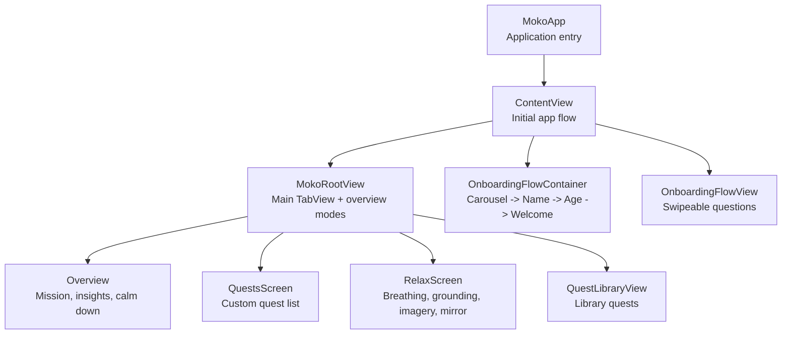

**Diagram sources**
- [MokoApp.swift:31-44](file://Moko/Moko/MokoApp.swift#L31-L44)
- [ContentView.swift:73-210](file://Moko/Moko/ContentView.swift#L73-L210)
- [MokoRootView.swift:14-100](file://Moko/Moko/MokoRootView.swift#L14-L100)
- [Overview.swift:74-124](file://Moko/Moko/UIScreens/homeScreens/Overview.swift#L74-L124)
- [Questsscreen.swift:69-114](file://Moko/Moko/UIScreens/Quests/Questsscreen.swift#L69-L114)
- [RelaxScreen.swift:133-197](file://Moko/Moko/UIScreens/relaxScreens/RelaxScreen.swift#L133-L197)
- [QuestLibraryView.swift:43-84](file://Moko/Moko/Features/QuestLibrary/QuestLibraryView.swift#L43-L84)
- [onboardingFlow.swift:15-39](file://Moko/Moko/UIScreens/Onboarding/onboardingFlow.swift#L15-L39)
- [OnboardingFlowView.swift:1-22](file://Moko/Moko/UIScreens/Onboarding_Questions/OnboardingFlowView.swift#L1-L22)

**Section sources**
- [MokoApp.swift:31-44](file://Moko/Moko/MokoApp.swift#L31-L44)
- [ContentView.swift:73-210](file://Moko/Moko/ContentView.swift#L73-L210)
- [MokoRootView.swift:14-100](file://Moko/Moko/MokoRootView.swift#L14-L100)

## Core Components
- `MokoTab`: Enum defining the four tabs: overview, quests, relax, search (explore).
- `MokoRootView`: Central tab manager that selects the active tab, manages overview modes, debrief presentation, and provides cross-screen navigation commands via environment values.
- `ContentView`: Top-level flow controller for splash, intro, authentication, onboarding info, onboarding questions, reflection, microphone permission, account deletion, and home.
- `MokoNavigation`: Shared navigation enums and environment keys for deep navigation actions like opening an overview mode or ending the session.
- Feature screens (`Overview`, `QuestsScreen`, `RelaxScreen`, `QuestLibraryView`) each manage their own local navigation stacks, sheets, and full-screen covers.

Key responsibilities:
- `MokoTab` centralizes tab identity and UI labels.
- `MokoRootView` coordinates tab selection, overview sub-states, and debrief lifecycle.
- `ContentView` decides whether to show onboarding or home based on registration state.
- `MokoNavigation` exposes typed navigation commands through environment values.

**Section sources**
- [MokoTab.swift:10-17](file://Moko/Moko/Models/MokoTab.swift#L10-L17)
- [MokoRootView.swift:10-100](file://Moko/Moko/MokoRootView.swift#L10-L100)
- [ContentView.swift:21-38](file://Moko/Moko/ContentView.swift#L21-L38)
- [MokoNavigation.swift:11-46](file://Moko/Moko/UIScreens/Quests/Mokonavigation.swift#L11-L46)

## Architecture Overview
The navigation architecture combines:
- A top-level `WindowGroup` hosting `ContentView`.
- Conditional rendering of app phases inside `ContentView`.
- A `TabView` rooted at `MokoRootView` for the main app experience.
- Multiple `NavigationStack`s scoped to feature areas.
- Environment-driven cross-cutting navigation commands.

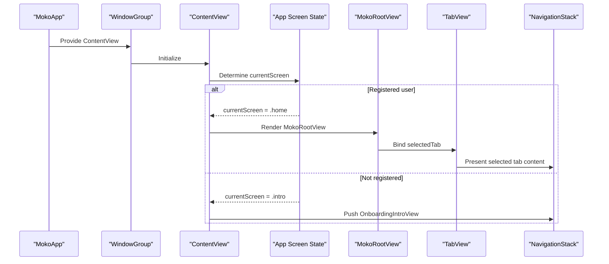

**Diagram sources**
- [MokoApp.swift:31-44](file://Moko/Moko/MokoApp.swift#L31-L44)
- [ContentView.swift:73-210](file://Moko/Moko/ContentView.swift#L73-L210)
- [MokoRootView.swift:14-58](file://Moko/Moko/MokoRootView.swift#L14-L58)

## Detailed Component Analysis

### MokoTab Enum-Based Tab System
`MokoTab` defines the shared tab set used by `TabView`. It is `CaseIterable`, `Identifiable`, and `Hashable`, enabling consistent tab selection and binding across the app.

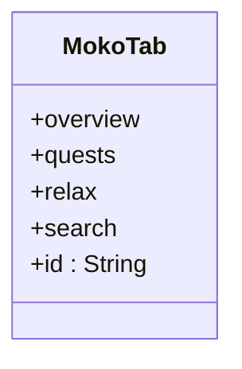

**Diagram sources**
- [MokoTab.swift:10-17](file://Moko/Moko/Models/MokoTab.swift#L10-L17)

**Section sources**
- [MokoTab.swift:10-17](file://Moko/Moko/Models/MokoTab.swift#L10-L17)

### Centralized Navigation Management Through MokoRootView
`MokoRootView` owns:
- `selectedTab`: Bound to `TabView.selection`.
- `overviewMode`: Controls which version of the overview is shown.
- `debriefQuest`: Presents the debrief as a full-screen cover.
- Environment injection of `openOverview` to allow deep navigation into the overview tab from anywhere.

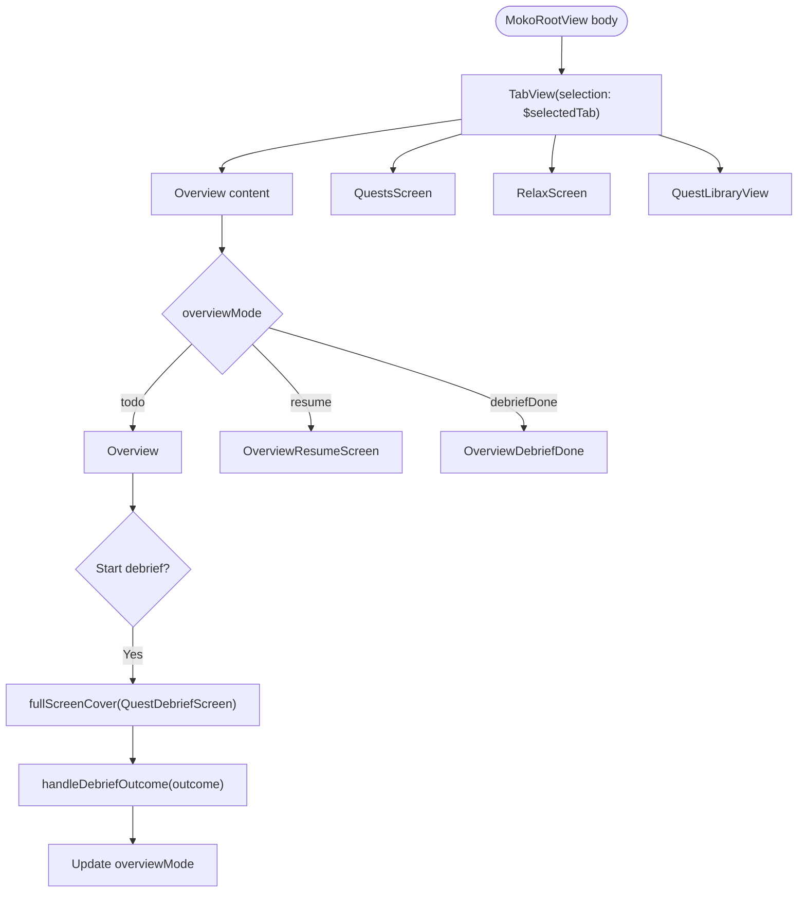

**Diagram sources**
- [MokoRootView.swift:14-100](file://Moko/Moko/MokoRootView.swift#L14-L100)
- [MokoRootView.swift:104-173](file://Moko/Moko/MokoRootView.swift#L104-L173)

**Section sources**
- [MokoRootView.swift:14-100](file://Moko/Moko/MokoRootView.swift#L14-L100)
- [MokoRootView.swift:104-173](file://Moko/Moko/MokoRootView.swift#L104-L173)

### Deep Linking Support and Cross-Screen Navigation Commands
Deep navigation is implemented using custom environment values:
- `openOverview`: Allows any screen to switch to the overview tab and select a specific overview mode.
- `endSession`: Allows any screen to end the signed-in session and return to the start flow.

These are provided by `MokoRootView` and consumed by deeper screens such as debrief flows.

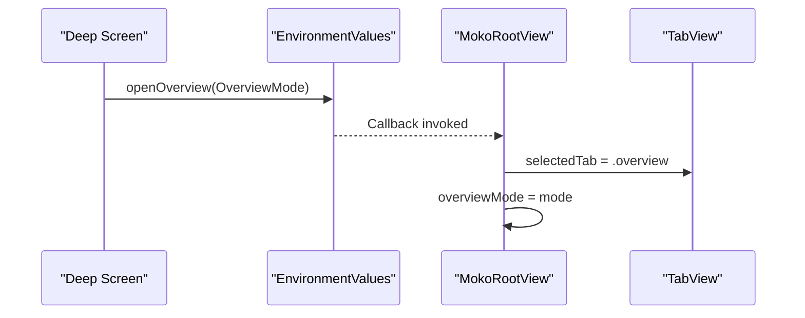

**Diagram sources**
- [MokoNavigation.swift:24-46](file://Moko/Moko/UIScreens/Quests/Mokonavigation.swift#L24-L46)
- [MokoRootView.swift:70-74](file://Moko/Moko/MokoRootView.swift#L70-L74)

**Section sources**
- [MokoNavigation.swift:11-46](file://Moko/Moko/UIScreens/Quests/Mokonavigation.swift#L11-L46)
- [MokoRootView.swift:70-74](file://Moko/Moko/MokoRootView.swift#L70-L74)

### Back Button Handling Patterns
Back button behavior follows SwiftUI conventions:
- `OnboardingAuthView` is presented as a pushed destination so it inherits the native back button.
- `OnboardingFlowView` uses `@Environment(\.dismiss)` for the first card’s back action.
- `RelaxScreen` uses explicit path manipulation to pop routes when sessions complete.
- `Overview` hides its own navigation bar but lets pushed screens use the default back button.

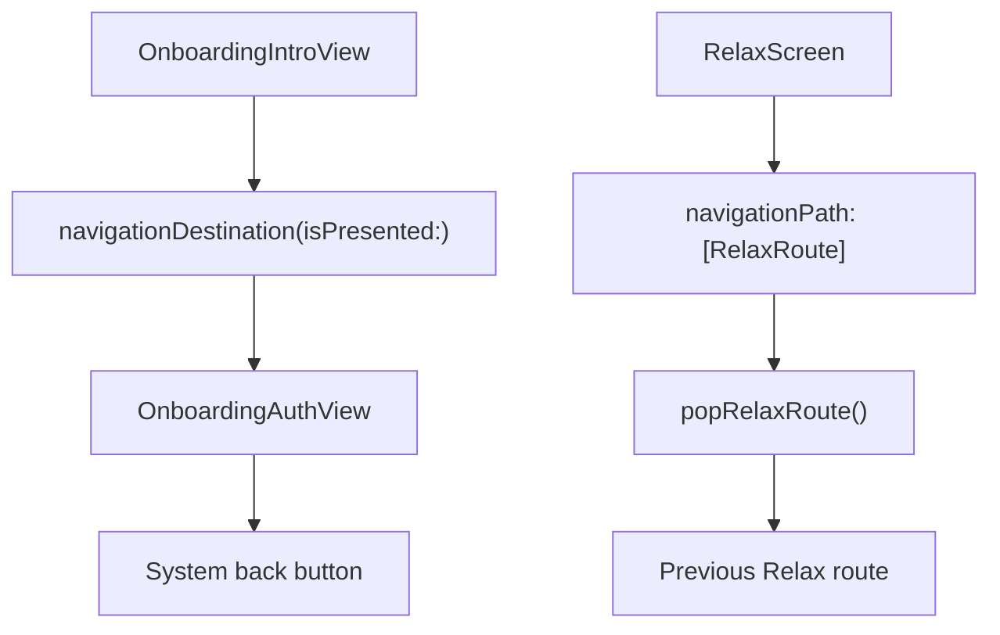

**Diagram sources**
- [ContentView.swift:59-69](file://Moko/Moko/ContentView.swift#L59-L69)
- [OnboardingFlowView.swift:1-22](file://Moko/Moko/UIScreens/Onboarding_Questions/OnboardingFlowView.swift#L1-L22)
- [RelaxScreen.swift:317-320](file://Moko/Moko/UIScreens/relaxScreens/RelaxScreen.swift#L317-L320)
- [Overview.swift:102-106](file://Moko/Moko/UIScreens/homeScreens/Overview.swift#L102-L106)

**Section sources**
- [ContentView.swift:59-69](file://Moko/Moko/ContentView.swift#L59-L69)
- [OnboardingFlowView.swift:1-22](file://Moko/Moko/UIScreens/Onboarding_Questions/OnboardingFlowView.swift#L1-L22)
- [RelaxScreen.swift:317-320](file://Moko/Moko/UIScreens/relaxScreens/RelaxScreen.swift#L317-L320)
- [Overview.swift:102-106](file://Moko/Moko/UIScreens/homeScreens/Overview.swift#L102-L106)

### Programmatic Navigation, Conditional Routing, and Parameter Passing
Programmatic navigation patterns include:
- Conditional routing via `currentScreen` in `ContentView`.
- Route enums per feature:
  - `QuestsRoute` for new/edit quest flows.
  - `RelaxRoute` for breathing, guided sessions, imagery guide, mirror preparation/timer/completion.
  - `OnboardingStep` for carousel/name/age/welcome steps.
- Parameter passing through:
  - View initializers (e.g., `QuestDetailScreen(quest:)`).
  - Environment values (`openOverview`, `endSession`).
  - Binding properties (`selectedTab`, `overviewMode`).
  - State variables (`debriefQuest`, `openedQuest`, `libraryArtworkURL`).

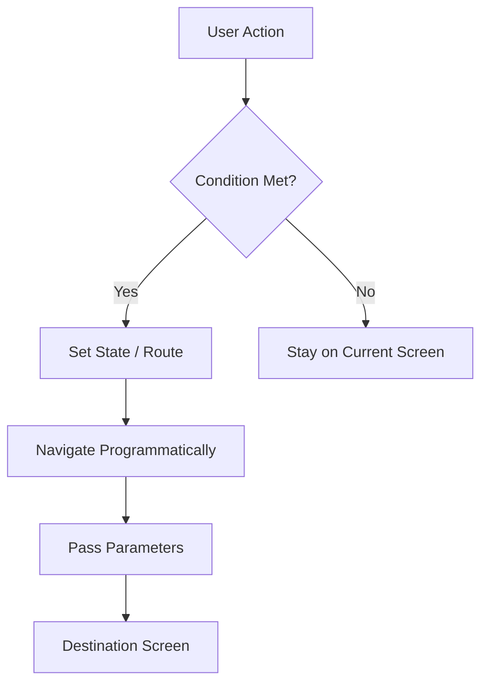

**Diagram sources**
- [ContentView.swift:217-236](file://Moko/Moko/ContentView.swift#L217-L236)
- [Questsscreen.swift:14-24](file://Moko/Moko/UIScreens/Quests/Questsscreen.swift#L14-L24)
- [RelaxScreen.swift:90-98](file://Moko/Moko/UIScreens/relaxScreens/RelaxScreen.swift#L90-L98)
- [onboardingFlow.swift:3-7](file://Moko/Moko/UIScreens/Onboarding/onboardingFlow.swift#L3-L7)

**Section sources**
- [ContentView.swift:217-236](file://Moko/Moko/ContentView.swift#L217-L236)
- [Questsscreen.swift:14-24](file://Moko/Moko/UIScreens/Quests/Questsscreen.swift#L14-L24)
- [RelaxScreen.swift:90-98](file://Moko/Moko/UIScreens/relaxScreens/RelaxScreen.swift#L90-L98)
- [onboardingFlow.swift:3-7](file://Moko/Moko/UIScreens/Onboarding/onboardingFlow.swift#L3-L7)

### Navigation Flow Between Major Features

#### Onboarding Flow
The onboarding flow is split into two major parts:
- Info screens: Carousel -> Name -> Age -> Welcome.
- Questions flow: Swipeable cards mapped to SwiftData models.

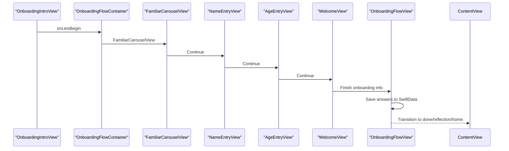

**Diagram sources**
- [ContentView.swift:143-168](file://Moko/Moko/ContentView.swift#L143-L168)
- [onboardingFlow.swift:15-39](file://Moko/Moko/UIScreens/Onboarding/onboardingFlow.swift#L15-L39)
- [OnboardingFlowView.swift:1-22](file://Moko/Moko/UIScreens/Onboarding_Questions/OnboardingFlowView.swift#L1-L22)

**Section sources**
- [ContentView.swift:143-168](file://Moko/Moko/ContentView.swift#L143-L168)
- [onboardingFlow.swift:15-39](file://Moko/Moko/UIScreens/Onboarding/onboardingFlow.swift#L15-L39)
- [OnboardingFlowView.swift:1-22](file://Moko/Moko/UIScreens/Onboarding_Questions/OnboardingFlowView.swift#L1-L22)

#### Relaxation Exercises Flow
The Relax tab uses a single `NavigationStack` with a typed route enum to manage multiple exercise journeys:
- Breathing timer sheet and push.
- Guided sessions grid.
- Imagery guide list and session completion.
- Mirror preparation, timer, and completion.

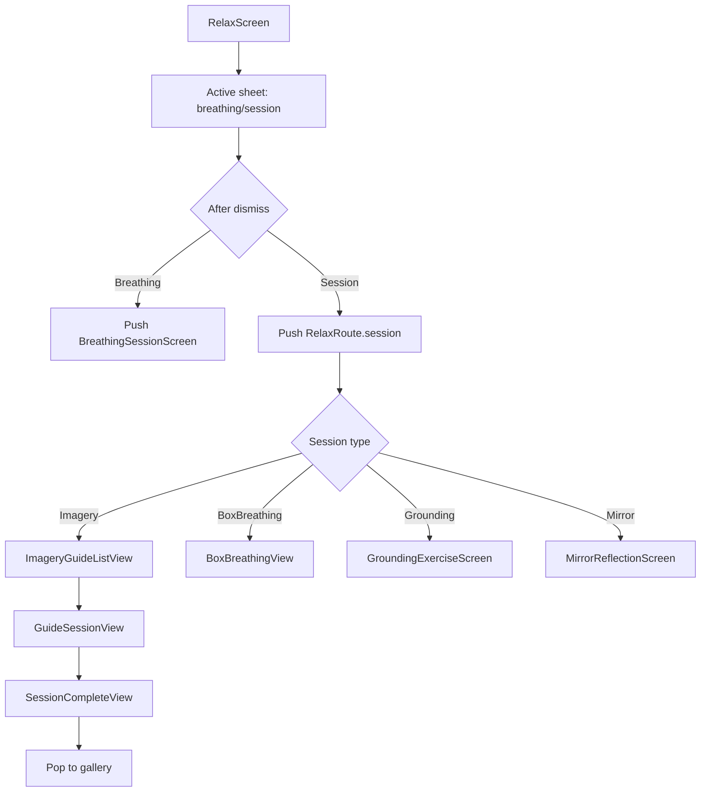

**Diagram sources**
- [RelaxScreen.swift:133-197](file://Moko/Moko/UIScreens/relaxScreens/RelaxScreen.swift#L133-L197)
- [RelaxScreen.swift:200-277](file://Moko/Moko/UIScreens/relaxScreens/RelaxScreen.swift#L200-L277)

**Section sources**
- [RelaxScreen.swift:133-197](file://Moko/Moko/UIScreens/relaxScreens/RelaxScreen.swift#L133-L197)
- [RelaxScreen.swift:200-277](file://Moko/Moko/UIScreens/relaxScreens/RelaxScreen.swift#L200-L277)

#### Quests Flow
The Quests tab manages:
- Filtering by category.
- Grouping by day.
- Editing and creating quests via full-screen cover.
- Opening quest details via item-based navigation.

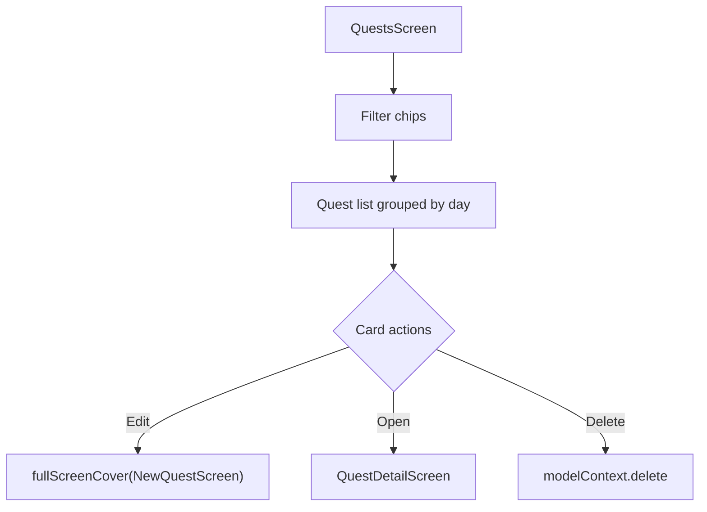

**Diagram sources**
- [Questsscreen.swift:69-114](file://Moko/Moko/UIScreens/Quests/Questsscreen.swift#L69-L114)
- [Questsscreen.swift:193-228](file://Moko/Moko/UIScreens/Quests/Questsscreen.swift#L193-L228)
- [Questsscreen.swift:326-331](file://Moko/Moko/UIScreens/Quests/Questsscreen.swift#L326-L331)

**Section sources**
- [Questsscreen.swift:69-114](file://Moko/Moko/UIScreens/Quests/Questsscreen.swift#L69-L114)
- [Questsscreen.swift:193-228](file://Moko/Moko/UIScreens/Quests/Questsscreen.swift#L193-L228)
- [Questsscreen.swift:326-331](file://Moko/Moko/UIScreens/Quests/Questsscreen.swift#L326-L331)

#### Profile Management Flow
Profile access is primarily through:
- Overview avatar button opening a profile sheet.
- Settings and account-related screens under profile management.

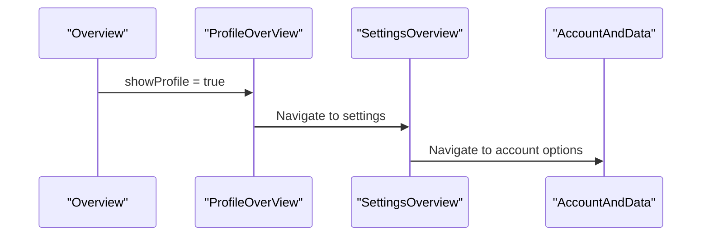

**Diagram sources**
- [Overview.swift:137-157](file://Moko/Moko/UIScreens/homeScreens/Overview.swift#L137-L157)
- [Overview.swift:116-120](file://Moko/Moko/UIScreens/homeScreens/Overview.swift#L116-L120)

**Section sources**
- [Overview.swift:137-157](file://Moko/Moko/UIScreens/homeScreens/Overview.swift#L137-L157)
- [Overview.swift:116-120](file://Moko/Moko/UIScreens/homeScreens/Overview.swift#L116-L120)

## Dependency Analysis
Navigation dependencies are structured as follows:

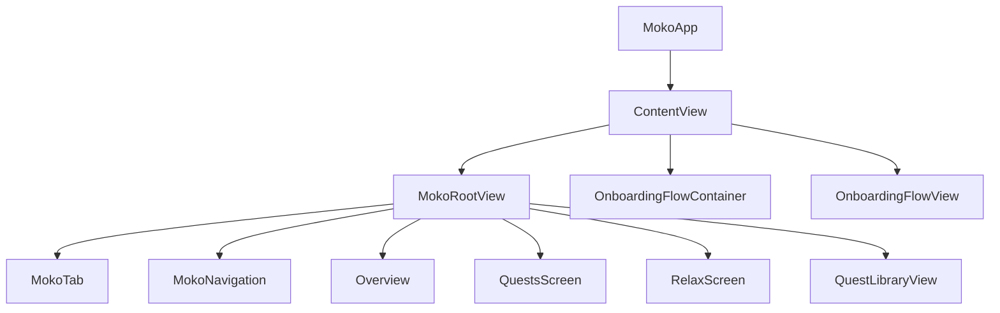

**Diagram sources**
- [MokoApp.swift:31-44](file://Moko/Moko/MokoApp.swift#L31-L44)
- [ContentView.swift:73-210](file://Moko/Moko/ContentView.swift#L73-L210)
- [MokoRootView.swift:14-100](file://Moko/Moko/MokoRootView.swift#L14-L100)
- [MokoTab.swift:10-17](file://Moko/Moko/Models/MokoTab.swift#L10-L17)
- [MokoNavigation.swift:11-46](file://Moko/Moko/UIScreens/Quests/Mokonavigation.swift#L11-L46)

**Section sources**
- [MokoApp.swift:31-44](file://Moko/Moko/MokoApp.swift#L31-L44)
- [ContentView.swift:73-210](file://Moko/Moko/ContentView.swift#L73-L210)
- [MokoRootView.swift:14-100](file://Moko/Moko/MokoRootView.swift#L14-L100)
- [MokoTab.swift:10-17](file://Moko/Moko/Models/MokoTab.swift#L10-L17)
- [MokoNavigation.swift:11-46](file://Moko/Moko/UIScreens/Quests/Mokonavigation.swift#L11-L46)

## Performance Considerations
- Use `NavigationStack(path:)` for typed, predictable navigation within feature scopes rather than ad-hoc boolean flags.
- Prefer `.sheet` and `.fullScreenCover(item:)` for modal presentations to avoid stacking too many views.
- Avoid unnecessary recomputation by keeping navigation state close to the owning view.
- Reuse lightweight route enums instead of large payload objects where possible.
- Respect `accessibilityReduceMotion` for animations and transitions.
- Clear pending navigation state after dismissal to prevent stale routes.

[No sources needed since this section provides general guidance]

## Troubleshooting Guide
Common navigation issues and resolutions:
- **Unexpected back button behavior**: Ensure the screen is pushed via `NavigationStack` rather than presented modally if you need the system back button.
- **Stale overview mode after debrief**: Verify `handleDebriefOutcome` updates `overviewMode` and clears pending debrief state.
- **Routes not popping correctly**: Confirm `navigationPath.removeLast()` or `removeAll()` is called appropriately in completion handlers.
- **Deep navigation not working**: Check that `openOverview` is provided in the environment and that the target view consumes it.

**Section sources**
- [MokoRootView.swift:160-173](file://Moko/Moko/MokoRootView.swift#L160-L173)
- [RelaxScreen.swift:317-320](file://Moko/Moko/UIScreens/relaxScreens/RelaxScreen.swift#L317-L320)
- [MokoNavigation.swift:24-46](file://Moko/Moko/UIScreens/Quests/Mokonavigation.swift#L24-L46)

## Conclusion
Moko’s navigation architecture centers on a clear separation of concerns:
- `MokoTab` defines the top-level tabs.
- `MokoRootView` orchestrates the main app navigation and overview modes.
- `ContentView` controls the initial app flow and authentication.
- Feature screens manage their own navigation stacks and modal presentations.
- Environment-driven commands enable safe, typed deep navigation.

This structure supports scalable growth, predictable state transitions, and maintainable navigation logic across onboarding, relaxation exercises, quests, and profile management.

[No sources needed since this section summarizes without analyzing specific files]