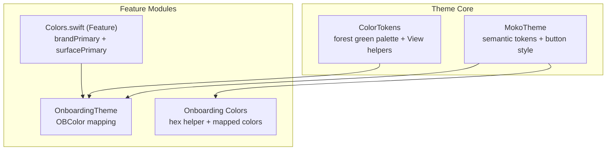
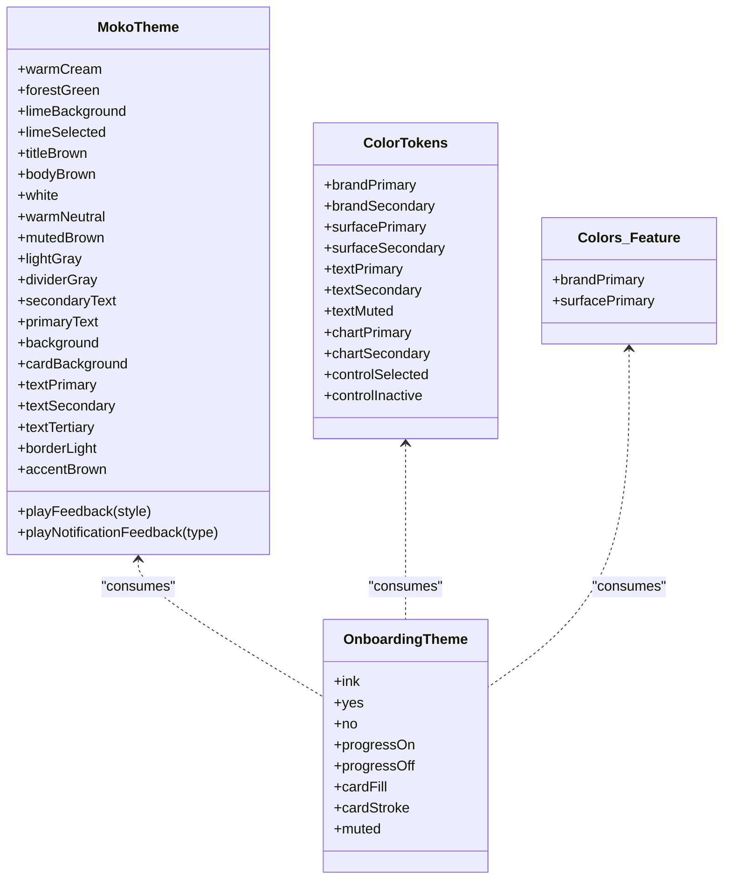
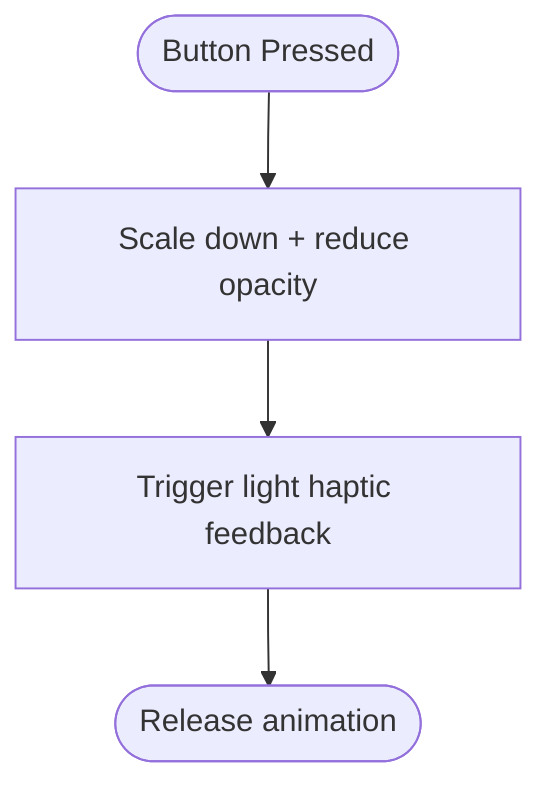
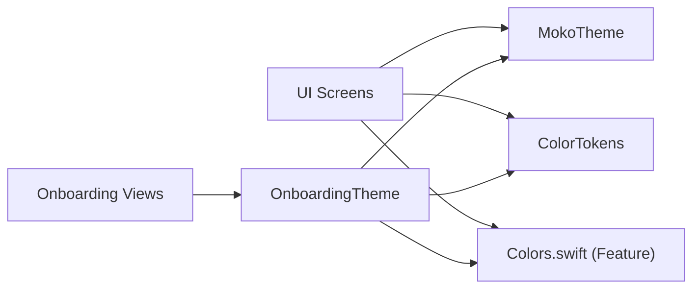

# Theme & Styling

<cite>
**Referenced Files in This Document**
- [MokoTheme.swift](file://Moko/Moko/UIScreens/startScreens/MokoTheme.swift)
- [ColorTokens.swift](file://Moko/Moko/Models/ColorTokens.swift)
- [Colors.swift](file://Moko/Features/ColorSystem/Colors.swift)
- [OnboardingTheme.swift](file://Moko/Moko/UIScreens/Onboarding_Questions/OnboardingTheme.swift)
- [Colors.swift](file://Moko/Moko/UIScreens/Onboarding/Colors.swift)
</cite>

## Table of Contents
1. [Introduction](#introduction)
2. [Project Structure](#project-structure)
3. [Core Components](#core-components)
4. [Architecture Overview](#architecture-overview)
5. [Detailed Component Analysis](#detailed-component-analysis)
6. [Dependency Analysis](#dependency-analysis)
7. [Performance Considerations](#performance-considerations)
8. [Troubleshooting Guide](#troubleshooting-guide)
9. [Conclusion](#conclusion)

## Introduction
This document explains Moko’s theme and styling system, focusing on the design token architecture, color management, typography conventions, and component styling patterns. It covers how semantic tokens are defined, how they are consumed across screens, and how to extend or customize them safely. It also addresses accessibility considerations, dynamic theme switching strategies, dark mode support, and performance best practices for theme updates and memory usage.

## Project Structure
The theme and styling assets are organized into focused files:
- Central theme tokens and UI primitives live under the start screens.
- A shared color token model provides a forest-green palette and View helpers.
- Feature-specific color modules provide localized palettes and hex utilities.
- Onboarding-related themes reference central theme tokens for consistency.

**Diagram sources**
- [MokoTheme.swift:10-89](file://Moko/Moko/UIScreens/startScreens/MokoTheme.swift#L10-L89)
- [ColorTokens.swift:9-40](file://Moko/Moko/Models/ColorTokens.swift#L9-L40)
- [Colors.swift:9-26](file://Moko/Features/ColorSystem/Colors.swift#L9-L26)
- [OnboardingTheme.swift:10-29](file://Moko/Moko/UIScreens/Onboarding_Questions/OnboardingTheme.swift#L10-L29)
- [Colors.swift:10-28](file://Moko/Moko/UIScreens/Onboarding/Colors.swift#L10-L28)

**Section sources**
- [MokoTheme.swift:10-89](file://Moko/Moko/UIScreens/startScreens/MokoTheme.swift#L10-L89)
- [ColorTokens.swift:9-40](file://Moko/Moko/Models/ColorTokens.swift#L9-L40)
- [Colors.swift:9-26](file://Moko/Features/ColorSystem/Colors.swift#L9-L26)
- [OnboardingTheme.swift:10-29](file://Moko/Moko/UIScreens/Onboarding_Questions/OnboardingTheme.swift#L10-L29)
- [Colors.swift:10-28](file://Moko/Moko/UIScreens/Onboarding/Colors.swift#L10-L28)

## Core Components
- MokoTheme: Central semantic token enum providing brand colors, surfaces, text roles, and a primary ButtonStyle with haptic feedback.
- ColorTokens (model): Public palette enum with brand, surface, text, chart, and control state colors; includes View extensions for background and text color defaults.
- Colors.swift (feature): Lightweight feature-level token set with brand and surface colors plus View helpers.
- OnboardingTheme: Onboarding-specific color mappings that reuse MokoTheme tokens and define additional hex-based colors.
- Onboarding Colors: Hex initializer and mapped convenience colors used by onboarding views.

Key responsibilities:
- Define stable, semantic color tokens.
- Provide reusable View modifiers for consistent backgrounds and text colors.
- Encapsulate component styles (e.g., primary button).
- Offer hex parsing utilities where needed.

**Section sources**
- [MokoTheme.swift:10-89](file://Moko/Moko/UIScreens/startScreens/MokoTheme.swift#L10-L89)
- [ColorTokens.swift:9-40](file://Moko/Moko/Models/ColorTokens.swift#L9-L40)
- [Colors.swift:9-26](file://Moko/Features/ColorSystem/Colors.swift#L9-L26)
- [OnboardingTheme.swift:10-29](file://Moko/Moko/UIScreens/Onboarding_Questions/OnboardingTheme.swift#L10-L29)
- [Colors.swift:10-28](file://Moko/Moko/UIScreens/Onboarding/Colors.swift#L10-L28)

## Architecture Overview
The theme system follows a layered approach:
- Base tokens define brand and neutral colors.
- Semantic tokens map base tokens to UI roles (background, card, textPrimary, etc.).
- Components consume semantic tokens rather than raw colors.
- Feature modules may add local tokens but should prefer central tokens for consistency.

**Diagram sources**
- [MokoTheme.swift:10-89](file://Moko/Moko/UIScreens/startScreens/MokoTheme.swift#L10-L89)
- [ColorTokens.swift:9-40](file://Moko/Moko/Models/ColorTokens.swift#L9-L40)
- [Colors.swift:9-26](file://Moko/Features/ColorSystem/Colors.swift#L9-L26)
- [OnboardingTheme.swift:10-29](file://Moko/Moko/UIScreens/Onboarding_Questions/OnboardingTheme.swift#L10-L29)

## Detailed Component Analysis

### MokoTheme: Semantic Tokens and Primary Button Style
MokoTheme is the central source of truth for semantic tokens and a reusable primary button style. It defines:
- Brand and neutral base colors.
- Semantic mappings for screen background, card background, and text roles.
- Haptic feedback helpers for interactions.
- A ButtonStyle that animates press states and triggers haptics.

**Diagram sources**
- [MokoTheme.swift:92-106](file://Moko/Moko/UIScreens/startScreens/MokoTheme.swift#L92-L106)

Best practices:
- Use semantic tokens (e.g., background, textPrimary) instead of hard-coded colors.
- Apply MokoPrimaryButtonStyle to buttons for consistent interaction feedback.

**Section sources**
- [MokoTheme.swift:10-89](file://Moko/Moko/UIScreens/startScreens/MokoTheme.swift#L10-L89)
- [MokoTheme.swift:92-106](file://Moko/Moko/UIScreens/startScreens/MokoTheme.swift#L92-L106)

### ColorTokens: Forest Green Palette and View Helpers
ColorTokens defines a public palette with semantic naming:
- Brand colors (primary and secondary).
- Surface colors for backgrounds and highlights.
- Text colors for primary, secondary, and muted roles.
- Chart and progress colors.
- Control state colors for selected and inactive states.
- View extensions for default background and text color application.

Usage guidance:
- Prefer ColorTokens.surfacePrimary for general backgrounds.
- Use ColorTokens.textPrimary for headings and key copy.
- Use ColorTokens.controlSelected for active controls.

Accessibility note:
- Ensure sufficient contrast between text and background tokens.
- Avoid using low-opacity variants for critical information.

**Section sources**
- [ColorTokens.swift:9-40](file://Moko/Moko/Models/ColorTokens.swift#L9-L40)

### Colors.swift (Feature Module): Lightweight Token Set
The feature module defines a minimal token set with brand and surface colors and View helpers for background and text styling. This file demonstrates a compact pattern for feature-scoped tokens while still encouraging reuse of central tokens.

Guidance:
- Keep feature tokens minimal and aligned with central tokens.
- Prefer importing and reusing MokoTheme and ColorTokens where possible.

**Section sources**
- [Colors.swift:9-26](file://Moko/Features/ColorSystem/Colors.swift#L9-L26)

### OnboardingTheme and Onboarding Colors: Localized Mapping
OnboardingTheme maps Figma-derived colors to app tokens:
- Reuses MokoTheme.titleBrown and MokoTheme.limeSelected for ink and progress off.
- Defines additional hex-based colors for yes/no states, progress, cards, and muted labels.
- Provides a Color(hex:) initializer for hex literals.

Onboarding Colors:
- Adds a Color(hex:) initializer.
- Exposes convenience colors like ink, forest, cream, cardFill, track, dotInactive, and terracotta.

Guidance:
- Map design tokens to semantic app tokens to maintain consistency.
- Use hex utilities sparingly; prefer named tokens for future theme changes.

**Section sources**
- [OnboardingTheme.swift:10-29](file://Moko/Moko/UIScreens/Onboarding_Questions/OnboardingTheme.swift#L10-L29)
- [Colors.swift:10-28](file://Moko/Moko/UIScreens/Onboarding/Colors.swift#L10-L28)

### Typography System
Typography is primarily expressed through semantic text tokens:
- Headings use titleBrown via textPrimary.
- Body text uses bodyBrown via textSecondary.
- Placeholder/muted text uses textTertiary.

Recommendations:
- Apply foregroundColor from semantic tokens rather than ad-hoc colors.
- Maintain consistent hierarchy: primary > secondary > tertiary.

**Section sources**
- [MokoTheme.swift:50-68](file://Moko/Moko/UIScreens/startScreens/MokoTheme.swift#L50-L68)

### Design Tokens Implementation
Design tokens are implemented as static constants within enums:
- Base tokens define exact RGB values.
- Semantic tokens alias base tokens to UI roles.
- View extensions encapsulate common styling patterns.

Benefits:
- Single source of truth for colors.
- Easier maintenance and global updates.
- Clear intent through semantic names.

**Section sources**
- [MokoTheme.swift:10-89](file://Moko/Moko/UIScreens/startScreens/MokoTheme.swift#L10-L89)
- [ColorTokens.swift:9-40](file://Moko/Moko/Models/ColorTokens.swift#L9-L40)

### Component Styling Patterns and Inheritance
- Buttons: Use MokoPrimaryButtonStyle for consistent press animations and haptics.
- Backgrounds: Use semantic background tokens (e.g., limeBackground, cardBackground).
- Text: Use semantic text tokens (textPrimary, textSecondary, textTertiary).
- Controls: Use controlSelected and controlInactive for state-aware visuals.

Inheritance mechanism:
- Semantic tokens inherit from base tokens (e.g., textPrimary = titleBrown).
- Feature modules can extend or alias tokens without duplicating definitions.

**Section sources**
- [MokoTheme.swift:92-106](file://Moko/Moko/UIScreens/startScreens/MokoTheme.swift#L92-L106)
- [MokoTheme.swift:50-74](file://Moko/Moko/UIScreens/startScreens/MokoTheme.swift#L50-L74)
- [ColorTokens.swift:27-40](file://Moko/Moko/Models/ColorTokens.swift#L27-L40)

## Dependency Analysis
The following diagram shows how components depend on theme tokens:

**Diagram sources**
- [MokoTheme.swift:10-89](file://Moko/Moko/UIScreens/startScreens/MokoTheme.swift#L10-L89)
- [ColorTokens.swift:9-40](file://Moko/Moko/Models/ColorTokens.swift#L9-L40)
- [Colors.swift:9-26](file://Moko/Features/ColorSystem/Colors.swift#L9-L26)
- [OnboardingTheme.swift:10-29](file://Moko/Moko/UIScreens/Onboarding_Questions/OnboardingTheme.swift#L10-L29)

**Section sources**
- [MokoTheme.swift:10-89](file://Moko/Moko/UIScreens/startScreens/MokoTheme.swift#L10-L89)
- [ColorTokens.swift:9-40](file://Moko/Moko/Models/ColorTokens.swift#L9-L40)
- [Colors.swift:9-26](file://Moko/Features/ColorSystem/Colors.swift#L9-L26)
- [OnboardingTheme.swift:10-29](file://Moko/Moko/UIScreens/Onboarding_Questions/OnboardingTheme.swift#L10-L29)

## Performance Considerations
- Static tokens: All color tokens are static constants, minimizing allocation overhead and enabling efficient reuse across the app.
- View extensions: Applying background and foregroundColor via extensions avoids repeated color construction logic.
- Animations: The primary button style uses lightweight scale and opacity changes with a spring animation; keep animations short and avoid heavy recompositions.
- Memory: Since tokens are static, there is no per-instance memory cost. Avoid creating new Color instances repeatedly inside tight loops; prefer referencing tokens directly.
- Theme updates: To update a theme globally, change the underlying token definition once. SwiftUI will propagate changes where tokens are referenced.

Recommendations:
- Prefer semantic tokens over inline colors to reduce duplication.
- Batch UI updates when changing multiple tokens to minimize redraws.
- Avoid excessive opacity layers; use tokens with appropriate built-in opacities where available.

[No sources needed since this section provides general guidance]

## Troubleshooting Guide
Common issues and resolutions:
- Inconsistent colors across screens:
  - Ensure all views reference semantic tokens (e.g., MokoTheme.background, ColorTokens.textPrimary) instead of hard-coded colors.
- Low contrast text:
  - Verify that text tokens against background tokens meet accessibility contrast requirements. Adjust tokens if necessary.
- Unexpected button behavior:
  - Confirm that buttons use MokoPrimaryButtonStyle for consistent animations and haptics.
- Hex color mismatches:
  - When using hex utilities, ensure the correct alpha channel and color space are applied consistently.

Checklist:
- Are all colors derived from tokens?
- Do text/background combinations meet contrast guidelines?
- Are interactive elements using the provided ButtonStyle?
- Are hex utilities used only where necessary?

**Section sources**
- [MokoTheme.swift:92-106](file://Moko/Moko/UIScreens/startScreens/MokoTheme.swift#L92-L106)
- [ColorTokens.swift:9-40](file://Moko/Moko/Models/ColorTokens.swift#L9-L40)
- [OnboardingTheme.swift:21-29](file://Moko/Moko/UIScreens/Onboarding_Questions/OnboardingTheme.swift#L21-L29)

## Conclusion
Moko’s theme system centers around semantic design tokens defined in MokoTheme and ColorTokens, with supporting modules for feature-specific palettes and onboarding flows. By consuming semantic tokens and applying consistent component styles, the app maintains visual coherence, simplifies maintenance, and supports future enhancements such as dynamic theming and dark mode. Following the outlined best practices ensures accessibility, performance, and long-term scalability of the styling system.

[No sources needed since this section summarizes without analyzing specific files]