# UI Design System

<cite>
**Referenced Files in This Document**
- [MokoTheme.swift](file://Moko/Moko/UIScreens/startScreens/MokoTheme.swift)
- [ColorTokens.swift](file://Moko/Moko/Models/ColorTokens.swift)
- [Colors.swift (Onboarding)](file://Moko/Moko/UIScreens/Onboarding/Colors.swift)
- [OnboardingTheme.swift](file://Moko/Moko/UIScreens/Onboarding_Questions/OnboardingTheme.swift)
- [SharedUI.swift](file://Moko/Moko/UIScreens/Onboarding_Questions/SharedUI.swift)
- [MokoTab.swift](file://Moko/Moko/Models/MokoTab.swift)
- [ContentView.swift](file://Moko/Moko/ContentView.swift)
- [MokoRootView.swift](file://Moko/Moko/MokoRootView.swift)
- [Overview.swift](file://Moko/Moko/UIScreens/homeScreens/Overview.swift)
- [OverviewResumeScreen.swift](file://Moko/Moko/UIScreens/homeScreens/OverviewResumeScreen.swift)
- [QuestLibraryView.swift](file://Moko/Moko/Features/QuestLibrary/QuestLibraryView.swift)
- [Summaryview.swift](file://Moko/Moko/UIScreens/homeScreens/Summary_CalmDown/Summaryview.swift)
- [OverviewData.swift](file://Moko/Moko/Models/OverviewData.swift)
- [Profile.swift](file://Moko/Moko/Models/Profile.swift)
- [ImageryGuide.swift](file://Moko/Moko/UIScreens/relaxScreens/ImageryGuide/ImageryGuide.swift)
</cite>

## Update Summary
**Changes Made**
- Updated Quest Library section to document scroll-aware header behavior with compact title bar
- Simplified Overview screen documentation removing complex slide-to-complete mechanics
- Added streamlined resume screen with single pill button interface
- Enhanced summary chart documentation with improved axis labeling and dynamic scaling
- Updated component architecture diagrams to reflect new navigation patterns

## Table of Contents
1. [Introduction](#introduction)
2. [Project Structure](#project-structure)
3. [Core Components](#core-components)
4. [Architecture Overview](#architecture-overview)
5. [Detailed Component Analysis](#detailed-component-analysis)
6. [Dependency Analysis](#dependency-analysis)
7. [Performance Considerations](#performance-considerations)
8. [Troubleshooting Guide](#troubleshooting-guide)
9. [Conclusion](#conclusion)
10. [Appendices](#appendices)

## Introduction
This document describes Moko's UI design system with a focus on theme architecture, color tokens, typography and semantic styling, navigation patterns, component composition, responsive behavior, accessibility, localization, platform-specific adaptations, and performance considerations. It is intended for designers and developers who want to maintain visual consistency while building new screens and components in SwiftUI.

## Project Structure
The UI design system is centered around:
- A shared theme token layer that defines brand colors, surfaces, text roles, and reusable view modifiers.
- A tab-based root shell that drives the main app flow.
- Feature-specific screens that compose small, reusable components using the theme tokens.
- Data-backed overview cards and charts that visualize user progress.
- Enhanced quest library with scroll-aware header behavior and simplified interaction patterns.

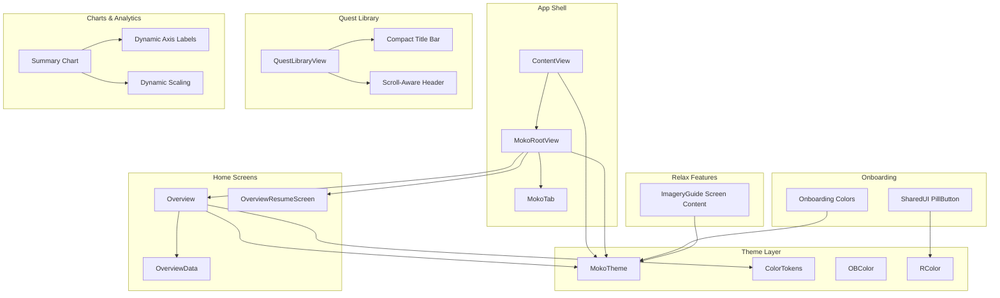

**Diagram sources**
- [ContentView.swift:73-213](file://Moko/Moko/ContentView.swift#L73-L213)
- [MokoRootView.swift:14-100](file://Moko/Moko/MokoRootView.swift#L14-L100)
- [MokoTheme.swift:10-89](file://Moko/Moko/UIScreens/startScreens/MokoTheme.swift#L10-L89)
- [ColorTokens.swift:9-40](file://Moko/Moko/Models/ColorTokens.swift#L9-L40)
- [Overview.swift:67-125](file://Moko/Moko/UIScreens/homeScreens/Overview.swift#L67-L125)
- [OverviewResumeScreen.swift:12-96](file://Moko/Moko/UIScreens/homeScreens/OverviewResumeScreen.swift#L12-L96)
- [QuestLibraryView.swift:45-94](file://Moko/Moko/Features/QuestLibrary/QuestLibraryView.swift#L45-L94)
- [Summaryview.swift:728-796](file://Moko/Moko/UIScreens/homeScreens/Summary_CalmDown/Summaryview.swift#L728-L796)
- [OverviewData.swift:11-42](file://Moko/Moko/Models/OverviewData.swift#L11-L42)
- [OnboardingTheme.swift:10-19](file://Moko/Moko/UIScreens/Onboarding_Questions/OnboardingTheme.swift#L10-L19)
- [SharedUI.swift:14-32](file://Moko/Moko/UIScreens/Onboarding_Questions/SharedUI.swift#L14-L32)
- [ImageryGuide.swift:80-157](file://Moko/Moko/UIScreens/relaxScreens/ImageryGuide/ImageryGuide.swift#L80-L157)

**Section sources**
- [ContentView.swift:73-213](file://Moko/Moko/ContentView.swift#L73-L213)
- [MokoRootView.swift:14-100](file://Moko/Moko/MokoRootView.swift#L14-L100)
- [MokoTheme.swift:10-89](file://Moko/Moko/UIScreens/startScreens/MokoTheme.swift#L10-L89)
- [ColorTokens.swift:9-40](file://Moko/Moko/Models/ColorTokens.swift#L9-L40)

## Core Components
This section documents the core UI primitives and how they are composed across the app.

- Theme tokens and palette
  - MokoTheme centralizes brand colors, semantic mappings, and haptic helpers.
  - ColorTokens provides a public, forest-green-focused palette with surface, text, chart, and control state tokens.
  - Onboarding-specific palettes (OBColor, RColor) derive from MokoTheme or define complementary hex values.

- Typography and text roles
  - Text roles are expressed through semantic tokens such as titleBrown, bodyBrown, and muted variants.
  - Views apply foreground styles and font weights consistently via these tokens.

- Navigation and tabs
  - MokoTab is the single source of truth for bottom tabs.
  - MokoRootView uses TabView bound to MokoTab and configures native behaviors like search activation and minimize-on-scroll.

- Enhanced quest library with scroll-aware headers
  - QuestLibraryView implements scroll-aware header behavior with compact title bar that fades in as content scrolls.
  - Uses `onScrollGeometryChange` to track scroll position and dynamically adjust header opacity.
  - Provides seamless transition between large in-content title and compact status bar title.

- Simplified overview interactions
  - OverviewResumeScreen streamlines the resume experience with single pill button interface.
  - Removes complex slide-to-complete mechanics in favor of direct action buttons.
  - Maintains consistent visual language while improving usability.

- Enhanced data visualization
  - Summary chart features improved axis labeling with dynamic unit switching (minutes/hours).
  - Implements dynamic scaling based on actual data ranges rather than fixed ceilings.
  - Provides better readability with intelligent label formatting.

- Accessibility and localization
  - Some views expose accessibility labels and hints.
  - ImageryGuide screen content includes localized copy fields and formatting helpers.

**Section sources**
- [MokoTheme.swift:10-89](file://Moko/Moko/UIScreens/startScreens/MokoTheme.swift#L10-L89)
- [ColorTokens.swift:9-40](file://Moko/Moko/Models/ColorTokens.swift#L9-L40)
- [OnboardingTheme.swift:10-19](file://Moko/Moko/UIScreens/Onboarding_Questions/OnboardingTheme.swift#L10-L19)
- [SharedUI.swift:14-32](file://Moko/Moko/UIScreens/Onboarding_Questions/SharedUI.swift#L14-L32)
- [MokoTab.swift:10-17](file://Moko/Moko/Models/MokoTab.swift#L10-L17)
- [MokoRootView.swift:14-100](file://Moko/Moko/MokoRootView.swift#L14-L100)
- [Overview.swift:67-125](file://Moko/Moko/UIScreens/homeScreens/Overview.swift#L67-L125)
- [OverviewResumeScreen.swift:12-96](file://Moko/Moko/UIScreens/homeScreens/OverviewResumeScreen.swift#L12-L96)
- [QuestLibraryView.swift:45-94](file://Moko/Moko/Features/QuestLibrary/QuestLibraryView.swift#L45-L94)
- [Summaryview.swift:157-178](file://Moko/Moko/UIScreens/homeScreens/Summary_CalmDown/Summaryview.swift#L157-L178)
- [OverviewData.swift:11-42](file://Moko/Moko/Models/OverviewData.swift#L11-L42)
- [ImageryGuide.swift:80-157](file://Moko/Moko/UIScreens/relaxScreens/ImageryGuide/ImageryGuide.swift#L80-L157)

## Architecture Overview
The UI architecture follows a layered approach with enhanced interaction patterns:
- App shell manages high-level flows and routes to feature screens.
- Theme layer exposes semantic tokens and reusable style helpers.
- Feature screens compose tokens into cards, lists, and interactive widgets.
- Data models compute and supply display values to views.
- Scroll-aware components provide adaptive UI behavior based on user interaction.

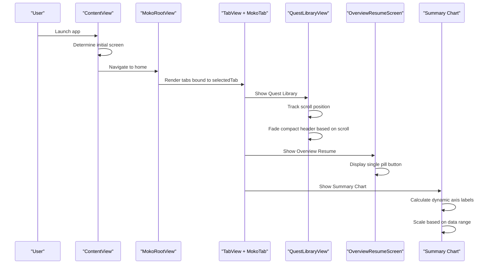

**Diagram sources**
- [ContentView.swift:73-213](file://Moko/Moko/ContentView.swift#L73-L213)
- [MokoRootView.swift:14-100](file://Moko/Moko/MokoRootView.swift#L14-L100)
- [QuestLibraryView.swift:70-77](file://Moko/Moko/Features/QuestLibrary/QuestLibraryView.swift#L70-L77)
- [OverviewResumeScreen.swift:53-96](file://Moko/Moko/UIScreens/homeScreens/OverviewResumeScreen.swift#L53-L96)
- [Summaryview.swift:728-796](file://Moko/Moko/UIScreens/homeScreens/Summary_CalmDown/Summaryview.swift#L728-L796)

## Detailed Component Analysis

### Theme Architecture and Tokens
Moko's theme is defined by two primary token layers:

- MokoTheme
  - Defines core brand colors, background surfaces, text roles, borders, and accent colors.
  - Provides semantic mappings like background, cardBackground, textPrimary, textSecondary, textTertiary, borderLight, and accentBrown.
  - Includes haptic feedback helpers for consistent tactile interactions.

- ColorTokens
  - Exposes a public enum with brandPrimary, brandSecondary, surfacePrimary, surfaceSecondary, textPrimary, textSecondary, textMuted, chartPrimary, chartSecondary, controlSelected, and controlInactive.
  - Adds View extensions for common styling: background() and textPrimary().

- Onboarding palettes
  - OBColor derives from MokoTheme for ink, progress states, and card fills.
  - RColor defines additional colors used in Done/Reflection flows.

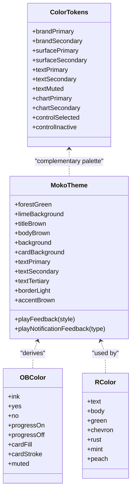

**Diagram sources**
- [MokoTheme.swift:10-89](file://Moko/Moko/UIScreens/startScreens/MokoTheme.swift#L10-L89)
- [ColorTokens.swift:9-40](file://Moko/Moko/Models/ColorTokens.swift#L9-L40)
- [OnboardingTheme.swift:10-19](file://Moko/Moko/UIScreens/Onboarding_Questions/OnboardingTheme.swift#L10-L19)
- [SharedUI.swift:4-12](file://Moko/Moko/UIScreens/Onboarding_Questions/SharedUI.swift#L4-L12)

**Section sources**
- [MokoTheme.swift:10-89](file://Moko/Moko/UIScreens/startScreens/MokoTheme.swift#L10-L89)
- [ColorTokens.swift:9-40](file://Moko/Moko/Models/ColorTokens.swift#L9-L40)
- [OnboardingTheme.swift:10-19](file://Moko/Moko/UIScreens/Onboarding_Questions/OnboardingTheme.swift#L10-L19)
- [SharedUI.swift:4-12](file://Moko/Moko/UIScreens/Onboarding_Questions/SharedUI.swift#L4-L12)

### Enhanced Quest Library with Scroll-Aware Headers
The quest library now features sophisticated scroll-aware header behavior:

- **Compact Title Bar**: A floating title that appears when users scroll past the main header, providing context without taking up space.
- **Scroll Position Tracking**: Uses `onScrollGeometryChange` to monitor scroll offset and calculate header opacity.
- **Smooth Transitions**: Implements fade-in/fade-out animations for seamless header transitions.
- **Accessibility Support**: Automatically hides compact header when not visible to assistive technologies.

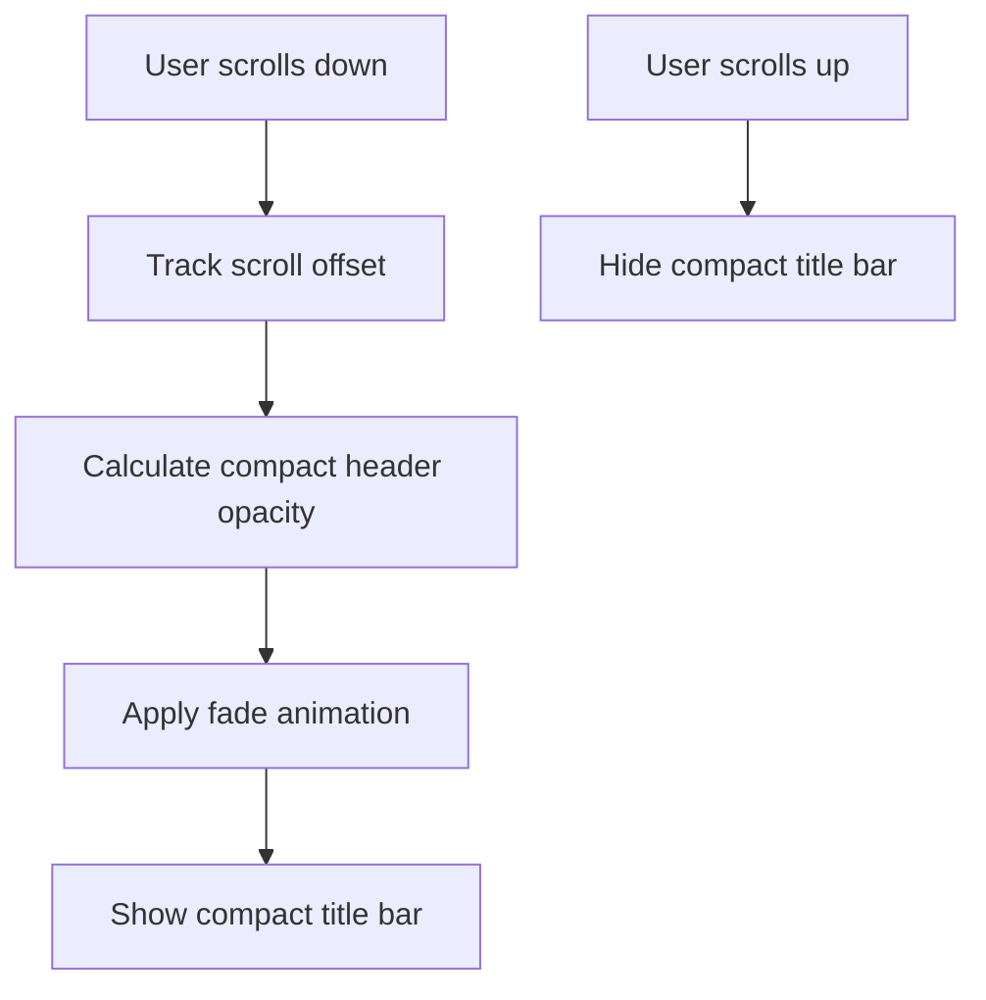

**Diagram sources**
- [QuestLibraryView.swift:70-77](file://Moko/Moko/Features/QuestLibrary/QuestLibraryView.swift#L70-L77)
- [QuestLibraryView.swift:100-127](file://Moko/Moko/Features/QuestLibrary/QuestLibraryView.swift#L100-L127)

**Section sources**
- [QuestLibraryView.swift:70-77](file://Moko/Moko/Features/QuestLibrary/QuestLibraryView.swift#L70-L77)
- [QuestLibraryView.swift:100-127](file://Moko/Moko/Features/QuestLibrary/QuestLibraryView.swift#L100-L127)

### Simplified Overview Interactions
The overview screen has been streamlined for better usability:

- **Single Pill Button Interface**: Replaces complex slide-to-complete mechanics with straightforward action buttons.
- **Direct Action Flow**: Users can directly access debriefs without intermediate gestures.
- **Consistent Visual Language**: Maintains design system consistency while simplifying interactions.
- **Improved Accessibility**: Reduces cognitive load and improves screen reader compatibility.

**Section sources**
- [OverviewResumeScreen.swift:153-159](file://Moko/Moko/UIScreens/homeScreens/OverviewResumeScreen.swift#L153-L159)

### Enhanced Summary Chart with Dynamic Scaling
The summary chart now features advanced data visualization capabilities:

- **Dynamic Axis Labeling**: Automatically switches between minutes and hours based on data range.
- **Intelligent Scaling**: Calculates optimal Y-axis scale based on actual data peaks rather than fixed values.
- **Improved Readability**: Provides cleaner, more intuitive labels for different time ranges.
- **Responsive Design**: Adapts chart appearance based on available screen space.

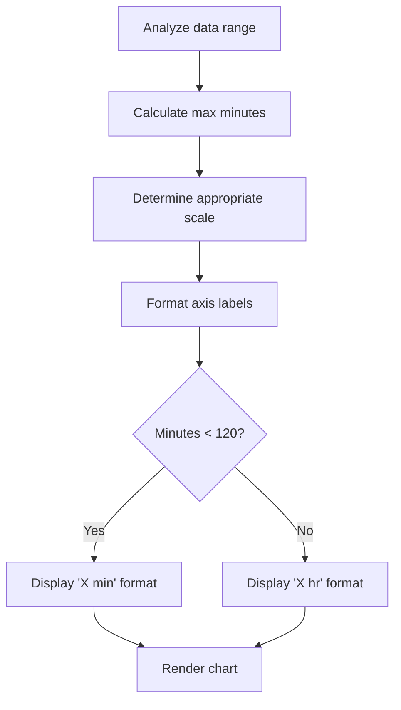

**Diagram sources**
- [Summaryview.swift:157-178](file://Moko/Moko/UIScreens/homeScreens/Summary_CalmDown/Summaryview.swift#L157-L178)
- [Summaryview.swift:501-547](file://Moko/Moko/UIScreens/homeScreens/Summary_CalmDown/Summaryview.swift#L501-L547)

**Section sources**
- [Summaryview.swift:157-178](file://Moko/Moko/UIScreens/homeScreens/Summary_CalmDown/Summaryview.swift#L157-L178)
- [Summaryview.swift:501-547](file://Moko/Moko/UIScreens/homeScreens/Summary_CalmDown/Summaryview.swift#L501-L547)

### Navigation Architecture and Tab-Based Patterns
- MokoTab
  - Centralized enum representing Overview, Quests, Relax, and Search tabs.
  - Conforms to CaseIterable, Identifiable, and Hashable for robust tab management.

- MokoRootView
  - Uses TabView bound to selectedTab.
  - Configures native iOS behaviors: minimize on scroll down and search tab selection activation.
  - Applies global tint and foregroundStyle using MokoTheme tokens.
  - Manages overview modes and debrief presentation.

- ContentView
  - Orchestrates app flow from splash to onboarding and finally to MokoRootView.
  - Sets up environment values and transitions between screens.

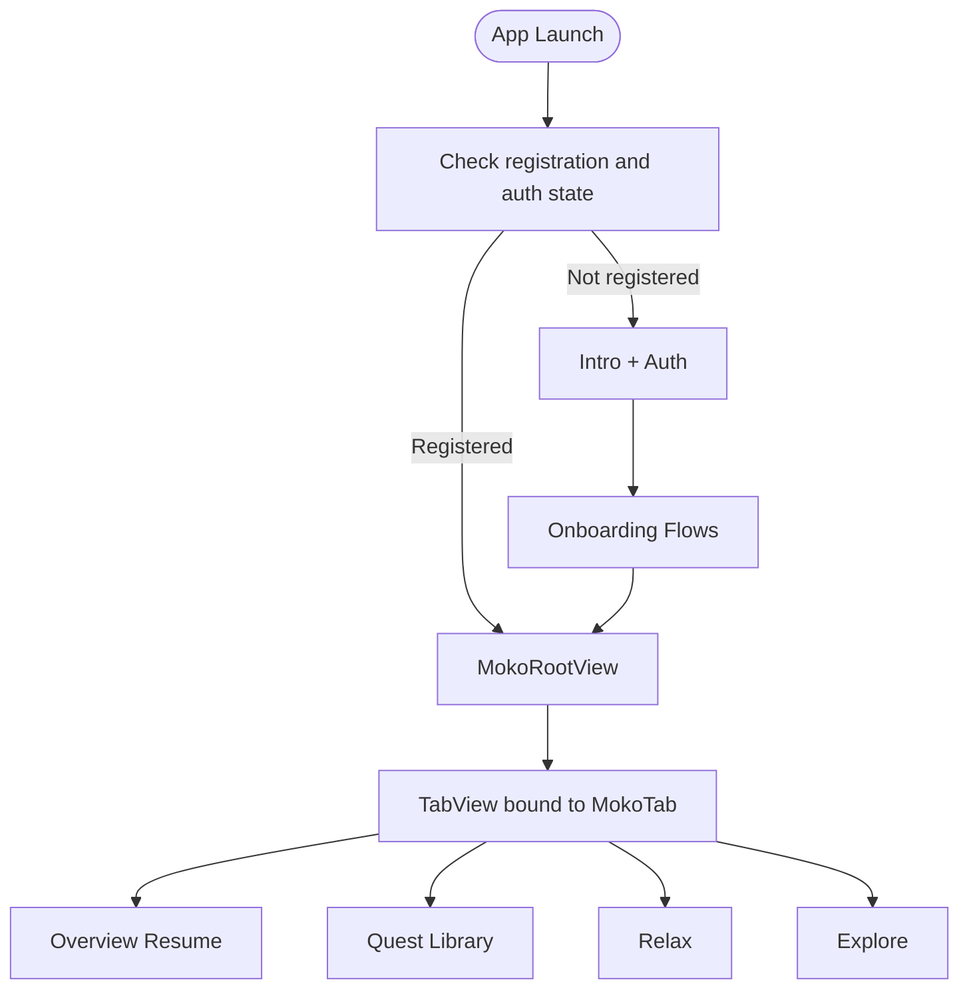

**Diagram sources**
- [ContentView.swift:73-213](file://Moko/Moko/ContentView.swift#L73-L213)
- [MokoRootView.swift:14-100](file://Moko/Moko/MokoRootView.swift#L14-L100)
- [MokoTab.swift:10-17](file://Moko/Moko/Models/MokoTab.swift#L10-L17)

**Section sources**
- [MokoTab.swift:10-17](file://Moko/Moko/Models/MokoTab.swift#L10-L17)
- [MokoRootView.swift:14-100](file://Moko/Moko/MokoRootView.swift#L14-L100)
- [ContentView.swift:73-213](file://Moko/Moko/ContentView.swift#L73-L213)

### Component Styling Patterns
- Consistent use of semantic tokens
  - Backgrounds use MokoTheme.limeBackground or ColorTokens.surfacePrimary.
  - Titles and headings use MokoTheme.titleBrown; body text uses MokoTheme.bodyBrown or ColorTokens.textSecondary.
  - Control states use ColorTokens.controlSelected and controlInactive.

- Reusable view modifiers
  - ColorTokens adds background() and textPrimary() to simplify styling.
  - MokoTheme provides haptic feedback helpers for button interactions.

- Example: PillButton
  - Defined in SharedUI with a green capsule background, white text, and shadow effects.
  - Demonstrates encapsulating a styled button pattern.

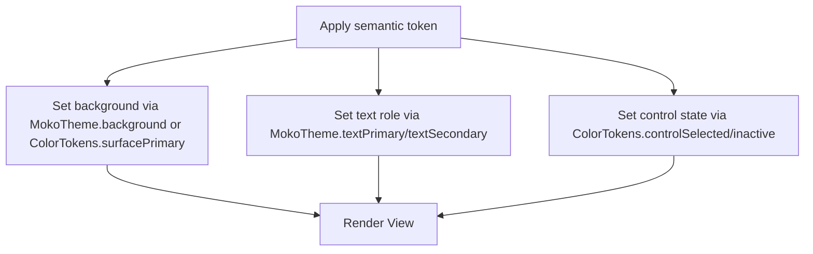

**Diagram sources**
- [ColorTokens.swift:32-40](file://Moko/Moko/Models/ColorTokens.swift#L32-L40)
- [MokoTheme.swift:53-75](file://Moko/Moko/UIScreens/startScreens/MokoTheme.swift#L53-L75)
- [SharedUI.swift:14-32](file://Moko/Moko/UIScreens/Onboarding_Questions/SharedUI.swift#L14-L32)

**Section sources**
- [ColorTokens.swift:32-40](file://Moko/Moko/Models/ColorTokens.swift#L32-L40)
- [MokoTheme.swift:53-75](file://Moko/Moko/UIScreens/startScreens/MokoTheme.swift#L53-L75)
- [SharedUI.swift:14-32](file://Moko/Moko/UIScreens/Onboarding_Questions/SharedUI.swift#L14-L32)

### Responsive Design Considerations
- Layout structure
  - Overview uses ScrollView with VStack sections and fixed paddings for consistent spacing.
  - Cards use rounded rectangles with subtle shadows and clear hierarchy.

- Chart components
  - InsightsRadarChartView and CalmDownBarChartView scale within GeometryReader bounds.
  - Bar heights and radar points adapt to available space.
  - Summary chart adapts to different time ranges with intelligent scaling.

- Platform behaviors
  - TabView uses .tabBarMinimizeBehavior(.onScrollDown) and .tabViewSearchActivation(.searchTabSelection).
  - Presentation detents and drag indicators are used for profile sheets.

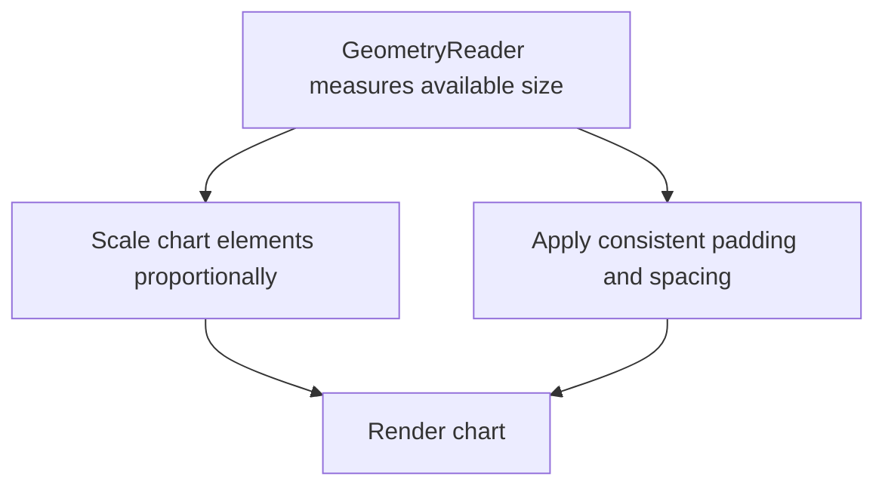

**Diagram sources**
- [Overview.swift:498-588](file://Moko/Moko/UIScreens/homeScreens/Overview.swift#L498-L588)
- [Overview.swift:603-635](file://Moko/Moko/UIScreens/homeScreens/Overview.swift#L603-L635)
- [MokoRootView.swift:60-69](file://Moko/Moko/MokoRootView.swift#L60-L69)

**Section sources**
- [Overview.swift:498-588](file://Moko/Moko/UIScreens/homeScreens/Overview.swift#L498-L588)
- [Overview.swift:603-635](file://Moko/Moko/UIScreens/homeScreens/Overview.swift#L603-L635)
- [MokoRootView.swift:60-69](file://Moko/Moko/MokoRootView.swift#L60-L69)

### Dark Mode Support
- Current implementation primarily uses light-mode tokens (e.g., limeBackground, titleBrown).
- No explicit dynamic color scheme switching is present in the analyzed files.
- To support dark mode, consider mapping semantic tokens to dynamic colors and providing alternate backgrounds and text roles.

[No sources needed since this section provides general guidance]

### Accessibility Features
- Accessibility labels and hints
  - Profile avatar button includes an accessibility label.
  - ImageryGuide screen content includes listAccessibilityHint and accessibilityLabelFormat fields.
  - Quest library compact header automatically hides when not visible.

- Haptic feedback
  - MokoTheme.playFeedback and playNotificationFeedback provide consistent tactile cues.

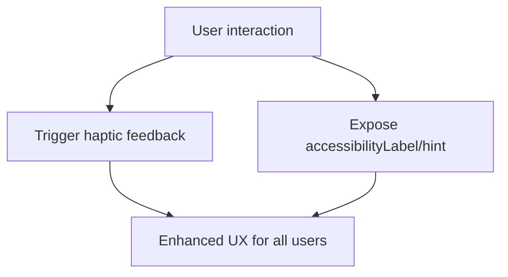

**Diagram sources**
- [Overview.swift:137-157](file://Moko/Moko/UIScreens/homeScreens/Overview.swift#L137-L157)
- [ImageryGuide.swift:92-94](file://Moko/Moko/UIScreens/relaxScreens/ImageryGuide/ImageryGuide.swift#L92-L94)
- [MokoTheme.swift:76-89](file://Moko/Moko/UIScreens/startScreens/MokoTheme.swift#L76-L89)

**Section sources**
- [Overview.swift:137-157](file://Moko/Moko/UIScreens/homeScreens/Overview.swift#L137-L157)
- [ImageryGuide.swift:92-94](file://Moko/Moko/UIScreens/relaxScreens/ImageryGuide/ImageryGuide.swift#L92-L94)
- [MokoTheme.swift:76-89](file://Moko/Moko/UIScreens/startScreens/MokoTheme.swift#L76-L89)

### Localization Support
- ImageryGuideScreenContent holds localized strings and format templates.
- The format helper replaces placeholders in template strings with provided values.

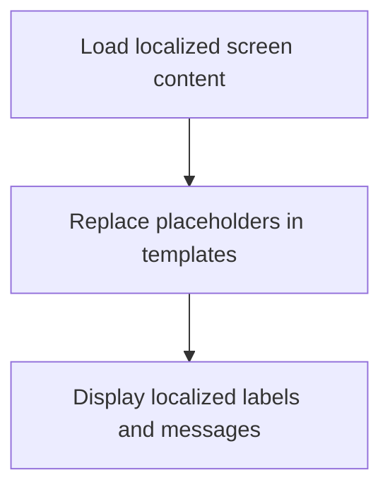

**Diagram sources**
- [ImageryGuide.swift:80-157](file://Moko/Moko/UIScreens/relaxScreens/ImageryGuide/ImageryGuide.swift#L80-L157)

**Section sources**
- [ImageryGuide.swift:80-157](file://Moko/Moko/UIScreens/relaxScreens/ImageryGuide/ImageryGuide.swift#L80-L157)

### Platform-Specific UI Adaptations
- Native tab bar behaviors
  - Minimize on scroll down and search tab activation are configured in MokoRootView.

- Presentation modals
  - Profile sheet uses presentationDetents and drag indicators for better iPad and larger-screen experiences.

**Section sources**
- [MokoRootView.swift:60-69](file://Moko/Moko/MokoRootView.swift#L60-L69)
- [Overview.swift:116-120](file://Moko/Moko/UIScreens/homeScreens/Overview.swift#L116-L120)

## Dependency Analysis
The following diagram shows how key UI components depend on theme tokens and each other.

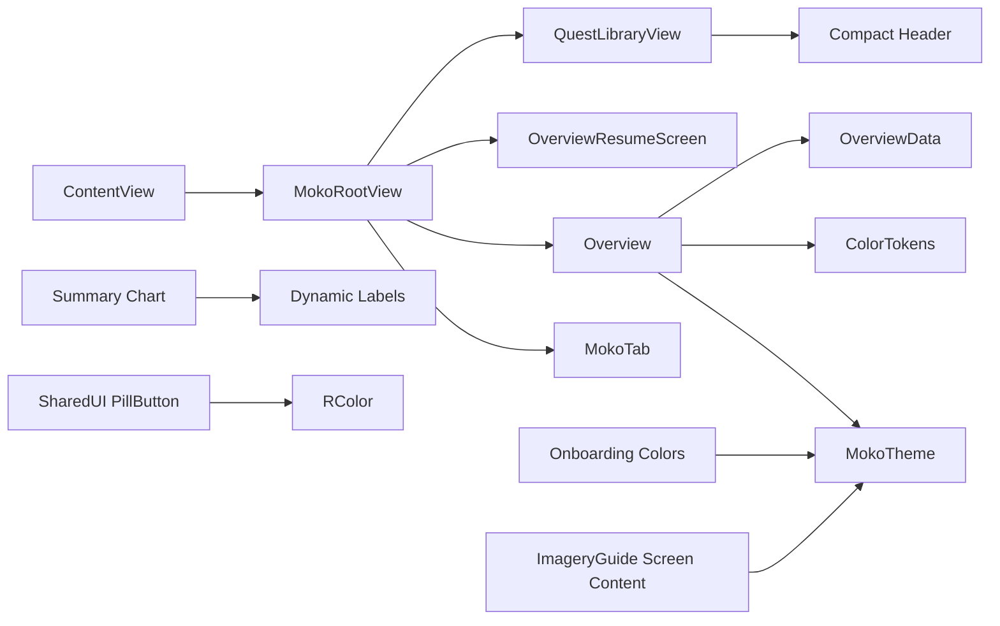

**Diagram sources**
- [ContentView.swift:73-213](file://Moko/Moko/ContentView.swift#L73-L213)
- [MokoRootView.swift:14-100](file://Moko/Moko/MokoRootView.swift#L14-L100)
- [Overview.swift:67-125](file://Moko/Moko/UIScreens/homeScreens/Overview.swift#L67-L125)
- [OverviewResumeScreen.swift:12-96](file://Moko/Moko/UIScreens/homeScreens/OverviewResumeScreen.swift#L12-L96)
- [QuestLibraryView.swift:45-94](file://Moko/Moko/Features/QuestLibrary/QuestLibraryView.swift#L45-L94)
- [Summaryview.swift:728-796](file://Moko/Moko/UIScreens/homeScreens/Summary_CalmDown/Summaryview.swift#L728-L796)
- [OnboardingTheme.swift:10-19](file://Moko/Moko/UIScreens/Onboarding_Questions/OnboardingTheme.swift#L10-L19)
- [SharedUI.swift:14-32](file://Moko/Moko/UIScreens/Onboarding_Questions/SharedUI.swift#L14-L32)
- [ImageryGuide.swift:80-157](file://Moko/Moko/UIScreens/relaxScreens/ImageryGuide/ImageryGuide.swift#L80-L157)

**Section sources**
- [ContentView.swift:73-213](file://Moko/Moko/ContentView.swift#L73-L213)
- [MokoRootView.swift:14-100](file://Moko/Moko/MokoRootView.swift#L14-L100)
- [Overview.swift:67-125](file://Moko/Moko/UIScreens/homeScreens/Overview.swift#L67-L125)

## Performance Considerations
- Efficient rendering
  - Use GeometryReader sparingly; prefer layout-driven sizing where possible.
  - Avoid heavy animations inside frequently updated views; keep animations scoped to specific state changes.
  - Scroll-aware components should optimize state updates to prevent unnecessary re-renders.

- Memory management
  - Keep large images and assets in asset catalogs; avoid loading unnecessary resources.
  - Use SwiftData model contexts efficiently; insert and save only when necessary.

- List and chart performance
  - For long lists, consider lazy loading and pagination.
  - Charts should compute data once per update cycle and reuse computed values.
  - Dynamic scaling calculations should be cached to avoid repeated computations.

[No sources needed since this section provides general guidance]

## Troubleshooting Guide
- Inconsistent colors
  - Ensure all views reference MokoTheme or ColorTokens instead of hard-coded colors.
  - Verify semantic mappings align with design specs.

- Broken tab navigation
  - Confirm MokoTab cases match TabView bindings and labels.
  - Check that selectedTab updates correctly and no conflicting state exists.

- Scroll-aware header issues
  - Verify scroll offset tracking is working correctly.
  - Check that compact header opacity calculations are accurate.
  - Ensure accessibility properties are properly set for invisible headers.

- Chart scaling problems
  - Validate dynamic axis label calculations for different data ranges.
  - Check that niceMax function produces appropriate scale values.
  - Ensure chart domain calculations handle edge cases properly.

- Accessibility issues
  - Add accessibilityLabel and hints to interactive elements.
  - Test with VoiceOver and ensure haptic feedback triggers appropriately.

- Localization problems
  - Validate placeholder replacement logic in formatted strings.
  - Ensure all required keys exist in localized content.

**Section sources**
- [MokoRootView.swift:14-100](file://Moko/Moko/MokoRootView.swift#L14-L100)
- [Overview.swift:137-157](file://Moko/Moko/UIScreens/homeScreens/Overview.swift#L137-L157)
- [ImageryGuide.swift:120-125](file://Moko/Moko/UIScreens/relaxScreens/ImageryGuide/ImageryGuide.swift#L120-L125)
- [QuestLibraryView.swift:117-127](file://Moko/Moko/Features/QuestLibrary/QuestLibraryView.swift#L117-L127)
- [Summaryview.swift:157-178](file://Moko/Moko/UIScreens/homeScreens/Summary_CalmDown/Summaryview.swift#L157-L178)

## Conclusion
Moko's UI design system centers on a strong theme layer with semantic tokens, a tab-based navigation shell, and reusable component patterns. Recent enhancements include scroll-aware quest library headers, simplified overview interactions, and improved data visualization with dynamic scaling. By adhering to MokoTheme and ColorTokens, teams can maintain visual consistency, improve accessibility, and localize content effectively. Extending the system with dark mode support and optimizing performance will further strengthen the user experience across devices and platforms.

[No sources needed since this section summarizes without analyzing specific files]

## Appendices

### Guidelines for Creating New UI Components
- Derive colors from MokoTheme or ColorTokens; avoid hard-coded values.
- Encapsulate reusable patterns (buttons, cards, chips) in dedicated components.
- Provide accessibility labels and hints for all interactive elements.
- Use GeometryReader judiciously for custom layouts; prefer standard SwiftUI layouts for responsiveness.
- Compose complex screens from smaller, testable components.
- Implement scroll-aware behaviors using `onScrollGeometryChange` for adaptive UI patterns.
- Use dynamic scaling for charts and data visualizations to improve readability.

[No sources needed since this section provides general guidance]

### Examples of Theme Customization and Style Inheritance
- Override semantic tokens at the app level by applying .tint and .foregroundStyle in the root view.
- Create component-specific styles that inherit from base tokens and extend them with local variations.
- Use View extensions to standardize common styling patterns.

**Section sources**
- [MokoRootView.swift:65-69](file://Moko/Moko/MokoRootView.swift#L65-L69)
- [ColorTokens.swift:32-40](file://Moko/Moko/Models/ColorTokens.swift#L32-L40)

### Advanced Interaction Patterns
- **Scroll-Aware Components**: Implement adaptive UI behavior based on scroll position using `onScrollGeometryChange`.
- **Dynamic Scaling**: Calculate optimal chart scales based on data ranges rather than fixed values.
- **Simplified Workflows**: Replace complex gesture interactions with direct action buttons for improved usability.

**Section sources**
- [QuestLibraryView.swift:70-77](file://Moko/Moko/Features/QuestLibrary/QuestLibraryView.swift#L70-L77)
- [Summaryview.swift:501-547](file://Moko/Moko/UIScreens/homeScreens/Summary_CalmDown/Summaryview.swift#L501-L547)
- [OverviewResumeScreen.swift:153-159](file://Moko/Moko/UIScreens/homeScreens/OverviewResumeScreen.swift#L153-L159)